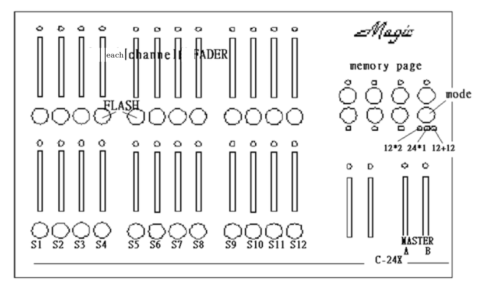
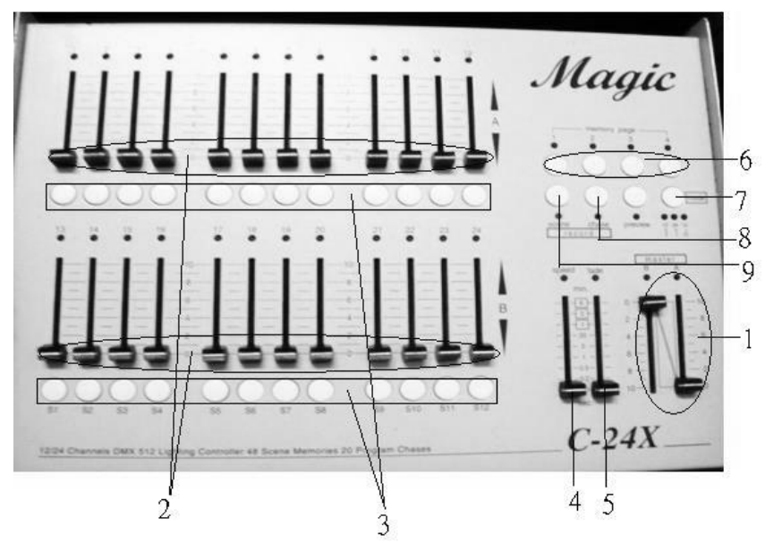

# C-24X (12/24 digital dimming console)

Its main feature is controlling 24 circuits at once, for events with many lights.

<figure markdown="span">
  { loading=lazy width="802" }
  <figcaption>panel layout, original handout p.88</figcaption>
</figure>

<figure markdown="span">
  { loading=lazy width="874" }
  <figcaption>unit with numbering, original handout p.89</figcaption>
</figure>

## Three modes (MODE key)

| Mode | MODE light | For | Behaviour |
| --- | --- | --- | --- |
| **12×2** | 12*2 | One dimmer | Ch.1 to circuit 1, Ch.2 to circuit 2… Upper row 1–12 follows MASTER-A, lower row 1–12 follows MASTER-B; both rows address Ch.1–12. A and B control the same lights, so you can cross-fade between looks; the FADE fader sets the time |
| **24×1** | 24*1 | Two dimmers | 24 circuits on 24 channels, all under MASTER-A |
| **SCENE** | 12+12 | Scenes / chases | Upper row controls dimmer circuits 1–12; lower row is 12 scenes; all under MASTER-A. 4 pages (Memory Page), 12 per page (S1–S12), **48 scenes** in total |

To play back scenes or chases, MODE must be on **12+12**.

## FLASH

The button under each channel, controlling the same channel as the fader above. **FLASH ignores MASTER-A and B.**

- 12×2: both rows of buttons address Ch.1–12.
- 24×1: the rows address the 24 channels; pressing gives 100%.
- SCENE: upper row flashes Ch.1–12; lower row flashes scenes S1–S12 at their stored levels.

## Panel

| # | Name | Function |
| --- | --- | --- |
| 1 | MASTER | Master output, faders A and B (they travel in opposite directions) |
| 2 | Channel faders | Brightness of Ch.1–24 |
| 3 | FLASH | Flash buttons for Ch.1–24; the lower row is also S1–S12, 12 stored scenes or chases |
| 4 | SPEED | Chase speed |
| 5 | FADE | Fade time |
| 6 | Memory Page | Page for scenes and chases, 4 pages |
| 7 | MODE | Switches between the 12×2, 12+12 and 24×1 modes |
| 8 | CHASE | Chase programming |
| 9 | SCENE | Scene programming |

## Scenes and chases

| Task | Steps |
| --- | --- |
| **Store a scene** | Press SCENE (light flashes) → set the lights → choose the page and press a store button (S1–S12). Can be recorded in 12×2 or 24×1 mode |
| **Store a chase** | Press CHASE → choose a store button (S1–S12) → set the lights → press SCENE to store the step → repeat (set lights → SCENE) → press CHASE to finish |
| **Delete a scene / chase** | Overwrite with a blank scene |

## Operating notes

*(Supplement from the C1201/C24 key-points note and Advanced Lighting 2 in the folder)*

- Set the power supply to **9V**; uses a 3-pin signal cable (3-pin–5-pin to the dimmer).
- With a scene up you can still add lights from the upper row.
- Store status: LED off = empty; steady = scene; flashing = chase.
- To set SPEED and FADE for a scene or chase: set them while storing, or hold that slot's flash button and adjust.
- Remember the rows change meaning when you change mode.
- Don't dim fixtures with transformers or motorised rotating lights; it damages them.
- With two dimmers chained, set the second to `d.013.`.
