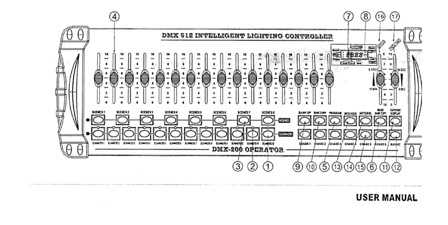
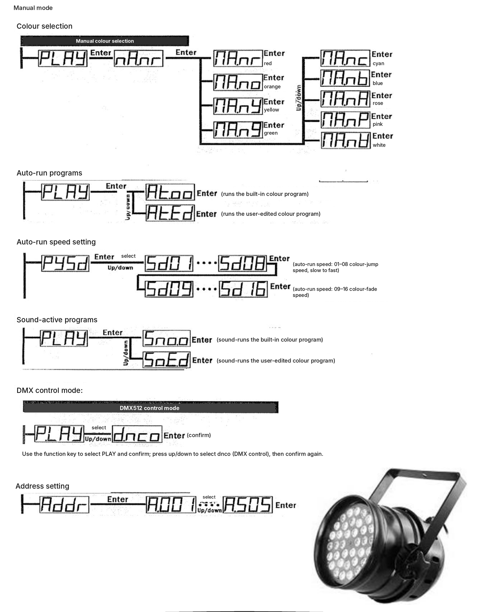

# DMX Console & LED PAR

## DMX console (DMX Operator)

<figure markdown="span">
  { loading=lazy width="880" }
  <figcaption>original handout p.95</figcaption>
</figure>

| # | Name | Function |
| --- | --- | --- |
| 1 | Scanner select buttons | Select fixtures |
| 2 | Scanner indicator LEDs | Show the selected fixtures |
| 3 | Scene select buttons | Store and recall scenes |
| 4 | Channel faders | Set DMX values |
| 5 | Program button | Enter programming mode |
| 6 | Music / Bank copy button |  |
| 7 | LED display window |  |
| 8 | Mode indicator LEDs | Mode (manual, music, auto) |
| 9 | Bank up | Page |
| 10 | Bank down | Page |
| 11 | Tap / Display | Chase speed |
| 12 | Blackout | Blocks the signal (zero output) |
| 13 | MIDI / ADD | Confirm store, record a step |
| 14 | Auto / Del | Delete key in programming mode |
| 15 | Chaser buttons | Chases 1–6 |
| 16 | Speed fader | How long each chase step holds |
| 17 | Fade-time fader | Transition time between scenes in a chase |

*(Items 1 and 2 are blanks in the main handout; the answers come from Advanced Lighting 2 in the folder.)*

### Scenes and chases

| Task | Steps |
| --- | --- |
| **Store a scene** | Program → (set the lights) → Add → Scene 1–8 → Program → Blackout |
| Recall a scene | Press its button. Keep a **blank scene** to turn off whatever is on |
| Pages | More than one page of scenes: Bank up / Bank down |
| **Store a chase** | Program → Chase → Scene 1–8 → Add → (repeat scene, Add) → Program → Blackout. **You can't record from the faders; a chase is built from stored scenes** |
| Run a chase | Press the chase → press Auto; the fader sets speed. Auto again stops on the current step |
| Add a scene to a chase | Program → Display → Add → Scene 1–8 → Add → Program → Blackout |
| Remove a scene from a chase | Program → Display → Scene 1–8 → Delete → Program → Blackout |
| Auto run | Choose a bank and press Auto; it cycles the scenes stored in that bank |
| Delete a scene | Enter Program → Delete → choose the scene |
| Delete a chase | Enter Program → Delete → choose the chase |
| Delete all chases | Power off → hold Bank down + Auto → power on |
| Delete all scenes and chases | Power off → hold Bank down + Program → power on |
- Any change to the console's settings starts by entering Program.
- Learn what each panel light means; a flash of the panel means a setting was changed.

## LED PAR

A digital fixture with red, green and blue LEDs; colour is adjustable, with automatic or sound-activated colour change; a DMX console adds control of colour change, strobe and more. Only 120 W, on ordinary mains. Several LED PARs and the console are daisy-chained with **DMX signal cable (3-pin–3-pin LED cable)**.

| Strengths | Weaknesses |
| --- | --- |
| Low power, little heat, easy to use, many functions, colours and effects | Colder colour than conventional lights, **very vulnerable to water**, expensive |

### Manual mode (on-board menu)

<figure markdown="span">
  { loading=lazy width="793" }
  <figcaption>menu paths for colour selection, auto programs, speed, sound mode, DMX mode and address, original handout p.96</figcaption>
</figure>

### Tri-colour LED PAR: DMX512 channel functions (7-channel mode)

| Ch | Function | Value | Description |
| --- | --- | --- | --- |
| 1 | Red | 0–255 | 0–100% red |
| 2 | Green | 0–255 | 0–100% green |
| 3 | Blue | 0–255 | 0–100% blue |
| 4 | Colour (static) | 5–9 | Red |
|  |  | 10–14 | Orange |
|  |  | 15–19 | Yellow |
|  |  | 20–24 | Green |
|  |  | 25–29 | Cyan |
|  |  | 30–34 | Blue |
|  |  | 35–39 | Rose |
|  |  | 40–44 | Pink |
|  | Auto colour change | 45–54 | Red through pink to white automatically; function and speed set by Ch5 |
|  | Sound colour change | 55–64 | Red through pink to white by sound; function set by Ch5 |
|  | User colour change | 65–74 | User program, automatic |
|  |  | 75–84 | User program, sound |
|  | Colour fade | 90–117 | Red 100% + green 0→100% |
|  |  | 118–144 | Green 100% + red 100→0% |
|  |  | 145–171 | Green 100% + blue 0→100% |
|  |  | 172–198 | Blue 100% + green 100→0% |
|  |  | 199–225 | Blue 100% + red 0→100% |
|  |  | 226–252 | Red 100% + blue 100→0% |
|  | White | 253–255 | Red, green, blue all 100% |
| 5 | Colour-change speed | 0–127 | Colour jump, slow to fast |
|  |  | 128–255 | Colour fade, slow to fast |
| 6 | Strobe | 0–4 | Full on, no strobe |
|  |  | 5–67 | Strobe slow to fast (1–24 Hz) |
|  |  | 68–72 | Sound strobe |
|  |  | 73–126 | Lightning-pulse strobe (slow to fast) |
|  |  | 127–131 | Sound lightning-pulse strobe |
|  |  | 132–185 | Fade-in pulse strobe (slow to fast) |
|  |  | 186–190 | Sound fade-in pulse strobe |
|  |  | 191–244 | Fade-out pulse strobe (slow to fast) |
|  |  | 245–249 | Sound fade-out pulse strobe |
|  |  | 250–255 | Full on, no strobe |
| 7 | Master dimmer | 0–255 | 0–100% |

!!! info "Note"

    - When Ch4 is active it overrides the colour channels (Ch1–3) and the master dimmer.
    - The fade directions (100→0%) and the 0–4 and 250–255 bands of Ch6 come from the newer digital fixtures & digital consoles handout in the folder; the main handout's table (p.97) gives every fade as 0→100% and omits those two bands.
    - Tables for other fixtures (four-colour LED, amber LED, laser) and other channel modes are in KK256A & Digital Fixture DMX Tables.
