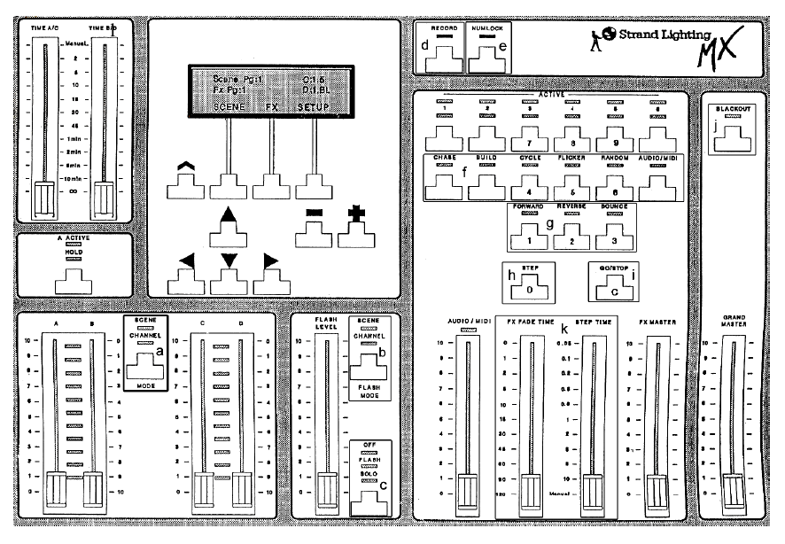
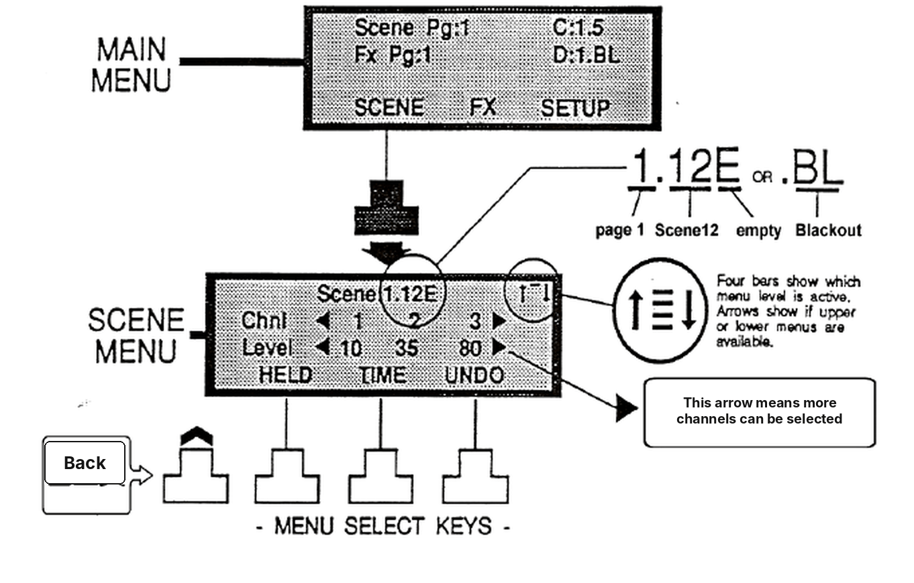
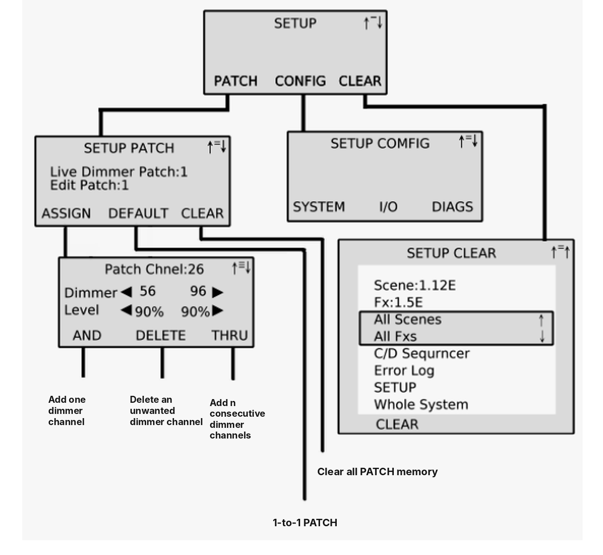
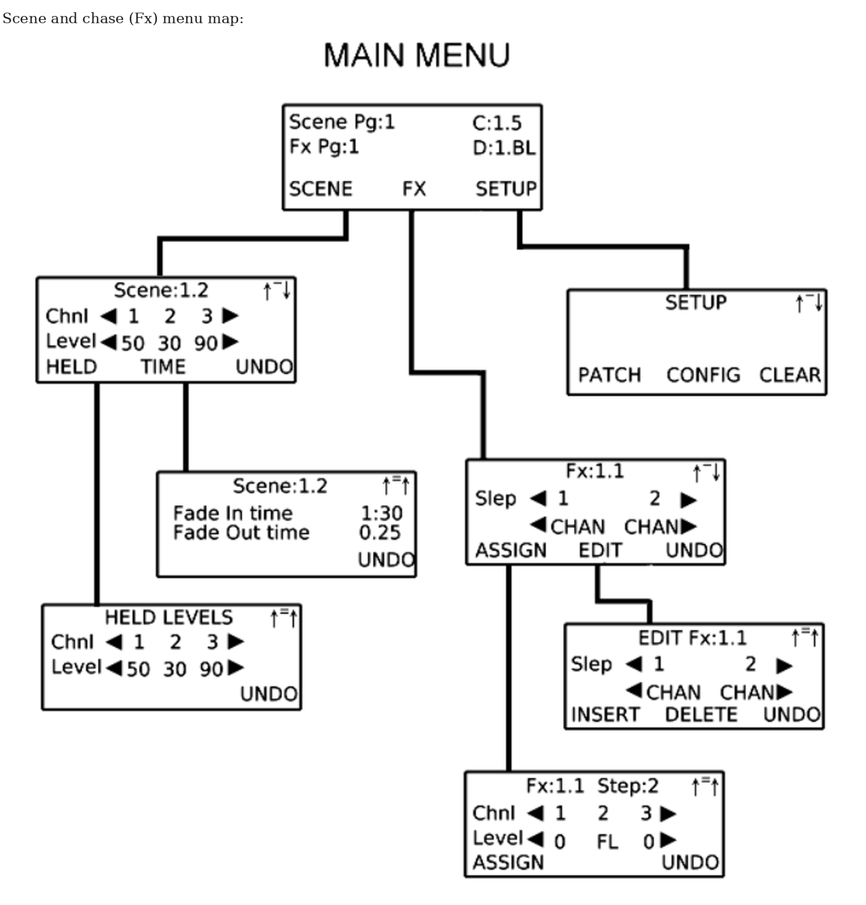

# Strand MX

A digital console with memory, FLASH, SCENE, AUTOFADE and FX (effects), suited to all kinds of shows and theatre.

- 12 channels; with **Patch**, up to **512** dimmer circuits.
- SETUP → PATCH can be set "digital" (one MX channel to several dimmer circuits) or "analog" (one to one).

<figure markdown="span">
  { loading=lazy width="886" }
  <figcaption>panel, original handout p.90</figcaption>
</figure>

## Panel keys

| Ref | Name | Function |
| --- | --- | --- |
| a | Mode | Scene or Channel mode. **Scene**: the A sub-faders set channel levels; the B sub-faders set scene levels. **Channel**: upper A and lower B sub-faders control the same channel, highest level wins |
| b | Flash Mode | With Mode on Scene, flash can be Scene or Channel; with Mode on Channel, flash is Channel only. Channel: the button flashes that channel; Scene: it flashes that scene |
| c | Off / Flash / Solo | Sets the flash keys to Flash or Solo. **Solo**: only the pressed channel or scene stays on; **Flash**: lights already up on faders are unaffected. During Record the Off light is on and flash is unavailable |
| d | Record | Programs scenes and Fx |
| e | NumLock | When lit, the numbers on the chase keys enter digits on the LCD |
| f | Six pattern keys | Chase pattern |
| g | Forward / Reverse / Bounce | Chase direction |
| h | Step | Records a step when programming; "next step" when running manually |
| i | Go / Stop | Start and stop the chase |
| j | BlackOut | When lit all output stops |
| k | Fx Fade Time / Step Time | Fade speed when the chase starts / chase speed |
| l | Time A/C, Time B/D | Delay: time for the A/B/C/D faders' signal to go 0→100 (or 100→0). Infinity = never; manual = 0 s; 2 = 0→10 takes 2 s |

## LCD and power-on setup (Patch)

<figure markdown="span">
  { loading=lazy width="681" }
  <figcaption>LCD: Main Menu / Scene Menu and menu keys, original handout p.91</figcaption>
</figure>

<figure markdown="span">
  { loading=lazy width="650" }
  <figcaption>SETUP → PATCH / CONFIG / CLEAR menu tree, original handout p.92</figcaption>
</figure>

| Item | Description |
| --- | --- |
| Live Dimmer patch | The patch in use now |
| Edit patch | The patch to edit |
| ASSIGN | Set the patch: assign channels to dimmer circuits |
| DEFAULT | Restore the 1-to-1 patch |
| CLEAR | Clear all patch memory (every channel's circuits) |

## Scenes and chases (Fx)

### (a) With the keys

**Store a scene**

1. Press **Record** → the LCD shows RECORD SCENE, the Off light comes on and the 12 flash keys become scene stores.
2. Choose the record mode and page. 4 scene pages of 12 = 48 scenes.
    - **OUTPUT mode**: records what is actually being output, so bring the lights up first, then choose page and store.
    - **A fader mode**: records the A sub-fader values (assuming the A master and Grand Master at 10), so you can record blind.
3. Press **Record** again to exit.

**Store a chase**

1. Press **Record** → press the store (first row); the LCD shows RECORD EFFECT. Only the lower 12 flash keys are used when programming a chase.
2. LCD right shows **Channel** → the step can hold several channels; **Scene** → the step holds one scene.
3. Press **STEP** for the next step.
4. Use the cursor and +/− to review and edit steps.
5. Press **Record** again to exit.

### (b) With the LCD

<figure markdown="span">
  { loading=lazy width="784" }
  <figcaption>menu map for Scene and Fx, original handout p.94</figcaption>
</figure>

| Item | Description |
| --- | --- |
| Scene 1.2 | Scene page 1, store 2 |
| Fx 1.1 | Chase page 1, store 1 |
| UNDO | Return to the state on entry |
| ASSIGN | With the cursor on CHAN, switches the step to Scene mode (choose with +/−); press again for Channel mode and set which channels light in each step (level is FL or 0 only) |
| EDIT | Add or remove chase steps |
| INSERT | Insert a step (before the current one) |
| DELETE | Move the cursor to the step and press |
