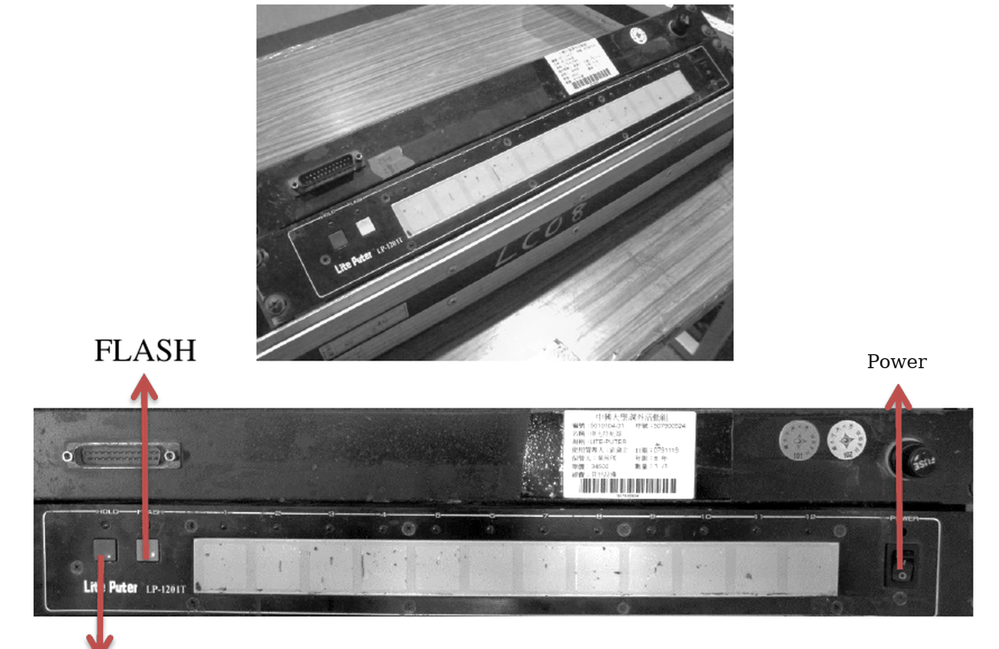
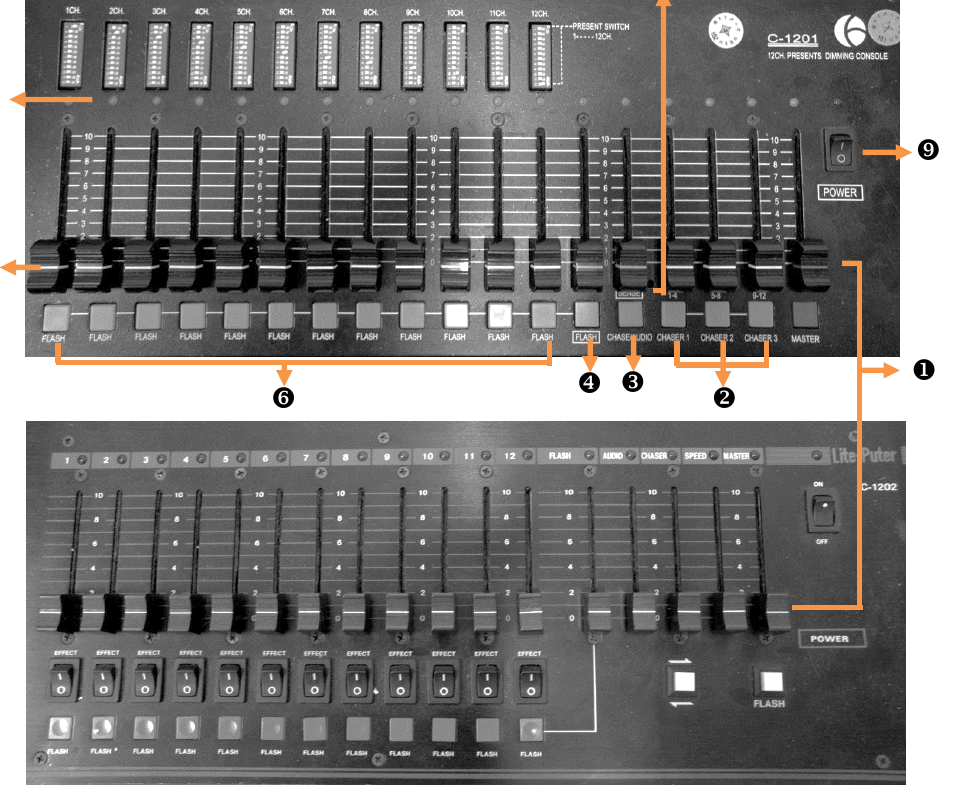

# Touchlight, C-1201, C-1202 (analog)

## Touchlight

A console designed for dance parties, simple and practical. Power switch on the right, 12 touch switches in the middle, two mode buttons on the left. A 25-pin–25-pin cable connects at the back.

| Mode | Action |
| --- | --- |
| HOLD | Touch once and the channel stays on; touch again to turn it off |
| FLASH | On only while your hand is on the switch |

Switching between the two keeps party lighting varied.

<figure markdown="span">
  { loading=lazy width="892" }
  <figcaption>original handout p.86</figcaption>
</figure>

## C-1201, C-1202

<figure markdown="span">
  { loading=lazy width="964" }
  <figcaption>top: C-1201; bottom: C-1202; original handout p.87</figcaption>
</figure>

| # | Name | Function |
| --- | --- | --- |
| 1 | MASTER | Master voltage output (0–10 V), governing the Ch.1–12 faders (7) and the FLASH fader (4) |
| 2 | CHASER 1, 2, 3 | Three independent chasers; the faders set chase speed for Ch.1–4, 5–8, 9–12 |
| 3 | CHASE/AUDIO | Switches between timed chase and sound-activated chase; with any chaser running, press the orange key for sound control |
| 4 | FLASH | Brightness of the yellow FLASH buttons for Ch.1–12 |
| 5 | SENSE | Sensitivity of sound-activated chase (built-in mic) |
| 6 | FLASH buttons | Flash that channel |
| 7 | Channel faders | Brightness of Ch.1–12 |
| 8 | Indicators | Per channel: green = ready (doubles as a night light), red = outputting |
| 9 | POWER | Console power switch |

### Operating points

*(Supplement from the C1201/C24 key-points note in the folder)*

- Connect to the dimmer with a 25-pin–25-pin cable.
- **Bringing up a light**: MASTER first, then the channel fader.
- **Levels multiply**: channel × MASTER. E.g. Ch.1 at 50% and Master at 40% → 20%.
- The FLASH fader also follows MASTER; the brighter value wins.
- **Chase**: CHASER 1, 2, 3 control Ch.1–4, 5–8, 9–12 and must be switched on; chase brightness comes from the channel faders, the CHASER fader sets speed and the indicator shows it. Once a chase runs, that group's channel faders and flash buttons stop working.
- **Sound**: with CHASE/AUDIO on AUDIO the fader sets the built-in mic's sensitivity and the chaser speed faders stop working.
