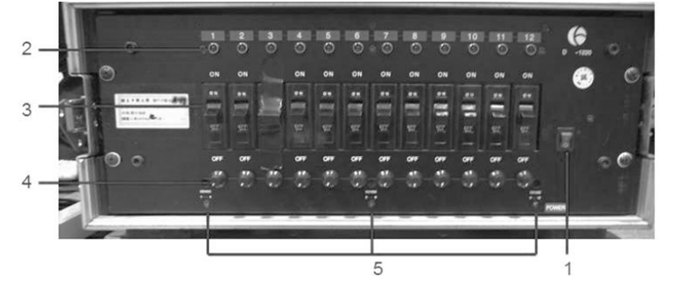
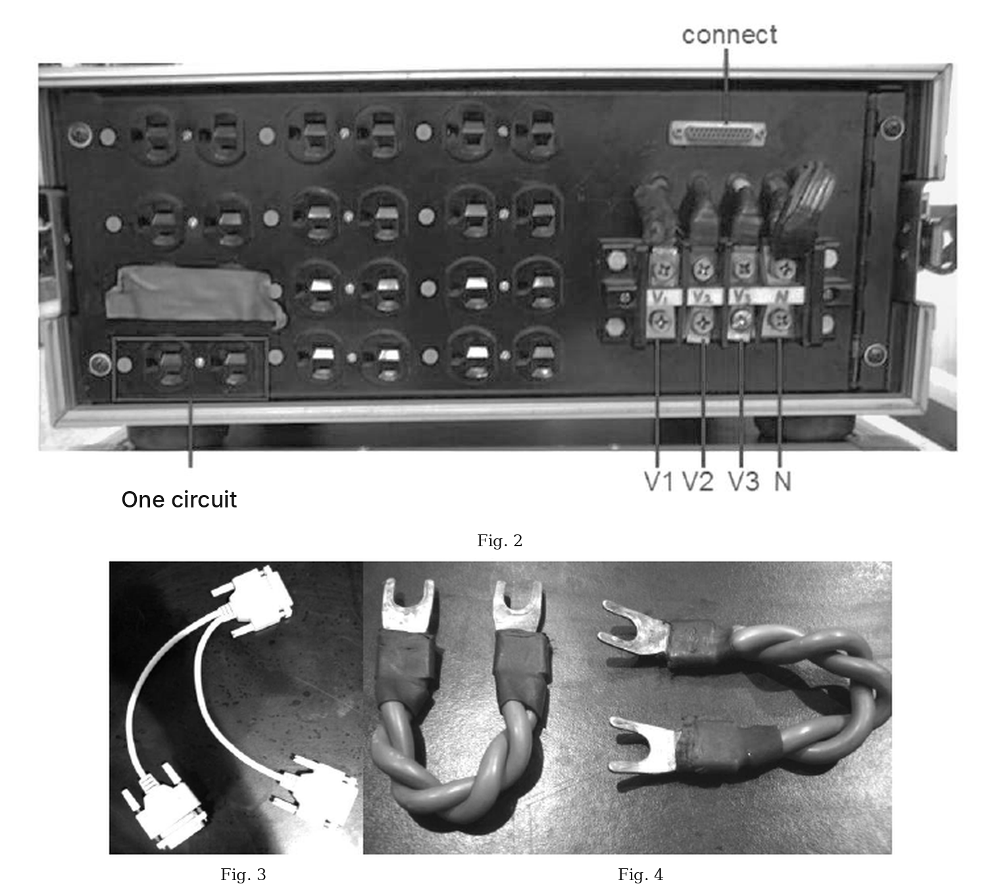
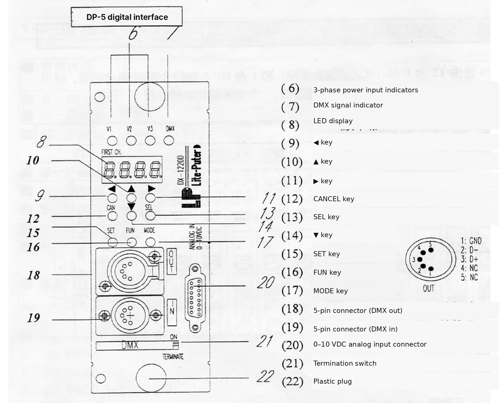

# Dimmers

## How a dimmer works

A dimmer regulates voltage and current to control brightness. Current passes through a filter to a silicon-controlled rectifier (SCR) or solid-state relay (SSR); the console's signal goes through a processor to each SSR, controlling each circuit's fixtures.

A lighting system has a **console (front end)** and **dimmer (back end)**: the dimmer outputs different currents on each channel according to the console's signal.

### Which lamps can be dimmed

| Lamp | Character / use | Dimmable by varying current? |
| --- | --- | --- |
| Discharge | High colour temperature, very bright; follow spots and scanners | ✗ |
| Quartz | Common in spotlights | ✓ |
| Incandescent | The most common | ✓ |

!!! warning "Caution"

    Almost every rotating effect light has a transformer and motor and needs a full, stable voltage or it is easily damaged. Don't dim them: plug into a wall outlet or switch with an AC-BAR.

### Common specifications

- Neutral N; lives V1, V2, V3 (or R, S, T). All three lives must be powered to use every circuit.
- 12 circuits, 20 A maximum each (use 15 A to be safe); spread the load evenly.

## Power Pack (analog dimmer)

<figure markdown="span">
  { loading=lazy width="796" }
  <figcaption>Fig. 1: front, original handout p.83</figcaption>
</figure>

| # | Front | Description |
| --- | --- | --- |
| 1 | Power switch |  |
| 2 | LED indicators | Show each channel on or off (under console control) |
| 3 | No-fuse switches | Overload protection per channel |
| 4 | FLASH | Dimming knobs for Ch.1–12 when no console is connected (for testing); don't move them unless necessary |
| 5 | SENSE | Filament sensitivity, prevents glow; **don't touch** |

<figure markdown="span">
  { loading=lazy width="760" }
  <figcaption>Fig. 2: rear; Fig. 3: Power Link; Fig. 4: Y-type 25-pin cable; original handout p.84</figcaption>
</figure>

- V1, V2, V3 (or R, S, T) terminals at rear right take the feeder, up to three lives; N is neutral.
- **With only one live, bridge with a Power Link.**
- "connect" is a 25-pin female connector to the console (25-pin–25-pin cable).
- 12 circuits on the left, two outlets each, 20 A maximum.
- The front Ch.1–12 switches **must be OFF before power is applied**.
- A Y-type 25-pin cable can drive two Power Packs at once.
- If fixtures don't respond to the console, check both ends of the ribbon cable first.

## DX-1220 (digital dimmer)

Twelve single-circuit driver modules plus a **DP-5 digital interface**.

- Front: 12 channels and their switches, the digital interface, two 5-pin DMX connectors (in and out), a 15-pin ribbon connector.
- Rear: three lives V1, V2, V3 and one neutral N.
- With three lives at the power box, connect each to the dimmer's lives; with one or two, link the dimmer's lives together (flexible Power Link).
- Another dimmer can be chained from DMX OUT (5-pin–5-pin).
- **The dimmer must be set to OFF mode when powering on and off.**

<figure markdown="span">
  { loading=lazy width="892" }
  <figcaption>DP-5 digital interface, original handout p.85</figcaption>
</figure>

### Three operating modes (MODE key)

| Mode | Display | Description |
| --- | --- | --- |
| Digital | `d.001.`, `d.013.` … | For digital consoles (C-24X, MX), via DMX IN on 5-pin–5-pin or 3-pin–5-pin. d means digital; with a good signal two small dots show (under the d and under the number). **No dot under the d = no digital signal** |
| Analog | `AE12` | For analog consoles (e.g. ZERO-88) |
| OFF | `OFF` | Ignores the console |
- After any change press **SEL** to store it in the dimmer.
- The number is the console channel that this dimmer's first circuit answers to: the first unit is `d.001.` (console 1–12), a chained second unit `d.013.` (console 13–24).
- Other functions: temperature and voltage display, dimmable / non-dim per circuit, level and so on.

### DP-5 panel

| # | Name | # | Name |
| --- | --- | --- | --- |
| 6 | Three-phase power indicators | 15 | SET key |
| 7 | DMX signal indicator | 16 | FUN key |
| 8 | LED display | 17 | MODE key |
| 9–11 | Up / keys | 18 | 5-pin connector (digital out) |
| 12 | CANCEL key | 19 | 5-pin connector (digital in) |
| 13 | SEL key | 20 | 0–10 VDC analog input connector |
| 14 | Down key | 21 / 22 | Termination switch / plastic clip |

Panel lights *(supplement from the C1201/C24 key-points note)*: **AC** — lit with no lamp connected, off with a lamp connected; **TRIG** — lit when the console is sending.
