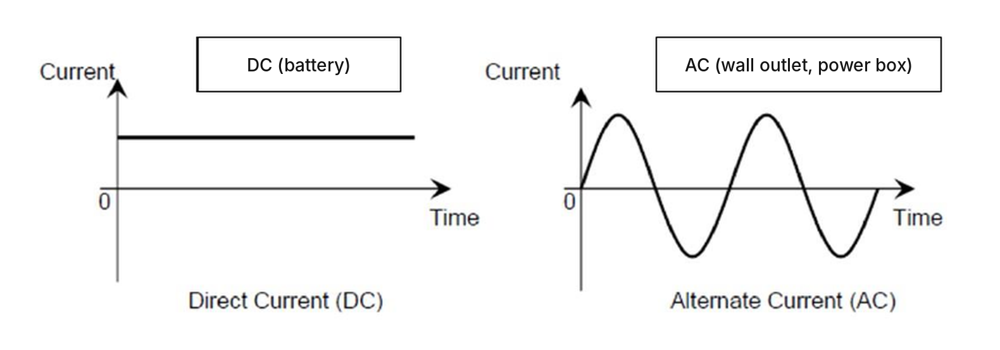
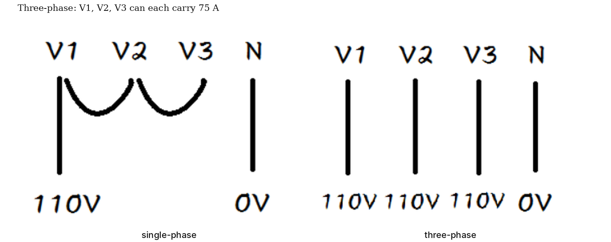
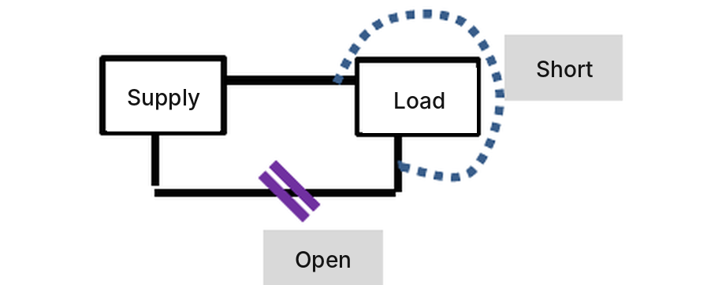

# Electrical Basics & Load Calculation

## Sources of electricity

- **Direct current (DC)**: batteries.
- **Alternating current (AC)**: wall outlets and the power boxes fixtures are fed from at events. Common voltages are 110V and 220V. AC is cheap and powerful and is the most widely used.

<figure markdown="span">
  { loading=lazy width="790" }
  <figcaption>DC and AC waveforms, original handout p.77</figcaption>
</figure>

## Basic quantities

| Quantity | Symbol / unit | Description |
| --- | --- | --- |
| Voltage | V, volts (V) | The "pressure" (electromotive force) needed to move current from A to B along a wire |
| Current | I, amperes (A) | Direct or alternating |
| Resistance | R, ohms (Ω) | How much an object opposes current; low-resistance objects such as wire are conductors |
| Power | P, watts (W) | The circuit supplies power and the appliance absorbs it — the load. 1000 W for one hour is one kWh |

!!! note "Formula"

    **Power: P = I × V**

    **Ohm's law: V = I × R**

## Calculating load

The power drawn by the fixtures must be less than the power box can supply, or the breaker trips or wiring catches fire.

**Example 1**: breaker rated 110V, 75A; PAR lamp 1000W, 110V. How many at most?

- For easy arithmetic, treat 110V as 100V.
- One PAR draws about 1000 W ÷ 100 V = **10 A**
- 75 A ÷ 10 A → at most **7** PAR lights.

**Example 2**: 2 Fresnels (750W) + 3 cyc lights (500W). How much current must a 110V box supply?

- Total power = 2 × 750 + 3 × 500 = 3000 W
- At 100V: 3000 ÷ 100 = **30 A** (about 27.3 A at exactly 110V; using 100V is the conservative figure)

## Common fixture wattages

| Fixture | Power | Fixture | Power |
| --- | --- | --- | --- |
| PAR | 1000 W | Double-ball light | 600 W |
| Fresnel | 750 W | Fog machine | 800 W |
| Zoom | 1000 W | Mirror ball / floor mirror ball | 300 W |
| Cyc light | 300 W or 500 W | Bubble machine | 30 W |
| Strobe | 300 W or 750 W | Laser | 200 W |
| "Dragon" bar light | 500 W | Beam mirror-ball light | 500 W |
| ET light | 400 W | Rocket light | 360 W |
| Pin spot (small / large) | 30 W | Small rotating light | 160 W |
| Seven-colour light | 300 W | Light string | 300 W |
| LED PAR | 120 W |  |  |

## Maximum cable loads

| Cable | Maximum current |
| --- | --- |
| Black extension cable | 15 A |
| Grey extension cable (longer) | 20 A |
| Feeder cable (38 mm²) | 100 A |
| Feeder cable (22 mm²) | 70 A |
| One dimmer circuit | 20 A (use 15 A to be safe) |
| Ordinary two-pin wall outlet | 15 A (derate to 12 A) |

Every power box, cable and component has a current limit. Work out the total load when designing, and confirm the box can supply it. If you use wall outlets instead of a power box, learn how the venue is wired and spread the load over different circuits to avoid tripping or burning wiring.

## Phases

With AC, the phase difference between live and live, or live and neutral, is the voltage. Different connections give different voltages and capacities.

Example: supply rated "single circuit 110V 75A"

|  | Capacity of V1, V2, V3 |
| --- | --- |
| Single-phase | 75 A **in total** across the three |
| Three-phase | 75 A **each** |

<figure markdown="span">
  { loading=lazy width="760" }
  <figcaption>single-phase and three-phase, original handout p.84</figcaption>
</figure>

## Wiring common sense

1. Measure the AC voltage at the breaker with a multimeter and check it matches the equipment (usually 110V or 220V).
2. When connecting: **neutral/ground first, then live; dimmer end first, then the power box.**
3. Use the power formula to total the current and confirm it is within the box's capacity; overload causes fire or low voltage.
4. No cable may be shorted, and each must be rated for the full current; test for opens and shorts before use.
5. Power for audio must be **kept separate** from air conditioners and motors (high-frequency interference) and from the high-current stage lighting system.

<figure markdown="span">
  { loading=lazy width="458" }
  <figcaption>open circuit and short circuit, original handout p.78</figcaption>
</figure>

!!! warning "Caution"

    An ordinary fixture on 220V will blow its lamp. A dimmer can take 220V but most fixtures cannot. After tying in, check with a multimeter or test with a cyc light first.

*Translation note: the source uses 地線 for the N conductor (rendered here as neutral/ground) and 火線 for live.*
