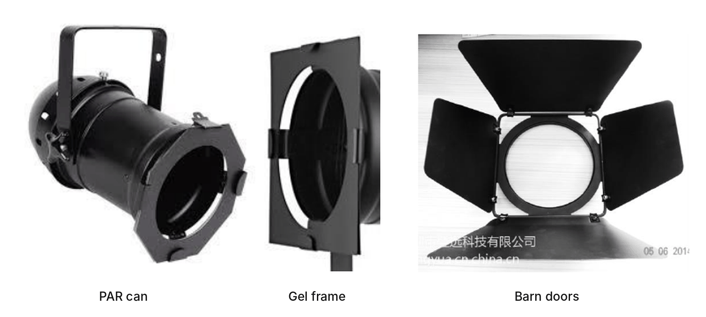
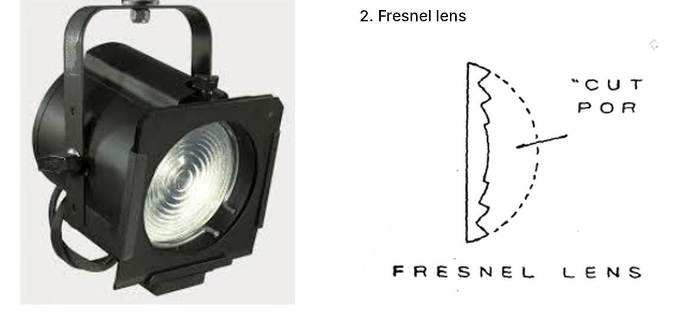
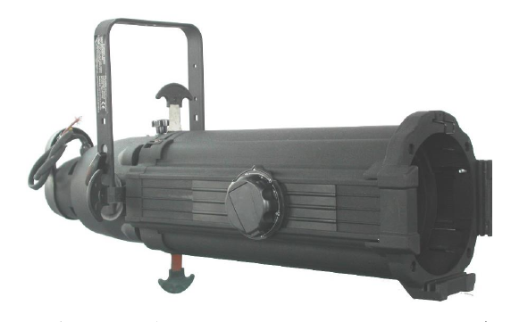
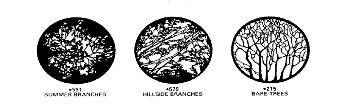
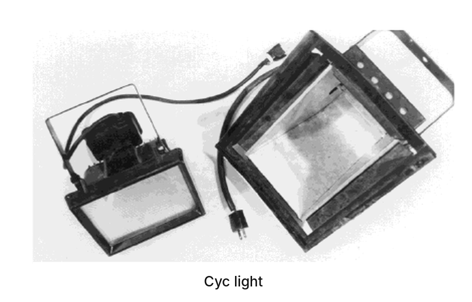
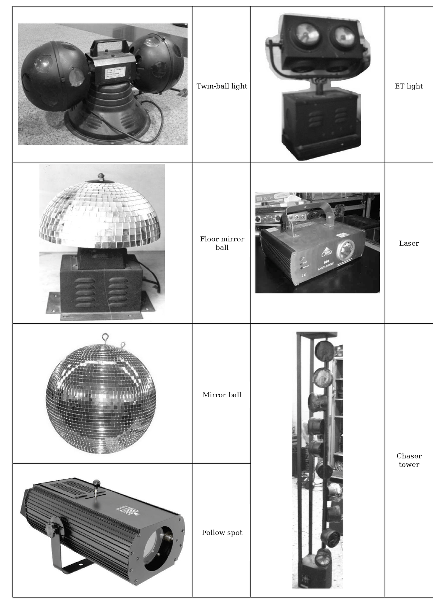

# Fixtures

## Spotlights

### PAR 64 [110V, 1000W]

PAR stands for Parabolic Aluminum Reflector, named for its parabolic reflector. Sizes by lamp diameter: PAR 36, 46, 56, 64.

<figure markdown="span">
  { loading=lazy width="802" }
  <figcaption>PAR can, gel frame, barn doors, original handout p.99</figcaption>
</figure>

Four types by beam angle — **N is tightest, S is widest**:

| Type | Lens | Beam angle | Suitable throw | Notes |
| --- | --- | --- | --- | --- |
| N (FFN) | Clear glass | Narrowest | About 35 m | Highest intensity, longest throw; uneven at close range |
| P (FFP) | Frosted glass | Second narrowest | About 25 m |  |
| R (FFR) | Large-grid glass | Second widest | About 15 m | Too little illuminance if thrown too far |
| S (FFS) | Small-grid glass | Widest | About 5 m | Lowest intensity, shortest throw |
- A PAR beam is always **oblong (oval, the shape of the filament)**, tight or wide; rotate the lamp when focusing.
- Add a **gel frame** to change colour. Use heat-resistant gel, not ordinary cellophane, which melts onto the light.
- **Barn doors** limit the spread but don't cut the beam square; they make the front heavy, so wire may be needed to hold the tilt.
- 1000 W: it gets very hot very quickly.

### Fresnel spotlight [110V, 750W]

Named for its Fresnel lens. The size and intensity of the pool can be changed between spot and flood; the pool is softer than a PAR's.

The Fresnel lens: a plano-convex lens with most of the spherical bulk cut away, its surface reproduced as a series of sloped concentric rings; each ring acts as a lens, gathering scattered light from lamp and reflector into parallel rays.

<figure markdown="span">
  { loading=lazy width="584" }
  <figcaption>Fresnel fixture and lens section, original handout p.99</figcaption>
</figure>

### Zoom [110V, 1000W]

A quartz lamp with an ellipsoidal reflector — an ellipsoidal light. One or two lenses give a brighter, longer throw. Four **shutters** around the body cut the beam square or semicircular; a **gobo** gives special shapes.

<figure markdown="span">
  { loading=lazy width="572" }
  <figcaption>original handout p.100</figcaption>
</figure>

**Gobo**: a heat-resistant steel plate whose cut-out pattern is projected onto floor or cyc.

<figure markdown="span">
  { loading=lazy width="705" }
  <figcaption>gobo examples, original handout p.100</figcaption>
</figure>

### Aircraft landing light (ACL)

Originally a runway light. A straight, tight beam with a small spot and high wattage; good for beam effects.

### Follow spot

Follows the lead performer and strengthens front light. High colour temperature (mostly 3200–5200K); on video the picture goes blue, so add colour-correction gel.

## Floodlights

### Cyc light [300W / 500W]

A floodlight for lighting the cyclorama; wide coverage.

<figure markdown="span">
  { loading=lazy width="470" }
  <figcaption>original handout p.100</figcaption>
</figure>

## Effect lights

<figure markdown="span">
  { loading=lazy width="719" }
  <figcaption>double-ball, ET light, floor mirror ball, laser, mirror ball, dragon bar, follow spot, original handout p.102</figcaption>
</figure>

| Fixture | Rating | Notes |
| --- | --- | --- |
| Strobe | 110V, 300W / 750W | Rate knob on the back |
| "Dragon" bar light | 110V, 500W | Same lamp as the rotating lights |
| ET light | 110V, 400W | Common at dance parties |
| Pin spot | 110V, 30W | Small coverage; for mirror balls or local colour |
| Small colour light | 110V, 300W | As above |
| Seven-colour light | 110V, 300W | Motor and small mic inside; turns to sound; sensitivity knob on the back; seven patterns |
| Double-ball light | 110V, 600W | Outer shell turns, lamp stays still; for dance parties |
| Fog machine | 110V, 800W | For dance parties and theatre; needs proper fog fluid; preheat about 10 minutes. Makes beams visible |
| Mirror ball / floor mirror ball | 110V, 300W | With pin spots, throws many rotating dots |
| Bubble machine | 110V, 30W | Better with a fan; use proper bubble fluid, not home-mixed detergent |
| Laser | 110V, 200W | Varied beams, sound-activated, better with fog. **Never look into the beam** |
| Beam mirror-ball light | 110V, 500W | Self-rotating, attractive beams, works with fog |
| Rocket light | 110V, 360W | Main shaft turns and the four barrels turn with it |
| Small rotating light | 110V, 160W | Main shaft turns, barrels don't |
| UFO light | 110V, 160W | Rotates in several directions |
| Light string | 110V, 300W | Local colour |

!!! warning "Caution"

    Almost every rotating effect light has a transformer and motor; give it a full, stable voltage or the fixture or transformer is easily damaged. Without a console, use a wall outlet or switch with an AC-BAR.

## Digital fixtures

*(This section is a supplement from the digital fixtures & digital consoles handout in the folder)*

Digital fixtures generally use LEDs in place of halogen or high-intensity discharge lamps: LED PARs, spots, battens and moving heads.

|  | Conventional | Digital |
| --- | --- | --- |
| Control | Vary the output voltage; current controls brightness | Change digital signal values to control functions |
| Strengths | Warm light, high output | Low power, runs from ordinary mains; little heat; many functions, colours and effects; safer, greener |
| Weaknesses | Power-hungry, hot | Harder, colder colour; halo spreads; lower output; costly; **very vulnerable to water**, keep dry |

| Fixture | Notes |
| --- | --- |
| Tri-colour LED PAR (3W×36, RGB) | About 120 W. Modes: static colour, colour change (auto / sound; built-in or user programs), DMX512 (Ch07 and Ch05 channel modes) |
| Four-colour LED PAR (3W×54, RGBW) | Adds white. Seven DMX modes: STAG, ARC.1, ARC.2, AR1.d, AR2.d, AR2.S, HSV; also master/slave, white balance, colour calibration, over-temperature protection, key lock |
| Amber LED (3W×36) | Softer light; only 2 DMX channels (strobe, dimmer) |
| Laser | 7 DMX channels |
| Moving head | Pans and tilts continuously; built-in colour wheel and patterns |

LED PAR keys: FUNC / MENU (menu or back), ENTER, UP, DOWN. The manual-mode menu and DMX channel tables are in Lighting Consoles → DMX Console & LED PAR.
