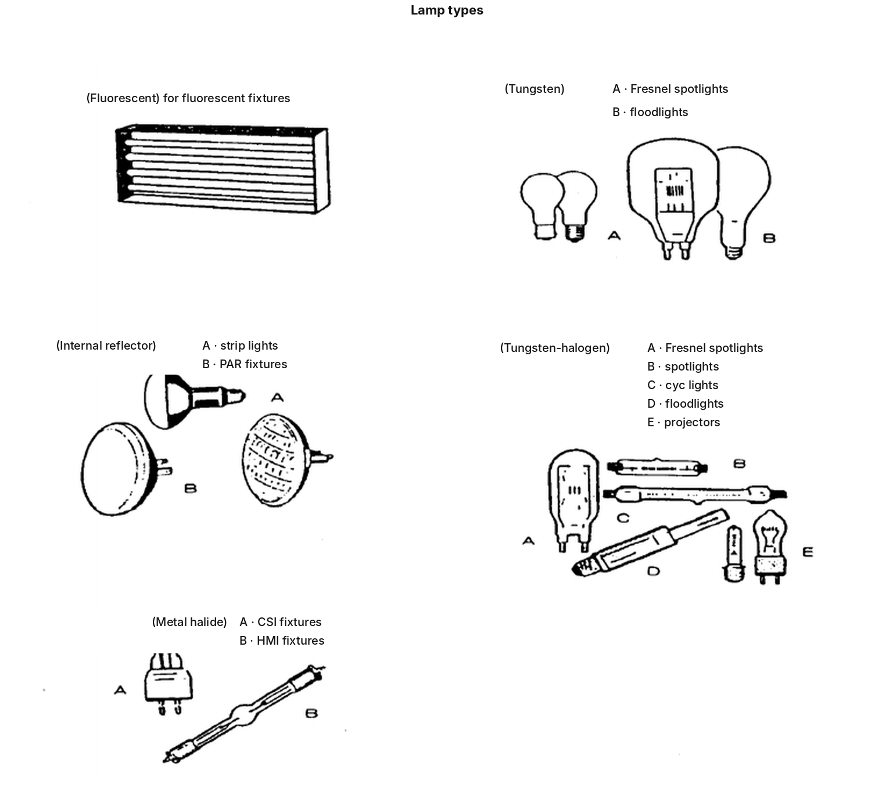
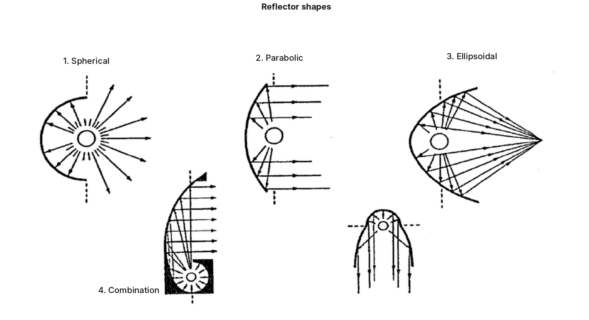

# Lighting Optics

## Lamp types

| Lamp | Character | Use |
| --- | --- | --- |
| Fluorescent | Low output (for TV lighting), broad soft light, 5000–6000K | Office lighting |
| Tungsten | Limited power (5–200 W) | Set dressing, domestic |
| Tungsten-halogen (quartz) | High efficiency and life, constant output and colour temperature (3000–3200K) | The main fixture lamp, e.g. Fresnel |
| Internal-reflector lamp | Good directionality, long throw, light weight | Outdoor concerts, e.g. PAR64 |
| Metal halide | 5000K and above, highest efficiency (HMI, CSI, CID) | Daylight fill, large night scenes |

<figure markdown="span">
  { loading=lazy width="765" }
  <figcaption>lamp types, original handout p.104</figcaption>
</figure>

## Reflectors

A reflector is a treated curved metal surface behind the source. It redirects light heading backwards (concentrating or spreading it) and increases illumination.

### Surface finish

| Type | Description |
| --- | --- |
| Specular | Very smooth mirror; angle of incidence equals angle of reflection |
| Diffuse | Smooth, matt surface that softens and reflects evenly, e.g. a broadlight |
| Mixed | Both specular and diffuse; a mix of hard and scattered light |
| Scattered | Wrinkled, stippled or pleated surface that breaks up the light like many small mirrors |

### Shape

| Shape | Typical fixture |
| --- | --- |
| Spherical | Fresnel |
| Ellipsoidal | Leko |
| Parabolic | PAR64, PAR36 |
| Combined spherical / parabolic | Softlite |

<figure markdown="span">
  { loading=lazy width="765" }
  <figcaption>reflector shapes, original handout p.104</figcaption>
</figure>

## Simple fixture repair

Most damage is from misuse (broken filaments, smashed plugs); careful handling comes first.

**If a light doesn't work, check in order**: plug loose → lamp broken → lampholder wiring or the extension cable.

### Why filaments fail

- **Bending**: either the reflector is badly positioned (reflected light focuses inside the envelope and overheats it) or the lampholder voltage is too high. Old lamps also sag, so bending indicates age.
- **Vibration**: the biggest cause. A just-used filament is extremely hot and fragile; handle carefully and **let it cool before taking it down**.

### Extension cables

A dead light isn't always the light; cables short and break too. Swap in another first, repair later.

## Units of illumination

| Unit | Definition |
| --- | --- |
| Illuminance (lux) | Luminous flux falling on a surface. **Proportional to the source's candlepower, inversely proportional to the square of the distance** |
| Foot-candle (fc) | Flux on one square foot one foot from a one-candela source. 1 fc = 10.76 lux |
| Luminance (nit) | Brightness reflected from the lit surface. Nit = illuminance × reflectance ÷ 4 |

Example: a 300-candela source at 10 ft:

**L = 300 ÷ 10² = 3 fc**
