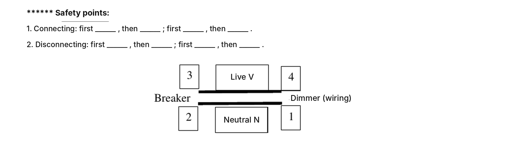
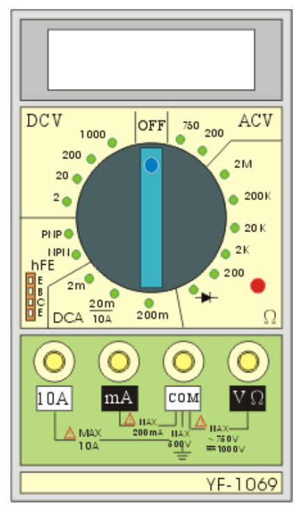
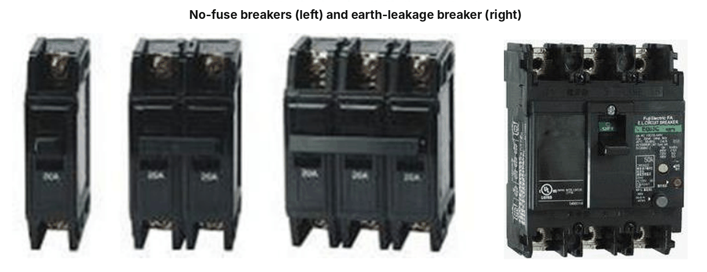
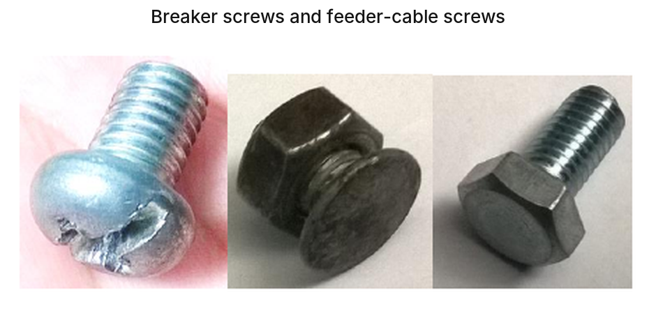

# Power Tie-in Safety & the Multimeter

Tying in power is the most dangerous step in setting up lighting. It is normally done only when everything is rigged, every fixture is cabled and you are ready to focus. Electricity can't be seen or heard; carelessness means shock, fire or damaged equipment. Safety depends on three things:

1. **Load calculation** → see Electrical Basics & Load Calculation
2. **Condition of the supply** (checked with a multimeter)
3. **Tie-in method**

## The tie-in rule

!!! tip "Rule to remember"

    **Connecting: neutral/ground first, then live; dimmer end first, then the power box.**

    **Disconnecting: the reverse — live first, then neutral/ground; power box first, then the dimmer.**

    The breaker must be OFF before connecting or disconnecting.

<figure markdown="span">
  { loading=lazy width="964" }
  <figcaption>connection order 1–4 for live V and neutral N between breaker and dimmer, original handout p.82</figcaption>
</figure>

## Electric shock

Injury from current passing through the body. Severity depends on the path through the body, the voltage, the current and its duration, body resistance and supply frequency.

- **Path**: current takes the path of least resistance, depending on what was touched, where you stand and any insulation.
- **Voltage**: above **35 V** is already considerably dangerous. Low-voltage shocks mostly come from carelessness, such as operating switches with wet hands.
- **Current and time**: the longer it flows, the worse the injury.

| Current (mA) | Effect |
| --- | --- |
| 0.3 | Threshold of sensation |
| 1 | Trembling |
| 10 | Muscle cramp |
| 30 | Unconsciousness |
| 50 | Fibrillation, death |
| 100 | Death |
- **Body resistance**: wet skin has far lower resistance than dry skin, so shocks are more severe.

| Part | Resistance |
| --- | --- |
| Between the ears | 100 Ω |
| Internal tissue (hand to ear) | 400–600 Ω |
| Wet skin | 1,000 Ω |
| Dry skin | 100,000–600,000 Ω |

## The multimeter

Before using a power box or outlet, confirm it is safe: no leakage, voltage in range and stable, breaker working. A multimeter measures voltage, current and resistance; there are digital and analogue types.

<figure markdown="span">
  { loading=lazy width="440" }
  <figcaption>panel: DCV / ACV / DCA / Ω / hFE ranges and the 10A, mA, COM, VΩ sockets, original handout p.117</figcaption>
</figure>

Common steps: black probe in **COM**, red probe in the appropriate socket → turn the dial to the **highest range** of that function → connect → step down to a lower range for a more accurate reading → read.

| Measurement | Red probe | Range | Connection |
| --- | --- | --- | --- |
| AC voltage (ACV) | VΩ | ACV | In **parallel** with the circuit (don't exceed the top range) |
| DC voltage (DCV) | VΩ | DCV | In **parallel** |
| DC current (DCA) | mA or 10A (by maximum current) | DCA | In **series** (don't exceed the top range) |
| Resistance (Ω) | VΩ | Ω | Probes across the item |
| Continuity buzzer | VΩ | Buzzer | Touch the probes together first to confirm battery and buzzer; then probe both ends of the cable. No tone → possibly open |
| Diode | VΩ | Diode | Across the diode; low resistance is forward (red probe on N, black on P), reversed gives high resistance |
| Transistor hFE | — | PNP or NPN in the hFE area | Insert the transistor into the test socket by pin |

Turn the dial to **OFF** afterwards to save the battery.

## Testing a power box

Before tying in, or plugging fixtures into wall outlets, measure the AC voltage. Take special care if it reads 220V.

1. Multimeter on **ACV**
2. Find a **true earth**
3. Measure the **enclosure** against true earth (leakage?)
4. Open the box; confirm the breaker is **OFF**
5. Measure the **neutral/ground**
6. Measure the live **before** the breaker against neutral
7. Measure the live **blocked** by the breaker (should be dead when OFF)
8. Switch the breaker **ON**
9. Measure the live **through** the breaker
10. Switch the breaker back **OFF**

*(Supplement from the C1201/C24 key-points note)* The order in concept: is the box leaking → is the neutral leaking → is the breaker leaking → is the live supplying normally → is the breaker passing power normally.

## Tie-in notes

1. Rule: neutral/ground first, then live; dimmer first, then the power box
2. Keep neutral and live clearly identified
3. Tighten every screw
4. Tie a safety on afterwards (at the power box)

<figure markdown="span">
  { loading=lazy width="766" }
  <figcaption>no-fuse breakers and an earth-leakage breaker (original handout p.118)</figcaption>
</figure>

<figure markdown="span">
  { loading=lazy width="470" }
  <figcaption>breaker screws and feeder screws (original handout p.118)</figcaption>
</figure>

## Notes for specific equipment

- **Distribution board**: connect at the board first, then at the wall power box; keep live and neutral straight.
- **Dimmer & Power Pack**: confirm live and neutral are correct. After the breaker is on, switch on at the panel: fan first, the individual channel switches last; reverse the order when striking.
- Breakers don't always have screws; bring your own.
- If a cable or the feeder gets **abnormally hot**, there may be a short or a loose connection → stop and switch off immediately; continue only when it is fixed.
