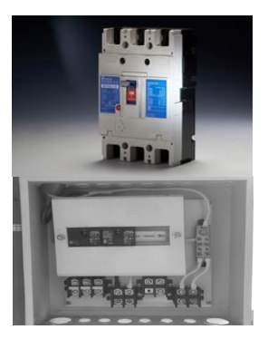
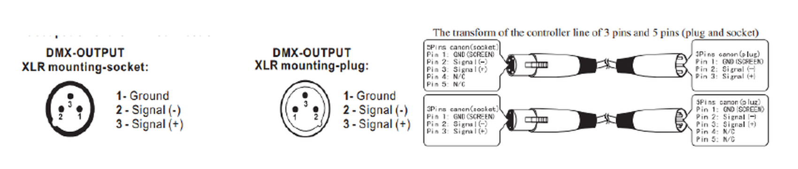
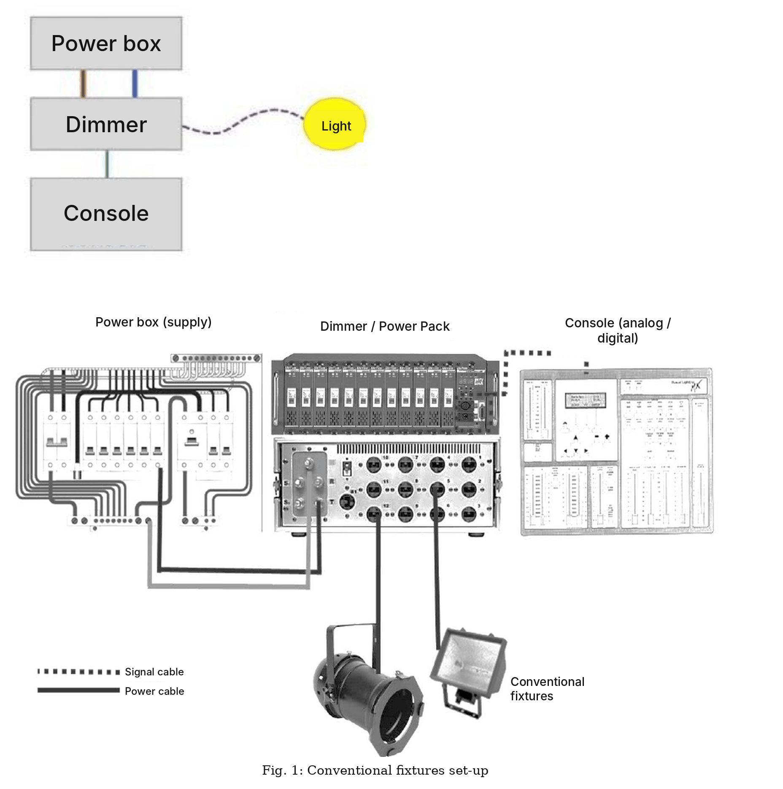
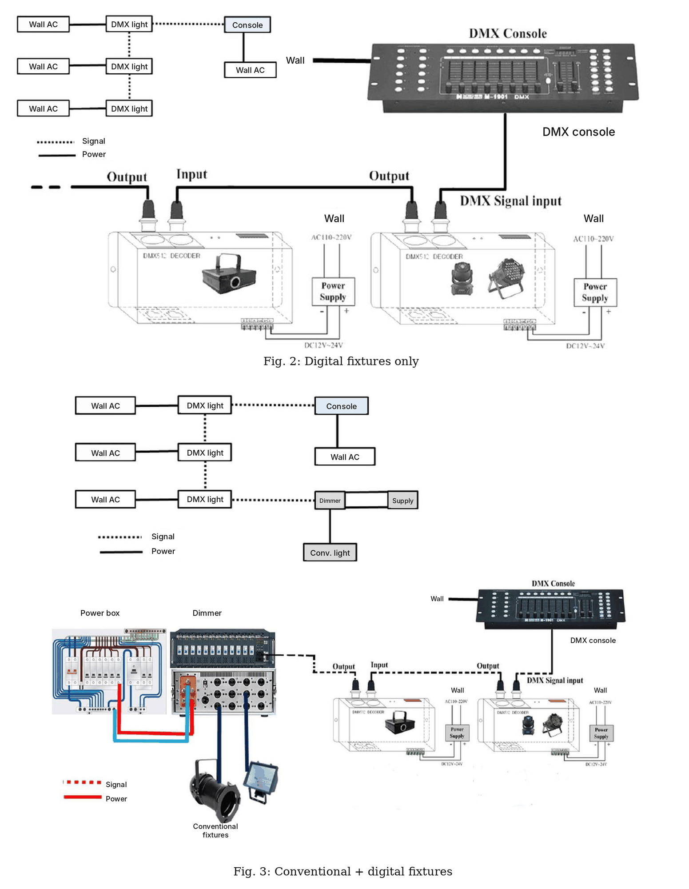

# Rigging Equipment & System Diagrams

When setting up lighting, know how much equipment you have and what it does, and plan the system with safety first.

## Equipment

### Breakers

| Type | How it works |
| --- | --- |
| **No-fuse breaker (NFB)** | Used in most power boxes. Trips automatically when the load exceeds what the box can supply |
| **Earth-leakage breaker** | The current leaving on the live must equal the current returning on the neutral; if they differ it trips |

<figure markdown="span">
  { loading=lazy width="296" }
  <figcaption>Original handout p.79</figcaption>
</figure>

### Cables

| Cable | Notes |
| --- | --- |
| Feeder (main power) cable | 38 mm²: carries 100 A; the smaller 22 mm²: 70 A. One red, one blue: live and neutral |
| Extension cables | Black: 15 A each; grey: 20 A (longer); used with Y splitters. Bundled multicable also exists |
| AC-BAR | The usual name for a multi-outlet strip. Check its current rating; the total load must not exceed it |
| Signal cables | Between console and dimmer: 5-pin–5-pin, 3-pin–5-pin, 25-pin–25-pin, depending on the units |
| Power Link | With only one live available, bridges the dimmer's V1, V2, V3 so all are powered. Rigid type for the Power Pack, flexible for the Dimmer |

<figure markdown="span">
  { loading=lazy width="850" }
  <figcaption>DMX 3-pin / 5-pin XLR pinout: 1 ground, 2 signal −, 3 signal + (original handout p.79)</figcaption>
</figure>

### Scaffolding

A scaffold set consists of **H frames, cross braces and planks**. Mainly for hanging fixtures; also for speakers or a cyc. Hang fixtures with C-clamps or similar; without them, secure firmly with wire. Details in Load-in & Strike Practice.

## System diagrams: three set-ups

1. Conventional (analog) fixtures only
2. Digital fixtures only
3. Conventional and digital together

<figure markdown="span">
  { loading=lazy width="928" }
  <figcaption>Fig. 1: conventional fixtures; power box → dimmer → lights, console → dimmer (original handout p.80)</figcaption>
</figure>

<figure markdown="span">
  { loading=lazy width="775" }
  <figcaption>Fig. 2: digital fixtures, the DMX console daisy-chained to each fixture, fixtures on wall power; Fig. 3: mixed (original handout p.81)</figcaption>
</figure>

|  | Conventional fixtures | Digital fixtures |
| --- | --- | --- |
| Power | Power box → dimmer / Power Pack → light | Ordinary mains (wall outlet / AC-BAR) |
| Control | The console signals the dimmer, which varies voltage/current to dim | The console (DMX) is daisy-chained to the fixtures and changes digital values to control functions |

## Digital vs analog

Sound and light in nature are waves, which can be stored in two ways:

- **Digital**: described by combinations of 0 and 1. Less prone to interference, and easier to give complex commands.
- **Analog**: the wave's values within a range are all recorded as voltages of varying strength.

Digital and analog signals can be converted into each other.

## DMX512 in brief

*(Supplement from the digital fixtures & digital consoles handout in the folder)*

- DMX (Digital Multiplex) 512 is the digital lighting-control protocol proposed by USITT, now used worldwide for digital fixtures and devices.
- Each channel is 8 bits, values **0–255** (256 levels).
- Fixtures and consoles are **daisy-chained** with 5-pin (or 3-pin) XLR cable; one line carries **512 addresses**.

| Term | Meaning |
| --- | --- |
| Chan. (Channel) | Channel |
| Addr. (Address) | Address |
| Patch | Assigning console channels to fixtures / dimmer circuits |
