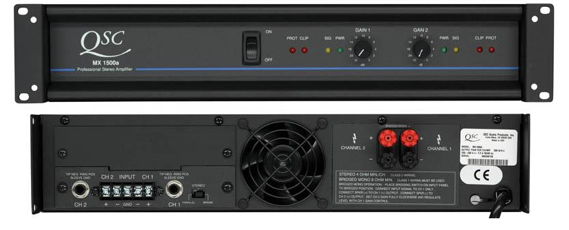
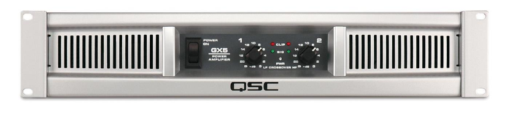
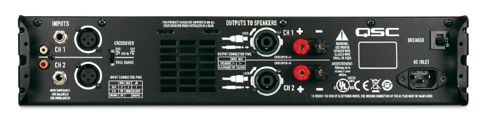
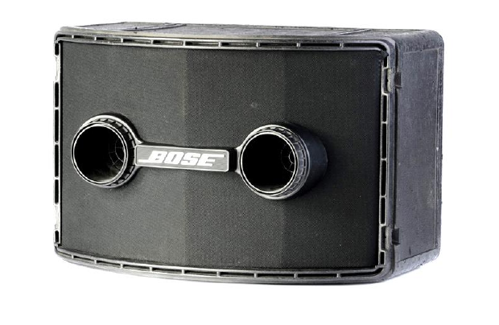
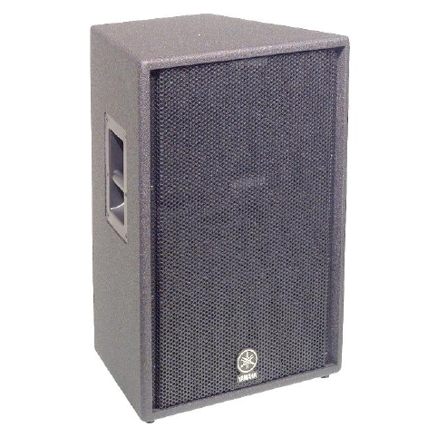

# Amplifiers & Speakers

After the mixer and processors, the signal goes to the amplifier and then the speakers. Professional amplifiers are many times more powerful than home hi-fi, so take care.

!!! warning "Caution"

    Once speakers are connected, **switch the amplifier off first** before plugging or unplugging anything or switching other devices. It is the last thing on and the first thing off.

## Amplifiers

| Model | Per channel @ 4 Ω | Per channel @ 8 Ω |
| --- | --- | --- |
| QSC MX-1500 | 500 W | 330 W |
| QSC GX5 (1 kHz) | 700 W | 500 W |
| CS-800X *(supplement)* | 420 W (2 Ω: 600 W) |  |

<figure markdown="span">
  { loading=lazy width="826" }
  <figcaption>QSC MX-1500 front and rear, original handout p.53</figcaption>
</figure>

<figure markdown="span">
  { loading=lazy width="826" }
  <figcaption>QSC GX5 front (original handout p.53)</figcaption>
</figure>

<figure markdown="span">
  { loading=lazy width="826" }
  <figcaption>Rear: QSC GX5, original handout p.53</figcaption>
</figure>

### CS-800X

*(Supplement from the Advanced PA II handout in the folder)*

Besides amplifying, it has a protective compression function (DDT) that engages automatically when the signal is too large. It has FULL RANGE, BRIDGE and BIAMPED modes; FULL RANGE covers ordinary events.

| Item | Description |
| --- | --- |
| DDT indicator | Lights when compression engages |
| Input knob | Same as GAIN |
| HIGH Z INPUTS | 1/4" inputs with Y-cord function |
| LOW Z INPUTS | Balanced XLR inputs |
| OUTPUTS | Amplified output to the speakers |
| MODE switch | Set to STEREO |
| DDT switch | DEFEAT turns compression off; ENABLE turns it on |

## Speakers

### Passive speakers

|  | Bose 802 II | Yamaha R112 |
| --- | --- | --- |
| Nominal impedance | 8 Ω | 8 Ω |
| Power | Recommended amplifier power 240 W (min) – 480 W (max) | Rated PGM 400 W, PEAK 800 W |
| Sensitivity | 91 dB SPL (1 W, 1 m) | 97 dB SPL (1 W, 1 m on axis) |
| Coverage | 120° horizontal, 100° vertical | 90° horizontal, 40° vertical |

<figure markdown="span">
  { loading=lazy width="620" }
  <figcaption>Bose 802 II, original handout p.54</figcaption>
</figure>

<figure markdown="span">
  { loading=lazy width="482" }
  <figcaption>Yamaha R112, original handout p.54</figcaption>
</figure>

- The Bose 802 II **must be used with the 802C controller** (see Signal Processors).
- The Bose 802 is a near-field speaker: however loud you run it, only the people in front of it hear it get noticeably louder. For a deep room or a big crowd, add speakers at the back instead of turning up.

### Active speakers

*(Supplement from the PA lecture handout in the folder)*

|  | JBL EON 615 |
| --- | --- |
| Rated power | 1000 W peak (700 LF + 300 HF); 500 W continuous (350 LF + 150 HF) |
| Coverage | 90° horizontal, 50° vertical |

## Matching power

- When the amplifier is more powerful than the speakers (e.g. 400 W into 300 W), full output can burn them → put a compressor/limiter in front.
- Two speakers for a 500-person event will always leave the far listeners unable to hear and the near ones deafened, and the system may be permanently damaged by overload. Plan the amount of equipment from the venue size and expected audience.
