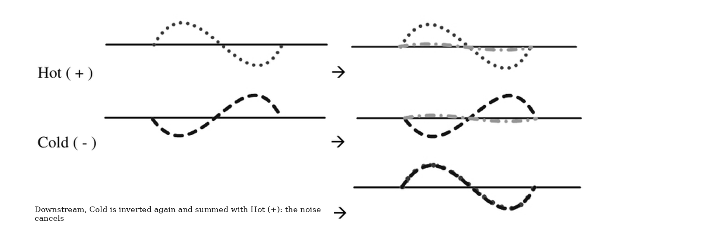
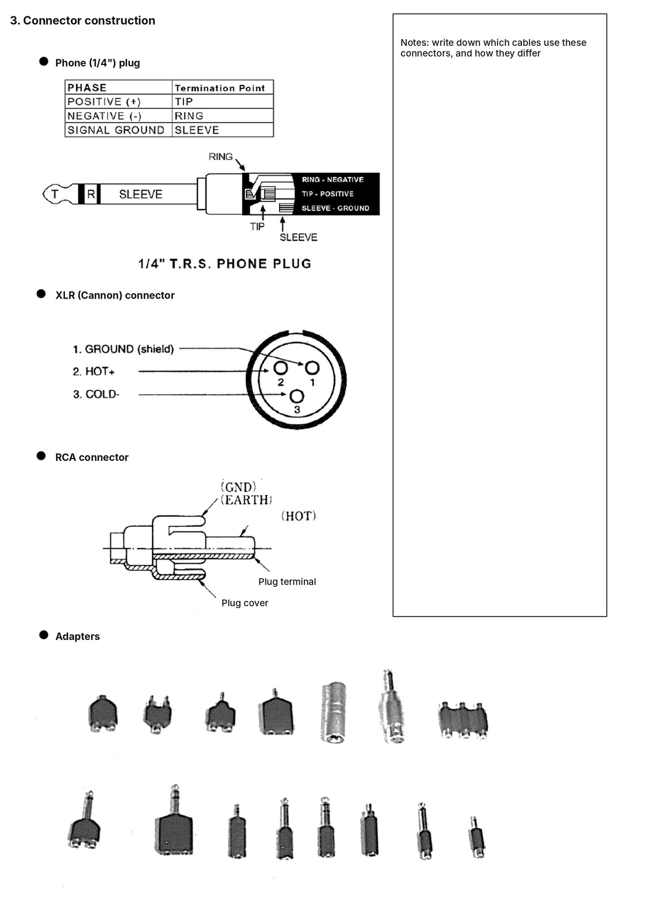
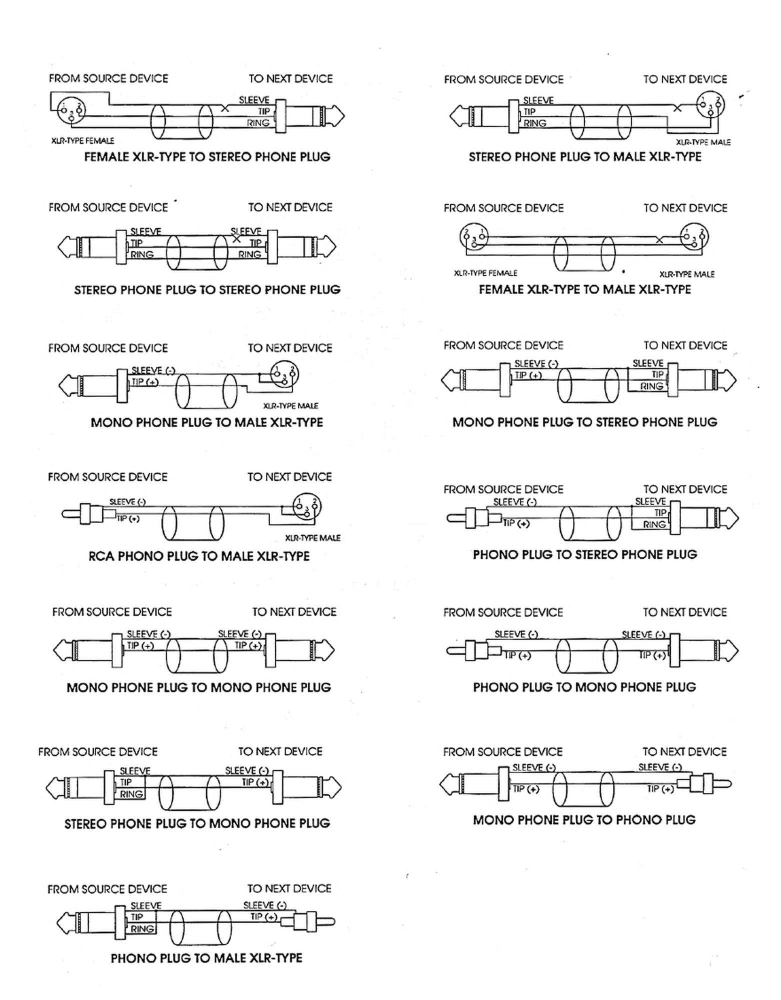
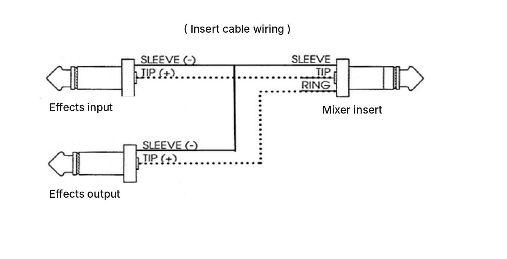
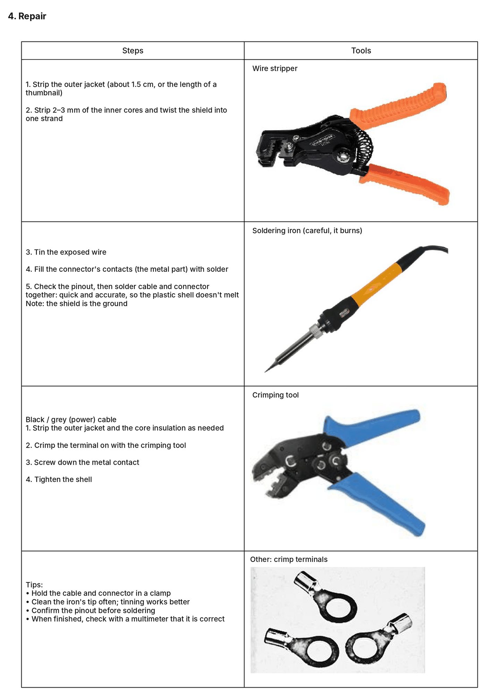

# Signal Cables & Connectors

## What signal cables do

Signal passes between devices over cables. A typical source is only a few millivolts, while a power amplifier needs about 0.7–1 V to work properly, so a preamp boosts it first; for a microphone the gain is about **100×**.

That gain amplifies noise along with the signal, so a good cable must both carry the signal faithfully and reject noise.

## Balanced and unbalanced

|  | Balanced | Unbalanced |
| --- | --- | --- |
| Construction | Two signal conductors inside a shield (three conductors) | One conductor plus the shield (two conductors) |
| Noise rejection | Interference is drained to ground through the shield; the signal is undisturbed | No shielding of the signal path; noise travels with the signal |

### How balancing cancels noise

The sender transmits the real signal **Hot (+)** and its inverted copy **Cold (−)**. Both pick up the same noise on the way. The receiver inverts Cold again and adds it to Hot: the signal doubles and the noise cancels.

<figure markdown="span">
  { loading=lazy width="964" }
  <figcaption>Hot / Cold and noise cancellation, original handout p.72</figcaption>
</figure>

### Rules and maximum lengths

- Use balanced cable (XLR) wherever possible.
- For unbalanced, high-impedance sources use a DI box to lower the impedance and balance the signal; keep the unbalanced part as short as possible.

| Cable | Maximum length |
| --- | --- |
| Low impedance, balanced | 80 m |
| Low impedance, unbalanced | 20 m |
| High impedance, unbalanced | 10 m |

Beyond these the signal attenuates and distorts.

## Connector construction

<figure markdown="span">
  { loading=lazy width="725" }
  <figcaption>1/4" jack, XLR and RCA construction and assorted adapters, original handout p.73</figcaption>
</figure>

| Connector | Pinout |
| --- | --- |
| **1/4" TRS ("Phone")** | Tip: positive (+); Ring: negative (−); Sleeve: ground. A mono TS plug has only Tip (+) and Sleeve (ground) |
| **XLR ("Canon")** | 1: ground (shield); 2: Hot (+); 3: Cold (−) → **1 ground, 2 hot, 3 cold** |
| **RCA** | Centre pin: signal (hot); outer ring: ground |

<figure markdown="span">
  { loading=lazy width="781" }
  <figcaption>wiring for XLR↔1/4", RCA↔XLR, mono↔stereo and more, original handout p.74</figcaption>
</figure>

*(Supplement from the load-in & cabling lecture notes)* The usual adapters are 1/4" and XLR, chosen by the jacks on the equipment; bring both so you have options when something goes wrong.

## Common cables

| Cable | Notes |
| --- | --- |
| Microphone cable (MIC IN) | Balanced XLR |
| Line cable (LINE IN) | 1/4" jack signal cable |
| Speaker cable / extension | Heavier gauge; uses XLR-style connectors for easy chaining but only two contacts (positive and ground) |
| Speaker link cable | For paralleling a second speaker |
| Insert cable | Y cable for external effects (see below) |
| Multicable | Many channels in one; an extension of the console |

### The braided shield

The tightly woven copper braid under the jacket is both the return conductor and the barrier against interference: RFI, AM radio, electromagnetic interference, electrostatic noise, transformers, dimmer noise and so on.

### DI box (Direct Injection Box)

One side is an unbalanced 1/4" input, the other a balanced XLR output. It converts high-impedance unbalanced signals (instruments, electric guitars, pickups) into low-impedance balanced ones, reducing noise and tone loss. Two uses:

1. Changing the nature of the signal
2. Extending the signal (balanced output allows long runs)

A simple home-made DI merely changes 1/4" to XLR (an adapter); watch the source level when plugging it into the mixer.

### Insert cable (for external effects)

A Y cable: one stereo plug splitting into two mono plugs, carrying send and return together.

- The stereo plug's **Tip** goes to one mono plug → to the **effect's input**
- The stereo plug's **Ring** goes to the other mono plug → from the **effect's output**, returning the signal to the mixer
- Both mono shields are soldered to the stereo plug's **Sleeve** (ground)
- The stereo plug goes into the mixer's Insert jack

<figure markdown="span">
  { loading=lazy width="620" }
  <figcaption>insert cable wiring, original handout p.76</figcaption>
</figure>

## Testing cables

*(Supplement from the load-in & cabling lecture notes)* Test every cable before a job: set the multimeter to continuity (buzzer), touch the probes to the matching contacts at each end; a tone means continuity. When soldering, the pinout must match at both ends or the signal will be scrambled. For multimeter use see Power Tie-in Safety & the Multimeter under Lighting System.

## Repair

<figure markdown="span">
  { loading=lazy width="717" }
  <figcaption>wire stripper, soldering iron, crimper, crimp terminals, original handout p.75</figcaption>
</figure>

### Signal cable (soldering)

| Step | Tool |
| --- | --- |
| 1. Strip the outer jacket (about 1.5 cm, or a thumbnail's length) | Wire stripper |
| 2. Strip the inner cores 2–3 mm; twist the shield into one strand | Wire stripper |
| 3. Tin the exposed wire | Soldering iron (mind burns) |
| 4. Fill the connector's contacts with solder | Soldering iron |
| 5. Check the pinout and solder wire to connector; be quick and accurate so the plastic doesn't melt. **The shield is ground** | Soldering iron |

### Black / grey power cable (crimping)

1. Strip the outer jacket and inner insulation as needed
2. Fit crimp terminals with the crimper
3. Screw onto the metal contacts
4. Tighten the housing

### Tips

- Hold cable and connector in a clamp
- Clean the iron tip often; it tins better
- Check the pinout before soldering
- Check the result with a multimeter
