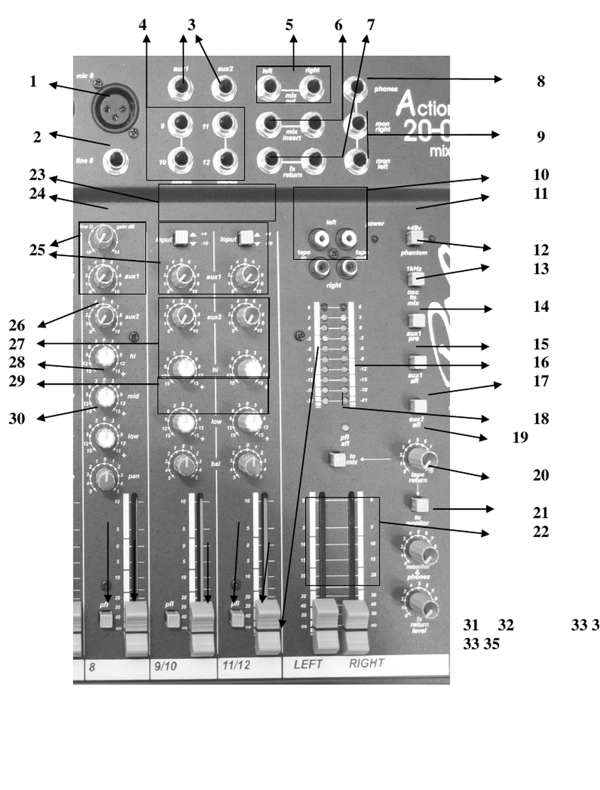
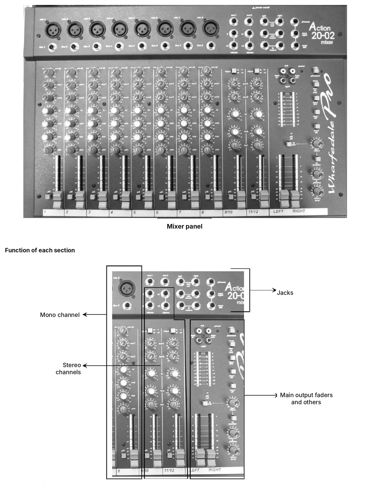

# Action 20-02

<figure markdown="span">
  { loading=lazy width="759" }
  <figcaption>panel with numbering (original handout p.46)</figcaption>
</figure>

<figure markdown="span">
  { loading=lazy width="744" }
  <figcaption>panel photo and sections: mono channels / stereo channels / jacks / main faders and others (original handout p.48)</figcaption>
</figure>

## Jacks

| # | Name | Function |
| --- | --- | --- |
| 1 | Balanced XLR mic input | Mono channel XLR input |
| 2 | Balanced line level input | Mono channel 1/4" input |
| 3 | Aux 1 & 2 sends | Aux 1 and 2 outputs (1/4") |
| 4 | Stereo balanced line input | Stereo channel 1/4" input |
| 5 | Main balanced outputs | Main left/right outputs (1/4") |
| 6 | Insert stereo for main mix output | Insert point on the main output |
| 7 | FX returns | Return from an external effect |
| 8 | Headphones output | Monitoring headphones |
| 9 | Monitor outputs | Monitor speakers |
| 10 | RCA phono inputs and outputs | External stereo source in, or out to a recorder |

## Switches and master

| # | Name | Function |
| --- | --- | --- |
| 11 | Phantom power | 48V for condenser mics on XLR |
| 12 | 1kHz to main mix outputs | Sends a 1 kHz tone to the main output |
| 13 | Aux 1 pre/post fader | Aux 1 pre or post fader |
| 14 | Aux 1 AFL | After-fader listen on Aux 1 |
| 15 | Aux 2 AFL | After-fader listen on Aux 2 |
| 16 | PFL / AFL LED | Monitoring indicator |
| 17 | Tape return level | Level of the RCA phono input |
| 18 | Tape return to main mix | Sends tape return to the main output |
| 19 | Tape return to monitor | Sends tape return to the monitor |
| 20 | Level control for monitors and headphone | Monitoring level |
| 21 | Effects return level | FX return level |
| 22 | Main mix faders | Main output faders |

## Channel controls

| # | Name | Function |
| --- | --- | --- |
| 23 | Input level (+4 dB / −10 dB) switch | High / low impedance input selection |
| 24 | Input level | Input level |
| 25 | Aux 1 & 2 level | Channel level to Aux 1 and 2 |
| 26 | High EQ (10 kHz) | Highs |
| 27 | Mid EQ (1 kHz) | Mids |
| 28 | Low EQ (100 Hz) | Lows |
| 29 | Balance (stereo channels) | Stereo channel left/right balance |
| 30 | Pan (individual channels) | Mono channel left/right balance |
| 31 | PFL (individual channels) | Pre-fader listen, mono channels |
| 32 | Individual channel fader | Mono channel fader |
| 33 | Stereo channel fader | Stereo channel fader |
| 34 | PFL (stereo channels) | Pre-fader listen, stereo channels |
| 35 | LEDs for all outputs level | Output level LEDs |
