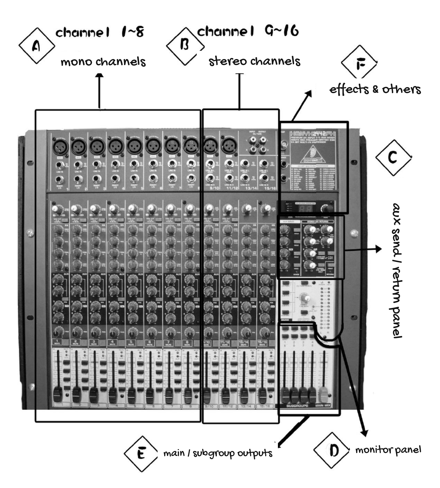
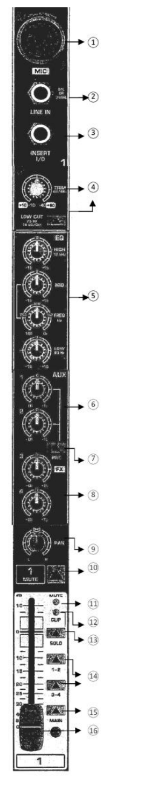
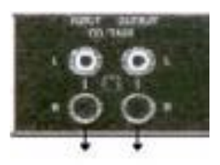
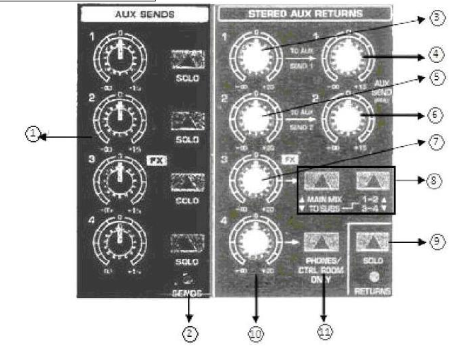
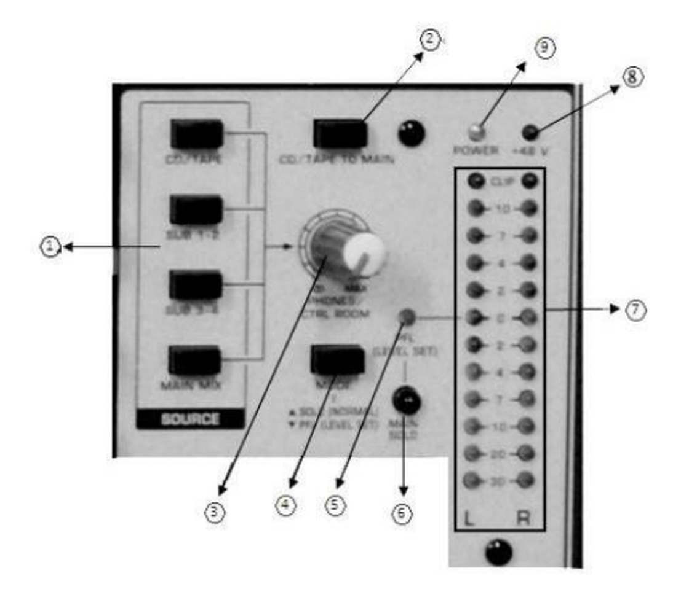
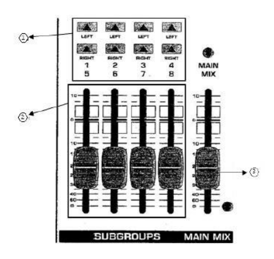
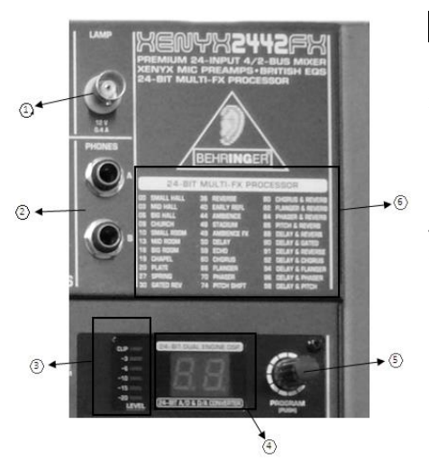
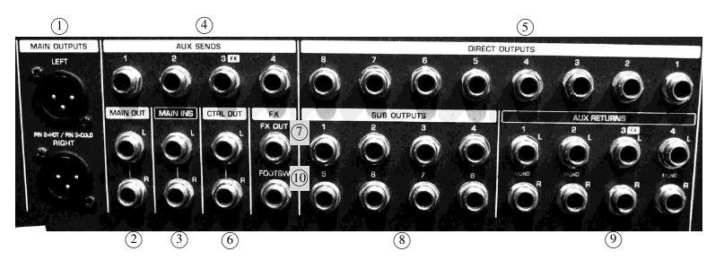

# BX-2442 (Behringer)

<figure markdown="span">
  { loading=lazy width="832" }
  <figcaption>Panel sections A–F (original handout p.12)</figcaption>
</figure>

| Section | Contents |
| --- | --- |
| A | Mono channels 1–8 |
| B | Stereo channels 9–16 |
| C | Aux send/return control panel |
| D | Monitor panel |
| E | Main and subgroup output panel |
| F | Effects and miscellaneous |
| G | Rear inputs and outputs |

## Things to watch

!!! warning "Caution"

    1. There are two MAIN outputs: XLR and 1/4".
    2. Ch.1–8 are mono; Ch.9–16 (really 4 channels) are stereo and can also be used mono (plug into LINE IN L / MONO).
    3. The TRIM on the stereo channels is a **MIC TRIM**; it does not affect LINE IN.
    4. The monitor PHONES output has two jacks, A and B; mono or stereo is set by MODE on the monitor panel. CTRL OUT has L and R and is stereo.
    5. When routing to SUB1-2 / SUB3-4, the left channel goes to 1 and 3, the right to 2 and 4.
    6. If AUX SEND 1 or 2 feeds an external effect, avoid returning through AUX RETURN 1 or 2, to prevent feedback.
    7. The built-in effect is on **AUX 3**.
    8. The AUXes are post-fader by design; AUX 1 and 2 can be switched to pre-fader.
    9. Mute a channel before plugging or unplugging it.
    10. Remember to assign the signal; the fader alone sends nothing.

    **Bring levels up in reverse!**

## A | Mono channels 1–8

<figure markdown="span">
  { loading=lazy width="253" }
  <figcaption>Original handout p.13</figcaption>
</figure>

| # | Name | Function |
| --- | --- | --- |
| 1 | XLR | Normally the microphone input |
| 2 | Line in | Balanced or unbalanced 1/4" input |
| 3 | Insert | Balanced 1/4" only; send and return together |
| 4 | TRIM | Input level |
|  | Low cut | Reduces signal below 75 Hz by 18 dB |
| 5 | EQ | HIGH: above 12 kHz; LOW: below 80 Hz; MID: level at the frequency set by FREQ; FREQ: MID centre frequency (100 Hz–8 kHz), acting over one octave around it. Clockwise boosts, anticlockwise cuts |
| 6 | AUX 1 & 2 | Aux sends 1 and 2 |
| 7 | PRE | Makes AUX 1 and 2 pre-fader |
| 8 | AUX 3 & 4 | Aux sends 3 and 4; AUX 3 feeds the built-in effect. Not affected by PRE |
| 9 | PAN | Left/right balance; fully clockwise is all right |
| 10 | MUTE | Mutes the channel. With PRE (7) pressed, AUX 1 and 2 (6) are not muted |
| 11 | MUTE LED | Lit when the channel is muted |
| 12 | CLIP LED | Flashes when the signal is too large; stays lit when SOLO is pressed |
| 13 | SOLO | Sends the channel to the monitor system ahead of PAN and fader |
| 14 | 1-2 / 3-4 | 1-2: left to SUB1(5), right to SUB2(6); 3-4: left to SUB3(7), right to SUB4(8) |
| 15 | MAIN | Sends the signal to MAIN MIX |
| 16 | FADER | Channel output level |

### CD / Tape

<figure markdown="span">
  { loading=lazy width="271" }
  <figcaption>Original handout p.14</figcaption>
</figure>

- INPUT: RCA inputs, left on top, right below
- OUTPUT: RCA outputs, left on top, right below

## C | Aux send/return control panel

<figure markdown="span">
  { loading=lazy width="663" }
  <figcaption>Original handout p.14</figcaption>
</figure>

| # | Name | Function |
| --- | --- | --- |
| 1 | AUX SENDS knobs / SOLO | Knobs set AUX 1–4 level to the AUX SEND jacks; SOLO sends that aux to the monitor |
| 2 | SOLO SEND LED | Lit when a SOLO is pressed |
| 3 | AUX RETURN 1 | Level of AUX RETURN 1 to MAIN MIX |
| 4 | AUX SEND 1 (pre) | Level of AUX RETURN 1 to AUX SEND 1 |
| 5 | AUX RETURN 2 | Level of AUX RETURN 2 to MAIN MIX |
| 6 | AUX SEND 2 (pre) | Level of AUX RETURN 2 to AUX SEND 2 |
| 7 | AUX RETURN 3 | Level of AUX RETURN 3 to the destination chosen at 8 |
| 8 | Assign buttons | Left: up → MAIN; down → SUB. Right: up → SUB1-2; down → SUB3-4 |
| 9 | SOLO RETURN | Sends all AUX RETURNs to the monitor; RETURN LED lights |
| 10 | AUX RETURN 4 | Level of AUX RETURN 4 to the monitor system |
| 11 | PHONES/CTRL ROOM ONLY | Pressed, sends AUX RETURN 4 to the monitor system |

## D | Monitor panel

<figure markdown="span">
  { loading=lazy width="560" }
  <figcaption>Original handout p.15</figcaption>
</figure>

| # | Name | Function |
| --- | --- | --- |
| 1 | SOURCE | Chooses what feeds the monitor (e.g. MAIN MIX) |
| 2 | CD/TAPE TO MAIN | Sends the CD/Tape input to MAIN MIX |
| 3 | PHONE/CTRL ROOM | Level of the PHONES jacks and CTRL OUT |
| 4 | MODE | **Down**: soloed channels go to the monitor in mono, PFL — normally used to set a channel's level to 0 dB; only the left meter works. **Up**: stereo, post-fader; both meters work |
| 5 | PFL LED | Lit when MODE is down |
| 6 | MAIN SOLO | Lit when MODE is up |
| 7 | LEVEL METER | Signal level; CLIP means too large |
| 8 | +48V LED | Lit when the rear +48V switch is on. For condenser mics; **don't plug or unplug once it is on** |
| 9 | POWER LED | Power on |

## E | Main and subgroup outputs

<figure markdown="span">
  { loading=lazy width="452" }
  <figcaption>Original handout p.15</figcaption>
</figure>

| # | Name | Function |
| --- | --- | --- |
| 1 | LEFT & RIGHT | LEFT sends that subgroup to MAIN MIX left; RIGHT to the right |
| 2 | SUBGROUPS | Subgroup level |
| 3 | MAIN MIX | Main output level |

## F | Effects and miscellaneous

<figure markdown="span">
  { loading=lazy width="476" }
  <figcaption>Original handout p.16</figcaption>
</figure>

| # | Name | Function |
| --- | --- | --- |
| 1 | LAMP | Socket for a console lamp |
| 2 | PHONE | Headphone outputs, two (same signal) |
| 3 | LEVEL | Level into the built-in effect |
| 4 | Display | Shows the selected effect |
| 5 | PROGRAM | Turn to choose (display flashes), press to confirm; the steady number is the selected effect |

## G | Rear inputs and outputs

<figure markdown="span">
  { loading=lazy width="807" }
  <figcaption>Original handout p.16</figcaption>
</figure>

| # | Name | Function |
| --- | --- | --- |
| 1 | MAIN OUTPUT | MAIN MIX out, XLR |
| 2 | MAIN OUT | MAIN MIX out, 1/4" |
| 3 | MAIN INSERT | Insert point on the main output |
| 4 | AUX SEND | Aux outputs |
| 5 | DIRECT OUTPUT | Direct outputs of Ch.1–8 |
| 6 | CONTROL OUT | Control-room signal, for monitoring |
| 7 | FX OUT | Dedicated effects output |
| 8 | SUB OUTPUT | Subgroup outputs (1–4 and 5–8 carry matching signals) |
| 9 | AUX RETURN | Aux inputs |
| 10 | FX FOOTSW | Footswitch for effect on/off |

## Operating notes

*(Supplement from the BX lecture script in the folder)*

- MIC IN (XLR) is lower impedance; LINE IN (1/4") is higher.
- **Don't use the INSERT jack as a LINE IN.**
- On stereo channels the two 1/4" jacks are LINE IN L on top (marked MONO; use it for a mono source) and LINE IN R below.
- TRIM can raise or lower the level; on some consoles it is called GAIN and mainly raises.
- MAIN OUTPUT is on both XLR and 1/4"; normally use one.
