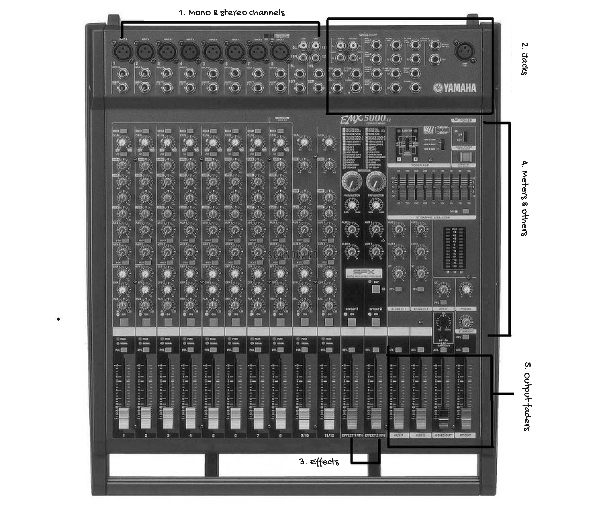
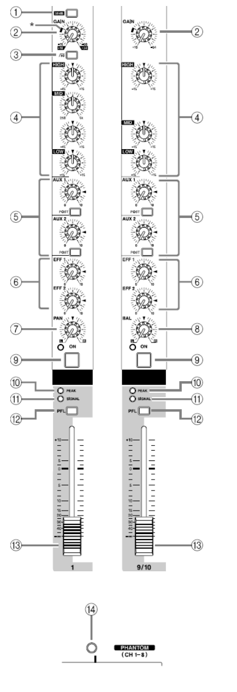
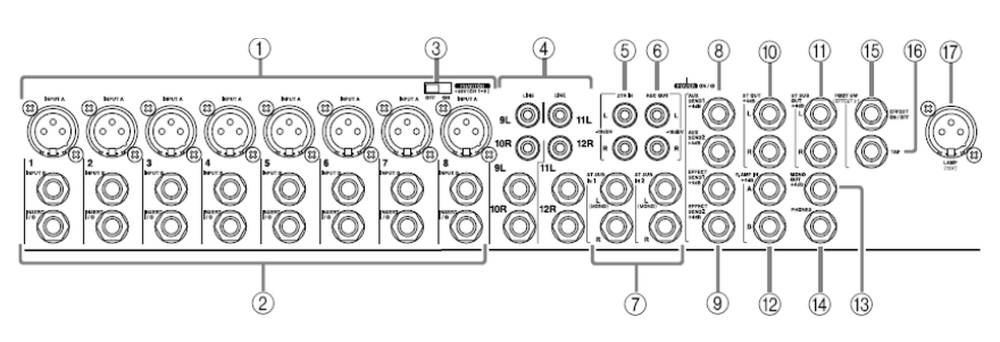
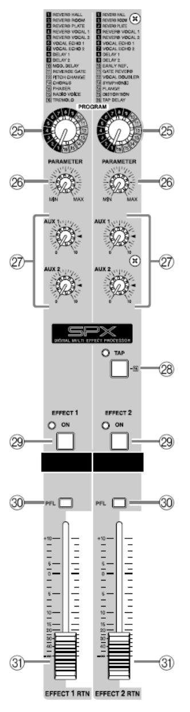
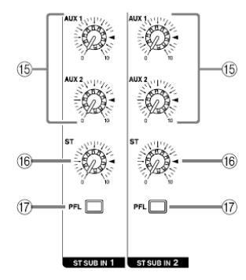
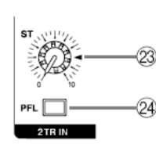
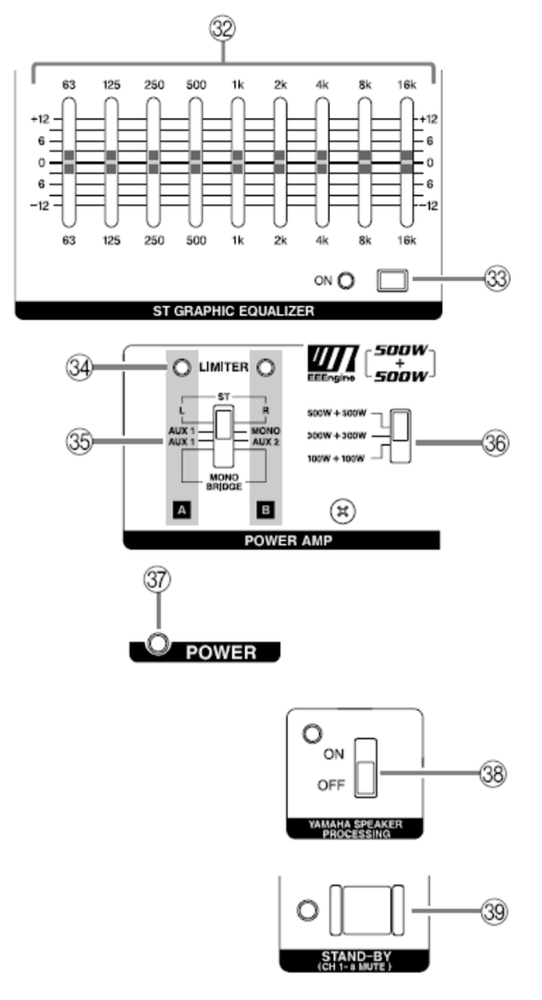
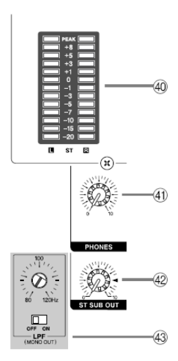
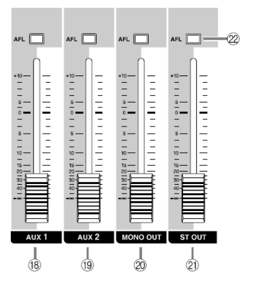
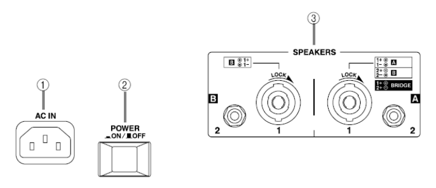

# EMX 5000-12 (Yamaha)

A powered mixer (built-in amplifier).

<figure markdown="span">
  { loading=lazy width="892" }
  <figcaption>Panel sections (original handout p.18)</figcaption>
</figure>

## Precautions

!!! warning "Caution"

    1. On a mono channel use either INPUT A (XLR) or INPUT B (1/4"), not both.
    2. The INSERT jack takes a balanced 1/4" plug only.
    3. When connecting a microphone by XLR, check whether PHANTOM is on.
    4. To send a mono channel to the main output, press its **ON switch**.
    5. For anything other than a microphone, press the **26 dB pad** to avoid an oversized signal.
    6. When PEAK lights, reduce the input to protect the unit.
    7. When using the built-in amplifier, connect speakers directly; don't feed it on into a PA system, or the excessive signal will damage equipment.
    8. With the built-in amp in MONO BRIDGE, use only the special speaker connector of group A and no other speaker jack.
    9. Using the P.AMP IN jack turns the whole unit into a plain amplifier; all mixer functions stop working.

## 1. Mono and stereo channels

<figure markdown="span">
  { loading=lazy width="434" }
  <figcaption>Original handout p.19</figcaption>
</figure>

| # | Name | Function |
| --- | --- | --- |
| 1 | 26dB pad switch | Reduces the input by 26 dB |
| 2 | GAIN | Input level |
| 3 | /80 (high-pass filter) | Cuts below 80 Hz by 18 dB to remove noise |
| 4 | Equalizer | Shapes the input tone |
| 5 | AUX 1, AUX 2 / POST switch | Aux sends, switchable PRE/POST |
| 6 | EFF 1, 2 (EFFECT) | Send to the built-in effects or EFFECT SEND |
| 7 | PAN | Ch.1–8, left/right balance |
| 8 | BAL | Ch.9/10, 11/12, left/right balance |
| 9 | ON switch / indicator | Whether the signal goes to the main output |
| 10 | PEAK | Input overload indicator |
| 11 | SIGNAL | Signal-present indicator |
| 12 | PFL | Sends the signal pre-fader to the monitor |
| 13 | Channel fader | Channel level |
| 14 | PHANTOM indicator | Shows 48V on the XLR inputs |

## 2. Jacks

<figure markdown="span">
  { loading=lazy width="880" }
  <figcaption>Original handout p.20</figcaption>
</figure>

| # | Name | Function |
| --- | --- | --- |
| 1 | Channel input (INPUT A, B) | Source inputs, XLR and 1/4" |
| 2 | INSERT I/O | 1/4" insert (input/output) |
| 3 | PHANTOM switch | +48V for condenser microphones |
| 4 | LINE (stereo) input | Stereo source inputs, RCA and 1/4" |
| 5 | 2TR IN | RCA, extra source input |
| 6 | REC OUT | RCA, main output to a recorder |
| 7 | ST SUB IN 1, 2 | 1/4", for a chained mixer or effects; can go to AUX 1/2 or the main output |
| 8 | AUX SEND 1, 2 | 1/4", AUX 1/2 outputs |
| 9 | EFFECT SEND 1, 2 | 1/4", each channel's EFF 1/2 send |
| 10 | ST OUT | 1/4", main output (after the ST fader) |
| 11 | ST SUB OUT | 1/4", main output to another mixer or PA |
| 12 | P.AMP IN A, B | 1/4", straight into the built-in power amp; **mixer functions are disabled when used** |
| 13 | MONO OUT | Main output via the MONO OUT fader |
| 14 | PHONES | Monitor output |
| 15 | FOOT SW EFFECT 2 ON/OFF | For a Yamaha FC5 footswitch |
| 16 | FOOT SW (EFFECT 2) TAP | For an FC5 when using the built-in TAP DELAY |
| 17 | LAMP | Work-lamp power |

## 3. Effects

<figure markdown="span">
  { loading=lazy width="332" }
  <figcaption>Original handout p.21</figcaption>
</figure>

| # | Name | Function |
| --- | --- | --- |
| 25 | PROGRAM selector | Selects the built-in digital effect type |
| 26 | PARAMETER | Effect time parameter / amount |
| 27 | AUX 1/2 | Level of the processed signal to AUX 1/2 |
| 28 | TAP switch | Used only with the TAP DELAY effect |
| 29 | EFFECT 1/2 ON | Built-in effect on/off |
| 30 | PFL | Sends to PHONES for monitoring |
| 31 | EFFECT 1/2 RTN fader | Effect level to the main output |

## 4. Meters and other controls

<figure markdown="span">
  { loading=lazy width="313" }
  <figcaption>Stereo sub input (original handout p.21)</figcaption>
</figure>

<figure markdown="span">
  { loading=lazy width="199" }
  <figcaption>2TR IN (original handout p.21)</figcaption>
</figure>

<figure markdown="span">
  { loading=lazy width="518" }
  <figcaption>ST graphic equalizer and power amp (original handout p.22)</figcaption>
</figure>

<figure markdown="span">
  { loading=lazy width="259" }
  <figcaption>Meters (original handout p.22)</figcaption>
</figure>

| # | Name | Function |
| --- | --- | --- |
|  | **Stereo sub input** |  |
| 15 | AUX 1, 2 | Aux sends for ST SUB IN 1, 2 |
| 16 | ST | Level of ST SUB IN 1, 2 to the main output |
| 17 | PFL | Independent of 16; sends to PHONES |
|  | **2TR IN** |  |
| 23 | ST | Level of 2TR IN to the main output |
| 24 | PFL | Sends to PHONES |
|  | **ST graphic equalizer** |  |
| 32 | Graphic equalizer | Graphic EQ on ST OUT |
| 33 | ON | ST OUT EQ switch |
|  | **Power amp** |  |
| 34 | LIMITER indicator | Power-amp overload indicator |
| 35 | Power amp select | Power-amp mode selector |
| 36 | Maximum output select | Maximum output power selector |
| 37 | POWER indicator | Power indicator |
| 38 | YAMAHA SPEAKER PROCESSING | Turn on when driving Yamaha speakers from the power amp, to improve tone |
| 39 | STAND BY | Mutes Ch.1–8; 9–12 stay active |
| 40 | Peak level indicator | Main output level |
| 41 | PHONES | Monitor level |
| 42 | ST SUB OUT | Level of the main output to ST SUB OUT |
| 43 | LPF / ON-OFF | Sends only signal below a set frequency to MONO OUT, for electronic crossover use |

## 5. Main output faders

<figure markdown="span">
  { loading=lazy width="422" }
  <figcaption>Original handout p.23</figcaption>
</figure>

| # | Name | Function |
| --- | --- | --- |
| 18 | AUX 1 fader | AUX 1 level to AUX SEND 1 |
| 19 | AUX 2 fader | AUX 2 level to AUX SEND 2 |
| 20 | MONO OUT fader | Main output level to MONO OUT |
| 21 | ST OUT fader | Main output level |
| 22 | AFL | Sends the output after its fader to PHONES |

## 6. Rear panel

<figure markdown="span">
  { loading=lazy width="711" }
  <figcaption>Original handout p.23</figcaption>
</figure>

1. AC inlet
2. POWER switch
3. SPEAKERS: speaker outputs, groups A and B; each has a 1/4" jack and a special speaker connector — use one or the other
