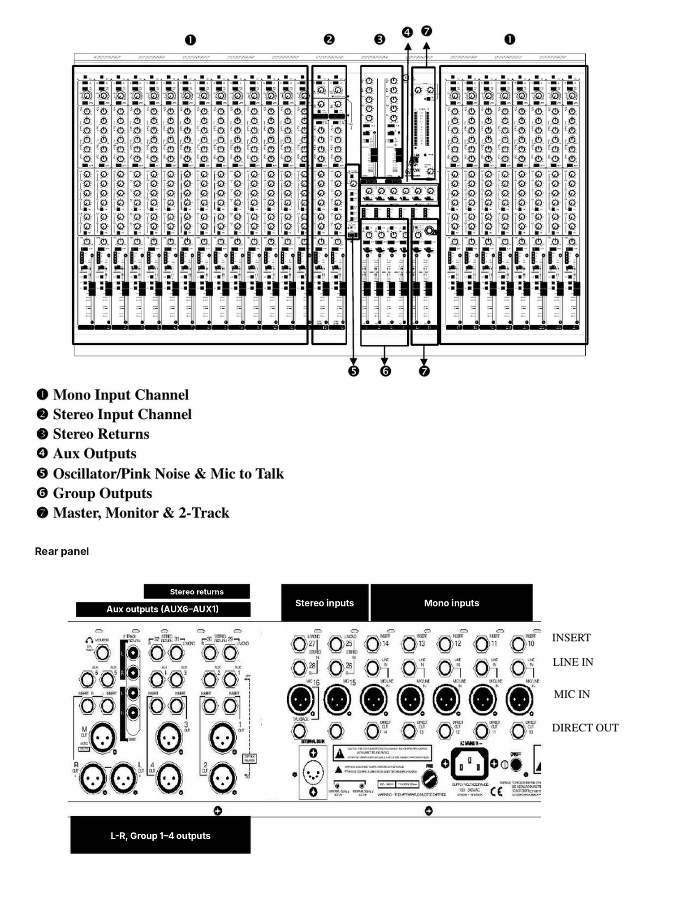
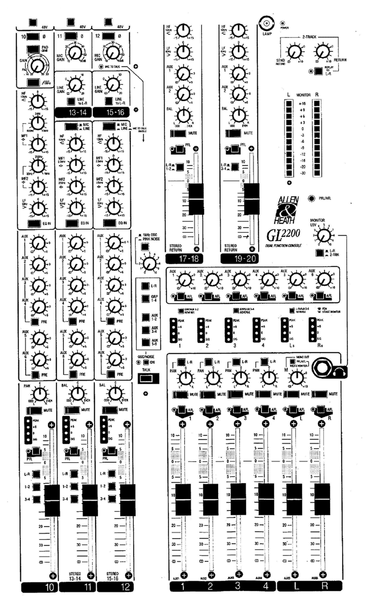
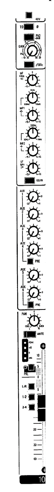
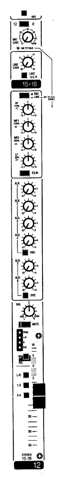
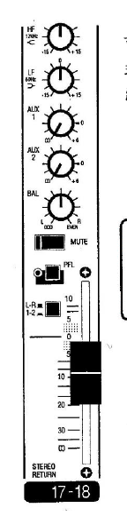
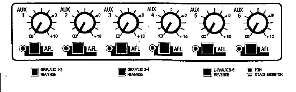
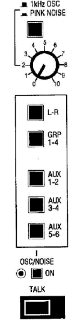
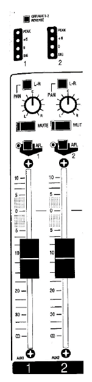
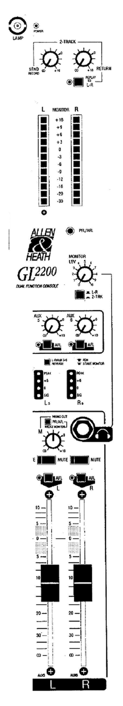
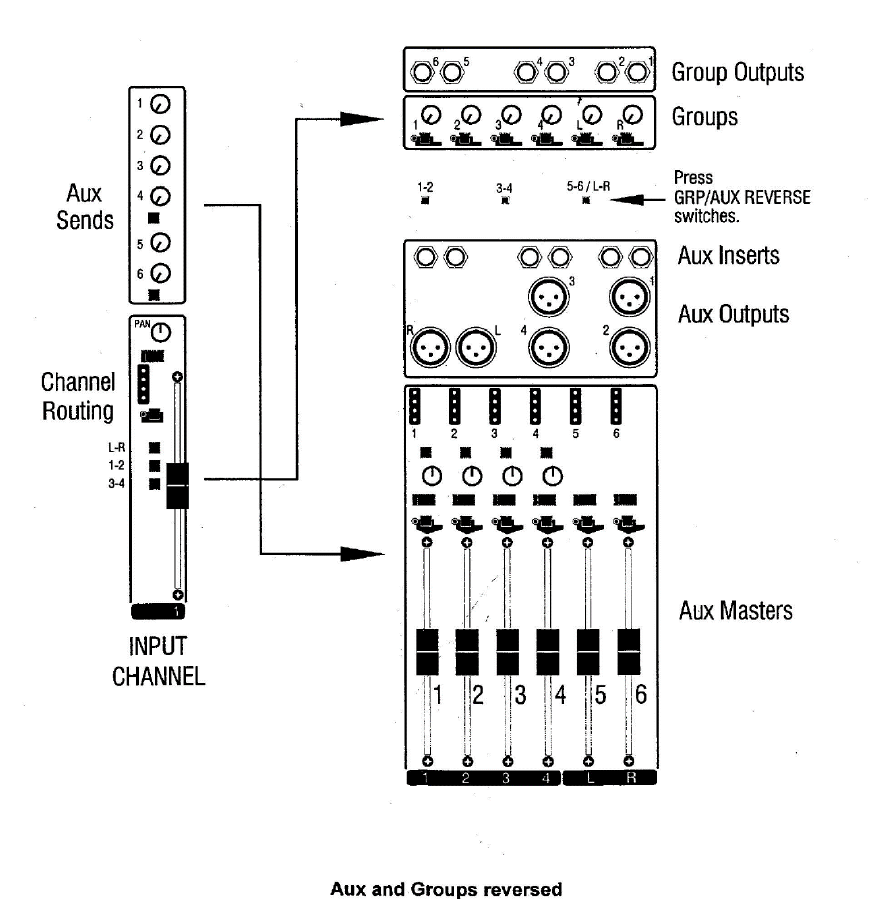

# GL2200-432 (Allen & Heath)

A large installed console.

<figure markdown="span">
  { loading=lazy width="751" }
  <figcaption>Front sections and rear panel (original handout p.24)</figcaption>
</figure>

<figure markdown="span">
  { loading=lazy width="620" }
  <figcaption>Block layout (original handout p.25)</figcaption>
</figure>

| Section | Contents |
| --- | --- |
| ❶ | Mono Input Channel |
| ❷ | Stereo Input Channel |
| ❸ | Stereo Returns |
| ❹ | Aux Outputs |
| ❺ | Oscillator / Pink Noise & Mic to Talk |
| ❻ | Group Outputs (Groups 1–4) |
| ❼ | Master, Monitor & 2-Track |

Rear panel: stereo returns, aux outputs (AUX 6–AUX 1), stereo inputs, mono inputs (INSERT / LINE IN / MIC IN / DIRECT OUT), L-R and Group 1–4 outputs.

## ❶ Mono Input Channel

<figure markdown="span">
  { loading=lazy width="139" }
  <figcaption>Original handout p.26</figcaption>
</figure>

| Name | Function |
| --- | --- |
| 48V | Phantom power. Press for condenser mics; leave off for ordinary dynamic mics |
| Φ | Polarity reverse. Corrects phase problems from mic placement and can reduce feedback |
| PAD (LINE) | High impedance (down) or low (up). Normally press for a 1/4" input; little effect on an XLR input |
| GAIN | Input level |
| 100Hz | Low cut, 15 dB below 100 Hz, removing low-frequency noise; independent of the EQ |
| EQ | HF and LF are fixed-frequency; MF1 and MF2 are parametric |
| EQ IN | The EQ is in circuit only when pressed |
| AUX SENDS | To monitors or effects. PRE buttons set Aux 1–4 and Aux 5–6 pre- or post-fader (pre: unaffected by the fader, still affected by MUTE) |
| PAN | Left/right balance |
| MUTE | Channel switch, red when pressed; doesn't affect monitoring |
| 4-LED channel meter | Green −20 dB, yellow normal, red (peak) too much |
| PFL | Hear the pre-fader signal on headphones; unaffected by MUTE |
| L-R, 1-2, 3-4 | Route to the main L-R and/or Groups 1–4, independently |
| FADER | Controls all post-fader output |

!!! info "Note"

    The installation recorded in the handout: L-R → 2 main speakers; Group 1-2 → 8 fill speakers; Group 3 → control-room speaker; Group 4 → stage monitors.

## ❷ Stereo Input Channel

<figure markdown="span">
  { loading=lazy width="159" }
  <figcaption>Original handout p.27</figcaption>
</figure>

Differences from the mono channel:

- Two rear line-in jacks, for left and right.
- GAIN is split into **MIC GAIN** and **LINE GAIN**: XLR input uses MIC GAIN; 1/4" input uses LINE GAIN.
- **LINE TO L-R**: sends the 1/4" input straight to L-R, independent of the button by the fader; when using it, set the lower button to LINE.
- **BALANCE**: left/right balance.
- Otherwise the same as the mono channel.

## ❸ Stereo Returns

<figure markdown="span">
  { loading=lazy width="144" }
  <figcaption>Original handout p.27</figcaption>
</figure>

A simplified stereo input: two EQ bands, two aux sends (Aux 1, Aux 2), and output only to L-R or 1-2 (/3-4).

## ❹ Aux Outputs

<figure markdown="span">
  { loading=lazy width="579" }
  <figcaption>Original handout p.27</figcaption>
</figure>

- Master outputs for AUX 1–6; nothing leaves until they are turned up.
- **AFL**: monitoring, following the knob above and the Mute key.
- **GROUP1-2 REVERSE**: see Mode Switching below.

## ❺ Oscillator / Pink Noise & Mic to Talk

<figure markdown="span">
  { loading=lazy width="133" }
  <figcaption>Original handout p.28</figcaption>
</figure>

| Name | Function |
| --- | --- |
| 1kHz OSC / PINK NOISE | Up: 1 kHz tone; down: pink noise; the knob sets level |
| L-R, GRP1-4 … AUX5-6 | Where the tone/noise and Mic to Talk go: L-R, GRP1-4, AUX1-2, AUX3-4, AUX5-6, independently |
| OSC/NOISE | Tone/noise on-off |
| TALK | For when Ch.16 needs both a 1/4" and an XLR input: set Ch.16's switch to LINE (enabling Mic to Talk), then press TALK; the channel's XLR signal goes to the destinations selected above |

## ❻ Group Outputs (Groups 1–4)

<figure markdown="span">
  { loading=lazy width="151" }
  <figcaption>Original handout p.28</figcaption>
</figure>

| Name | Function |
| --- | --- |
| 4-LED meter | Signal status; red (peak) is too much |
| L-R | Sends this group to the main L-R |
| PAN | Left/right balance into L-R |
| MUTE | Group switch |
| AFL | Monitoring; follows the fader, unaffected by Mute |

## ❼ Master, Monitor & 2-Track

<figure markdown="span">
  { loading=lazy width="174" }
  <figcaption>Original handout p.29</figcaption>
</figure>

| Name | Function |
| --- | --- |
| LAMP | 12V for a small lamp |
| 2-TRACK SEND | RCA output with level knob; carries L-R, usable for recording, unaffected by the L-R fader |
| 2-TRACK RETURN | RCA input with level knob; button below: down to L-R, up to Monitor |
| L-R LED METER | Main L-R level; red PEAK is too much |
| MONITOR LEV | Headphone level; button below: down monitors 2-Track, up monitors L-R. A channel PFL takes priority |
| Headphone jack |  |
| MONO OUT / AFL-PFL switch and knob | The XLR output is on the rear; switchable between main L-R and the AFL/PFL mix; usable for monitoring or as an auxiliary output |
| MUTE | L-R switch; red when pressed = off |
| AFL | Monitoring; follows the fader, unaffected by Mute |
| FADER | Main output level |

## Mode Switching (Aux and Groups reversed)

<figure markdown="span">
  { loading=lazy width="886" }
  <figcaption>Aux and Groups reversed (original handout p.30)</figcaption>
</figure>

Pressing the GRP/AUX REVERSE switches swaps the master controls of Groups and Auxes: the Aux sends are then controlled by the group faders (Aux Masters) and gain the inserts, while the groups move to the rotary controls. Useful when you want faders on several monitor mixes.
