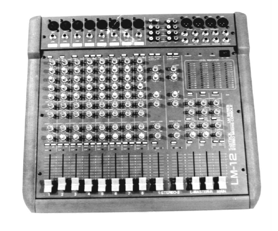
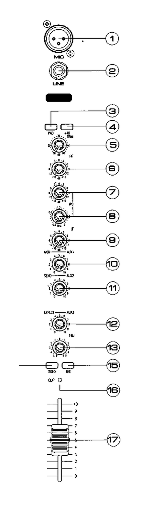
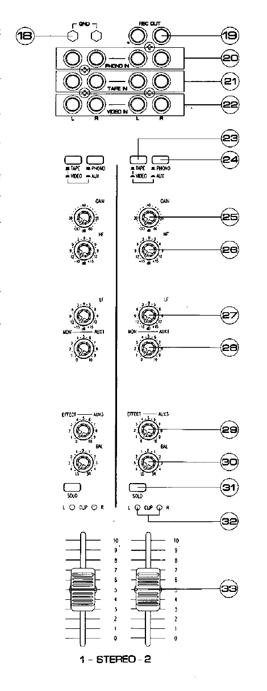
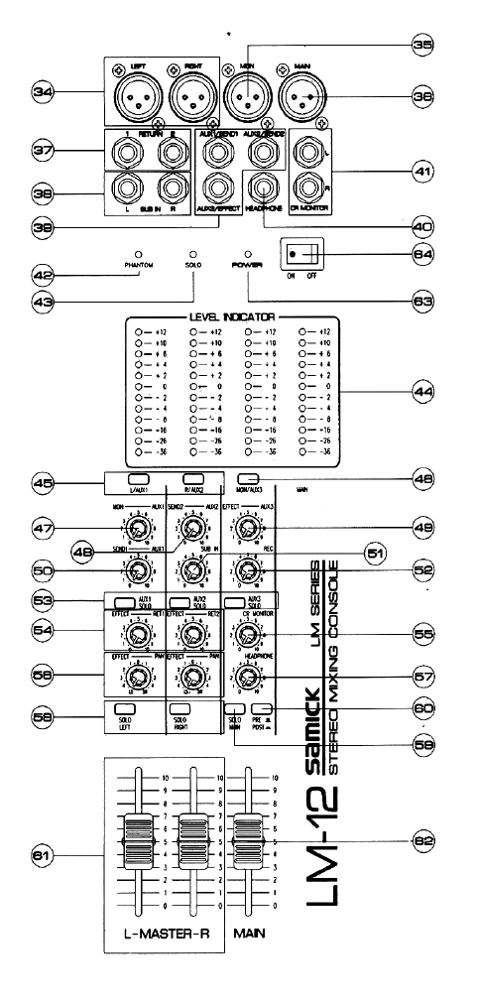
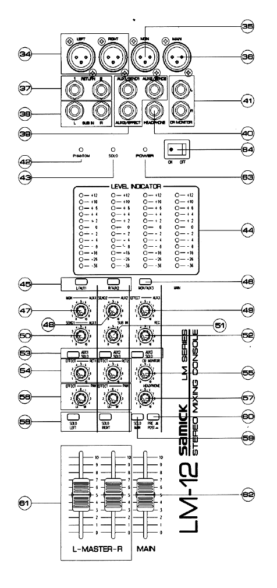

# LM12 (Samick)

<figure markdown="span">
  { loading=lazy width="542" }
  <figcaption>Original handout p.32</figcaption>
</figure>

## Mono channel (1–17)

<figure markdown="span">
  { loading=lazy width="319" }
  <figcaption>Original handout p.32</figcaption>
</figure>

| # | Name | Function |
| --- | --- | --- |
| 1 | MIC INPUT | Female XLR; low-impedance microphone on balanced cable |
| 2 | LINE INPUT | Cassette deck or other source; balanced or unbalanced 1/4" |
| 3 | PAD | Higher impedance, for larger signals |
| 4 | PHANTOM POWER | +48V for condenser microphones; **risk of burning out a non-condenser microphone** |
| 5 | TRIM | Channel input level |
| 6–9 | EQ | Shapes the input tone |
| 10 | AUX1 (MONITOR) | Level to MON or AUX1 |
| 11 | AUX2 (SEND) | Level to AUX2 and SEND |
| 12 | AUX3 (EFFECT) | Level to AUX3 and EFFECT |
| 13 | PAN | Channel balance |
| 14 | SOLO | Sends the sound to HEADPHONE OUTPUT |
| 15 | MIX | Allows the signal to the left/right main output |
| 16 | CLIP | Overload indicator |
| 17 | CHANNEL FADER | Channel output level |

## Stereo / Tape input (18–33)

<figure markdown="span">
  { loading=lazy width="470" }
  <figcaption>Original handout p.33</figcaption>
</figure>

| # | Name | Function |
| --- | --- | --- |
| 18 | GND | Ground |
| 19 | REC OUT | Recording output to a tape input |
| 20 | PHONO IN | RCA input |
| 21 | TAPE IN | Standard RCA input for a tape deck |
| 22 | VIDEO IN | Standard RCA input for video audio |
| 23 | TAPE/VIDEO SELECT | Tape or Video input |
| 24 | PHONO/AUX SELECT | Phono or AUX; AUX requires Tape or Video mode |
| 25 | GAIN | Tape / Video / Phono input level |
| 26 | HF-HIGH | High EQ |
| 27 | LF-LOW | Low EQ |
| 28 | MON (AUX) | Level to AUX1 / Monitor |
| 29 | EFFECT (AUX3) | Level to AUX3 / Effect |
| 30 | BAL | Left/right level |
| 31 | SOLO | As 14 |
| 32 | CLIP | As 16 |
| 33 | CHANNEL FADER | As 17 |

## Outputs and master section (34–64)

<figure markdown="span">
  { loading=lazy width="482" }
  <figcaption>34–55 (original handout p.34)</figcaption>
</figure>

<figure markdown="span">
  { loading=lazy width="476" }
  <figcaption>56–64 (original handout p.35)</figcaption>
</figure>

| # | Name | Function |
| --- | --- | --- |
| 34 | LEFT/RIGHT | Left/right master outputs, balanced |
| 35 | MON | Monitor output, balanced |
| 36 | MAIN | Main output, balanced |
| 37 | RETURN | Aux return, used with AUX for effects |
| 38 | SUB INPUT | For other equipment or chaining another mixer |
| 39 | AUX 1/2/3 | Unbalanced outputs |
| 40 | HEADPHONE | Unbalanced headphone output |
| 41 | CR MONITOR | Unbalanced output for another pair of monitor speakers |
| 42 | PHANTOM INDICATOR | Phantom power on |
| 43 | SOLO INDICATOR | SOLO on |
| 44 | CHANNEL LED METER | Output level display |
| 45 | L/AUX1, R/AUX2 SELECT | Meter shows the outputs or AUX1/AUX2 |
| 46 | MON/AUX3 SELECT | Meter shows MON or AUX3 |
| 47 | MONITOR/AUX1 | Level to Monitor / AUX1 |
| 48 | SEND2/AUX2 | Level to SEND2 / AUX2 |
| 49 | EFFECT/AUX3 | Level to EFFECT / AUX3 |
| 50 | SEND1/AUX1 | Level to SEND1 / AUX1 |
| 51 | SUB IN | Level of SUB IN to the master output |
| 52 | REC | Level to the recording deck |
| 53 | SOLO/AUX1,2,3 | Sends AUX1, 2, 3 to SOLO |
| 54 | EFFECT (RET1,2) | Level of the effect return from RETURN 1, 2 to the left/right outputs |
| 55 | CR MONITOR CONTROL | CR Monitor level |
| 56 | EFFECT (PAN) | Effect left/right |
| 57 | HEADPHONE CONTROL VOLUME | Headphone level |
| 58 | SOLO (L/R) |  |
| 59 | SOLO |  |
| 60 | PRE/POST SELECT | Whether MAIN OUTPUT is pre or post the master |
| 61 | MASTER (L/R) FADER | Master level |
| 62 | MAIN FADER | MAIN OUTPUT level |
| 63 | POWER INDICATOR | Power light |
| 64 | POWER ON/OFF | Power switch |
