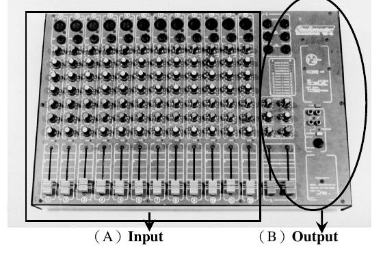
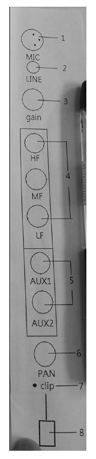
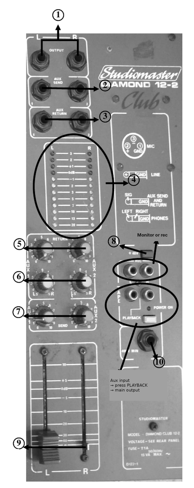

# MX122 (Studiomaster)

"122": 12 input channels and 2 master outputs (one L/R pair). Apart from large concerts it is more than enough for ordinary events.

<figure markdown="span">
  { loading=lazy width="560" }
  <figcaption>(A) Input and (B) Output sections (original handout p.36)</figcaption>
</figure>

## (A) Input channel

<figure markdown="span">
  { loading=lazy width="199" }
  <figcaption>Original handout p.36</figcaption>
</figure>

| # | Name | Function |
| --- | --- | --- |
| 1 | MIC INPUT | Female XLR; low-impedance microphone on balanced cable |
| 2 | LINE INPUT | Cassette deck and other sources |
| 3 | GAIN CONTROL | 15–60 dB; channel input level |
| 4 | EQ | HF: 12 kHz; MF: 2 kHz; LF: 20 Hz (as stated in the handout) |
| 5 | AUX | AUX1 is post-fader; AUX2 is pre-fader |
| 6 | PAN | Left/right balance |
| 7 | CLIP | Flashes when the input is too large |
| 8 | FADER | Channel output level |

!!! warning "Caution"

    **Never use MIC INPUT and LINE INPUT at the same time; it will damage the unit.**

## (B) Output section

<figure markdown="span">
  { loading=lazy width="398" }
  <figcaption>Original handout p.37</figcaption>
</figure>

| # | Name | Function |
| --- | --- | --- |
| 1 | L/R OUTPUT | Master outputs, 1/4", unbalanced |
| 2 | AUX SEND 1 & 2 | Aux outputs, 1/4", unbalanced |
| 3 | AUX RETURN 1 & 2 | Aux inputs, used with AUX SEND for effects; 1/4", unbalanced |
| 4 | L/R LED METERS | Left/right output meters |
| 5 | AUX RETURN 1 & 2 LEVEL | Aux return level |
| 6 | AUX RETURN 1 & 2 PAN | Aux return left/right balance |
| 7 | AUX SEND 1 & 2 LEVEL | Aux send level |
| 8 | +48V | Powers all MIC INPUTs; **risk of burning out a non-condenser microphone connected at the time** |
| 9 | L/R OUTPUT FADER | Master faders |
| 10 | PHONES | Headphone monitoring |

The figure also marks "monitor or record" and "aux input → press PLAYBACK → main output".

## Precautions

1. Confirm mains voltage is 110V.
2. On a power cut switch off at once; when power returns, power up in order.
3. Pull the faders down before powering on and before connecting any channel.
4. Connect the 802C and speakers before powering on.
5. Put the mixer somewhere stable.
6. If there is still no sound: check whether the LED meters show output. **Yes** → check speaker cable continuity with a multimeter; **no** → check that the source is on and the input cable is good.
7. Always follow the power sequence, especially for the amplifier.
