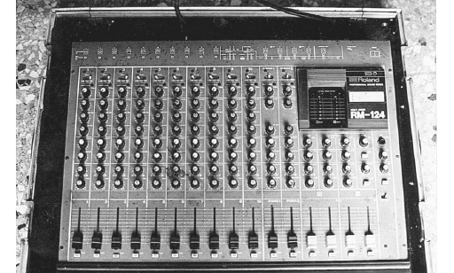
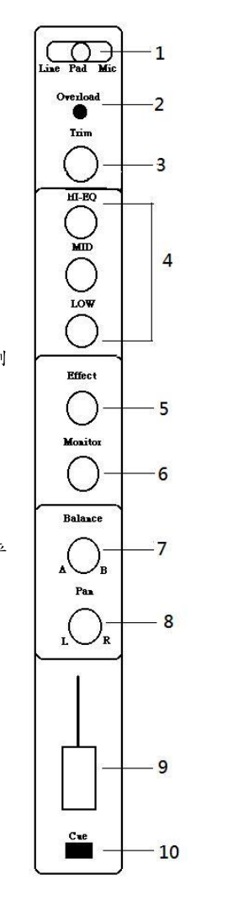
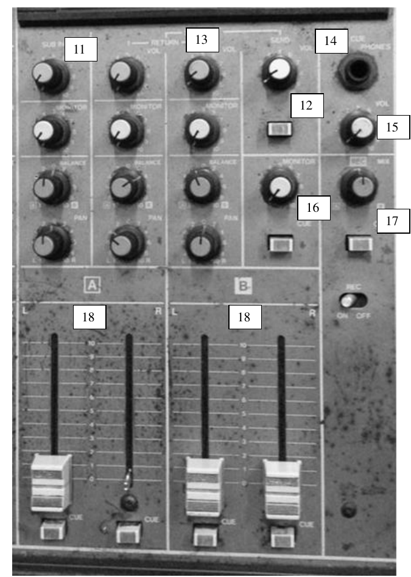
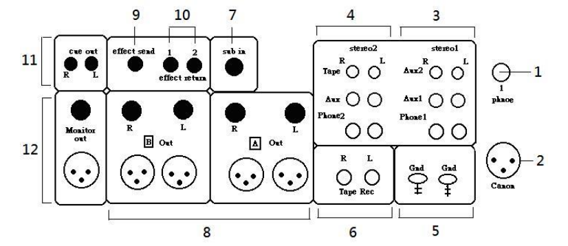

# RM-124 (Roland)

12 inputs and 4 output channels (two L/R pairs, A and B), hence RM-124. Two of the 12 channels are stereo inputs designed for cassette, turntable, CD and the like.

<figure markdown="span">
  { loading=lazy width="512" }
  <figcaption>Original handout p.43</figcaption>
</figure>

## 1. Panel

<figure markdown="span">
  { loading=lazy width="277" }
  <figcaption>1–10 (original handout p.43)</figcaption>
</figure>

<figure markdown="span">
  { loading=lazy width="675" }
  <figcaption>11–18 (original handout p.44)</figcaption>
</figure>

| # | Name | Function |
| --- | --- | --- |
| 1 | SWITCH | Mono channels select LINE, PAD or MIC; PAD shares the MIC input but is 3 dB lower. Stereo channels select PHONE 1 / AUX1 / AUX2, or PHONE 2 / AUX3 / TAPE (as labelled in the handout) |
| 2 | OVERLOAD | Same as CLIP |
| 3 | TRIM | Same as GAIN (up to about 30 dB) |
| 4 | EQ | HI: 10 kHz; MID: 1 kHz; LOW: 100 Hz |
| 5 | EFFECT | Aux send; the effect unit must be external |
| 6 | MONITOR | Aux send |
| 7 | BALANCE | Balance between output pairs A and B |
| 8 | PAN | Left/right balance of a mono channel |
| 9 | OUT LEVEL FADER |  |
| 10 | CUE | Monitor on headphones or CUE OUT |
| 11 | SUB IN | For connecting another mixer |
| 12 | EFFECT SEND | Level at the EFFECT SEND jack |
| 13 | EFFECT RETURN | Level of EFFECT RETURN to the masters (A, B) |
| 14 | CUE PHONE JACK | Headphone jack |
| 15 | CUE PHONE VOL | Headphone volume |
| 16 | MONITOR | Monitor output level |
| 17 | REC | Recording source: pair A or B; REC must be ON to record |
| 18 | L-R MASTER FADER | Outputs A and B |

## 2. Rear jacks

<figure markdown="span">
  { loading=lazy width="826" }
  <figcaption>Original handout p.45</figcaption>
</figure>

| # | Name | Function |
| --- | --- | --- |
| 1 | Balance In | Mono channel input |
| 2 | Unbalance In | Mono channel input |
| 3 | PHONE 1, AUX1, AUX2 | Inputs for stereo 1 |
| 4 | PHONE 2, AUX3, TAPE | Inputs for stereo 2 |
| 5 | GND | Ground |
| 6 | TAPE REC | Recording output; RCA to the deck's LINE IN; the front REC switch must be ON |
| 7 | SUB IN | Chain another mixer |
| 8 | A, B OUT | Master outputs A and B, on 6.3 mm jack and XLR |
| 9 | EFFECT RETURN | Effect input, from the effect unit's output |
| 10 | EFFECT SEND | Dry signal output, to the effect unit's input |
| 11 | CUE OUT | Cue output |
| 12 | MONITOR OUT | Monitor output |

!!! info "Note"

    The handout describes 1 and 2 as "Balance In = same as LINE input, Unbalance In = same as XLR input", the opposite of normal practice (XLR is balanced); probably a slip. Go by the markings on the unit.

## 3. Notes

1. Amplifier, EQ and so on must be connected separately.
2. Mostly used for evening shows and singing contests; with singing, connect an effect unit and a monitor system.
3. **Three ways to connect an effect**: all leave from EFFECT SEND into the effect's input, and return from the effect's output to:
    - ① EFFECT RETURN
    - ② SUB IN
    - ③ a spare channel
    
    Turn up EFF on channels that need the effect and zero it on those that don't. With ③, **the EFF on the returning channel must stay off, or it will feed back**. ③ makes the effect level easiest to control.
    
4. **Monitors**: MONITOR OUT feeds a second system (compressor/limiter, EQ, power amp, speakers); then set each channel's MONITOR knob.
