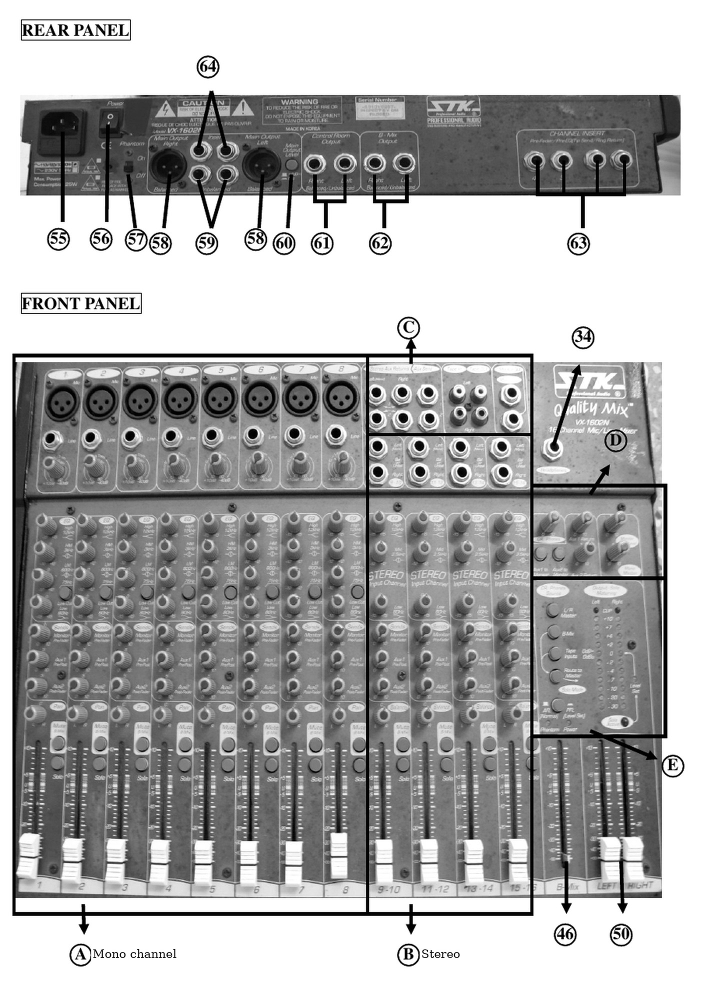
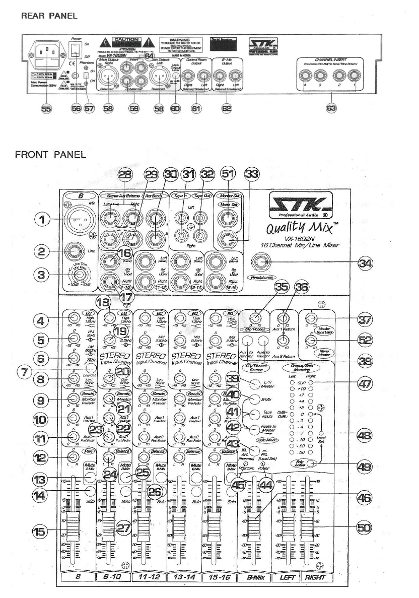
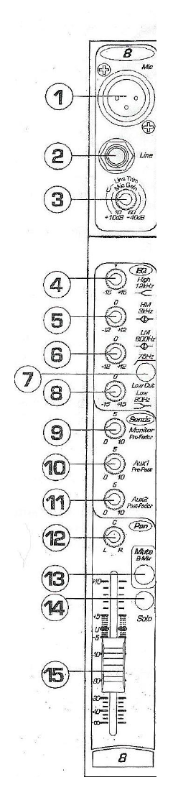
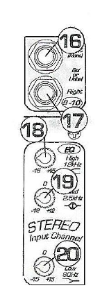
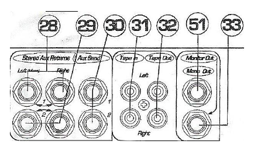
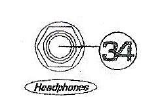
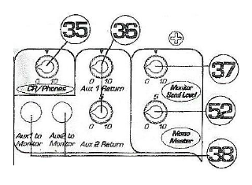
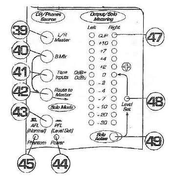
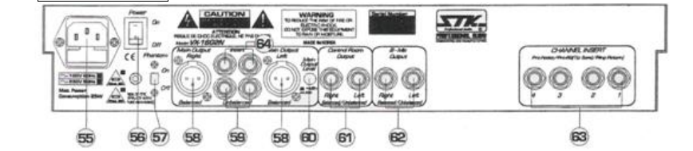

# VX-16 (STK)

<figure markdown="span">
  { loading=lazy width="718" }
  <figcaption>rear / front panel photos with sections A–E (original handout p.38)</figcaption>
</figure>

<figure markdown="span">
  { loading=lazy width="832" }
  <figcaption>panel drawings with numbering (original handout p.39)</figcaption>
</figure>

## A | Mono channel

<figure markdown="span">
  { loading=lazy width="241" }
  <figcaption>Original handout p.40</figcaption>
</figure>

| # | Name | Function |
| --- | --- | --- |
| 1 | Mic input | XLR input |
| 2 | Line input | 1/4" input |
| 3 | Line Trim / Mic Gain | Channel input level |
| 4 | High EQ | Highs |
| 5 | High Mid EQ | Upper mids |
| 6 | Low Mid EQ | Lower mids |
| 7 | Low Cut Switch | Removes below 75 Hz |
| 8 | Low EQ | Lows |
| 9 | Monitor Send (pre-fader) | Level to Monitor Out (33) |
| 10 | Aux 1 Send (pre-fader) | Level to Aux 1 Send (30) |
| 11 | Aux 2 Send (post-fader) | Level to Aux 2 Send (30) |
| 12 | Pan | Left/right balance |
| 13 | Mute / B-Mix Switch | Sends the signal to B-Mix Output (62) and cuts it from the main output |
| 14 | Solo Switch | Monitor one channel through Control Room / Headphone. Works with Solo Mode (43) |
| 15 | Channel Fader | Channel output level |

!!! warning "Caution"

    Don't press Solo on several channels at once; the signal becomes too large.

## B | Stereo channel

<figure markdown="span">
  { loading=lazy width="157" }
  <figcaption>Original handout p.41</figcaption>
</figure>

| # | Name | Function |
| --- | --- | --- |
| 16 | Left (mono) | Left input of a stereo source; also a mono input |
| 17 | Right | Right input of a stereo source |
| 18 | High EQ | Highs |
| 19 | Mid EQ | Mids |
| 20–27 |  | Same as 8–15 on the mono channel |

## C | Aux, tape and monitor jacks

<figure markdown="span">
  { loading=lazy width="434" }
  <figcaption>Original handout p.41</figcaption>
</figure>

<figure markdown="span">
  { loading=lazy width="157" }
  <figcaption>Headphone Output (original handout p.41)</figcaption>
</figure>

| # | Name | Function |
| --- | --- | --- |
| 28 | Aux Return 1 (L/R) | Aux input 1, straight to the main output |
| 29 | Aux Return 2 (L/R) | Aux input 2, straight to the main output |
| 30 | Aux Send 1 & 2 | Aux 1 and 2 outputs |
| 31 | Tape Input (L/R) | RCA, for a tape deck etc. **Can only be heard through CR Monitor / Headphone**; press 41 to select Tape Inputs as the source |
| 32 | Tape Output (L/R) | RCA, mainly for recording; same signal as the main output |
| 33 | Monitor Output | Carries all Monitor Sends; level set by 37 |
| 51 | Mono Out | Left and right main output summed; level set by 52 |
| 34 | Headphone Output | Headphone monitoring |

## D | Output controls

<figure markdown="span">
  { loading=lazy width="320" }
  <figcaption>Original handout p.41</figcaption>
</figure>

| # | Name | Function |
| --- | --- | --- |
| 35 | Control Room / Headphone Level | CR Monitor / Headphone level |
| 36 | Aux Return Controls (1 & 2) | Level of Aux Return 1, 2 (28, 29) to the main output |
| 37 | Monitor Output Level | Monitor Out (33) level |
| 38 | Aux1 & Aux2 To Monitor | Redirects the Aux 1/2 Return signal to Monitor Out |
| 52 | Mono Master Level | Mono Out level |

## E | CR source select and master

<figure markdown="span">
  { loading=lazy width="356" }
  <figcaption>Original handout p.42</figcaption>
</figure>

| # | Name | Function |
| --- | --- | --- |
| 39 | L/R Master | Main output as the CR Monitor / Headphone source |
| 40 | B-Mix | B-Mix as the monitor source |
| 41 | Tape Inputs | Tape Inputs as the monitor source |
| 42 | Route To Master | Sends the monitored B-Mix or Tape Inputs to the main output |
| 43 | Solo Mode Switch | AFL / PFL; pressed, the solo signal ignores the channel fader |
| 44 | Power Indicator | Power light |
| 45 | Phantom Power Indicator | Phantom (57) light |
| 46 | B-Mix Stereo Fader | Level to B-Mix Output |
| 47 | Meter Assembly | CR Monitor / Headphone level |
| 48 | Level Set Indicator | With 14 and 43 both pressed, shows the soloed channel's level |
| 49 | Solo Active Indicator | Lit when Solo (14) is pressed: the monitor source is the soloed channel |
| 50 | L & R Master Faders | Main output level |

## Rear panel

<figure markdown="span">
  { loading=lazy width="868" }
  <figcaption>Original handout p.42</figcaption>
</figure>

| # | Name | Function |
| --- | --- | --- |
| 55 | Power inlet |  |
| 56 | Power | Power switch |
| 57 | Phantom Power Switch | Puts 48V on the mic inputs of Ch.1–8 for condenser mics; **do not turn on with dynamic microphones connected** |
| 58 | Main Outputs (XLR) | Left/right main outputs, balanced |
| 59 | Main Outputs (1/4") | Left/right main outputs, unbalanced |
| 60 | Main Output Level Switch | Raises the main output level; affects only the XLR outputs (58) |
| 61 | Control Room Outputs | CR Monitor outputs |
| 62 | B-Mix Outputs | B-Mix outputs |
| 63 | Channel Insert Jack | Inserts for Ch.1–4 |
| 64 | Main Insert L & R | Inserts on the main output |
