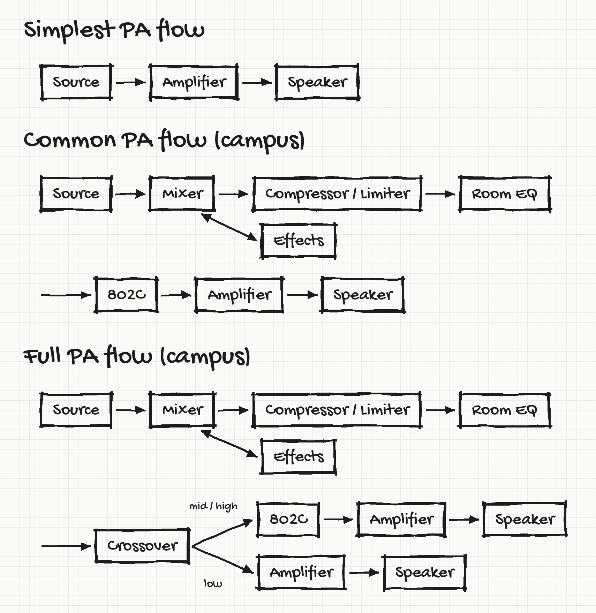

# PA Overview & System Logic

## What a PA system is

PA (Public Address) means using audio or broadcast equipment to amplify sound for one-to-many communication. To amplify sound you need a **source, an amplifier and speakers**; mixers and signal processors add variety. The goal is to reproduce the source accurately, or to shape it slightly, so you first need to understand the source.

## Three PA flows

<figure markdown="span">
  { loading=lazy width="854" }
  <figcaption>Original handout p.6</figcaption>
</figure>

| Flow | Signal chain |
| --- | --- |
| Simplest | Source → amplifier → speaker |
| Common | Source → mixer (⇄ effects) → compressor/limiter → graphic EQ → 802C → amplifier → speaker |
| Full | Source → mixer (⇄ effects) → compressor/limiter → graphic EQ → electronic crossover → mid/high: 802C → amplifier → speaker; low: amplifier → speaker |

## System connection: five stages

Every audio connection can be described as:

`Source → Mixing → Processing → Amplifying → Speaker`

- **Source**: the sound you want to amplify, e.g. a microphone or music from a computer.
- **Mixing**: combining or routing sources to the next device, done by the mixer.
- **Processing**: anything that changes the source from its original state — phase, dynamics, attenuation, PEQ, GEQ, input delay, level, pan, effects. Everything on a mixer other than its inputs and outputs is really processing.
- **Amplifying**: turning the processed signal into enough current to drive speakers, done by the amplifier.
- **Speaker**: the current becomes sound.

First confirm that signal passes through everything before the amplifier, and set reference levels. If the signal flow is wrong, check that cables are in the right place and seated; if that doesn't fix it, cross-check to find whether a cable or a device is at fault (see Troubleshooting & Cross-Checking).

## Three rules of operation

Once connected, the devices form a system: change one parameter anywhere and the result changes; unsafe use damages equipment.

!!! warning "Caution"

    **Power on with the PA flow, power off against it**: switch on from front to back (mixer → … → amplifier); switch off from back to front (amplifier → … → mixer).

1. **Switch on and off in connection order** (as above).
2. **Hitting Peak now and then is fine; clipping is not.** Peak means the level is close to distortion, usually 3–6 dB below clip; it is the range that lets the signal follow the programme's dynamics. If the meter sits at Peak or clips, reduce input gain. Even if the organiser complains it is too quiet, don't force it — it means more speakers are needed next time.
3. **While the system is running, adjust every parameter carefully.** The classic mistake: the fader is at the top, it is still quiet, so you grab the Gain. The correct procedure:
    1. Pull that channel's fader down to no output.
    2. Turn Gain to a higher setting than before.
    3. Bring the fader up slowly while listening; when it seems loud enough keep going until it is slightly too loud, then stop.
    4. Note the position, then start correcting that channel's frequencies (leave headroom for the channel).

## Wiring logic

- **1 = left, 2 = right; 1 = top, 2 = bottom; 1 = A, 2 = B**
- Connect devices with the same kind of signal cable where possible.

Checklist for the simplest system when everything is healthy:

| Signal flow ↓ | Left | Right |
| --- | --- | --- |
| Microphone (source) | Connected to mixer |  |
| Mixer | L output sending | R output sending |
| Amplifier | Ch.1 has signal | Ch.2 has signal |
| Speakers | Left OK | Right OK |

## The fader rule

!!! tip "Rule to remember"

    **Bring levels up in reverse!** The handout repeats this three times: work against the signal flow, opening up from the output end back toward the input end. Also remember to assign the signal (press MAIN / L-R etc.); pushing the fader alone sends nothing out.
