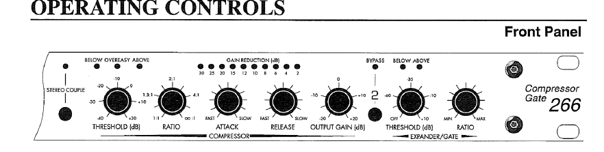
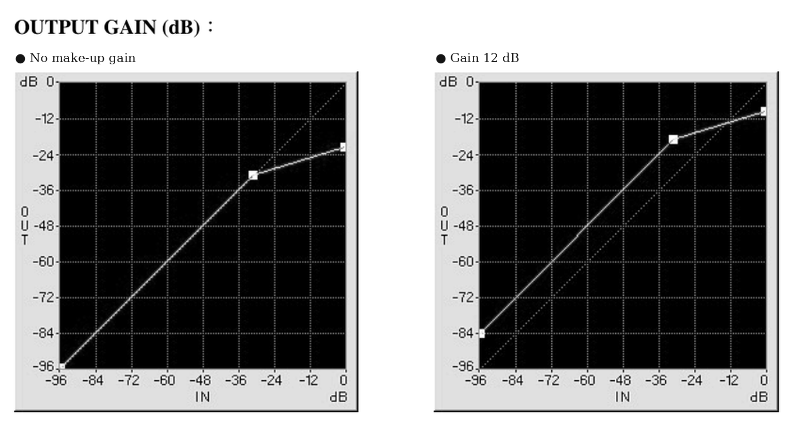
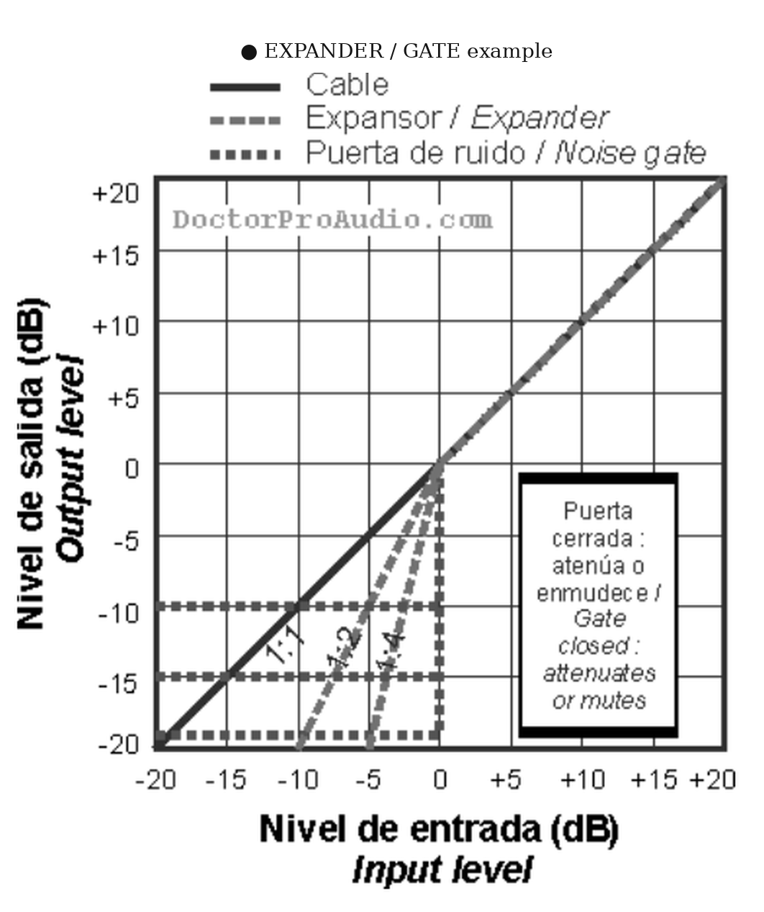
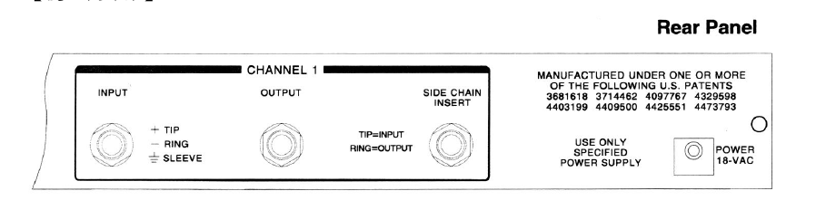
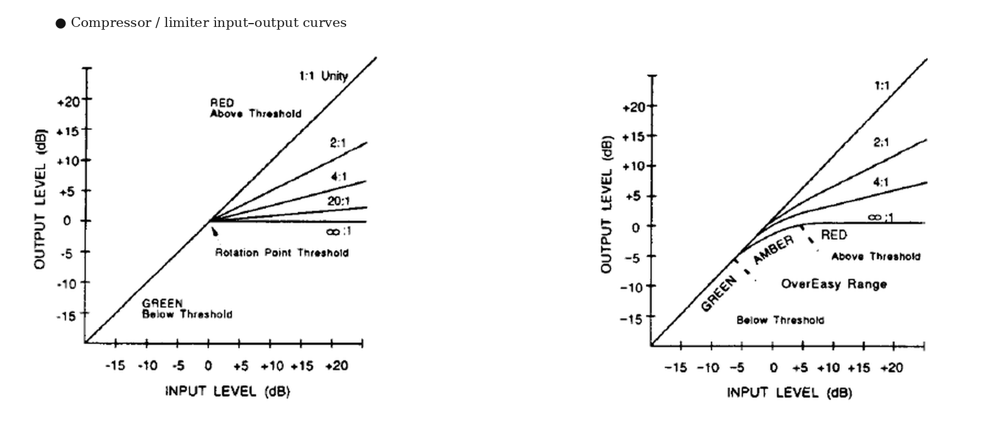
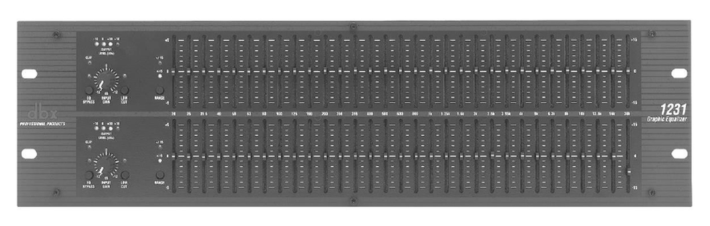
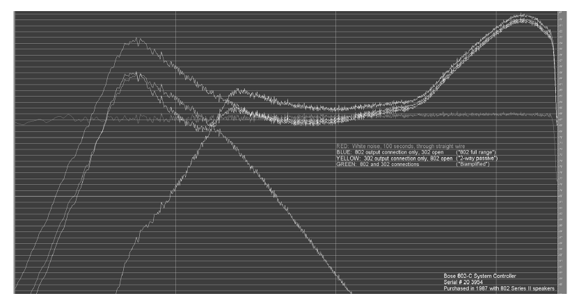

# Signal Processors

Signal processors **protect equipment** and **shape the signal**: compressor/limiter, graphic EQ, effects, speaker controller (Bose 802C) and electronic crossover.

## Compressor–Limiter

Amplifier power often exceeds speaker power — for example a 400 W amplifier driving 300 W speakers, which can burn the speakers at full output. A compressor/limiter ahead of the amplifier compresses and limits the signal so it can be amplified safely.

### dbx 266 Compressor / Gate

<figure markdown="span">
  { loading=lazy width="882" }
  <figcaption>front panel, original handout p.49</figcaption>
</figure>

**Compressor section (left to right)**

| Control | Function |
| --- | --- |
| STEREO COUPLE | Links channels 1 and 2; channel 2's knobs and meters stop working (except its GAIN REDUCTION meter) |
| THRESHOLD (dB) | Compression starts when the input exceeds this level. BELOW / OVEREASY / ABOVE lights show where the signal is relative to it |
| RATIO | Compression ratio X:1 (1 ≤ X < ∞): the part above the threshold is divided by X |
| ATTACK | How fast compression reacts. Shorter protects equipment faster; longer sounds more natural |
| RELEASE | How fast compression lets go. Short makes abrupt changes; longer smooths them |
| GAIN REDUCTION (dB) | Shows how much the signal above threshold is being reduced |
| OUTPUT GAIN (dB) | Make-up gain for level lost to compression |
| BYPASS | Bypass |

<figure markdown="span">
  { loading=lazy width="844" }
  <figcaption>OUTPUT GAIN at 0 vs +12 dB, original handout p.50</figcaption>
</figure>

**Expander / Gate section**

| Control | Function |
| --- | --- |
| THRESHOLD (dB) | The signal is attenuated when it falls **below** this level. BELOW / ABOVE lights show its position |
| RATIO | Low ratios give gentle downward expansion; high ratios act as a noise gate |

<figure markdown="span">
  { loading=lazy width="531" }
  <figcaption>expander/gate illustration, original handout p.50</figcaption>
</figure>

**Rear panel**

- INPUT: accepts balanced or unbalanced signals.
- OUTPUT: unbalanced.

<figure markdown="span">
  { loading=lazy width="898" }
  <figcaption>rear panel, original handout p.51</figcaption>
</figure>

<figure markdown="span">
  { loading=lazy width="910" }
  <figcaption>compressor/limiter input–output curves, original handout p.51</figcaption>
</figure>

### Controls found on other models

*(Supplement from the Advanced PA II handout in the folder)*

| Control | Function |
| --- | --- |
| LINK | Links channels A and B; A's RATIO and RELEASE control both, the other knobs stay independent so set them almost identically |
| GATE | Sets a gate; anything below it is removed; independent of the other knobs |
| INPUT | Input level, active even in bypass. It decides how large a signal the compressor "sees", so adjust it together with THRESHOLD |
| OUTPUT | Output level, making up gain lost to compression; only active with COMPRESS engaged |

The rear 1/4" jacks are TRS (Tip +, Ring −, Sleeve G): a TRS plug is balanced; a mono plug shorts Ring to Sleeve and becomes unbalanced.

## Equalizer

Room size, shape, surroundings and building materials cause abnormal boosts and cuts in different bands; the sound is wrong and feedback becomes more likely. An equalizer adjusts each band as needed, minimising feedback caused by uneven response, and can also shape tone.

<figure markdown="span">
  { loading=lazy width="886" }
  <figcaption>graphic equalizer, original handout p.51</figcaption>
</figure>

Common panel controls *(supplement from the Advanced PA II handout)*:

| Control | Function |
| --- | --- |
| Feedback Display Threshold | Sets the level at which each band's feedback indicator lights (−20 to +20 dB) |
| Filter | Filter switch for low or high frequencies, cutting 18 dB |
| EQ In | EQ settings only apply when pressed |
| Level Control | Input level for that channel |

## Effects processors

| Effect | Description |
| --- | --- |
| Delay | Copies the sound and plays it slightly later. Apart from level and timing, the copy sounds the same |
| Echo | Simulates sound bouncing back from an obstacle, coloured by wall material and distance; the tail repeats and fades |
| Reverb | Simulates reflections from ceiling, walls and floor all mixed together; lengthens the tail so the sound is fuller and less dry |

### Why delay speakers need delay

Level falls with distance: **each doubling of distance loses 6 dB SPL** (not valid for vertical line arrays). Large venues add fill speakers at the back, but electrical signals travel far faster than sound, so on one drum hit people at the back hear two — first the nearby fill speaker, then the main speakers at the stage — and it becomes muddy.

The fix is a delay unit or an effects processor's delay: hold back the signal to the fill speakers so both arrive at the listener together.

Common panel controls: Input / Output set the level in and out; Mix sets the balance of dry and effected sound.

## Bose 802C II System Controller

A fixed-EQ controller designed for Bose 802 II and 302 II speakers, giving them a sensible dynamic range. Without it an 802 II sounds odd and its drivers are driven abnormally.

> "Bose EQ is not a suggestion, it is a requirement."
> 

<figure markdown="span">
  { loading=lazy width="832" }
  <figcaption>802C frequency response curves, original handout p.52</figcaption>
</figure>

*(Supplement from the Advanced PA II handout)* The 802C has three connection modes: Full-Range, Two-Passive and Biamplified. Hidden switches in the output jacks give it electronic-crossover behaviour in Biamplified mode. The front-panel HI CUT and LOW CUT reduce high and low gain.

## Electronic crossover

*(Supplement from the Advanced PA II handout; the main handout only mentions it in the full PA flow)*

Every speaker has frequencies it handles best. A crossover splits the signal by frequency and feeds separate amplifiers and speakers so both are used efficiently.

- **Active electronic crossover**: the crossover point is selectable.
- **Passive crossover**: the crossover point is fixed.
- Usually two bands (2-way) or three (3-way).

| Front panel | Function |
| --- | --- |
| CH.1 / CH.2 MASTER | Master level for that channel |
| LOW LEVEL | Low-band level |
| MUTE | Mutes the low band |
| DELAY | Low-band delay time |
| CROSSOVER FREQUENCY SELECTOR | Crossover point: above goes to the high output, below to the low output |
| HIGH LEVEL | High-band level |

Rear panel: INPUT (Ch.1, Ch.2), HIGH OUTPUT, LOW OUTPUT (all 1/4" jacks).
