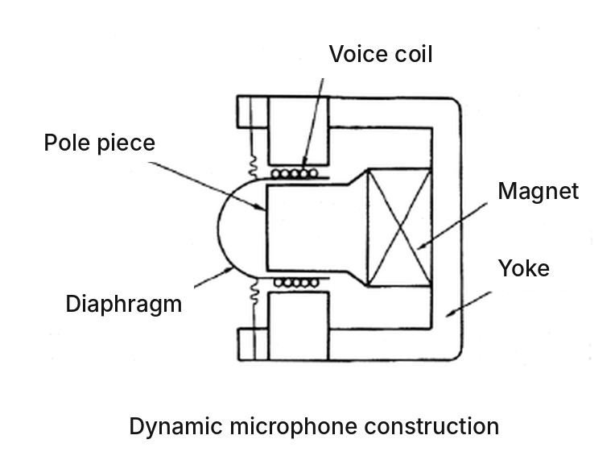
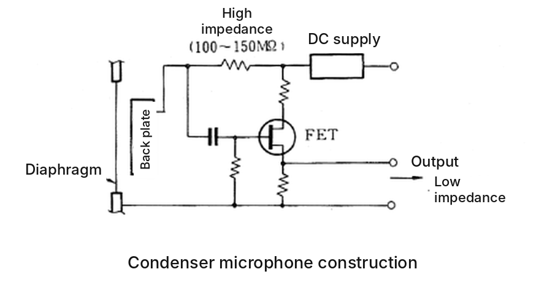
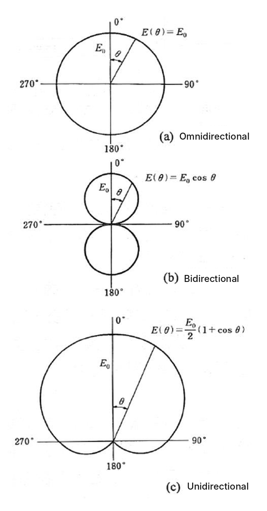
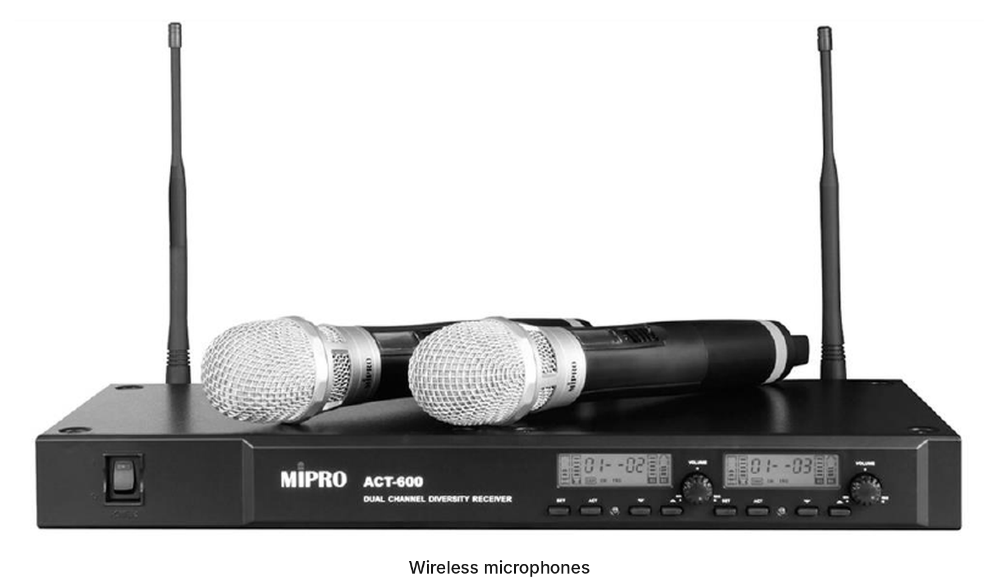

# Sources & Microphones

## Types of source

1. **Phones, MP3 and CD players**: common.
2. **Instruments**: keyboards, electric guitars and so on. Before the mixer they usually go through a **Direct Box (DI)**, a transformer that converts high impedance to low. There is no single way to capture an instrument; experiment.
3. **Microphones**: for voice, drums and instruments. Placement and technique vary with the source.

## Microphone types

A microphone converts acoustic energy into electrical energy. PA work mostly uses dynamic microphones.

| Type | Principle | Strengths | Weaknesses / notes |
| --- | --- | --- | --- |
| Dynamic (moving coil) | The diaphragm moves a voice coil through a magnetic field, inducing a voltage | No power needed, rugged, unaffected by temperature and humidity, stable | Lower sensitivity at low and high frequencies, compensated by resonant chambers in the body — so don't dismantle or knock it |
| Condenser | The diaphragm is one plate of a capacitor; vibration changes capacitance and produces a signal voltage | Excellent frequency response (wide, flat); used in studios and for measurement | Plate spacing is tiny (0.01–0.05 mm), so it dislikes vibration, shock, temperature and humidity changes; needs polarising voltage and preamp power → **turn on Phantom Power (+48V)** |
| Electret | A condenser whose diaphragm is a permanently charged polymer film, so no polarising supply is needed | Small, cheap, good performance | The preamp still needs a battery; a flat battery causes sudden failure |

<figure markdown="span">
  { loading=lazy width="382" }
  <figcaption>Dynamic microphone construction (original handout p.7)</figcaption>
</figure>

<figure markdown="span">
  { loading=lazy width="446" }
  <figcaption>Condenser microphone construction (original handout p.8)</figcaption>
</figure>

More detail:

- A dynamic voice coil has low impedance (a few Ω to a few hundred Ω); a built-in transformer sometimes raises the output impedance.
- A condenser capsule's capacitance is only a few pF to a few hundred pF, so its impedance is very high and it cannot drive a normal amplifier directly; an FET preamp is built into the body. Polarising voltage is about 40–200 V; today it usually comes from the mixer's DC 48V over a normal 2-core shielded mic cable — phantom power.

## Microphone properties

### Output impedance

The nominal internal impedance seen at the output at 1000 Hz. It must match the amplifier's input impedance.

|  | High impedance | Low impedance |
| --- | --- | --- |
| Range | 10 kΩ and up (commonly 50 kΩ) | 600 Ω and below (commonly 600 Ω) |
| Sensitivity | Step-up transformer inside; about 20 dB higher than 600 Ω | Lower |
| Hum pickup | More | Less |
| Maximum cable length | About 10 m | Unbalanced 20 m; balanced 80 m |

Beyond these lengths the highs roll off and the sound degrades, or oscillation occurs.

### Output type: balanced and unbalanced

Noise picked up by the cable is amplified with the signal. To prevent hum the conductors must be wrapped in a metal shield:

- **Unbalanced**: one of the two signal conductors is shared with the outer shield.
- **Balanced**: both signal conductors are inner cores with a separate shield around them; isolation is better.

When the microphone is far from the amplifier, use balanced (the amplifier needs a balanced input too). See Signal Cables & Connectors for the principle.

### Polar pattern

How sensitivity varies with the angle of arrival; 0° is straight in front of the diaphragm.

<figure markdown="span">
  { loading=lazy width="344" }
  <figcaption>(a) omnidirectional (b) bidirectional (c) unidirectional (original handout p.9)</figcaption>
</figure>

| Pattern | Character | Use |
| --- | --- | --- |
| Omnidirectional | Equal sensitivity in all directions (sealed behind the diaphragm) | General recording, simple PA, capturing ambience. Prone to howling in reverberant rooms, so rare in professional use |
| Bidirectional (figure-8) | Sensitive front and back only, less at the sides | Two people facing each other |
| Unidirectional (cardioid) | Most sensitive in one direction; the pattern narrows as frequency rises | Picks up only the wanted sound and improves S/N. **PA commonly uses unidirectional mics to avoid feedback** |

### Sensitivity

How much electrical output a given sound produces, now nearly always in dB.

- Reference: 1 V output for a 1000 Hz tone at 1 μbar is 0 dB. 1 μbar is roughly normal speech 20 cm from the mouth.
- Real output is far below 0 dB, so the figure is negative. −50 dB means 50 dB of gain is needed; −70 dB needs 70 dB.
- A −70 dB microphone is 20 dB (10×) less sensitive than a −50 dB one.

### Frequency response

Output sensitivity at each frequency, given as numbers (e.g. 50–12000 Hz ±3 dB, meaning sensitivity varies no more than ±3 dB within the range) or as a curve. Wider range and smaller ± are better.

- Vocals: 100–8000 Hz
- Clear, pleasant announcement: 200–7000 Hz or better
- Narrower than 250–4500 Hz is unusable

### Proximity effect

When the mouth is very close to a directional microphone, low-frequency sensitivity rises and an unpleasant boominess appears. A distant source arrives as a plane wave; a very close one as a spherical wave. If you must work close, compensate with the mic's low cut, the amplifier's filter or tone controls.

## Wireless microphones

Think of the wireless microphone as a small FM transmitter and the receiver as an FM radio that only receives one frequency. The user is free of the cable, but you need to understand radio behaviour.

<figure markdown="span">
  { loading=lazy width="821" }
  <figcaption>Wireless microphones and receiver (original handout p.11)</figcaption>
</figure>

### Antennas

Even a good receiver gives noise or distortion with the wrong antenna practice.

| Antenna | Directionality | Notes |
| --- | --- | --- |
| Rod | Equal in all directions | Convenient, but picks up noise too |
| Whip |  |  |
| T-type (doublet) | Directional | Placed well, it maximises the mic signal and minimises outside noise |

Antenna length must suit the frequency. Example: 40.68 MHz has a wavelength of about 7.5 m; a rod antenna is most sensitive at 1/4 wavelength, times a shortening factor of 0.95, about **1.76 m**; a T-type is twice that, about **3.52 m**.

### Dead points

If the sound suddenly drops or gets noisy as the user moves, it looks like a fault but is actually a dead point (these occur indoors, or outdoors when surrounded by buildings). Put the receiver antenna within the mic's movement area, somewhere free of dead points.

## Don'ts

!!! danger "Don'ts"

    1. Don't blow on, hit or tap a microphone
    2. Don't hold the microphone by its head
    3. Don't point it at a speaker (the sound source)

    Items 2 and 3 easily cause feedback.

Practical note: a handheld mic needs to be within a few centimetres of the mouth to pick up clearly. For a big chorus with too few microphones, give them to a few lead singers.
