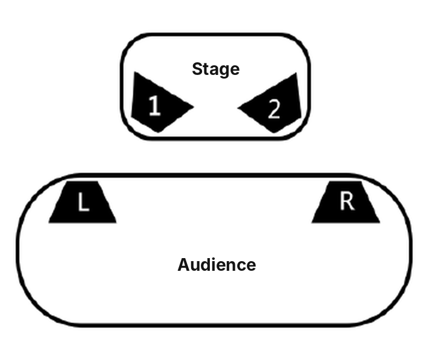
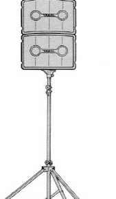
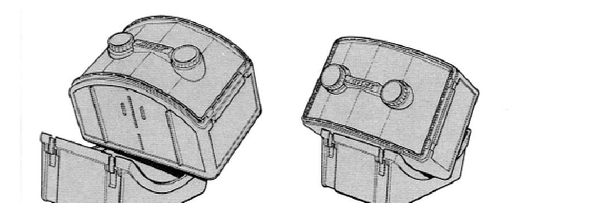

# System Setup

## 1. Planning

### 1.1 Safety

The site plan is your planning on paper; draw it however you like, but start from safety.

**Electrical safety**

- Stable power is the foundation. Watch whether people walking by can kick out the plug; if it can come loose, tape the cable or move the console somewhere safer.
- A typical two-pin wall outlet in Taiwan carries about **15 A; derate to 80%, so no more than 12 A**, and never exceed the rating on the extension lead.
- With more than six speakers running at once, watch the level of each.

**Safe use**

Two speakers for a 500-person event will leave the far listeners unable to hear and the near ones deafened whatever the placement, and the equipment may be permanently damaged. Plan from the venue size and expected headcount; if you don't know the headcount, plan from the venue size.

**People safety**

Any cable where people walk or in the audience area can trip someone and damage equipment. Decide cable routes at the planning stage.

### 1.2 Console position

Confirm the console position first, and confirm it again, because once set nobody may move it.

1. **Prefer the position that is easier to build.** Example: for audio only, the sides of the stage are ideal — short runs for speaker and stage cables, cables can follow the stage edge, and you can respond quickly to anything on stage.
2. **But if that position blocks movement or sightlines, choose one that doesn't.** Example: if crew pass constantly or large props pile up near the stage, move the console somewhere safe. Most event staff have no safety awareness around sound and lighting gear; think for them.
3. **This logic suits most "speech reinforcement" events; adjust for other types.**
    - Small band show: put the console on the centre line of the room to balance what the audience hears; cables and speakers looking messy on stage is fine as long as they don't affect the players or the listening. Blocking a sightline is acceptable; the audience will find their own spot.
    - Theatre: no console or cable may be visible to the audience at all.
4. **Even in a fixed room there is no fixed console position; it depends on the need.**

*(Supplement from the Advanced PA handouts)* The best position is on the stage centre line without blocking the audience, where you can watch the stage and the balance; given speaker and mic cable lengths, the next best is stage left or right, but you must balance the sound field beforehand.

### 1.3 Speaker and stage layout

Every live mix splits into two systems:

|  | FOH (Front of House) | Monitor |
| --- | --- | --- |
| Also called | Mains, house speakers | Foldback, stage monitors |
| For | The audience | The performers on stage |
| Numbering | Left to right from the audience's view; L and R for stereo | Left to right, front to back from the audience's view, by number; usually mono and more flexible |

<figure markdown="span">
  { loading=lazy width="362" }
  <figcaption>FOH and monitor layout, original handout p.57</figcaption>
</figure>

- What separates the two systems is above all **speaker angle and position**. FOH placed closer to the performer than the monitors is pointless; so is a monitor not aimed at the performer. Know who each speaker is for.
- Example: the performer stands centre stage but the monitors are 5 m away at the sides. Rather than turning up and risking feedback, move and aim the speakers, and agree performer positions with the organiser beforehand.
- With only one set of equipment, you do both FOH and monitor work on one console.
- How much FOH and monitor you need: properly it is calculated from equipment specs; for small events experience is usually enough.

### Channel list

Plan the stage from the performers' requirements and list every channel and its details.

**Example 1: band input channel list**

| Ch. | Instrument | Input | Insert FOH | +48V | Stand |
| --- | --- | --- | --- | --- | --- |
| 1 | Bass Drum | Shure Beta52 | Gate+Comp |  | Y |
| 2 | Snare Top | Shure SM57 | Gate+Comp |  | Y |
| 3 | Snare Bottom | Shure SM57 | Gate+Comp |  | Y |
| 4 | Hi Tom | Shure SM57 | Gate+Comp |  | Y |
| 5 | Mid Tom | Shure SM57 | Gate+Comp |  | Y |
| 6 | Floor Tom | Shure SM57 | Gate+Comp |  | Y |
| 7 | Hi-Hat | AKG C451 | Gate+Comp | Y | Y |
| 8 | Overhead L | AKG C451 |  | Y | Y |
| 9 | Overhead R | AKG C451 |  | Y | Y |
| 10 | Bass DI | Radial ProDI | Comp |  |  |
| 11 | Bass Mic | Shure SM57 | Gate+Comp |  | Y |
| 12 | EG | Shure SM57 | Gate+Comp |  | Y |
| 13 | AG | Radial ProDI | Comp |  |  |
| 14 | Lead Vocal | Shure SM58 | Gate+Comp |  | Y |
| 15 | AG's Vocal | Shure SM58 | Gate+Comp |  | Y |
| 16 | EG's Vocal | Shure SM58 | Gate+Comp |  | Y |
| 17 | Bass's Vocal | Shure SM58 | Gate+Comp |  | Y |
| 18 | Wireless | Sennheiser EW 500-945 G3 | Gate+Comp |  |  |
| 19 | Wireless | Sennheiser EW 500-945 G3 | Gate+Comp |  |  |
| 20 | Music |  |  |  |  |
| 21 | Music |  |  |  |  |

!!! info "Note"

    The +48V and Stand columns are misaligned in the source PDF; the Y marks here follow the equipment (C451 condensers need +48V; wired mics need stands). Check the original handout p.57–58 for detail.

**Example 2: a small event**

| Ch. | Source | Input via | Processing | +48V | Mic stand |
| --- | --- | --- | --- | --- | --- |
| 1 | Mic (host) | Wireless mic | Compressor |  |  |
| 2 | Mic (host) | Wireless mic | Compressor |  |  |
| 3 | Mic (singer) | Wireless mic | Compressor |  | Yes |
| 4 | Mic (backing vocal) | Wireless mic | Compressor |  | Yes |
| 5 | Acoustic guitar (with line out) | DI | Compressor |  |  |
| 6 | Acoustic guitar (no line out) | Wired mic | Compressor |  | Yes |
| 7 | Laptop music (left) | Signal cable |  |  |  |
| 8 | Laptop music (right) | Signal cable |  |  |  |
| 9 | Projector video audio (left) | DI |  |  |  |
| 10 | Projector video audio (right) | DI |  |  |  |

*(Check the mic-stand column against the original handout p.58 as well.)*

A channel list is useful at any scale: clear at a glance, hard to get wrong, and easy for the organiser to follow. Even two channels can be two handwritten lines.

### 1.4 Understanding what the organiser needs

Not everyone you deal with knows what they need. Your job is to **translate** the request into something they understand and you can deliver.

| They say | Don't just say "OK" — ask or explain |
| --- | --- |
| "Someone will sing and play guitar." | "Can the guitar be plugged in?" If they don't know they will find out, and one uncertainty is gone |
| "A group will sing together, one playing guitar." | Explain that a mic needs to be within a few centimetres of the mouth and there aren't enough for everyone, so give mics to a few lead singers; then ask whether the guitar can be plugged in |
| "Can the music be louder? I want thumping bass." | Walk to the audience area in front of the stage and hear what they hear before deciding |

Whether it can go louder depends at least on **balance, hearing damage, programme dynamics and system load**. If it shouldn't, explain the equipment's limits (near-field speakers only get louder for the front rows; the real answer is more speakers at the back). Protecting equipment matters as much as meeting requests; if it really is too quiet at the front, go back and turn it up.

## 2. System logic

Connection order, power sequence, peak vs clip, how to set gain and the wiring rules are in PA Overview & System Logic.

## 3. Practical methods

### 3.1 Speaker stand SOP

<figure markdown="span">
  { loading=lazy width="169" }
  <figcaption>Original handout p.62</figcaption>
</figure>

<figure markdown="span">
  { loading=lazy width="566" }
  <figcaption>Original handout p.62</figcaption>
</figure>

1. Loosen the tripod knob slightly, rest one leg on the floor and pull the other two back to open it quickly.
2. Open to a suitable spread and tighten. Indoors there is no weather, and too wide a spread blocks walkways; outdoors open it fully against wind.
3. Take the speaker mount off the top of the stand and bolt it to the bottom of the speaker with screw and washer.
4. Without removing the speaker's lid, hold the lid handle, set the speaker on the stand and tighten the mount.
5. To add a second speaker, lift it by the lid handle and stack it; its base must sit in the recess on top of the first.
6. Remove the lids, loosen the height knob, put a foot on the crossbar, grip the pole and raise it in one go.
7. At the height you want, **insert the safety pin** and tighten the knob.

Always bolt the speaker to the stand so it can't slide off; when placing speakers consider distance to listeners, even left/right level and dead spots. Strike is the reverse.

### 3.2 Cable-run SOP

- The console doesn't move once set, but other items may → **no slack at the console end, leave slack at the item end**.
- **Any cable hanging in the air is an unfinished cable.**
- Safety first, but use your judgement on whether something is a hazard.
- *(Supplement from the load-in & cabling lecture notes)* Run signal and power separately; mind male/female direction; follow an edge if there is one, otherwise run straight with right angles; tape down firmly.

Speaker cable example: start laying from the console end, tidying as you go, following edges or running straight. Extension speaker cables can be tied in a knot before connecting for a firmer joint. Check which way the ends uncoil before you start or it will tangle. At the speaker, coil the excess, lay the coil flat in the middle of the three stand legs, then connect.

The same logic applies to mic and line cables on stage.

**Multicable is the exception**: like a household extension it is an extension of the console, so once placed it does not move. With lots of stage equipment, connect everything to the multicable with short cables and run one cable instead of dozens.

### 3.3 Simple monitor tuning

Tuning makes the speaker sound right; for monitors the bigger goal is letting performers hear what they want without feedback. What they want has nothing to do with the audience; satisfy it as far as possible without affecting FOH.

Prepare: an equalizer for the monitors, and ideally earplugs for yourself.

1. Send your own voice to the monitor at a level that feels right and **note the setting**; then act as the performer and set the speaker's position and angle to where it sounds best.
2. Speak into the mic louder than normal, listen to the monitor's response and cut bands that are excessive or unpleasant.
3. Send a bit more to the monitor and deliberately provoke feedback (wave the mic in front of it, cup the head), then cut the feedback frequencies; how far to go depends on the show.
4. Finish by returning the level to the setting you noted.

*(Supplement)* With instruments, stage monitoring is vital: once performers can hear themselves and each other without feedback, work on the balance between instruments.
