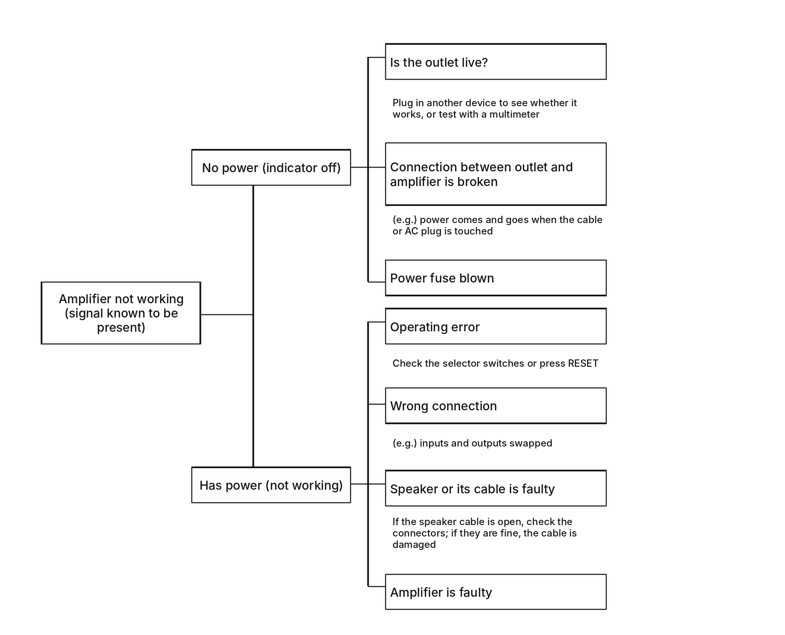
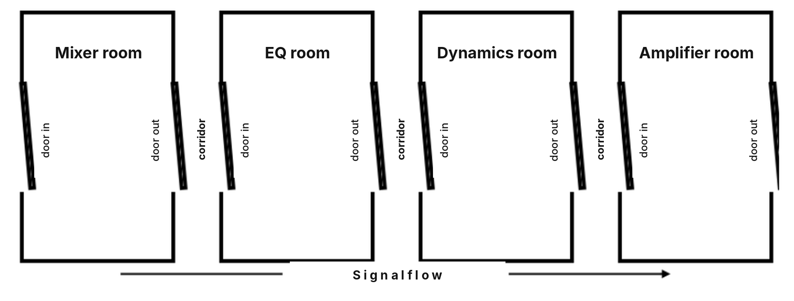

# Troubleshooting & Cross-Checking

## Symptoms

| Symptom | Possible causes |
| --- | --- |
| **No sound** | Wiring: wrong connection, bad cable (broken), poor contact at a plug; equipment: see "amplifier not working" below |
| **Feedback** | Poor speaker position, badly set graphic EQ, poor mic angle, too loud |
| **Can't get loud** | Compressor/limiter set wrongly, bad speaker cable, poor input signal |
| **Noise** | Poor system grounding; cassette decks, VCRs, air conditioners nearby; bad signal cable; poor input signal |

### Dealing with feedback

Feedback is output and input looping and amplifying endlessly, producing a piercing sound. Options:

- Turn down the output at the mixer
- Move the microphone
- Cut the feedback frequency with EQ

## Amplifier not working (signal known to be present)

<figure markdown="span">
  { loading=lazy width="964" }
  <figcaption>original handout p.66</figcaption>
</figure>

- **No power (indicator off)**
    - Is the outlet live? → plug in another device, or test with a multimeter
    - Cable between outlet and amplifier broken → e.g. power comes and goes when the lead or plug is touched
    - Mains fuse blown
- **Powered (but not working)**
    - Operating error → check switches or press RESET
    - Misconnected → e.g. input and output swapped
    - Speaker or its wiring faulty → if the speaker cable is open, check the connectors first; if they are fine the cable is damaged
    - Amplifier faulty

The same approach extends to other equipment.

## Cross-checking logic

Each device is a room with a door in (input) and a door out (output); cables are the corridors between rooms. If any door won't open or a corridor is blocked, signal can't pass. Cross-checking finds which door or corridor is at fault; then substitute other equipment, or if there is nothing to substitute, drop it.

<figure markdown="span">
  { loading=lazy width="904" }
  <figcaption>mixer / EQ / dynamics / amplifier as "rooms", original handout p.67</figcaption>
</figure>

!!! tip "Key points"

    **Three principles**

    1. Check in the direction of signal flow.
    2. Use the known to find the unknown: swap something known to be good with something uncertain.
    3. For devices before the amplifier you needn't power down to replug, but **the speaker cables must not be connected**; once speakers are connected, always switch the amplifier off before replugging or switching anything.

### Worked example

System: microphone → mixer → EQ → compressor → amplifier → speakers. After wiring (speaker cables not yet connected), the meters show:

| Device | Ch.1 (L) | Ch.2 (R) |
| --- | --- | --- |
| Mixer output | Sending | Sending |
| EQ | **No signal** | Signal |
| Compressor | No signal | No signal |
| Amplifier | No signal | No signal |

**Step 1: swap two cables.** Swap the "mixer L → EQ Ch.1" and "mixer R → EQ Ch.2" cables:

| Result after swapping | Meaning |
| --- | --- |
| Ch.1 has signal, Ch.2 none | The cable is faulty |
| Ch.1 still none, Ch.2 has signal | Cable fine; the mixer L output or EQ Ch.1 input is faulty |
| Neither has signal | Cable and equipment both faulty |

**Step 2: find which device.** Suppose it is the second case. The path "mixer R output → EQ Ch.2 input" is known good:

- Connect mixer **R output** to EQ **Ch.1 input** → still no signal ⇒ EQ Ch.1 is faulty.
- Connect mixer **L output** to EQ **Ch.2 input** → signal ⇒ mixer L output is fine.

**Step 3: fix.** Replace a bad cable; substitute or drop a bad device. After fitting another EQ:

| Device | Ch.1 | Ch.2 |
| --- | --- | --- |
| EQ | Signal | Signal |
| Compressor | Signal | Signal |
| Amplifier | Signal | **No signal** |

**Step 4: same method further down.** Swap the "compressor Ch.1 → amp Ch.1" and "compressor Ch.2 → amp Ch.2" cables:

| Result after swapping | Meaning |
| --- | --- |
| Amp Ch.2 has signal, Ch.1 none | The cable is faulty |
| Ch.2 still none, Ch.1 has signal | Cable fine; the compressor Ch.2 output or amp Ch.2 input is faulty |
| Neither | Cable and amplifier both faulty |

Suppose it is the first; with a spare cable everything before the speakers passes signal.

**Step 5: connect the speakers.** Turn the amplifier knobs to zero and switch it off → connect the speakers → switch on → turn up. Result: left speaker fine, **right speaker silent**. Switch the amplifier off (leave the speaker cables in). The fault is now somewhere in "amp output → speaker": amp Ch.2 output, the right speaker cable, or the right speaker.

| Test | Result and conclusion |
| --- | --- |
| Move the **known-good left speaker cable** to amp **Ch.2 output** (still to the left speaker) | Left speaker works ⇒ Ch.2 output is fine; silent ⇒ Ch.2 output faulty (right cable and speaker still unknown) |
| Connect the **right speaker cable** to amp **Ch.1 output**, other end to the left speaker | Left speaker works ⇒ right cable fine, so the **right speaker is faulty**; silent ⇒ right cable faulty (right speaker still unknown) |

### Key points

- Use the **amplifier as the dividing line** and handle the two halves separately. It reads as complicated, but once you know the logic it is quick.
- When checking around the amplifier, **only switch it on to test for sound**; always switch it off before replugging.
