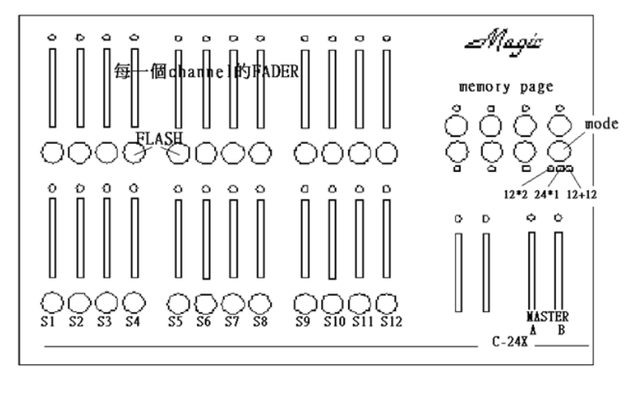
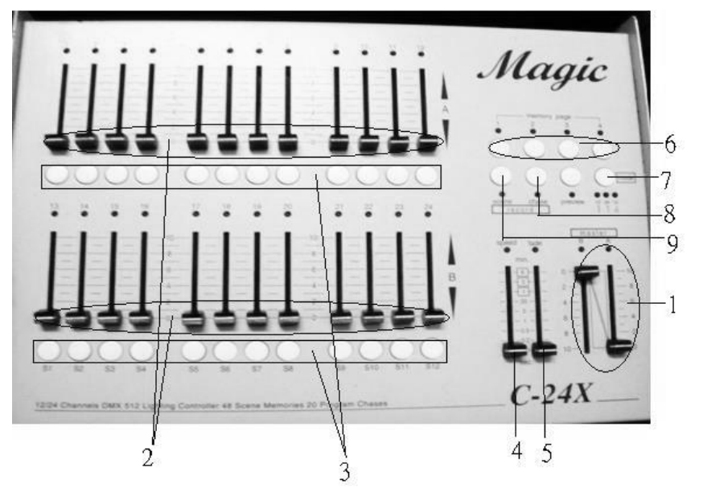

# C-24X（12/24 數位式調光控制器）

最大的特色是可以同時控制 24 個迴路，適合同時用很多燈的活動。

<figure markdown="span">
  { loading=lazy width="802" }
  <figcaption>面板配置，原講義 p.88</figcaption>
</figure>

<figure markdown="span">
  { loading=lazy width="874" }
  <figcaption>實機與編號，原講義 p.89</figcaption>
</figure>

## 三種控制模式（MODE 鍵切換）

| 模式 | MODE 燈 | 用途 | 動作 |
| --- | --- | --- | --- |
| **12×2** | 12*2 | 接一台 Dimmer | Ch.1 對一號迴路、Ch.2 對二號迴路…。上排 1–12 受 MASTER-A 控制，下排 1–12 受 MASTER-B 控制，兩排都對應 Ch.1–12。A、B 控制相同的燈，可做換幕，用 FADE 推桿調整漸亮漸暗時間 |
| **24×1** | 24*1 | 接兩台 Dimmer | 兩台共 24 個迴路分別對到 24 個 Channel，全部受 MASTER-A 控制 |
| **SCENE** | 12+12 | 場景／跑馬 | 上排控制 Dimmer 的 1–12 迴路，下排為 12 個場景，全受 MASTER-A 控制。場景共 4 頁（Memory Page 切換），每頁 12 組（S1–S12），共 **48 組** |

要放出場景或跑馬時，MODE 要切到 **12+12**。

## FLASH

每個 Channel 下方的按鈕，控制的 Channel 和上方推桿相同。**FLASH 不受 MASTER-A、B 控制。**

- 12×2：上下兩排按鈕都對應 Ch.1–12。
- 24×1：上下排分別對應 24 個 Channel，按下即 100% 輸出。
- SCENE：上排是 Ch.1–12 的 FLASH；下排是 S1–S12 場景的 FLASH，亮度為該場景設定的亮度。

## 面板

| # | 名稱 | 功能 |
| --- | --- | --- |
| 1 | MASTER | 主輸出，分 A、B 兩支推桿（A、B 推的方向相反） |
| 2 | Channel Fader | 分別控制 Ch.1–24 的亮度 |
| 3 | FLASH | Ch.1–24 的 Flash 按鈕；下排同時代表 S1–S12，為 12 組記憶的 Scene 或 Chase |
| 4 | SPEED | 調整跑馬速度 |
| 5 | FADE | 調整漸亮漸暗的延滯時間 |
| 6 | Memory Page | 記錄 Scene 及 Chase 的頁，共 4 頁 |
| 7 | MODE | 切換 12×2、12+12、24×1 三種模式 |
| 8 | CHASE | 設定跑馬燈 |
| 9 | SCENE | 設定場景記憶 |

## 場景與跑馬

| 動作 | 步驟 |
| --- | --- |
| **設定場景** | 按 SCENE（指示燈閃爍）→ 推好燈 → 選頁數，按儲存格（S1–S12）。可在 12×2 或 24×1 模式下記錄 |
| **設定跑馬** | 按 CHASE → 選儲存格（S1–S12）→ 推好燈 → 按 SCENE 儲存此步驟 → 重複（推燈 → SCENE）→ 結束按 CHASE |
| **刪除場景／跑馬** | 以空白場景覆蓋 |

## 操作補充

*（補充自資料夾內《C1201 C24 重點整理》與《進階燈光 2》）*

- 電源供應器要撥到 **9V**；使用 3-pin 訊號線（接 Dimmer 用 3pin–5pin）。
- 場景亮著時，可以再用上排迴路加燈。
- 查看儲存狀態：LED 不亮 = 空的；恆亮 = 有場景；閃爍 = 有跑馬。
- 設定某個場景／跑馬的 SPEED、FADE：儲存時先推好，或按住該格的 Flash 不放再調 SPEED、FADE。
- 注意模式轉換時上下排的意義會改變。
- 不可接有變壓器的燈具或有馬達的旋轉燈做調光，會損壞燈具。
- 串聯兩台 Dimmer 時，第二台要設成 `d.013.`。
