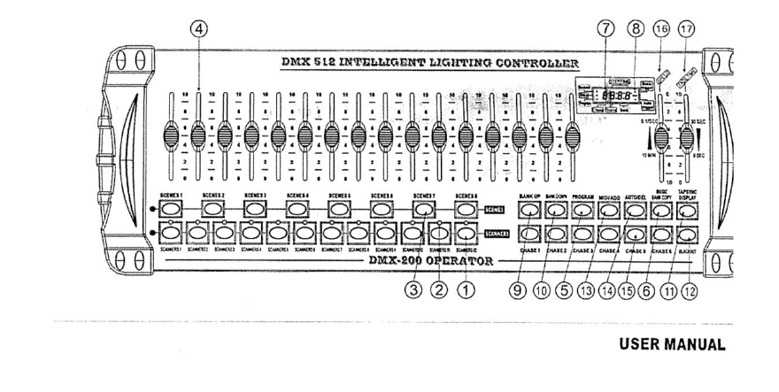
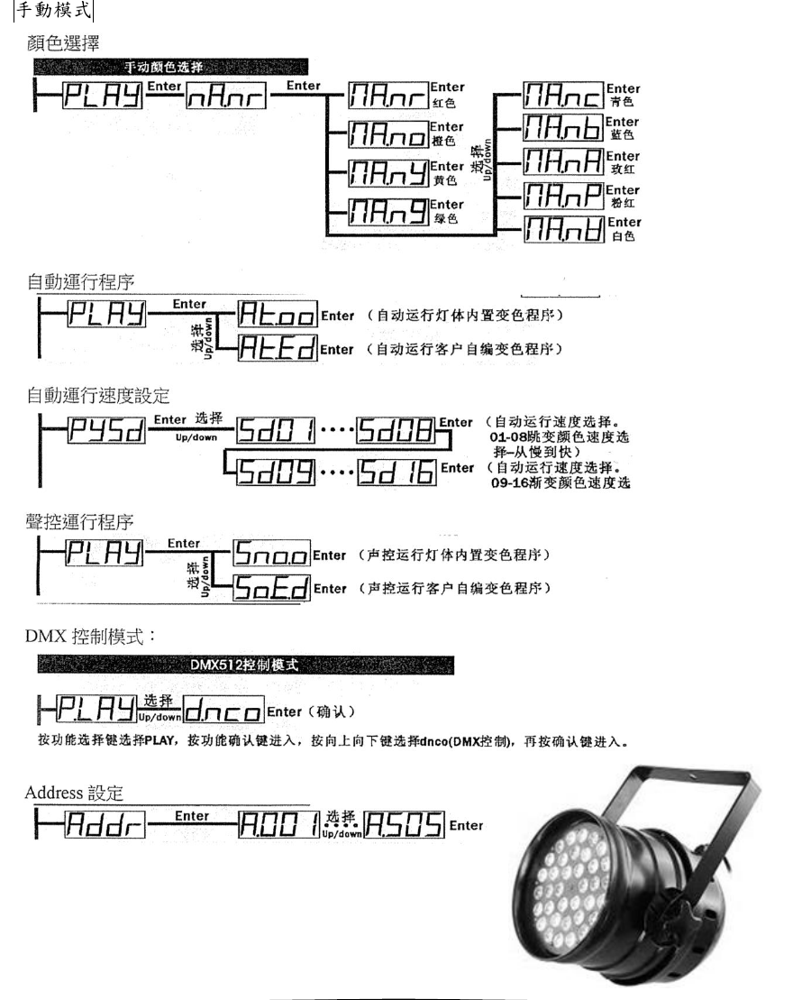

# DMX 控台與 LED PAR

## DMX 控台（DMX Operator）

<figure markdown="span">
  { loading=lazy width="880" }
  <figcaption>原講義 p.95</figcaption>
</figure>

| # | 名稱 | 功能 |
| --- | --- | --- |
| 1 | Scanner select buttons | 選擇燈具 |
| 2 | Scanner indicator LEDs | 顯示所選的燈具 |
| 3 | Scene select buttons | 場景儲存及使用 |
| 4 | Channel fader | 調整 DMX 數值 |
| 5 | Program button | 進入 Programming 模式 |
| 6 | Music／Bank copy button |  |
| 7 | LED display window |  |
| 8 | Mode indicator LEDs | 顯示模式（manual、music、auto） |
| 9 | Bank up | 換頁 |
| 10 | Bank down | 換頁 |
| 11 | Tap／Display | 調整跑馬速度 |
| 12 | Blackout | 阻斷訊號（輸出歸零） |
| 13 | MIDI／ADD | 確認儲存、記錄步驟 |
| 14 | Auto／Del | Programming 模式下的刪除鍵 |
| 15 | Chaser buttons | 跑馬記錄 1–6 |
| 16 | Speed fader | 跑馬中每步驟維持的時間 |
| 17 | Fade-time fader | 跑馬中場景之間的過渡時間 |

*（第 1、2 項在主講義為填空，答案取自資料夾內《進階燈光 2》。）*

### 場景及跑馬設定

| 動作 | 步驟 |
| --- | --- |
| **儲存場景** | Program →（推好燈）→ Add → Scene 1–8 → Program → Blackout |
| 放出場景 | 按一下所存的位置。通常會留一個**空白場景**用來關掉已開啟的場景 |
| 換頁 | 場景不只一頁，用 Bank up／Bank down |
| **儲存跑馬** | Program → Chase → Scene 1–8 → Add →（重複選 Scene、Add）→ Program → Blackout。**無法用推的方式記憶，只能用已存的 Scene 組成** |
| 放出跑馬 | 按該 Chase → 按 Auto；用 Fader 控制速度。再按一次 Auto 會停在跑到的那一步 |
| 跑馬中加入一個場景 | Program → Display → Add → Scene 1–8 → Add → Program → Blackout |
| 跑馬中刪除一個場景 | Program → Display → Scene 1–8 → Delete → Program → Blackout |
| Auto run | 選好 Bank，按 Auto，就會輪跑該 Bank 內存有的場景 |
| 刪除 Scene | 進入 Program → 按 Delete → 選要刪的 Scene |
| 刪除 Chase | 進入 Program → 按 Delete → 選要刪的 Chase |
| 刪除全部 Chase | 關機 → 按住 Bank down + Auto → 開機 |
| 刪除全部 Scene 和 Chase | 關機 → 按住 Bank down + Program → 開機 |
- 要更改機台設定，都要先進入 Program。
- 注意面板上每個燈代表的意義；面板閃一下表示設定已被修改。

## LED PAR 燈

數位式燈具，有紅、綠、藍三種燈珠，可調整色光、自動或聲控變色；搭配 DMX 控台可進一步控制變色、頻閃等。功率僅 120 W，接一般電源即可。用 **DMX 訊號線（3pin–3pin LED 線）** 串聯數顆 LED PAR 及控台。

| 優點 | 缺點 |
| --- | --- |
| 耗電量小、不易產熱、使用方便、功能多、顏色與效果選擇多 | 打出的顏色比傳統燈冷、**極度怕水**、貴 |

### 手動模式（機身選單）

<figure markdown="span">
  { loading=lazy width="880" }
  <figcaption>顏色選擇、自動運行程序、運行速度、聲控運行、DMX 控制模式、Address 設定的選單路徑，原講義 p.96</figcaption>
</figure>

### 三色 LED PAR：DMX512 各 Channel 功能表（7 通道模式）

| Ch | 功能 | 數值 | 說明 |
| --- | --- | --- | --- |
| 1 | 紅光 | 0–255 | 0–100% 紅光 |
| 2 | 綠光 | 0–255 | 0–100% 綠光 |
| 3 | 藍光 | 0–255 | 0–100% 藍光 |
| 4 | 顏色（靜態單色） | 5–9 | 紅 |
|  |  | 10–14 | 橙 |
|  |  | 15–19 | 黃 |
|  |  | 20–24 | 綠 |
|  |  | 25–29 | 青 |
|  |  | 30–34 | 藍 |
|  |  | 35–39 | 玫瑰紅 |
|  |  | 40–44 | 粉紅 |
|  | 自動變色 | 45–54 | 從紅到粉紅、白色自動變色；變色功能和速度由 Ch5 調節 |
|  | 聲控變色 | 55–64 | 從紅到粉紅、白色聲控變色；變色功能由 Ch5 調節 |
|  | 自編變色 | 65–74 | 自編自動變色 |
|  |  | 75–84 | 自編聲控變色 |
|  | 顏色漸變 | 90–117 | 紅 100% + 綠 0→100% |
|  |  | 118–144 | 綠 100% + 紅 100→0% |
|  |  | 145–171 | 綠 100% + 藍 0→100% |
|  |  | 172–198 | 藍 100% + 綠 100→0% |
|  |  | 199–225 | 藍 100% + 紅 0→100% |
|  |  | 226–252 | 紅 100% + 藍 100→0% |
|  | 白光 | 253–255 | 紅綠藍皆 100% |
| 5 | 變色速度 | 0–127 | 顏色跳變，速度由小到大 |
|  |  | 128–255 | 顏色漸變，速度由小到大 |
| 6 | 頻閃 | 0–4 | 全亮，無頻閃 |
|  |  | 5–67 | 頻閃速度由小到大（1–24 Hz） |
|  |  | 68–72 | 聲控頻閃 |
|  |  | 73–126 | 雷電脈衝頻閃（由小到大） |
|  |  | 127–131 | 聲控雷電脈衝頻閃 |
|  |  | 132–185 | 漸亮脈衝頻閃（由小到大） |
|  |  | 186–190 | 聲控漸亮脈衝頻閃 |
|  |  | 191–244 | 漸暗脈衝頻閃（由小到大） |
|  |  | 245–249 | 聲控漸暗脈衝頻閃 |
|  |  | 250–255 | 全亮，無頻閃 |
| 7 | 總調光 | 0–255 | 0–100% 調光 |

!!! info "補充說明"

    - Ch4 開啟時，不受各色光（Ch1–3）及總調光控制。
    - 顏色漸變的方向（100→0%）與 Ch6 的 0–4、250–255 兩段，取自資料夾內較新的《數位燈具與數位前級講義》；主講義 p.97 的表將漸變都寫成 0→100%，且未列這兩段。
    - 其他燈具（四色 LED、琥珀色 LED、雷射燈）與其他通道模式的表，見「KK256A 與數位燈具 DMX 表」。
