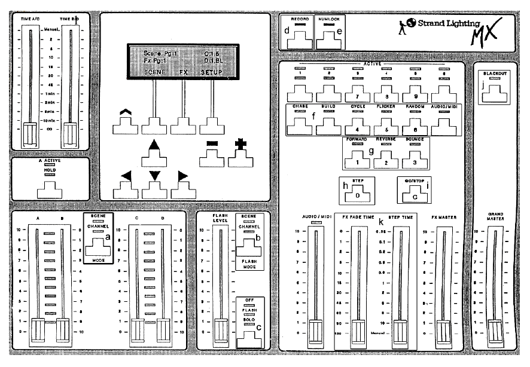
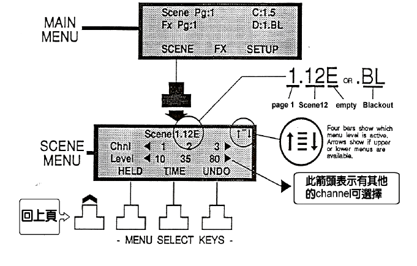
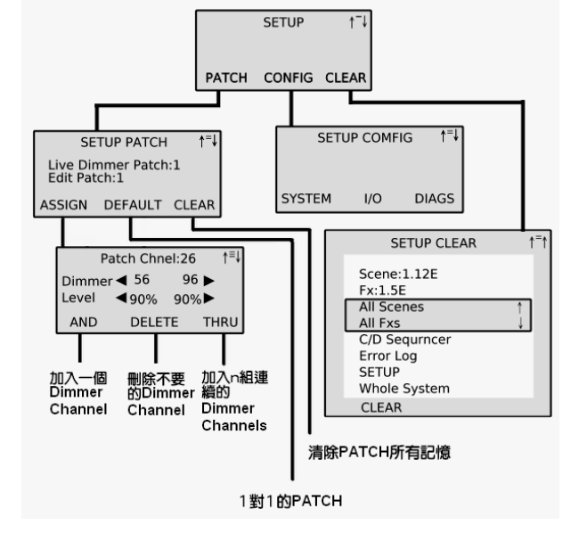
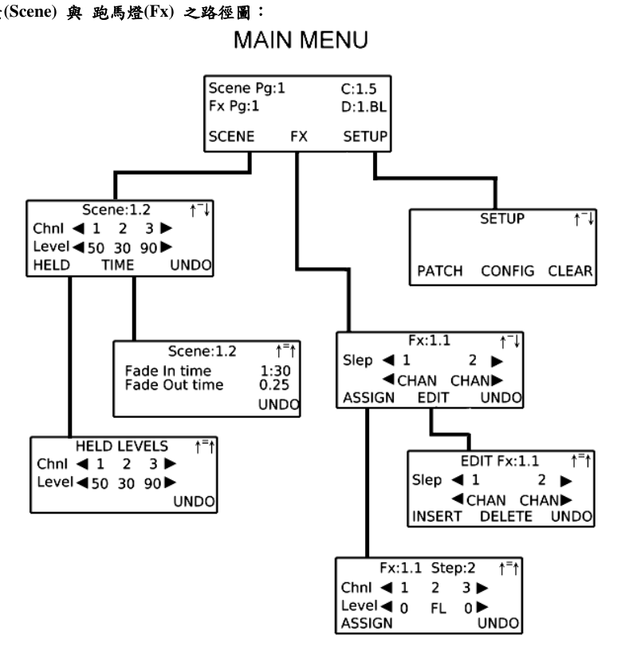

# Strand MX

數位式燈光控制器，有記憶功能、FLASH、SCENE，還有 AUTOFADE、FX（Effect）等，適用於各類晚會及舞台戲劇表演。

- 共 12 個 Channel；透過 **Patch** 最多可控制 **512** 個 Dimmer 迴路。
- SETUP → PATCH 可設成「數位」（一個 MX Channel 對 Dimmer 上的數個迴路）或「類比」（一對一）。

<figure markdown="span">
  { loading=lazy width="886" }
  <figcaption>面板，原講義 p.90</figcaption>
</figure>

## 面板按鍵

| 代號 | 名稱 | 功能 |
| --- | --- | --- |
| a | Mode | 切換 Scene 或 Channel 模式。**Scene 模式**：A 區子 Fader → 該 Channel 的亮度；B 區子 Fader → 該場景的亮度。**Channel 模式**：上下 A、B 區子 Fader 控制同一個 Channel，以最大亮度為優先 |
| b | Flash Mode | Mode 為 Scene 時，可把 Flash 切成 Scene 或 Channel；Mode 為 Channel 時 Flash 只能是 Channel。Channel：Flash 鈕閃該 Channel 的燈；Scene：Flash 鈕閃該場景 |
| c | Off／Flash／Solo | 切換 Flash 鍵為 Flash 或 Solo。**Solo**：只亮所按的 Channel 或 Scene，其餘熄滅；**Flash**：不影響已用 Fader 推亮的燈。Record 時 Off 燈亮起，此時無法 Flash |
| d | Record | 設定 Scene 及 Fx |
| e | NumLock | 燈亮時，可用跑馬燈區按鍵上的數字直接在 LCD 輸入 |
| f | 六個模式鍵 | 設定跑馬燈的亮燈模式 |
| g | Forward／Reverse／Bounce | 跑馬燈的方向 |
| h | Step | 設定跑馬時的步驟記錄鍵；手動跑馬時的「下一步」 |
| i | Go／Stop | 啟動與停止跑馬燈 |
| j | BlackOut | 燈亮時所有輸出停止，全場暗 |
| k | Fx Fade Time／Step Time | 跑馬啟動時漸亮漸暗的速度／跑馬的速度 |
| l | Time A/C、Time B/D | 延遲：控制 A／B／C／D Fader 訊號由 0→100（或 100→0）的時間。無限大 = 延遲無限秒；manual = 0 秒；2 = 刻度 0→10 需要 2 秒 |

## LCD 與開機設定（Patch）

<figure markdown="span">
  { loading=lazy width="681" }
  <figcaption>LCD：Main Menu／Scene Menu 與選單鍵，原講義 p.91</figcaption>
</figure>

<figure markdown="span">
  { loading=lazy width="650" }
  <figcaption>SETUP → PATCH／CONFIG／CLEAR 的選單樹，原講義 p.92</figcaption>
</figure>

| 項目 | 說明 |
| --- | --- |
| Live Dimmer patch | 現在正在使用的 Patch |
| Edit patch | 要編輯的 Patch |
| ASSIGN | 進入後設定 Patch，指定 Channel 對應到 Dimmer 上的迴路 |
| DEFAULT | 回復成 1 對 1 的 Patch |
| CLEAR | 清除 Patch 所有的記憶（所有 Channel 對應的迴路） |

## 場景（Scene）與跑馬燈（Fx）

### (a) 直接以按鍵設定

**設定場景**

1. 按 **Record** → LCD 顯示 RECORD SCENE，Flash Mode 的 Off 燈亮，12 個 Flash 鈕變成場景的儲存格。
2. 選擇 Record 模式與頁數。Scene page 共 4 頁，每頁 12 格，共 48 個場景。
    - **OUTPUT 模式**：記錄「有訊號輸出」的狀態，所以要先把燈推亮，再選頁數和儲存格。
    - **A fader 模式**：記錄 A 區子 Fader 推開的數值（假定 A 區主 Fader 與 Grand Master 皆為 10），燈沒亮也能記。
3. 再按一下 **Record** 退出，完成儲存。

**設定跑馬燈**

1. 按 **Record** → 按欲儲存的儲存格（第一排）；LCD 跳到 RECORD EFFECT。設定跑馬時只能用下面 12 個 Flash 鈕。
2. LCD 右邊顯示 **Channel** → 此步驟可存多個 Channel；顯示 **Scene** → 此步驟只能存 1 個 Scene。
3. 設定下一步按 **STEP**。
4. 可用游標與 +／− 檢視、編輯各步驟。
5. 再按 **Record** 退出，完成儲存。

### (b) 以 LCD 面板設定

<figure markdown="span">
  { loading=lazy width="784" }
  <figcaption>Scene 與 Fx 的選單路徑圖，原講義 p.94</figcaption>
</figure>

| 項目 | 說明 |
| --- | --- |
| Scene 1.2 | 場景第 1 頁的第 2 個儲存格 |
| Fx 1.1 | 跑馬第 1 頁的第 1 個儲存格 |
| UNDO | 回復到進來時最初的狀態 |
| ASSIGN | 游標在 CHAN 時按下會切成 Scene 模式（用 +／− 選 Scene）；再按一次切回 Channel 模式並進入設定，指定每一步要亮哪幾個 Channel（亮度只能設 FL 或 0） |
| EDIT | 增加或刪減跑馬步驟 |
| INSERT | 插入步驟（插在前一步） |
| DELETE | 把游標移到要刪的步驟後按下 |
