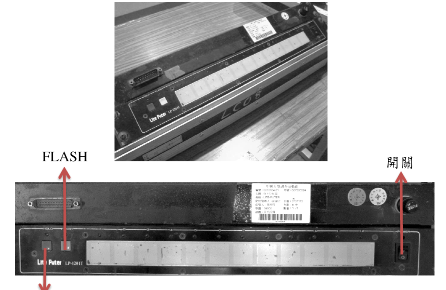
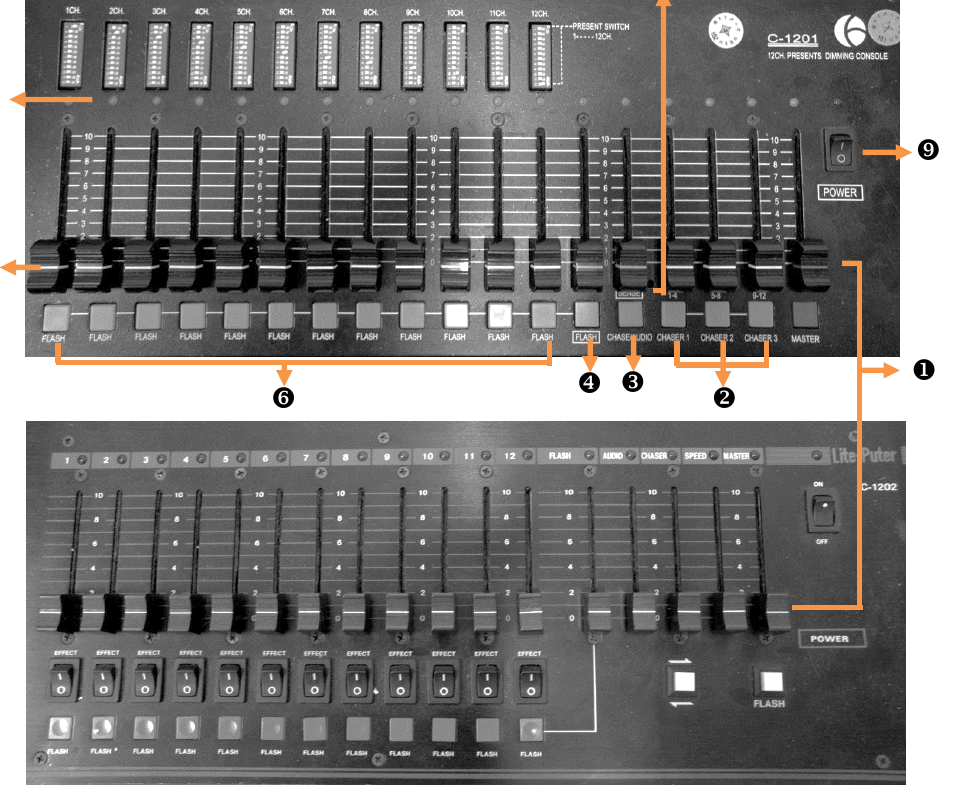

# Touchlight、C-1201、C-1202（類比）

## Touchlight

專為舞會設計的 Console，構造簡單實用。面板右方是電源開關，中間是 12 個觸碰式開關，左邊兩個按鈕切換操作模式。背面接 25pin–25pin 線。

| 模式 | 動作 |
| --- | --- |
| HOLD | 碰一下觸控開關，該 Channel 的燈一直亮；再碰一下關閉 |
| FLASH | 手按住才亮，手一離開就滅 |

適度切換兩種模式，可以讓舞會的燈光更多變。

<figure markdown="span">
  { loading=lazy width="892" }
  <figcaption>原講義 p.86</figcaption>
</figure>

## C-1201、C-1202

<figure markdown="span">
  { loading=lazy width="964" }
  <figcaption>上：C-1201；下：C-1202；原講義 p.87</figcaption>
</figure>

| # | 名稱 | 功能 |
| --- | --- | --- |
| 1 | MASTER | 主電壓輸出（0–10 V），調控 Ch.1–12 推桿（7）及 FLASH 推桿（4）的輸出 |
| 2 | CHASER 1、2、3 | 三個獨立控制的跑燈組，推桿分別調 Ch.1–4、5–8、9–12 的跑燈速度 |
| 3 | CHASE/AUDIO | 自動調速跑燈與聲控跑燈的切換；CHASER 1、2、3 任一組啟動時，按下橙色鍵即可聲控 |
| 4 | FLASH | 控制 Ch.1–12 各自 FLASH 黃色按鈕的亮度 |
| 5 | SENSE | 聲控跑燈的靈敏度（內建 Mic 的感應程度） |
| 6 | 各別 FLASH 按鍵 | 按下即觸發該 Channel 的 FLASH 輸出 |
| 7 | 各別調光推桿 | 分別控制 Ch.1–12 的亮度 |
| 8 | 指示燈 | Ch.1–12 的指示燈：綠色為準備狀態（可當夜光指示），轉紅表示該 Channel 有輸出電壓 |
| 9 | POWER | 前級電源總開關 |

### 操作重點

*（補充自資料夾內《C1201 C24 重點整理》）*

- 用 25pin–25pin 線連接後級。
- **推燈**：先推 MASTER，再推單 Channel 的 Fader。
- **亮度相乘**：單 Channel × MASTER。例：Ch.1 推 50%、Master 推 40% → 燈亮 20%。
- FLASH 推桿也受 MASTER 控制；亮度以較亮者優先。
- **跑馬**：CHASER 1、2、3 分別控制 Ch.1–4、5–8、9–12，要先開啟；跑馬的亮度由單 Channel 的 Fader 決定，CHASER 推桿調速度，指示燈顯示速度。跑馬開始後，該組的單 Channel Fader 和 Flash 即失去作用。
- **聲控**：CHASE/AUDIO 切到 AUDIO 後，推桿改為控制內建 Mic 的靈敏度，CHASER 的速度推桿失去作用。
