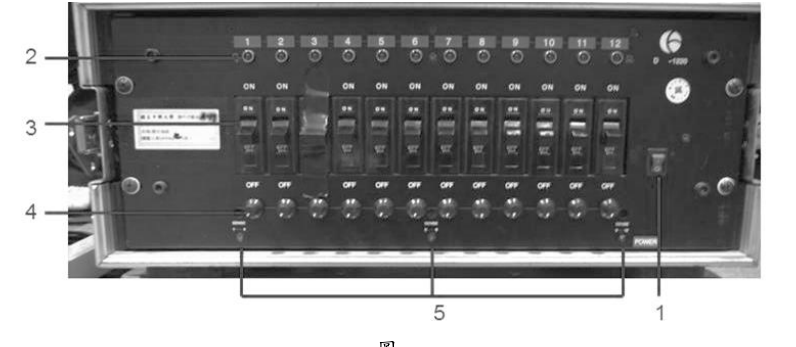
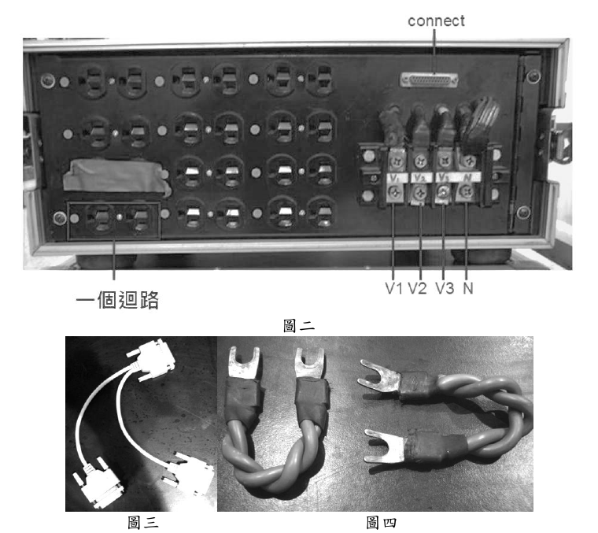
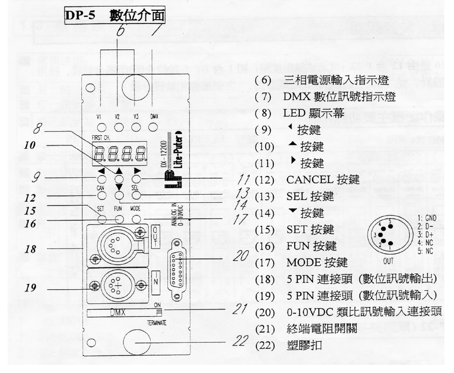

# 燈光後級（Dimmer）

## Dimmer（調光器）的原理

調光器調節電壓、電流大小，藉以控制燈的亮度。電流經濾波器送到矽控半導體（SCR）或固態繼電器（SSR）；控制器送出的訊號經處理器送到各個 SSR，藉此控制各迴路的燈具。

燈光系統分成 **Console（前級）** 與 **Dimmer（後級）**：後級依前級送來的訊號，對不同 Channel 輸出不同大小的電流。

### 哪些燈泡可以調光

| 燈泡 | 特性／用途 | 可用改變電流調光？ |
| --- | --- | --- |
| 放電燈泡 | 色溫高、亮度大，常用於 Follow Spot 或 Scan | ✗ |
| 石英燈泡 | 常見於各式聚光燈 | ✓ |
| 白熾燈泡 | 最常見、最普遍 | ✓ |

!!! warning "注意"

    幾乎所有會旋轉的效果燈都有變壓器及馬達，需要足夠且穩定的電壓，否則容易損壞。這類燈不要用調光的方式控制：直接插壁插，或用 AC-BAR 開關。

### 共通規格

- 地線 N，火線 V1、V2、V3（或標 R、S、T），三條火線都要「過電」才能使用。
- 12 個迴路，每迴路最大 20 A（安全起見抓 15 A），迴路間平均配電。

## Power Pack（類比式後級）

<figure markdown="span">
  { loading=lazy width="796" }
  <figcaption>圖一：正面，原講義 p.83</figcaption>
</figure>

| # | 正面 | 說明 |
| --- | --- | --- |
| 1 | 電源開關 |  |
| 2 | LED 指示燈 | 顯示該 Channel 亮或滅（有受前級控制） |
| 3 | 無熔絲開關 | 各 Channel 防過載 |
| 4 | FLASH | Ch.1–12 在未接前級時的調光鈕（測試、檢查用）；非不得已請勿移動 |
| 5 | SENSE | 燈絲靈敏度，防漏光；**勿碰** |

<figure markdown="span">
  { loading=lazy width="760" }
  <figcaption>圖二：背面；圖三：Power Link；圖四：Y 型 25pin 線；原講義 p.84</figcaption>
</figure>

- 背面右方有 V1、V2、V3（或 R、S、T）接孔，主電源接在此，最多可接三條火線；N 為地線。
- **只有一條火線時，要用 Power Link 串連**。
- 「connect」為 25-pin 母頭，接前級（25pin–25pin 線）。
- 左方 12 個迴路，每組迴路有兩個母頭，最多 20 A。
- 正面 Ch.1–12 的開關，**通電前要切到 OFF**。
- 可用 Y 型 25-pin 訊號線同時控制兩台 Power Pack。
- 若燈具不受 Console 控制，先檢查排線兩端有沒有接好。

## DX-1220（數位式 Dimmer）

由 12 台單迴路推動模組和一個 **DP-5 數位介面**組成。

- 正面：12 個 Channel 及其開關、數位介面、兩個 5-pin 的 DMX 輸入與輸出孔、15-pin 排線孔。
- 背面：三條火線 V1、V2、V3 與一條地線 N。
- 電箱有三條火線時分別接到 Dimmer 的三條火線；只有一條或兩條時，Dimmer 的火線要串聯使用（軟式 Power Link）。
- 可用 DMX OUT 再串接另一台 Dimmer（5pin–5pin）。
- **開機、關機時 Dimmer 都必須設定成 OFF 模式。**

<figure markdown="span">
  { loading=lazy width="892" }
  <figcaption>DP-5 數位介面，原講義 p.85</figcaption>
</figure>

### 三種工作模式（按 MODE 鍵切換）

| 模式 | 面板顯示 | 說明 |
| --- | --- | --- |
| 數位模式 | `d.001.`、`d.013.` … | 接數位前級（C-24X、MX），經 DMX IN，用 5pin–5pin 或 3pin–5pin 線。d 表示數位；正常收到訊號時有兩個小亮點（d 下方和數字下方）。**d 下方的點不見 = 沒有數位訊號輸入** |
| 類比模式 | `AE12` | 接類比式前級（如 ZERO-88） |
| OFF 模式 | `OFF` | 不接受 Console 的訊號 |
- 做完任何設定修改後，按 **SEL** 鍵把設定輸入 Dimmer。
- 數字代表此 Dimmer 第一迴路對應前級的第幾個 Channel：第一台設 `d.001.`（前級 1–12），串聯的第二台設 `d.013.`（前級 13–24）。
- 其他功能：顯示溫度、電壓、設定迴路可調光／不可調光、亮度等。

### DP-5 面板

| # | 名稱 | # | 名稱 |
| --- | --- | --- | --- |
| 6 | 三相電源輸入指示燈 | 15 | SET 按鍵 |
| 7 | DMX 數位訊號指示燈 | 16 | FUN 按鍵 |
| 8 | LED 顯示幕 | 17 | MODE 按鍵 |
| 9–11 | ↑／按鍵 | 18 | 5-pin 連接器（數位訊號輸出） |
| 12 | CANCEL 按鍵 | 19 | 5-pin 連接器（數位訊號輸入） |
| 13 | SEL 按鍵 | 20 | 0–10 VDC 類比訊號輸入連接器 |
| 14 | ↓ 按鍵 | 21／22 | 終端電阻開關／塑膠扣 |

面板燈號 *（補充自《C1201 C24 重點整理》）*：**AC** — 沒接燈時亮、有接燈時熄滅；**TRIG** — 前級有送訊號時亮。
