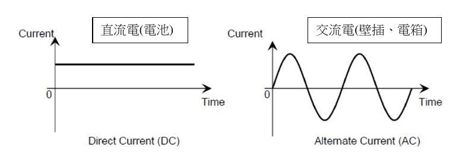
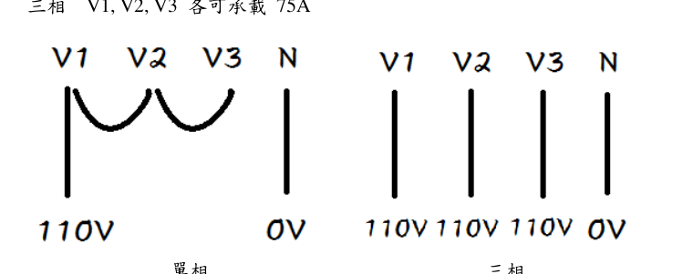
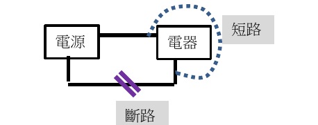

# 電學基礎與用電計算

## 電的來源

- **直流電（DC）**：電池。
- **交流電（AC）**：壁插、活動時燈具所接的電箱。常見電壓為 110V 與 220V。交流電價廉、功率大，使用最廣。

<figure markdown="span">
  { loading=lazy width="790" }
  <figcaption>直流電與交流電波形，原講義 p.77</figcaption>
</figure>

## 基本物理量

| 量 | 符號／單位 | 說明 |
| --- | --- | --- |
| 電壓 | V，伏特（V） | 電流在導線中由 A 點傳到 B 點需要的「壓力」（電動勢） |
| 電流 | I，安培（A） | 分直流與交流 |
| 電阻 | R，歐姆（Ω） | 物體阻礙電流通過的能力；電線這類低電阻物體稱為導體 |
| 電功率 | P，瓦特（W） | 線路中的電流提供功率，電器吸收功率，即負載量。1000 W 用一小時為一度電 |

!!! note "公式"

    **電功率公式：P = I × V**

    **歐姆定律：V = I × R**

## 用電量的計算

燈具消耗的電量必須小於電箱所能提供的電量，否則會跳電或電線走火。

**例題 1**：電箱 Breaker 規格 110V、75A；PAR 燈燈泡 1000W、110V。最多可接幾顆？

- 為方便計算，把 110V 簡化成 100V。
- 一顆 PAR 燈的電流 ≈ 1000 W ÷ 100 V = **10 A**
- 75 A ÷ 10 A → 最多接 **7 顆** PAR 燈。

**例題 2**：2 顆佛式燈（750W）+ 3 顆 500W 天幕燈，110V 電箱至少要能供多少電流？

- 總功率 = 2 × 750 + 3 × 500 = 3000 W
- 以 100V 估算：3000 ÷ 100 = **30 A**（以 110V 精算約 27.3 A；用 100V 算較保守）

## 常見燈具功率

| 燈具 | 功率 | 燈具 | 功率 |
| --- | --- | --- | --- |
| PAR 燈 | 1000 W | 雙球燈 | 600 W |
| 佛式燈 | 750 W | 噴煙機 | 800 W |
| ZOOM 燈 | 1000 W | 鏡球／落地鏡球 | 300 W |
| 天幕燈 | 300 W 或 500 W | 泡泡機 | 30 W |
| 閃光燈 | 300 W 或 750 W | 雷射燈 | 200 W |
| 一條龍燈 | 500 W | 萬丈光芒燈 | 500 W |
| ET 燈 | 400 W | 火箭燈 | 360 W |
| 小雨燈／大雨燈 | 30 W | 小旋轉燈 | 160 W |
| 七彩燈 | 300 W | 燈串 | 300 W |
| LED PAR | 120 W |  |  |

## 線材最大負載電流

| 線材 | 最大電流 |
| --- | --- |
| 黑線（延長線） | 15 A |
| 灰線（較長的延長線） | 20 A |
| 主電源線（38 mm²） | 100 A |
| 主電源線（22 mm²） | 70 A |
| 後級單一迴路 | 20 A（安全起見抓 15 A） |
| 一般兩孔壁插 | 15 A（實際打八折，12 A） |

每個電箱、每條線路、每個零件都有最大電流限制。設計燈光時要先算總用電量，確認電箱足夠供應。沒接電箱而用壁插時，要先了解場地的配電，盡量分散到不同電路，以免跳電或線路燒毀。

## 相位

交流電的火線與火線、火線與地線之間的相位差就是電壓。不同接法會有不同的電壓和承載量。

例：電源規格「單迴路 110V 75A」

|  | V1、V2、V3 的承載 |
| --- | --- |
| 單相 | 三者**總共** 75 A |
| 三相 | 三者**各自** 75 A |

<figure markdown="span">
  { loading=lazy width="760" }
  <figcaption>單相與三相，原講義 p.84</figcaption>
</figure>

## 配接電線常識

1. 用三用電表測 Breaker 的交流電壓是否符合電器規格（通常 110V 或 220V）。
2. 配接電源時：**先接地線，再接火線；先接後級，再接電箱。**
3. 用電功率公式算出所有電器的總電流，確認在電箱負荷之內；超過會電線走火或電壓不足。
4. 所有電線不可短路，規格必須足以負載所有電流；使用前要檢查是否斷路或短路（測線）。
5. 音響器材的電源，要與容易產生高頻干擾的冷氣機、馬達，或需要大電流的舞台燈光系統**分開架設**。

<figure markdown="span">
  { loading=lazy width="458" }
  <figcaption>斷路與短路，原講義 p.78</figcaption>
</figure>

!!! warning "注意"

    一般燈具接上 220V，燈泡會燒毀。Dimmer 可承受 220V，但大多燈具不行。接好電後先用三用電表檢測，或先以天幕燈測試。
