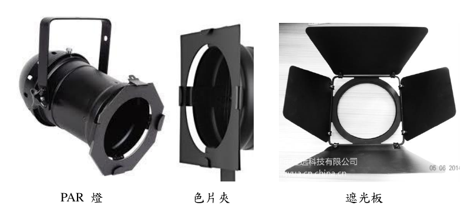
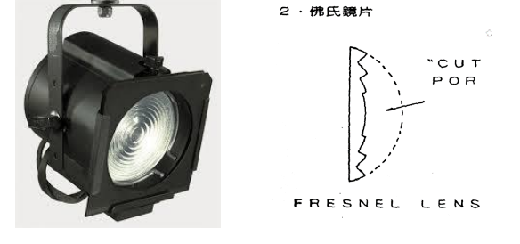
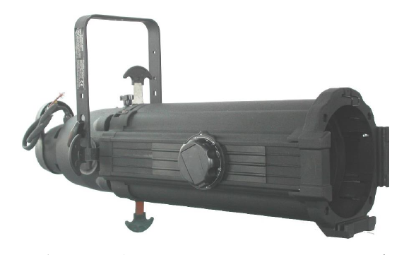
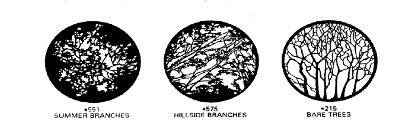
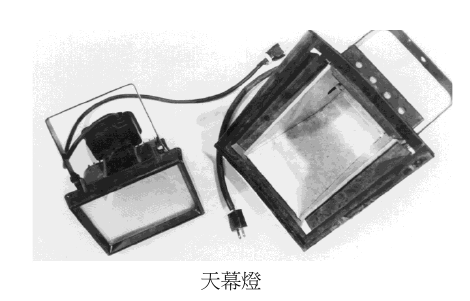
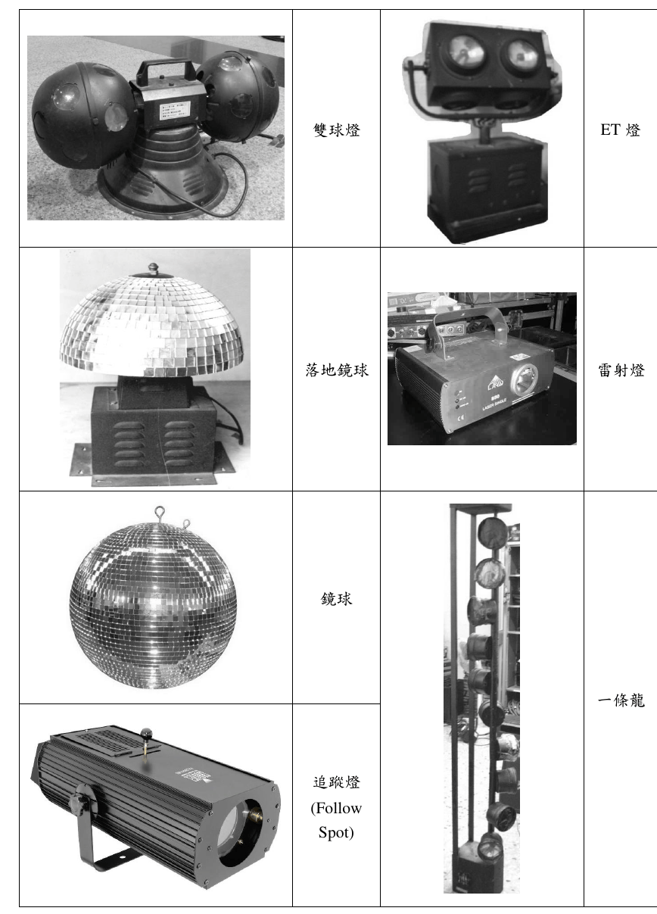

# 燈具介紹

## 聚光燈

### PAR 64 燈【110V、1000W】

PAR 是 Parabolic Aluminum Reflector（拋物型鋁質反射體）的縮寫，因使用拋物型反射鏡而得名。依燈泡直徑有 PAR 36、46、56、64，數字代表燈泡直徑。

<figure markdown="span">
  { loading=lazy width="802" }
  <figcaption>PAR 燈、色片夾、遮光板，原講義 p.99</figcaption>
</figure>

依投射角分四型，口訣 **N 聚 S 散**：

| 型 | 鏡面 | 投射角 | 適合距離 | 說明 |
| --- | --- | --- | --- | --- |
| N（FFN） | 透明玻璃 | 最小 | 約 35 m | 單位亮度最大、照得最遠；近距離投射會明暗不協調 |
| P（FFP） | 霧玻璃 | 次小 | 約 25 m |  |
| R（FFR） | 大方格狀玻璃 | 次大 | 約 15 m | 距離太遠照度不足而失去效果 |
| S（FFS） | 小方格狀玻璃 | 最大 | 約 5 m | 單位亮度最小、照得最近 |
- PAR 燈打出來的光不論聚散都是**長條形（橢圓，燈絲形狀）**，調燈時要轉動燈泡找最佳效果。
- 加**色片夾**可以換色。要用耐高溫的色片，不能用一般玻璃紙，會融化黏在燈上。
- 加**遮光板**可以限制光的範圍，但不會把光切成正方形；加了之後前面變重，可能要用鐵絲固定。
- 1000 W，用一下就會很燙。

### 佛式燈（Fresnel Spotlight）【110V、750W】

因採用佛式透鏡而得名。可以改變光區的大小及亮度，讓光區呈現聚光與散光兩種光質；光圈比 PAR 燈柔和。

佛式透鏡：把一片平凸透鏡切掉球形面的大部分，再把球形表面複製成一連串傾斜的同心圓環；每個傾斜環就像一片透鏡，把燈泡及反射鏡發出的散亂光源聚集成平行光。

<figure markdown="span">
  { loading=lazy width="584" }
  <figcaption>佛式燈與佛氏鏡片剖面，原講義 p.99</figcaption>
</figure>

### ZOOM 燈【110V、1000W】

使用石英燈泡與橢圓形反射鏡，又稱橢圓形反射鏡燈具（Ellipsoidal Light）。由一片或兩片透鏡構成，光度較亮、投射距離較遠。燈身周圍有四組 **Shutter**，可以把光束切成方形或半圓形；也可以加 **GOBO 片**做出特殊燈形。

<figure markdown="span">
  { loading=lazy width="572" }
  <figcaption>原講義 p.100</figcaption>
</figure>

**GOBO 片**：用耐高熱的鋼片製成，可以把上面刻的圖案投射到地板或天幕上。

<figure markdown="span">
  { loading=lazy width="705" }
  <figcaption>GOBO 片範例，原講義 p.100</figcaption>
</figure>

### 飛機燈（AC 燈）

原本是機場跑道導引飛機起降的燈具。光線是一直束，投射點只有一小點，瓦數高，適合做舞台光束特效。

### 追蹤燈（Follow Spot）

追隨主演者、加強正面光以示凸顯。色溫相當高（多在 3200–5200K），錄影時畫面會偏藍，要加降溫紙。

## 泛光燈

### 天幕燈【300W／500W】

散光燈，用來打亮天幕，照射範圍寬廣。

<figure markdown="span">
  { loading=lazy width="470" }
  <figcaption>原講義 p.100</figcaption>
</figure>

## 效果燈

<figure markdown="span">
  { loading=lazy width="868" }
  <figcaption>雙球燈、ET 燈、落地鏡球、雷射燈、鏡球、一條龍、追蹤燈，原講義 p.102</figcaption>
</figure>

| 燈具 | 規格 | 說明 |
| --- | --- | --- |
| 閃光燈 | 110V，300W／750W | 背後有旋鈕可調閃光頻率 |
| 一條龍燈 | 110V、500W | 燈泡規格與旋轉燈相同 |
| ET 燈 | 110V、400W | 常用於舞會 |
| 小雨燈 | 110V、30W | 照射範圍有限，常用於打亮鏡球或局部做色 |
| 小色燈 | 110V、300W | 同上 |
| 七彩燈 | 110V、300W | 內有馬達和小 Mic，收到外界聲音就轉動；背後旋鈕調靈敏度；可變化七種花色 |
| 雙球燈 | 110V、600W | 外閥轉動、內燈不動；適合舞會 |
| 噴煙機 | 110V、800W | 常用於舞會及劇場，必須用專用煙油；要預熱約 10 分鐘。可以讓光束現形 |
| 鏡球／落地鏡球 | 110V、300W | 搭配小雨燈，打出很多旋轉亮點 |
| 泡泡機 | 110V、30W | 搭配風扇效果更好；用專用泡泡水，不要自己用清潔劑調 |
| 雷射燈 | 110V、200W | 多變的雷射光束，可聲控，搭配噴煙機更佳。**不可肉眼直視光束** |
| 萬丈光芒燈 | 110V、500W | 自動旋轉的鏡球燈，有漂亮的光束，可搭配噴煙機 |
| 火箭燈 | 110V、360W | 主軸轉動，四個圓筒狀燈軸也跟著轉 |
| 小旋轉燈 | 110V、160W | 主軸轉動，燈軸不動 |
| 飛碟燈 | 110V、160W | 可多方向旋轉 |
| 燈串 | 110V、300W | 局部做色 |

!!! warning "注意"

    幾乎所有會旋轉的效果燈都有變壓器及馬達，要供給足夠且穩定的電壓，否則易損壞燈具或變壓器。不用 Console 控時，插壁插或用 AC-BAR 開關。

## 數位燈具

*（本節補充自資料夾內《數位燈具與數位前級講義》）*

數位燈具一般指以 LED 取代鹵素燈或高強度放電燈作為光源的舞台燈光設備，有 LED PAR、聚光燈、條形燈和搖頭電腦燈等。

|  | 傳統燈具 | 數位燈具 |
| --- | --- | --- |
| 控制方式 | 調整電壓輸出，用電流控制亮暗 | 改變數位訊號數值來控制功能 |
| 優點 | 光質暖、亮度高 | 耗電小，可接一般電源；不易產熱；功能多、顏色與效果選擇多；較安全、環保 |
| 缺點 | 耗電、發燙 | 燈色較硬較冷；光暈容易擴散；輸出強度較低；成本高；**極度怕水**，需防潮 |

| 燈具 | 說明 |
| --- | --- |
| 三色 LED PAR（3W×36，RGB） | 功率約 120 W。運行模式：靜態單色、動態變色（自動／聲控；內建或自編程式）、DMX512 外控（Ch07、Ch05 兩種通道模式） |
| 四色 LED PAR（3W×54，RGBW） | 多了白光。DMX 有 STAG、ARC.1、ARC.2、AR1.d、AR2.d、AR2.S、HSV 七種通道模式；另有主從連動、白平衡、偏色校正、超溫保護、鍵盤鎖 |
| 琥珀色 LED（3W×36） | 燈光較柔和；DMX 只有 2 個通道（頻閃、總調光） |
| 雷射燈 | DMX 由 7 個通道控制 |
| 搖頭電腦燈 | 燈軸可水平／垂直連續運動，內建色盤及多種圖形 |

LED PAR 的面板按鍵：FUNC／MENU（主選單或返回）、ENTER（進入或確認）、UP、DOWN。手動模式選單與 DMX 各通道功能表見「燈光前級 → DMX 控台與 LED PAR」。
