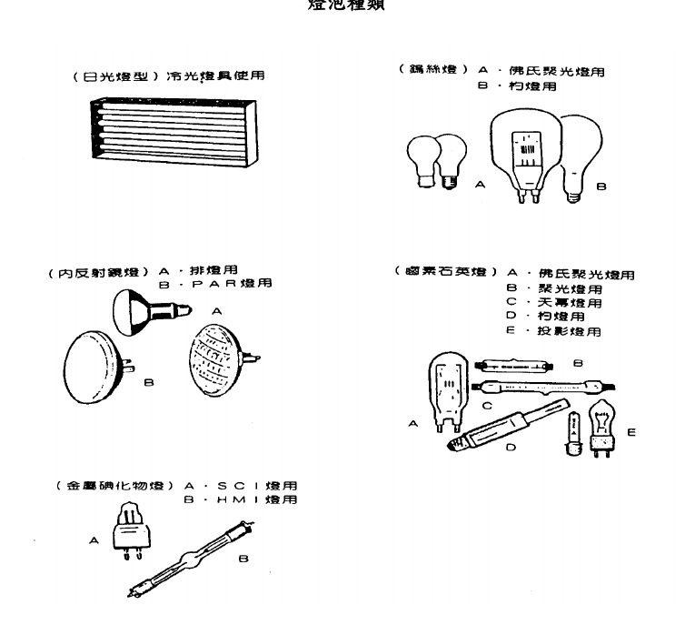
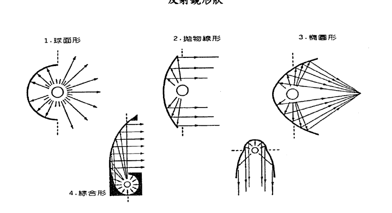

# 照明光學

## 燈泡的種類

| 燈泡 | 特性 | 用途 |
| --- | --- | --- |
| 日光燈型 | 輸出亮度不足（對電視燈光而言），大面積散光，色溫 5000–6000K | 辦公室照明 |
| 鎢絲燈 | 功率不能太高（5–200 W） | 佈景裝飾燈、家庭 |
| 鹵素石英燈 | 效率與壽命都高，亮度與色溫固定（3000–3200K） | 主要燈具的燈泡，如 Fresnel |
| 內反射鏡燈泡 | 方向性好、投射遠、重量輕 | 戶外演唱會，如 PAR64 |
| 金屬碘化物燈 | 色溫 5000K 以上，效率最高（HMI、CSI、CID） | 大白天補光、夜間大場景 |

<figure markdown="span">
  { loading=lazy width="765" }
  <figcaption>燈泡種類，原講義 p.104</figcaption>
</figure>

## 燈具的反射鏡

反射鏡是置於光源後方、表面經處理的曲面金屬板，功能有二：把散向後方的光線重新導向（集中或泛射），以及加強照明度。

### 表面處理

| 類型 | 說明 |
| --- | --- |
| 鏡面反射（Specular） | 非常光滑的鏡面，入射角等於反射角 |
| 散射（Diffuse） | 平滑、模糊的表面，平均地柔化並反射光線，如 Broadlight |
| 混合反射（Mixed） | 兼具鏡面與散射，反射出硬光與散射光的混合 |
| 亂射（Scattered） | 縐縮、點刻或縐摺狀的表面把入射光打散，像很多小鏡子 |

### 形狀

| 形狀 | 代表燈具 |
| --- | --- |
| 球面狀（Spherical） | 佛式燈 |
| 橢圓形（Ellipsoidal） | LEKO |
| 拋物線形（Parabolic） | PAR64、PAR36 |
| 球面與拋物線綜合形 | Softlite |

<figure markdown="span">
  { loading=lazy width="765" }
  <figcaption>反射鏡形狀，原講義 p.104</figcaption>
</figure>

## 簡易的燈具維修

燈具損壞多半是人為使用不當（燈絲摔斷、插頭摔壞），小心使用是第一要務。

**燈不亮的檢查順序**：插頭是否鬆脫 → 燈泡是否斷裂 → 燈座接線或延長線。

### 燈絲故障的原因

- **彎曲**：可能是反射鏡位置不良（反射光聚在燈球內，溫度過高），或燈座電壓過高。用久的燈泡燈絲也會彎，可視為老化程度。
- **振動**：損壞的最大原因。剛用完時燈絲溫度極高、非常脆弱，拆燈或放燈要小心，**等冷卻後再拆**。

### 延長線

燈不亮不一定是燈的問題，延長線也會短路、斷路。先找另一條交換，再來維修。

## 照明的單位

| 單位 | 定義 |
| --- | --- |
| 照度（Lux） | 投落在表面的光通量。**與光源的燭光數成正比，與距離的平方成反比** |
| 呎燭光（foot candle, fc） | 距離 1 燭光的光源 1 英呎處，1 平方英呎表面上的光通量。1 fc = 10.76 Lux |
| 輝度（Nit） | 從被照物體表面反射出來的亮度。Nit = 照度 × 反射率 ÷ 4 |

例：300 燭光的光源，在 10 ft 遠的表面上：

**L = 300 ÷ 10² = 3 fc**
