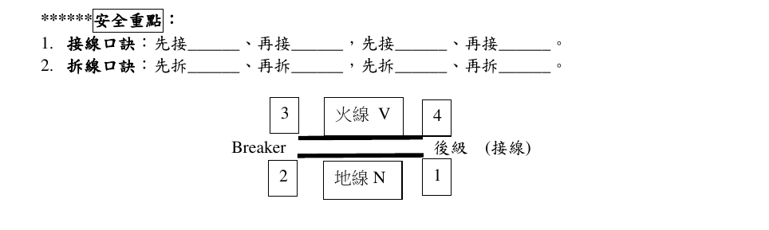
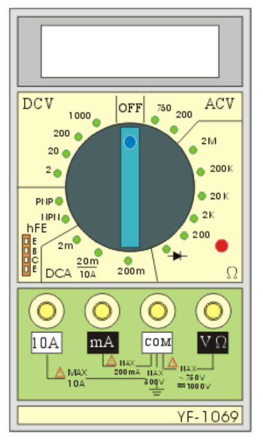
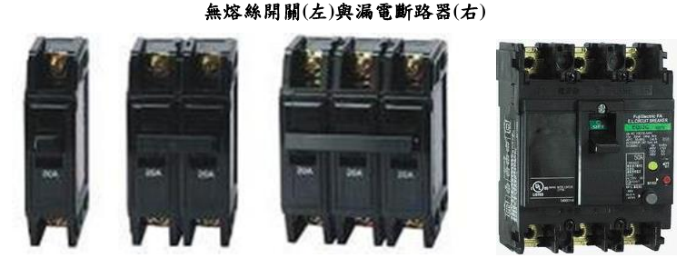
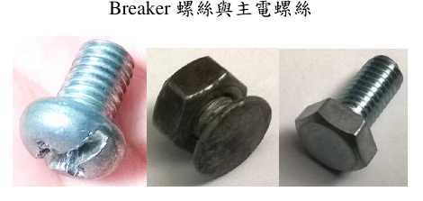

# 接電安全與三用電表

接電是架設燈光系統最危險的步驟。通常在所有器材都架好、每顆燈的線路都走好、要開始調燈時才接電。電看不見也聽不著，沒注意就可能觸電、火災、損毀器材。安全取決於三件事：

1. **電量計算** → 見「電學基礎與用電計算」
2. **電源狀況**（用三用電表確認）
3. **接電方法**

## 接電口訣

!!! tip "口訣"

    **接線：先接地線，再接火線；先接後級，再接電箱。**

    **拆線：順序相反 — 先拆火線，再拆地線；先拆電箱，再拆後級。**

    接、拆之前，Breaker 都要先切到 OFF。

<figure markdown="span">
  { loading=lazy width="964" }
  <figcaption>Breaker 與後級之間火線 V、地線 N 的接線順序編號 1–4，原講義 p.82</figcaption>
</figure>

## 觸電事故

人體因電流流入而受到的傷害。輕重取決於：電流通過的部位、電壓高低、電流大小與通過時間、人體電阻值、電源頻率。

- **通過部位**：電流走電阻最小的路徑，與接觸的器官、站立位置及接觸的絕緣物有關。
- **電壓**：超過 **35 V** 對人體就有相當的危險性。低壓觸電多半是因為輕忽，例如雙手潮濕操作開關。
- **電流與時間**：通過時間越久傷害越重。

| 電流（mA） | 徵兆 |
| --- | --- |
| 0.3 | 感覺的下限 |
| 1 | 戰慄 |
| 10 | 肌肉痙攣 |
| 30 | 昏迷 |
| 50 | 心房顫動、死亡 |
| 100 | 死亡 |
- **人體電阻**：潮濕的皮膚電阻遠低於乾燥皮膚，更容易嚴重觸電。

| 部位 | 電阻值 |
| --- | --- |
| 兩耳間 | 100 Ω |
| 體內組織（手至耳間） | 400–600 Ω |
| 潮濕皮膚 | 1,000 Ω |
| 乾燥皮膚 | 100,000–600,000 Ω |

## 三用電表

使用電箱或壁插前要先確認安全：有無漏電、電壓是否在正常範圍、是否穩定、NFB 是否正常作用。三用電表主要測電壓、電流、電阻，有數位式與指針式。

<figure markdown="span">
  { loading=lazy width="440" }
  <figcaption>三用電表面板：DCV／ACV／DCA／Ω／hFE 檔位與 10A、mA、COM、VΩ 插孔，原講義 p.117</figcaption>
</figure>

共通步驟：黑棒插 **COM**，紅棒插對應插孔 → 旋鈕轉到該功能的**最高檔** → 接上待測物 → 依讀值切到較低檔以得到較準的值 → 讀取。

| 測量 | 紅棒插孔 | 檔位 | 接法 |
| --- | --- | --- | --- |
| 交流電壓 ACV | VΩ | ACV | 與待測電路**並聯**（電壓勿超過最大檔位） |
| 直流電壓 DCV | VΩ | DCV | 與待測電路**並聯** |
| 直流電流 DCA | mA 或 10A（依最大電流） | DCA | 與待測電路**串聯**（電流勿超過最大檔位） |
| 電阻 Ω | VΩ | Ω | 測試棒接到待測物兩端 |
| 導通蜂鳴 | VΩ | 蜂鳴檔 | 先讓兩棒相碰，確認電力足夠、蜂鳴器正常；再接線材兩端。不響 → 線材可能斷路 |
| 二極體 | VΩ | 二極體檔 | 接到二極體兩端；低電阻為順向（紅棒端為 N 極、黑棒為 P 極），對調後為高電阻（逆向） |
| 電晶體 hFE | — | hFE 區的 PNP 或 NPN | 依腳位插入電晶體測試座 |

用完把旋鈕轉到 **OFF** 以免耗電。

## 測電箱

接電箱或燈具插壁插前，先測交流電壓是否符合電器規格。測出 220V 要特別注意。

1. 三用電表轉到 **ACV** 檔
2. 找**絕對地線**
3. 以絕對地線測**外殼**（有無漏電）
4. 打開電箱，確認 Breaker 在 **OFF**
5. 測**地線**
6. 以地線測 Breaker **前**的火線
7. 以地線測 Breaker **擋住**的火線（OFF 時應無電）
8. 把 Breaker 打到 **ON**
9. 以地線測**通過** Breaker 的火線
10. 測完把 Breaker 關回 **OFF**

*（補充自《C1201 C24 重點整理》）* 順序概念：測電箱是否漏電 → 地線是否漏電 → Breaker 是否漏電 → 火線是否正常供電 → Breaker 是否正常供電。

## 接電箱注意事項

1. 安全接電口訣：先接地線，再接火線；先接後級，再接電箱
2. 接電時分清楚地線、火線
3. 所有螺絲鎖緊
4. 接完記得打保險（打在電箱上）

<figure markdown="span">
  { loading=lazy width="766" }
  <figcaption>無熔絲開關與漏電斷路器（原講義 p.118）</figcaption>
</figure>

<figure markdown="span">
  { loading=lazy width="470" }
  <figcaption>Breaker 螺絲與主電螺絲（原講義 p.118）</figcaption>
</figure>

## 器材接電注意事項

- **配電盤**：先接配電盤這一端，接好後再接牆上的電源箱；分清火、地線。
- **Dimmer & Power Pack**：確定火地線接線正確。Breaker 開啟後再開面板上的開關：先開風扇，最後才是單 Channel 的開關；拆卸時順序顛倒。
- Breaker 上不一定有螺絲，要自備。
- 發現電線或主電源線**異常發熱**，代表線路可能短路或連接不牢 → 立即停用並關閉電源，排除後才繼續。
