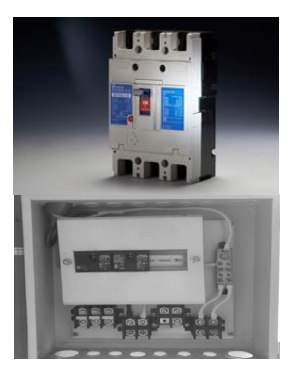
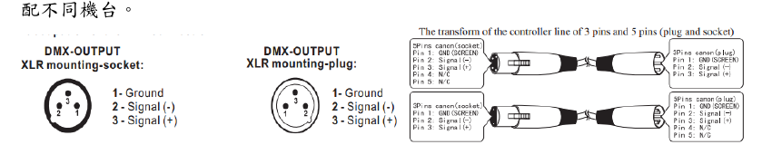
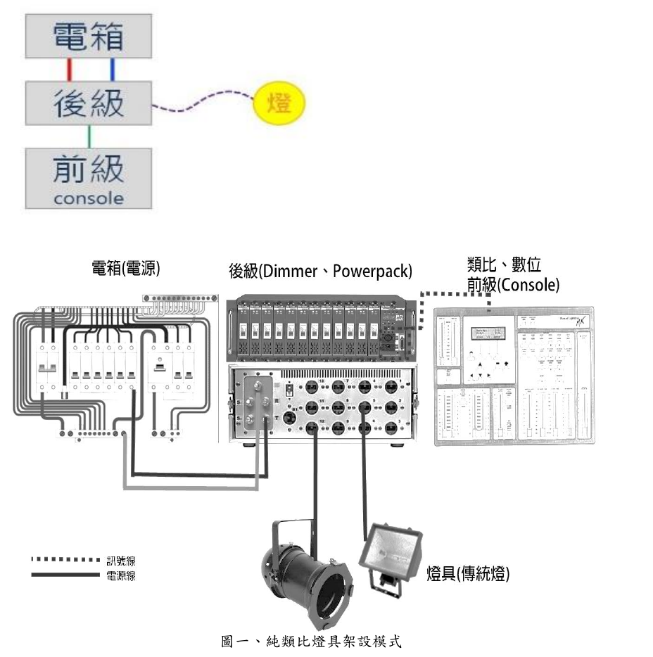
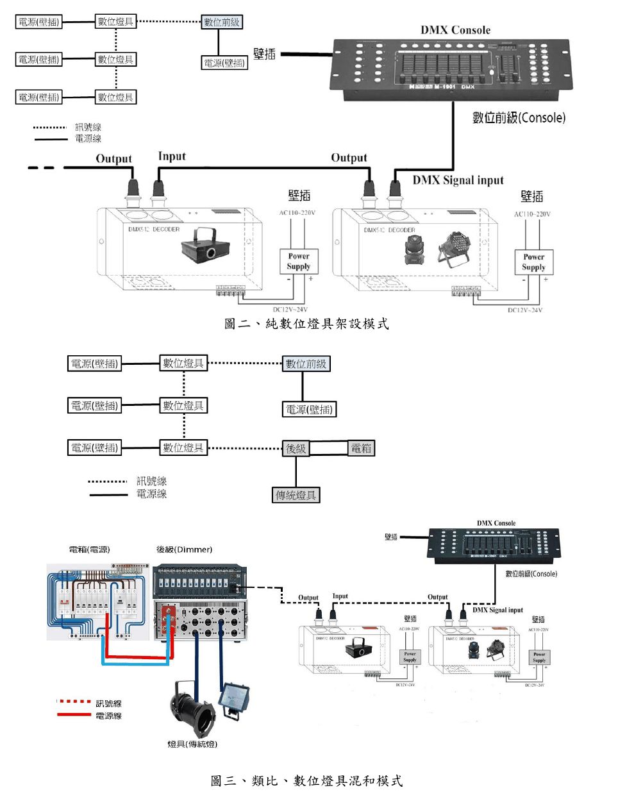

# 架設器材與系統示意

架設燈光系統時，要了解器材的數量與特性，在顧及安全的前提下規劃系統。

## 器材

### 斷路器

| 種類 | 動作原理 |
| --- | --- |
| **無熔絲斷路器 NFB**（No Fuse Breaker） | 大部分電箱使用。用電量超過電箱所能提供的電量時自動跳電 |
| **漏電斷路器**（Electricity Leakage Breaker） | 火線送出的電流要等於中性線回到斷路器的電流；送出量不等於送回量就跳電 |

<figure markdown="span">
  { loading=lazy width="296" }
  <figcaption>原講義 p.79</figcaption>
</figure>

### 線材

| 線材 | 說明 |
| --- | --- |
| 主電源線 | 內徑 38 mm²：可承受 100 A；較小的 22 mm²：70 A。一紅一藍，分別為火線、地線 |
| 延長線 | 黑線每條 15 A，灰線 20 A（較長）；可配合 Y 扣使用。另有成束的 Multi-cable |
| AC-BAR | 多孔插座的慣用語。注意上面標示的電流負載量，總用電不可超過 |
| 訊號線 | 連接前級與後級：5pin–5pin、3pin–5pin、25pin–25pin，依機台搭配 |
| Power Link | 只有一條火線時，用來把後級的 V1、V2、V3 串起來「過電」。Power Pack 用硬式，Dimmer 用軟式 |

<figure markdown="span">
  { loading=lazy width="850" }
  <figcaption>DMX 3-pin／5-pin XLR 腳位：1 Ground、2 Signal −、3 Signal +（原講義 p.79）</figcaption>
</figure>

### 鷹架

一組鷹架包括 **H 架、叉架及跨板**。主要用來懸掛燈具，也可以放喇叭、掛天幕。掛燈時用 C 型夾、背扣等；沒有這些工具就必須用鐵絲固定牢靠。架設細節見「搭場與撤場實務」。

## 系統示意：三種架設模式

1. 純類比燈具
2. 純數位燈具
3. 類比、數位燈具共用

<figure markdown="span">
  { loading=lazy width="928" }
  <figcaption>圖一：純類比燈具架設模式；電箱 → 後級 → 燈，前級 → 後級（原講義 p.80）</figcaption>
</figure>

<figure markdown="span">
  { loading=lazy width="964" }
  <figcaption>圖二：純數位燈具，DMX Console 以訊號線串接各燈、燈具直接插壁插；圖三：類比、數位混合（原講義 p.81）</figcaption>
</figure>

|  | 類比（傳統）燈具 | 數位燈具 |
| --- | --- | --- |
| 供電 | 電箱 → 後級（Dimmer／Power Pack）→ 燈 | 直接接一般電源（壁插／AC-BAR） |
| 控制 | 前級送訊號給後級，後級改變電壓電流來調亮暗 | 前級（DMX 控台）用訊號線直接串接燈具，改變數位數值來控制功能 |

## 何謂數位、類比

自然界的聲音、光線都以波的型態存在，儲存這些波有兩種方式：

- **數位**：用 0 與 1 的組合描述資料。較不受干擾，也較容易給出複雜的指令。
- **類比**：把波在一個數值範圍內的數據，全部轉成強弱不同的電壓記錄下來。

數位與類比訊號可以互相轉換。

## DMX512 簡介

*（補充自資料夾內《數位燈具與數位前級講義》）*

- DMX（Digital Multiplex）512 是 USITT（美國劇場技術協會）提出的數位燈控協定，現通用於全世界數位燈具與裝置的控制與配接。
- 每個通道以 8 位元傳輸，數值範圍 **0–255**（256 級）。
- 用 5-pin XLR（或 3-pin XLR）訊號線**串聯**燈具和機台，一條訊號線共可傳 **512 個地址**的資料。

| 術語 | 意思 |
| --- | --- |
| Chan.（Channel） | 通道 |
| Addr.（Address） | 地址 |
| Patch | 配接（把控台的通道指定到燈具／後級迴路） |
