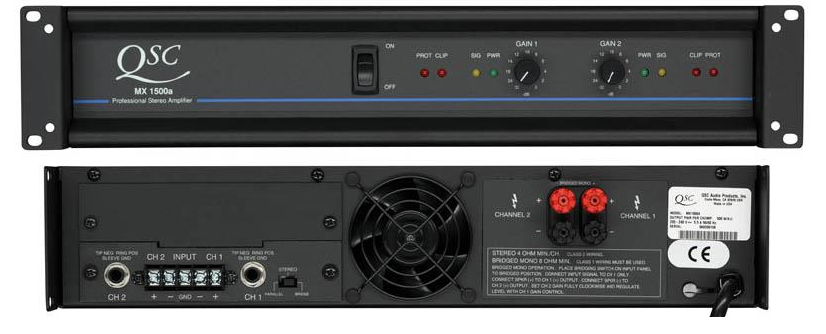
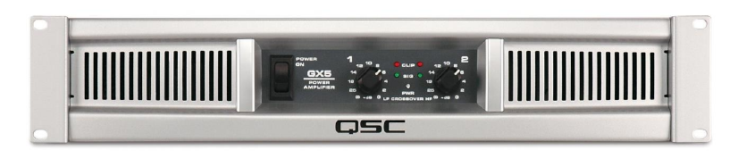
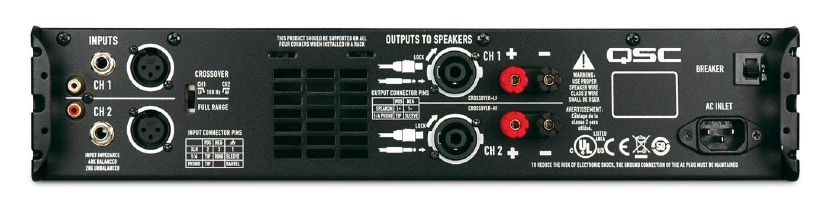
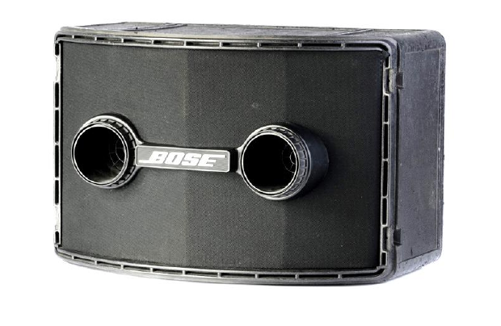
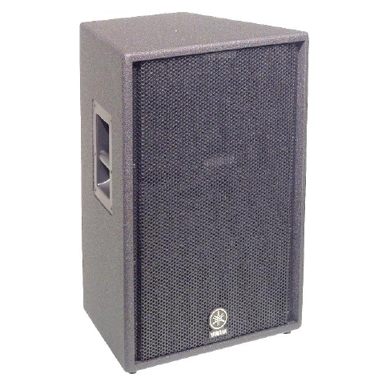

# 擴大機與喇叭

音源經過混音機及訊號處理器後，送入擴大機放大，再由喇叭播放。專業擴大機的功率比家用音響大上許多倍，使用時要小心。

!!! warning "注意"

    只要已經連接到喇叭，插拔線和開關其他設備之前，都必須**先關閉擴大機**。開機最後開、關機最先關。

## 擴大機

| 型號 | 每 Channel @ 4 Ω | 每 Channel @ 8 Ω |
| --- | --- | --- |
| QSC MX-1500 | 500 W | 330 W |
| QSC GX5（1 kHz） | 700 W | 500 W |
| CS-800X *（補充）* | 420 W（2 Ω：600 W） |  |

<figure markdown="span">
  { loading=lazy width="826" }
  <figcaption>QSC MX-1500 正面與背面（原講義 p.53）</figcaption>
</figure>

<figure markdown="span">
  { loading=lazy width="826" }
  <figcaption>QSC GX5 正面（原講義 p.53）</figcaption>
</figure>

<figure markdown="span">
  { loading=lazy width="826" }
  <figcaption>QSC GX5 背面（原講義 p.53）</figcaption>
</figure>

### CS-800X

*（補充自資料夾內《進階 PA II 講義》）*

除了擴大功能，本身還有保護用的壓縮功能（DDT）：訊號過大時自動啟動。有 FULL RANGE、BRIDGE、BIAMPED 三種模式，一般活動用 FULL RANGE 就足夠。

| 位置 | 說明 |
| --- | --- |
| DDT 指示燈 | 壓縮功能啟動時亮起 |
| 輸入旋鈕 | 等同 GAIN，控制輸入訊號大小 |
| HIGH Z INPUTS | Phone 頭輸入，具 Y-cord 功能 |
| LOW Z INPUTS | XLR 平衡式輸入 |
| OUTPUTS | 放大後的輸出，接喇叭 |
| MODE 切換 | 置於 STEREO |
| DDT 開關 | DEFEAT 關閉壓縮；ENABLE 啟動壓縮 |

## 喇叭

### 被動式喇叭

|  | Bose 802 II | Yamaha R112 |
| --- | --- | --- |
| 標稱阻抗 | 8 Ω | 8 Ω |
| 功率 | 推薦擴大機功率 240 W（最小）– 480 W（最大） | 額定 PGM 400 W、PEAK 800 W |
| 靈敏度 | 91 dB SPL（1 W, 1 m） | 97 dB SPL（1 W, 1 m on axis） |
| 覆蓋範圍 | 水平 120°、垂直 100° | 水平 90°、垂直 40° |

<figure markdown="span">
  { loading=lazy width="620" }
  <figcaption>Bose 802 II（原講義 p.54）</figcaption>
</figure>

<figure markdown="span">
  { loading=lazy width="482" }
  <figcaption>Yamaha R112（原講義 p.54）</figcaption>
</figure>

- Bose 802 II **一定要搭配 802C 控制器**（見「訊號處理器」）。
- Bose 802 屬於近場聆聽：開再大聲，也只有喇叭前面的人明顯覺得變大聲。場地深、人多時，解法是在後面多加喇叭，而不是把音量推大。

### 主動式喇叭

*（補充自資料夾內《PA 大堂課講義》）*

|  | JBL EON 615 |
| --- | --- |
| 額定功率 | 1000 W Peak（700 LF + 300 HF）；500 W Continuous（350 LF + 150 HF） |
| 覆蓋範圍 | 水平 90°、垂直 50° |

## 功率匹配的觀念

- 後級功率大於喇叭功率時（例：400 W 推 300 W），全輸出就可能燒喇叭 → 前面加壓縮限制器。
- 用兩顆喇叭做 500 人的晚會，一定是遠的人聽不清楚、近的人覺得吵，而且系統可能因負擔太大而永久受損。要依場地大小與預計人數規劃設備數量。
