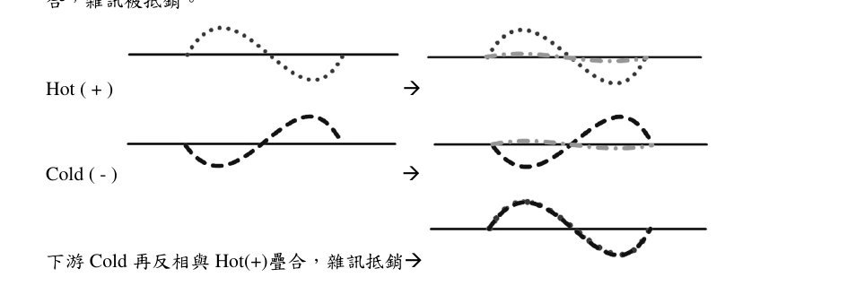
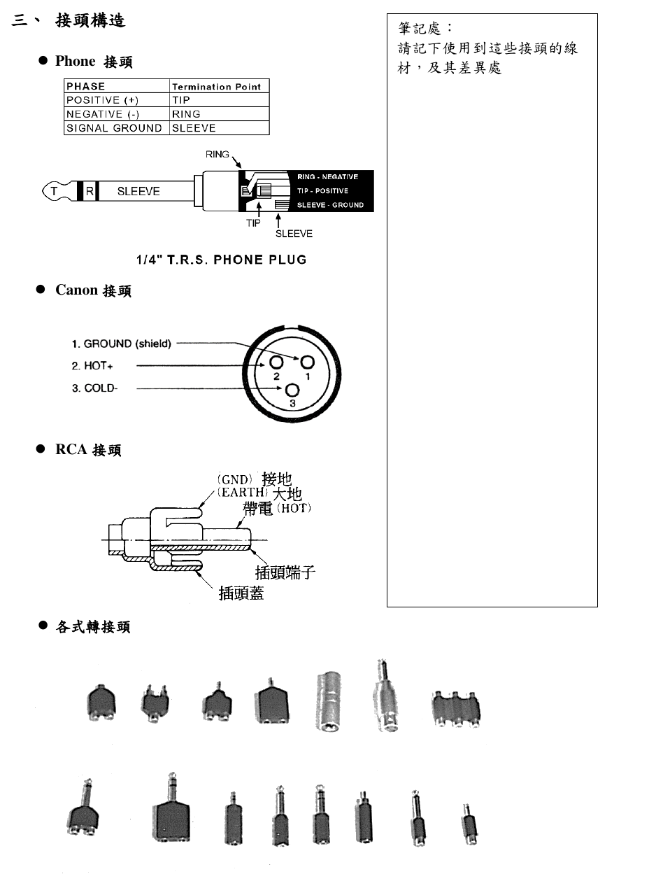
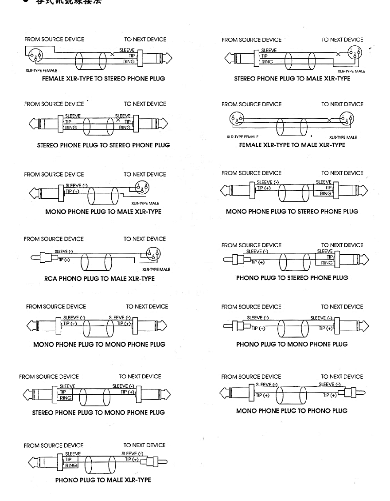
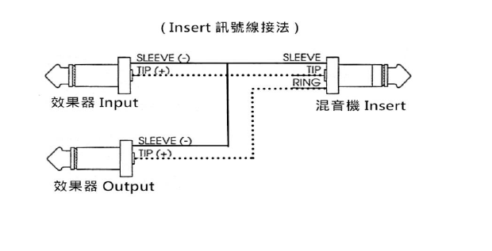
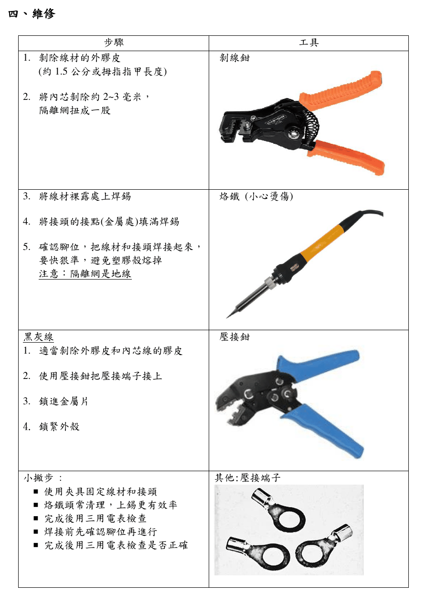

# 訊號線與接頭

## 訊號線的功用

機器與機器之間的訊號靠訊號線傳遞。一般音源訊號只有幾毫伏特（mV），而擴大機要正確運作需要約 0.7–1 V，所以要先用前置放大器放大；以麥克風為例，增益約 **100 倍**。

這個巨大的增益會把正常訊號和干擾雜訊一起放大，所以好的訊號線不只要忠實傳遞訊號，還要能隔離雜訊。

## 平衡式與非平衡式

|  | 平衡式（Balance） | 非平衡式（Unbalance） |
| --- | --- | --- |
| 構造 | 兩蕊導線傳訊號，外包隔離網（共三蕊） | 一蕊導線 + 隔離網傳訊號（共兩蕊） |
| 抗雜訊 | 外界干擾經隔離網接地隔離（屏蔽效應），正常訊號不受干擾 | 無法屏蔽，雜訊會跟著訊號一起傳 |

### 平衡式抵銷雜訊的原理

傳送時同時送出真實訊號 **Hot (+)** 與它的反相訊號 **Cold (−)**。兩者在途中受到同樣的雜訊影響；下游機台收到後，把 Cold 再反相一次跟 Hot 疊合，訊號加倍、雜訊正好抵銷。

<figure markdown="span">
  { loading=lazy width="964" }
  <figcaption>Hot／Cold 與雜訊抵銷，原講義 p.72</figcaption>
</figure>

### 使用原則與長度上限

- 所有訊號線盡量用平衡線（XLR／Canon）。
- 遇到非平衡且高阻抗的訊源，盡量用 DI box 降低阻抗並轉成平衡訊號；非平衡的部分越短越好。

| 線材 | 長度上限 |
| --- | --- |
| 低阻抗平衡式 | 80 m |
| 低阻抗不平衡式 | 20 m |
| 高阻抗不平衡式 | 10 m |

超過長度訊號會衰減、失真。

## 接頭構造

<figure markdown="span">
  { loading=lazy width="928" }
  <figcaption>Phone／Canon／RCA 接頭構造與各式轉接頭，原講義 p.73</figcaption>
</figure>

| 接頭 | 腳位 |
| --- | --- |
| **Phone（1/4" TRS）** | Tip：正 (+)；Ring：負 (−)；Sleeve：地（Ground）。單聲道 TS 頭只有 Tip（正）與 Sleeve（地） |
| **Canon（XLR）** | 1：Ground（shield）；2：Hot (+)；3：Cold (−) → **一地二正三負** |
| **RCA** | 中心針：訊號（Hot）；外環：接地 |

<figure markdown="span">
  { loading=lazy width="880" }
  <figcaption>各式訊號線接法：XLR↔Phone、RCA↔XLR、Mono↔Stereo…，原講義 p.74</figcaption>
</figure>

*（補充自《搭場線材講稿》）* 轉接頭常用的是 Phone 與 Canon，依機台有的孔決定；建議兩種都帶，現場出狀況才有得換。

## 常用線材

| 線材 | 說明 |
| --- | --- |
| 麥克風線（MIC IN） | Canon 平衡線 |
| Line 線（LINE IN） | Phone 頭訊號線 |
| 喇叭線／喇叭延長線 | 線徑較粗；雖然用 Canon 頭方便串接延長，實際只用兩個接點（正、地） |
| 喇叭並線 | 並聯第二顆喇叭用 |
| Insert 線 | Y 型，外接效果器用（見下） |
| Multi-cable | 多軌合一，當作控台的延伸 |

### 遮蔽雜訊的銅絲網

訊號線膠皮裡那層密編的銅絲網，既是信號電流的回流導體，也是擋住干擾的屏障。能擋的包括：無線射頻（RFI）、廣播電台（AM radio）、電磁感應干擾、靜電、變壓器、調光器（Dimmer）干擾等。

### DI box（Direct Injection Box）

一側是 Phone 非平衡輸入，另一側是 XLR／Canon 平衡輸出。把高阻抗非平衡的訊號（樂器、電吉他、拾音器等）轉成低阻抗平衡訊號，減少非平衡線材感應的雜音及音色衰減。用途兩點：

1. 轉換訊號的本質
2. 延長訊號（轉成平衡式有利於拉長線）

簡單版的自製 DI 純粹只是把 Phone 改成 Canon（等同轉接頭），接入混音機時要注意訊號源強度。

### Insert 訊號線（外接效果器用）

Y 型線：一個立體插頭分成兩個 Mono 插頭，同時傳遞輸出與輸入。

- 立體插頭的 **Tip** 接到一個 Mono 頭 → 送去**效果器的 Input**
- 立體插頭的 **Ring** 接到另一個 Mono 頭 → 接**效果器的 Output**，把訊號送回混音機
- 兩條 Mono 線的隔離網都焊到立體頭的 **Sleeve**（地）
- 立體插頭插入混音機的 Insert 孔

<figure markdown="span">
  { loading=lazy width="620" }
  <figcaption>Insert 訊號線接法，原講義 p.76</figcaption>
</figure>

## 測線

*（補充自《搭場線材講稿》）* 出場前線材都要測：三用電表轉到蜂鳴檔，測試棒接線材兩端對應的接點，有聲音表示導通。焊線時兩端腳位要對，不然訊號會錯亂。三用電表用法見燈光系統的「接電安全與三用電表」。

## 維修

<figure markdown="span">
  { loading=lazy width="892" }
  <figcaption>剝線鉗、烙鐵、壓接鉗、壓接端子，原講義 p.75</figcaption>
</figure>

### 訊號線（焊接）

| 步驟 | 工具 |
| --- | --- |
| 1. 剝除線材的外膠皮（約 1.5 公分或拇指指甲長度） | 剝線鉗 |
| 2. 內芯剝除約 2–3 毫米，隔離網扭成一股 | 剝線鉗 |
| 3. 線材裸露處上焊錫 | 烙鐵（小心燙傷） |
| 4. 接頭的接點（金屬處）填滿焊錫 | 烙鐵 |
| 5. 確認腳位，把線材和接頭焊起來；要快狠準，避免塑膠殼熔掉。**隔離網是地線** | 烙鐵 |

### 黑灰線（電源線，壓接）

1. 適當剝除外膠皮和內芯線的膠皮
2. 用壓接鉗把壓接端子接上
3. 鎖進金屬片
4. 鎖緊外殼

### 小撇步

- 用夾具固定線材和接頭
- 烙鐵頭常清理，上錫更有效率
- 焊接前先確認腳位
- 完成後用三用電表檢查是否正確
