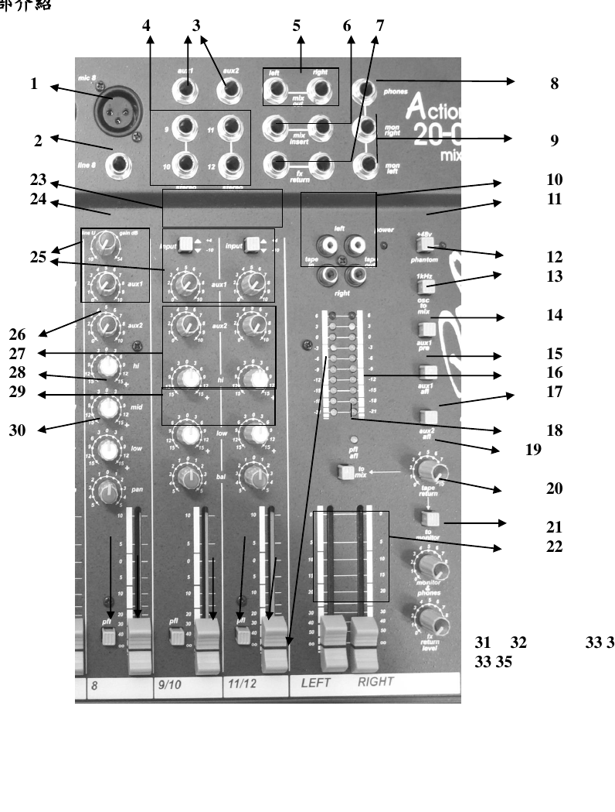
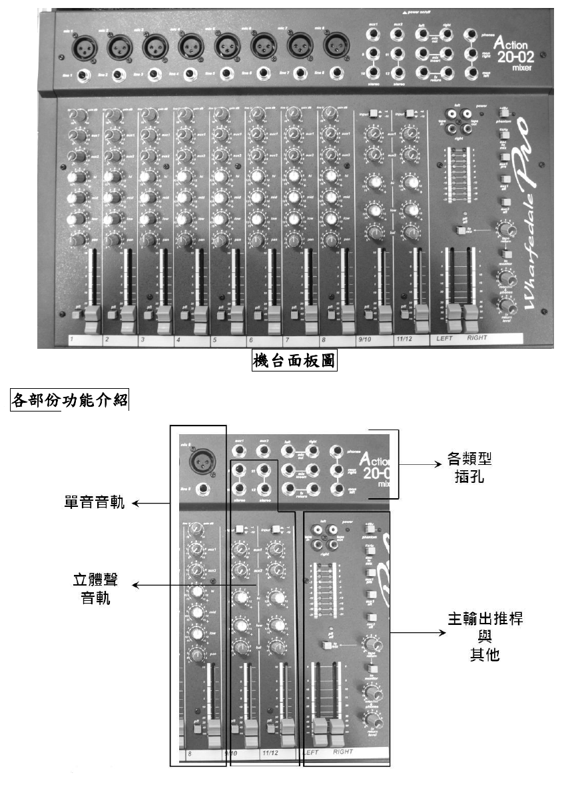

# Action 20-02

<figure markdown="span">
  { loading=lazy width="796" }
  <figcaption>面板與編號（原講義 p.46）</figcaption>
</figure>

<figure markdown="span">
  { loading=lazy width="880" }
  <figcaption>機台面板圖與分區：單音音軌／立體聲音軌／各類型插孔／主輸出推桿與其他（原講義 p.48）</figcaption>
</figure>

## 插孔

| # | 名稱 | 功能 |
| --- | --- | --- |
| 1 | Balanced XLR mic input | 單音音軌 Canon 頭輸入 |
| 2 | Balanced line level input | 單音音軌 Phone 頭輸入 |
| 3 | Aux 1 & 2 sends | Aux 1、2 輸出（Phone） |
| 4 | Stereo balanced line input | 立體聲音軌 Phone 頭輸入 |
| 5 | Main balanced outputs | 主輸出左右聲道（Phone） |
| 6 | Insert stereo for main mix output | 主輸出的插入點 |
| 7 | FX returns | 外部效果器處理完的訊號由此進入 |
| 8 | Headphones output | 監聽耳機 |
| 9 | Monitor outputs | 監聽喇叭 |
| 10 | RCA phono inputs and outputs | 外接立體音源輸入，或輸出到錄音設備 |

## 開關與主控

| # | 名稱 | 功能 |
| --- | --- | --- |
| 11 | Phantom power | 供 48V 給 Canon 頭的電容式麥克風 |
| 12 | 1kHz to main mix outputs | 送出 1 kHz 訊號到主輸出 |
| 13 | Aux 1 pre/post fader | 切換 Aux 1 為 Pre 或 Post-fader |
| 14 | Aux 1 AFL | 經 Fader 監聽 Aux 1 |
| 15 | Aux 2 AFL | 經 Fader 監聽 Aux 2 |
| 16 | PFL／AFL LED | 監聽訊號指示燈 |
| 17 | Tape return level | RCA phono input 的進入大小 |
| 18 | Tape return to main mix | 把 Tape return 送到主輸出 |
| 19 | Tape return to monitor | 把 Tape return 送到監聽 |
| 20 | Level control for monitors and headphone | 監聽大小 |
| 21 | Effects return level | FX returns 的進入大小 |
| 22 | Main mix faders | 主輸出推桿 |

## Channel 控制

| # | 名稱 | 功能 |
| --- | --- | --- |
| 23 | Input level（+4 dB／−10 dB）switch | 高、低阻抗輸入切換 |
| 24 | Input level | 輸入大小 |
| 25 | Aux 1 & 2 level | 該軌分流到 Aux 1、2 的大小 |
| 26 | High EQ（10 kHz） | 高音 |
| 27 | Mid EQ（1 kHz） | 中音 |
| 28 | Low EQ（100 Hz） | 低音 |
| 29 | Balance（stereo channels） | 立體聲音軌的左右平衡 |
| 30 | Pan（individual channels） | 單音音軌送到左右聲道的比例 |
| 31 | PFL（individual channels） | 單音音軌不經 Fader 監聽 |
| 32 | Individual channel fader | 單音音軌推桿 |
| 33 | Stereo channel fader | 立體聲音軌推桿 |
| 34 | PFL（stereo channels） | 立體聲音軌不經 Fader 監聽 |
| 35 | LEDs for all outputs level | 輸出訊號大小指示燈 |
