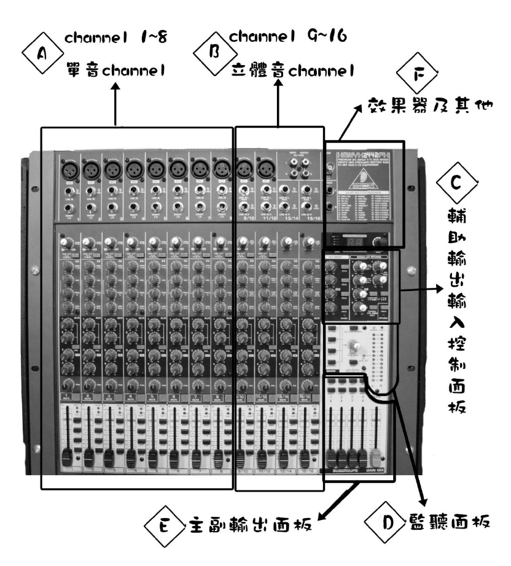
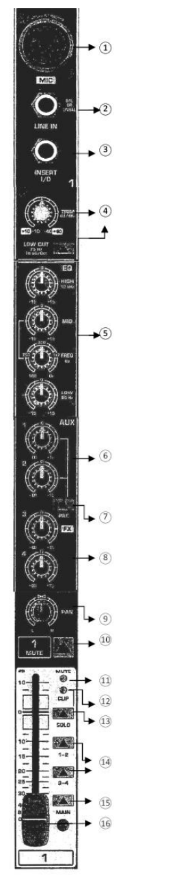
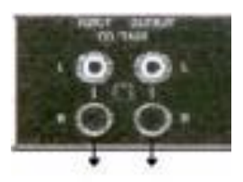
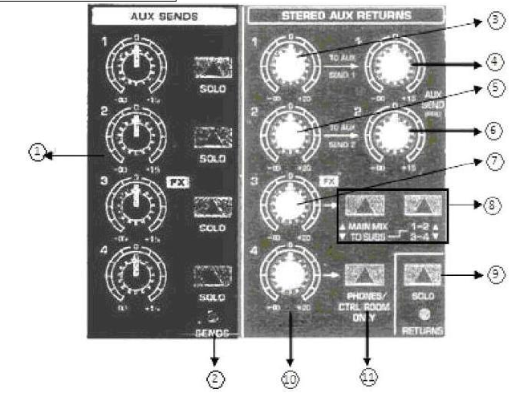
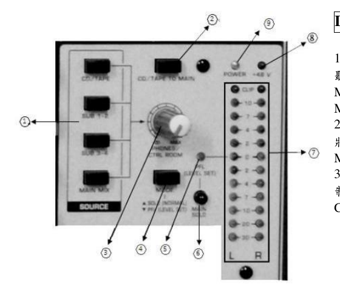
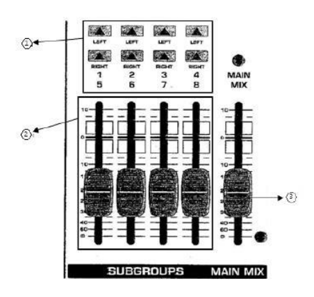
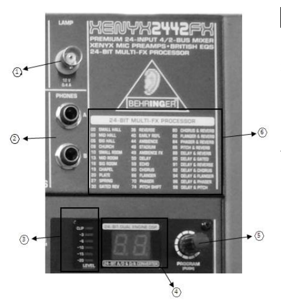
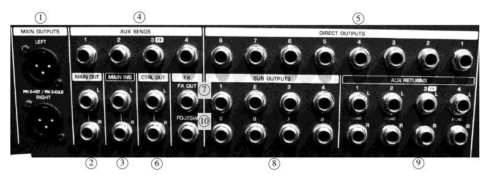

# BX-2442（Behringer）

<figure markdown="span">
  { loading=lazy width="832" }
  <figcaption>面板分區 A–F，原講義 p.12</figcaption>
</figure>

| 區塊 | 內容 |
| --- | --- |
| A | 單音 Channel 1–8 |
| B | 立體音 Channel 9–16 |
| C | 輔助輸出輸入控制面板 |
| D | 監聽面板 |
| E | 主副輸出面板 |
| F | 效果器及其他 |
| G | 背面輸入、輸出孔 |

## 特別要注意的地方

!!! warning "注意"

    1. MAIN 主輸出有兩種：Canon 頭與 Phone 頭。
    2. Ch.1–8 是單聲道；Ch.9–16（實際是 4 個 Channel）是雙聲道，也可以當單聲道用（插 LINE IN L／MONO）。
    3. 立體聲 Channel 的 TRIM 鈕是 **MIC TRIM**，LINE IN 的訊號不受它控制。
    4. 監聽的 PHONE 有 A、B 兩個輸出孔，單／雙聲道由監聽面板的 MODE 決定；CTRL OUT 有 L、R，是雙聲道輸出。
    5. 訊號送到 SUB1-2、SUB3-4 時，左聲道送到 1、3，右聲道送到 2、4。
    6. AUX SEND 1、2 如果外接效果器，避免用 AUX RETURN 1、2 送回機台，以免 Feedback。
    7. 內建效果器的迴路在 **AUX 3**。
    8. AUX 本身設計成 Post-fader，AUX 1、2 可用按鈕改成 Pre-fader。
    9. 插拔各 Channel 的線時要先開 MUTE，避免瞬間訊號傷機台。
    10. 要記得選訊號流向；只推 Fader，訊號出不去。

    **推聲音，要逆推！**

## A｜單音軌 1–8（Mono channels）

<figure markdown="span">
  { loading=lazy width="253" }
  <figcaption>原講義 p.13</figcaption>
</figure>

| # | 名稱 | 功能 |
| --- | --- | --- |
| 1 | Canon | 一般供麥克風輸入 |
| 2 | Line in | 可用 balance 或 unbalance 的 Phone 頭輸入 |
| 3 | Insert | 只能用 balance 的 Phone 頭，同時輸入輸出 |
| 4 | TRIM | 調整輸入訊號的大小 |
|  | Low cut | 將低於 75 Hz 的訊號降低 18 dB |
| 5 | EQ | HIGH：12 kHz 以上；LOW：80 Hz 以下；MID：調整 FREQ 所設定頻率的音量；FREQ：設定 MID 的中心頻率（100 Hz–8 kHz），調整範圍是以該頻率為中央的一個八度。皆往右增大、往左減小 |
| 6 | AUX 1 & 2 | 輔助輸出 1、2 |
| 7 | PRE | 讓 AUX 1、2 變成 Pre-fader |
| 8 | AUX 3 & 4 | 輔助輸出 3、4；AUX 3 經過內建效果器。不受 PRE 控制 |
| 9 | PAN | 左右聲道比；順時針轉到底為全部右聲道 |
| 10 | MUTE | 該 Channel 靜音。若 PRE（7）按下，AUX 1、2（6）不受 MUTE 控制 |
| 11 | MUTE LED | 亮表示該 Channel 靜音 |
| 12 | CLIP LED | 閃表示訊號過大；若 SOLO 按下則持續亮 |
| 13 | SOLO | 把該 Channel 的訊號優先於 PAN 與 Fader 送到監聽系統 |
| 14 | 1-2／3-4 | 1-2：左聲道送 SUB1(5)、右聲道送 SUB2(6)；3-4：左聲道送 SUB3(7)、右聲道送 SUB4(8) |
| 15 | MAIN | 把訊號送到 MAIN MIX |
| 16 | FADER | 控制該 Channel 輸出的音量 |

### CD／Tape

<figure markdown="span">
  { loading=lazy width="271" }
  <figcaption>原講義 p.14</figcaption>
</figure>

- INPUT：RCA 輸入孔，上為左聲道、下為右聲道
- OUTPUT：RCA 輸出孔，上為左聲道、下為右聲道

## C｜輔助輸出輸入控制面板

<figure markdown="span">
  { loading=lazy width="663" }
  <figcaption>原講義 p.14</figcaption>
</figure>

| # | 名稱 | 功能 |
| --- | --- | --- |
| 1 | AUX SENDS 旋鈕／SOLO | 旋鈕控制 AUX 1–4 輸出到 AUX SEND jack 的音量；SOLO 把對應的輔助輸出送到監聽 |
| 2 | SOLO SEND LED | 亮表示有 SOLO 鍵被按下 |
| 3 | AUX RETURN 1 | AUX RETURN 1 送到 MAIN MIX 的大小 |
| 4 | AUX SEND 1 (pre) | AUX RETURN 1 送到 AUX SEND 1 的大小 |
| 5 | AUX RETURN 2 | AUX RETURN 2 送到 MAIN MIX 的大小 |
| 6 | AUX SEND 2 (pre) | AUX RETURN 2 送到 AUX SEND 2 的大小 |
| 7 | AUX RETURN 3 | AUX RETURN 3 送到「8」所選目的地的大小 |
| 8 | 指派鍵 | 左邊：不按 → 送 MAIN；按 → 送 SUB。右邊：不按 → SUB1-2；按 → SUB3-4 |
| 9 | SOLO RETURN | 把所有 AUX RETURN 送到監聽，RETURN LED 亮 |
| 10 | AUX RETURN 4 | AUX RETURN 4 送到監聽系統的大小 |
| 11 | PHONES/CTRL ROOM ONLY | 按下則把 AUX RETURN 4 送到監聽系統 |

## D｜監聽面板

<figure markdown="span">
  { loading=lazy width="560" }
  <figcaption>原講義 p.15</figcaption>
</figure>

| # | 名稱 | 功能 |
| --- | --- | --- |
| 1 | SOURCE | 選擇要送到監聽的訊號源（例：按 MAIN MIX 就是監聽 MAIN MIX） |
| 2 | CD/TAPE TO MAIN | 把 CD／Tape 的輸入送到 MAIN MIX |
| 3 | PHONE/CTRL ROOM | 控制 PHONES jack 及 CTRL OUT 的音量 |
| 4 | MODE | **按下**：SOLO 的軌以單聲道、PFL 方式送到監聽，通常用來把該軌音量設到 0 dB，此時 Level Meter 只有左邊作用。**不按**：以立體音、Post-fader 方式送到監聽，兩邊燈號都作用 |
| 5 | PFL LED | 亮表示 MODE 在按下狀態 |
| 6 | MAIN SOLO | 亮表示 MODE 在不按狀態 |
| 7 | LEVEL METER | 顯示訊號大小；CLIP 亮表示過大 |
| 8 | +48V LED | 亮表示後方的 +48V 開關已開。+48V 用於電容式麥克風，**打開後不要再插拔** |
| 9 | POWER LED | 電源開啟 |

## E｜主副輸出面板

<figure markdown="span">
  { loading=lazy width="452" }
  <figcaption>原講義 p.15</figcaption>
</figure>

| # | 名稱 | 功能 |
| --- | --- | --- |
| 1 | LEFT & RIGHT | 按 LEFT：把該副輸出送到 MAIN MIX 左聲道；按 RIGHT：送到右聲道 |
| 2 | SUBGROUPS | 控制該副輸出的音量 |
| 3 | MAIN MIX | 控制主輸出的音量 |

## F｜效果器及其他

<figure markdown="span">
  { loading=lazy width="476" }
  <figcaption>原講義 p.16</figcaption>
</figure>

| # | 名稱 | 功能 |
| --- | --- | --- |
| 1 | LAMP | 混音器專用燈座 |
| 2 | PHONE | 監聽耳機輸出，兩組（訊號相同） |
| 3 | LEVEL | 顯示輸入內建效果器的訊號大小 |
| 4 | 顯示器 | 顯示所選的效果 |
| 5 | PROGRAM | 旋轉選效果（顯示器會閃爍），確定後按下，不閃爍的號碼即為所選效果 |

## G｜輸入、輸出孔（背面）

<figure markdown="span">
  { loading=lazy width="807" }
  <figcaption>原講義 p.16</figcaption>
</figure>

| # | 名稱 | 功能 |
| --- | --- | --- |
| 1 | MAIN OUTPUT | MAIN MIX 輸出，Canon 頭 |
| 2 | MAIN OUT | MAIN MIX 輸出，Phone 頭 |
| 3 | MAIN INSERT | 主輸出的插入點（同時輸出輸入） |
| 4 | AUX SEND | 輔助輸出孔 |
| 5 | DIRECT OUTPUT | Ch.1–8 的直接輸出 |
| 6 | CONTROL OUT | 輸出 Control Room 的訊號，用於監聽 |
| 7 | FX OUT | 效果器專用輸出孔 |
| 8 | SUB OUTPUT | Subgroup 輸出孔（1–4 與 5–8 的訊號對應相同） |
| 9 | AUX RETURN | 輔助輸入孔 |
| 10 | FX FOOTSW | 接腳踏鍵，控制效果器開關 |

## 操作補充

*（補充自資料夾內《BX 講稿》）*

- MIC IN（Canon）阻抗較小，LINE IN（Phone）阻抗較大。
- **不要把 INSERT 孔當 LINE IN 插。**
- 立體聲 Channel 的兩個 Phone 孔：上是 LINE IN L（標 MONO，單聲道輸入就插這裡），下是 LINE IN R。
- TRIM 可以調大也可以調小；有些機台叫 GAIN，主要是調大。
- MAIN OUTPUT 同時有 Canon 和 Phone 兩種，通常擇一使用。
