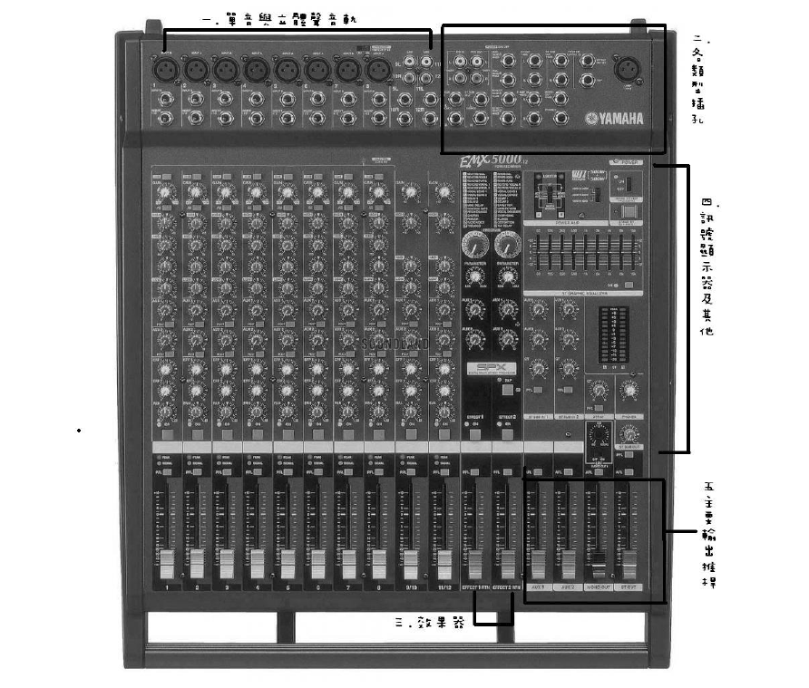
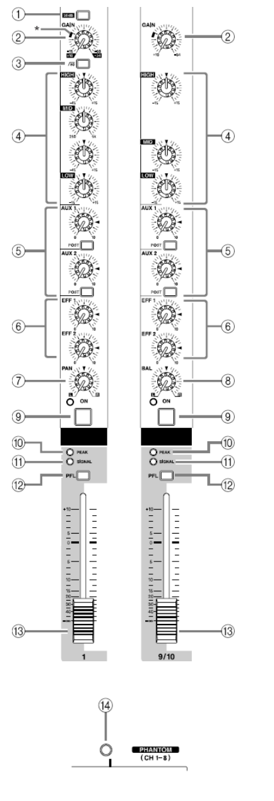
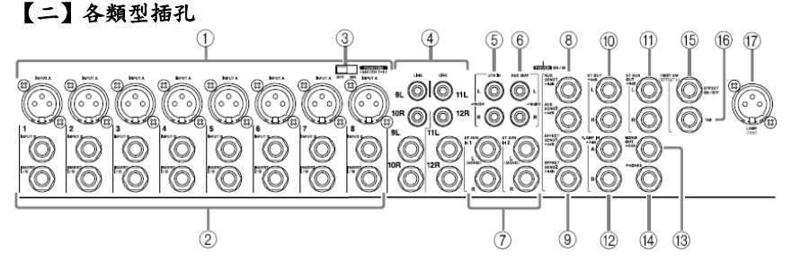
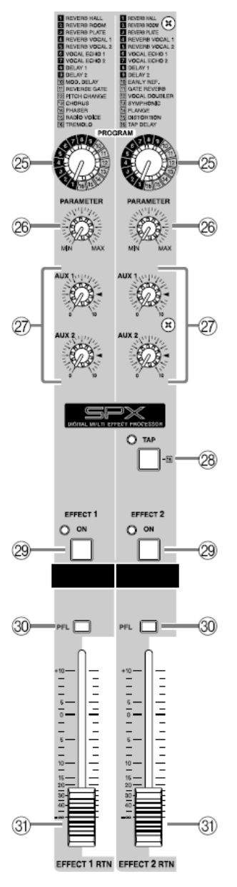
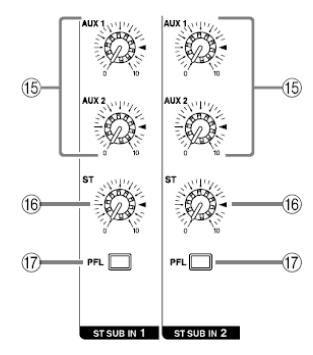
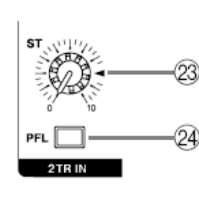
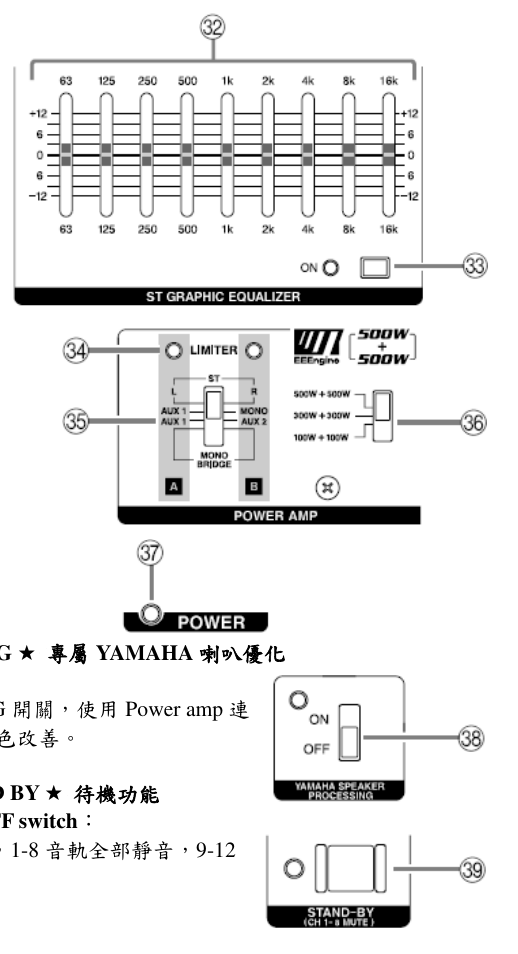
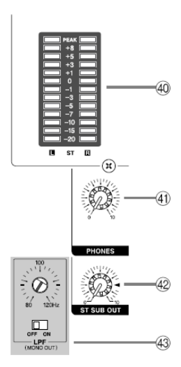
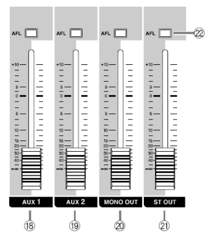
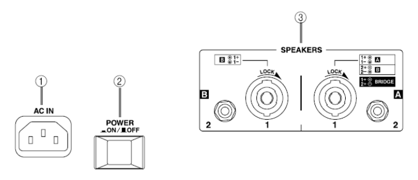

# EMX 5000-12（Yamaha）

內建擴大機的混音機（Powered Mixer）。

<figure markdown="span">
  { loading=lazy width="892" }
  <figcaption>面板分區（原講義 p.18）</figcaption>
</figure>

## 注意事項

!!! warning "注意"

    1. 一個單音軌的 INPUT A（Canon）與 INPUT B（Phone）只能擇一使用。
    2. INSERT 孔只能接平衡式 Phone 頭。
    3. 用 Canon 頭接麥克風時，注意 PHANTOM 是否開啟。
    4. 單音軌要送到主輸出，記得按 **ON switch**。
    5. 除了麥克風外，其他音源請按下 **26 dB pad**，避免訊號過大。
    6. PEAK 燈亮時，把輸入訊號轉小以保護機器。
    7. 用內建擴大機輸出時，請直接接喇叭，不要再接進 PA 系統，訊號過大會損傷機器。
    8. 內建擴大機選 MONO BRIDGE 時，只能用 A 組的特殊喇叭接頭，不要再接其他喇叭插孔。
    9. 一旦使用 P.AMP IN 插孔，整台會變成普通擴大機，Mixer 的功能按鍵全部失效。

## 一、單音與立體聲音軌

<figure markdown="span">
  { loading=lazy width="434" }
  <figcaption>原講義 p.19</figcaption>
</figure>

| # | 名稱 | 功能 |
| --- | --- | --- |
| 1 | 26dB pad switch | 輸入訊號降低 26 dB |
| 2 | GAIN | 控制輸入訊號大小 |
| 3 | /80（High pass filter） | 80 Hz 以下減弱 18 dB，用來去雜訊 |
| 4 | Equalizer | 修飾輸入的音質 |
| 5 | AUX 1、AUX 2／POST switch | 輔助輸出，可切換 PRE／POST |
| 6 | EFF 1、2（EFFECT） | 送到內建效果器或 EFFECT SEND |
| 7 | PAN | Ch.1–8，左右聲道平衡 |
| 8 | BAL | Ch.9/10、11/12，左右聲道平衡 |
| 9 | ON switch／indicator | 控制訊號是否送到主輸出 |
| 10 | PEAK | 輸入超載指示燈 |
| 11 | SIGNAL | 訊號輸入指示燈 |
| 12 | PFL | 按下後訊號 Pre-fader 送到監聽 |
| 13 | Channel fader | 音軌推桿 |
| 14 | PHANTOM indicator | 指示 Canon 插座有供 48V |

## 二、各類型插孔

<figure markdown="span">
  { loading=lazy width="880" }
  <figcaption>原講義 p.20</figcaption>
</figure>

| # | 名稱 | 功能 |
| --- | --- | --- |
| 1 | Channel input（INPUT A、B） | 音源輸入，Canon 與 Phone |
| 2 | INSERT I/O | Phone 頭插孔（input／output） |
| 3 | PHANTOM switch | 提供 +48V 給電容式麥克風 |
| 4 | LINE（stereo）input | 立體音源輸入，RCA 與 Phone |
| 5 | 2TR IN | RCA，額外音源輸入 |
| 6 | REC OUT | RCA，把主輸出送到錄音器材 |
| 7 | ST SUB IN 1、2 | Phone，給串聯的 Mixer 或效果器用；可送到 AUX 1/2 或主輸出 |
| 8 | AUX SEND 1、2 | Phone，AUX 1/2 的輸出 |
| 9 | EFFECT SEND 1、2 | Phone，各軌經 EFF 1、2 控制後由此送出 |
| 10 | ST OUT | Phone，主輸出（經 ST fader） |
| 11 | ST SUB OUT | Phone，把主輸出送到其他 Mixer 或 PA 系統 |
| 12 | P.AMP IN A、B | Phone，直接送入內建 Power Amp；**使用時 Mixer 功能全部無法使用** |
| 13 | MONO OUT | 主輸出經 MONO OUT fader 送出 |
| 14 | PHONES | 監聽輸出 |
| 15 | FOOT SW EFFECT 2 ON/OFF | 接 Yamaha FC5 腳踏開關 |
| 16 | FOOT SW (EFFECT 2) TAP | 用內建 TAP DELAY 時接 FC5 |
| 17 | LAMP | 工作燈電源 |

## 三、效果器

<figure markdown="span">
  { loading=lazy width="332" }
  <figcaption>原講義 p.21</figcaption>
</figure>

| # | 名稱 | 功能 |
| --- | --- | --- |
| 25 | PROGRAM selector | 選擇內建數位效果的型式 |
| 26 | PARAMETER | 效果的時間參數、效果程度 |
| 27 | AUX 1/2 | 效果處理後的訊號送到 AUX 1/2 的大小 |
| 28 | TAP switch | 只在 TAP DELAY 效果時使用 |
| 29 | EFFECT 1/2 ON | 內建效果的開關 |
| 30 | PFL | 送到 PHONES 監聽 |
| 31 | EFFECT 1/2 RTN fader | 效果送到主輸出的大小 |

## 四、訊號指示器與其他

<figure markdown="span">
  { loading=lazy width="313" }
  <figcaption>Stereo sub input（原講義 p.21）</figcaption>
</figure>

<figure markdown="span">
  { loading=lazy width="199" }
  <figcaption>2TR IN（原講義 p.21）</figcaption>
</figure>

<figure markdown="span">
  { loading=lazy width="518" }
  <figcaption>ST graphic equalizer 與 Power amp（原講義 p.22）</figcaption>
</figure>

<figure markdown="span">
  { loading=lazy width="259" }
  <figcaption>訊號指示器（原講義 p.22）</figcaption>
</figure>

| # | 名稱 | 功能 |
| --- | --- | --- |
|  | **Stereo sub input** |  |
| 15 | AUX 1、2 | ST SUB IN 1、2 的輔助輸出 |
| 16 | ST | ST SUB IN 1、2 送到主輸出的大小 |
| 17 | PFL | 不受 16 控制，送到 PHONES 監聽 |
|  | **2TR IN** |  |
| 23 | ST | 2TR IN 送到主輸出的大小 |
| 24 | PFL | 送到 PHONES 監聽 |
|  | **ST graphic equalizer** |  |
| 32 | Graphic equalizer | ST OUT 的圖形式 EQ |
| 33 | ON | ST OUT EQ 的開關 |
|  | **Power amp** |  |
| 34 | LIMITER indicator | Power amp 超載指示燈 |
| 35 | Power amp select | Power amp 型式選擇 |
| 36 | Maximum output select | 最大輸出功率選擇 |
| 37 | POWER indicator | 電源指示燈 |
| 38 | YAMAHA SPEAKER PROCESSING | 用 Power amp 接 Yamaha 喇叭時可開啟，改善音色 |
| 39 | STAND BY | 按下後 Ch.1–8 全部靜音，9–12 仍有作用 |
| 40 | Peak level indicator | 主輸出訊號指示燈 |
| 41 | PHONES | 監聽輸出大小 |
| 42 | ST SUB OUT | 主輸出送到 ST SUB OUT 的大小 |
| 43 | LPF／ON-OFF | 把特定頻率以下的訊號送到 MONO OUT，用於電子分音 |

## 五、主要輸出推桿

<figure markdown="span">
  { loading=lazy width="422" }
  <figcaption>原講義 p.23</figcaption>
</figure>

| # | 名稱 | 功能 |
| --- | --- | --- |
| 18 | AUX 1 fader | AUX 1 送到 AUX SEND 1 的大小 |
| 19 | AUX 2 fader | AUX 2 送到 AUX SEND 2 的大小 |
| 20 | MONO OUT fader | 主輸出送到 MONO OUT 的大小 |
| 21 | ST OUT fader | 主輸出大小 |
| 22 | AFL | 輸出訊號經過 Fader 後送到 PHONES 監聽 |

## 六、背後面板

<figure markdown="span">
  { loading=lazy width="711" }
  <figcaption>原講義 p.23</figcaption>
</figure>

1. AC inlet：電源線插孔
2. POWER switch：電源開關
3. SPEAKERS：喇叭輸出，A、B 兩組；每組有 Phone 與特殊喇叭接頭，擇一使用
