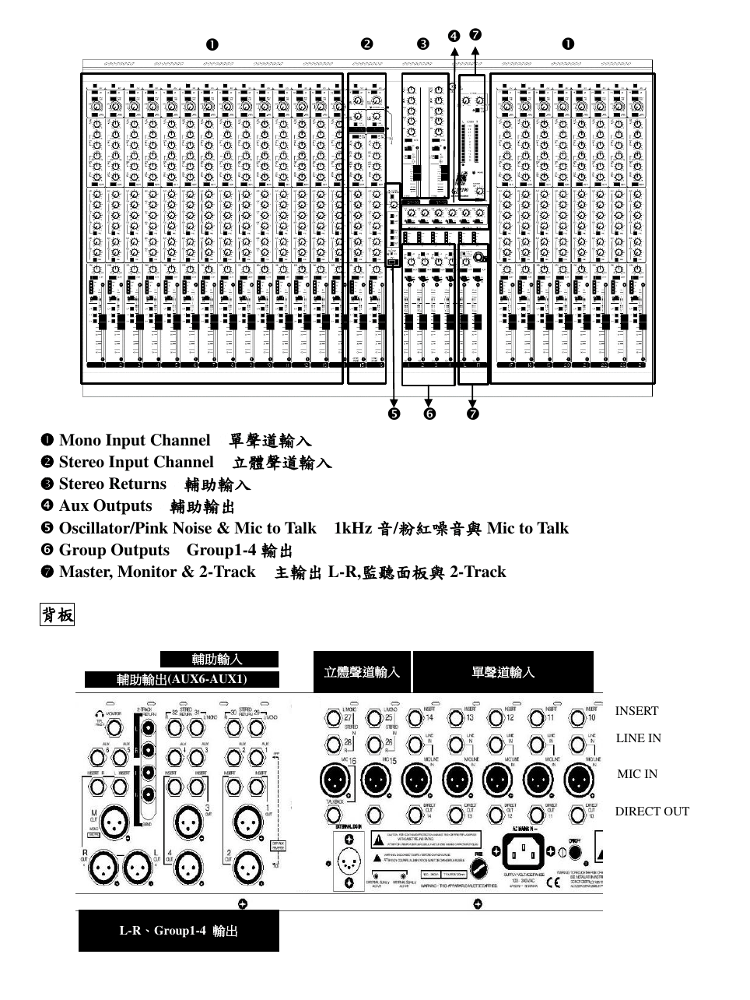
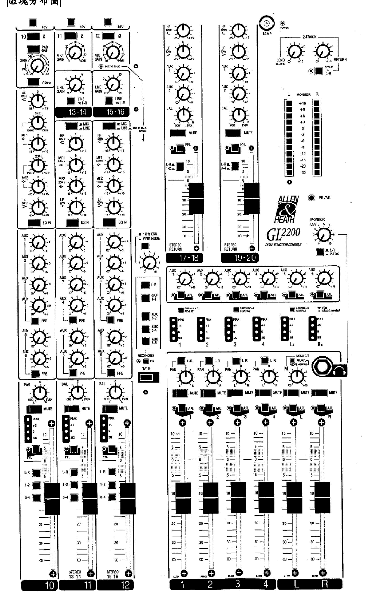
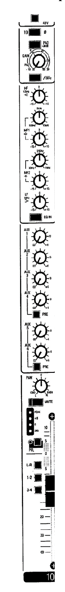
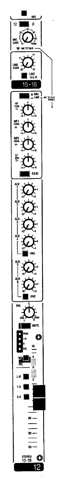
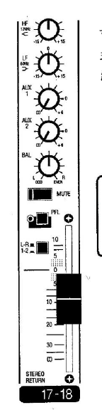
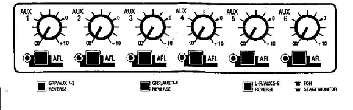
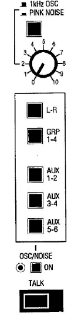
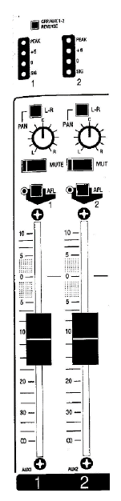
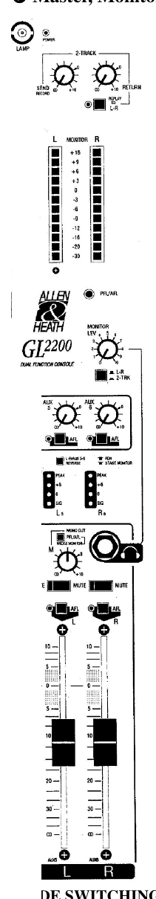
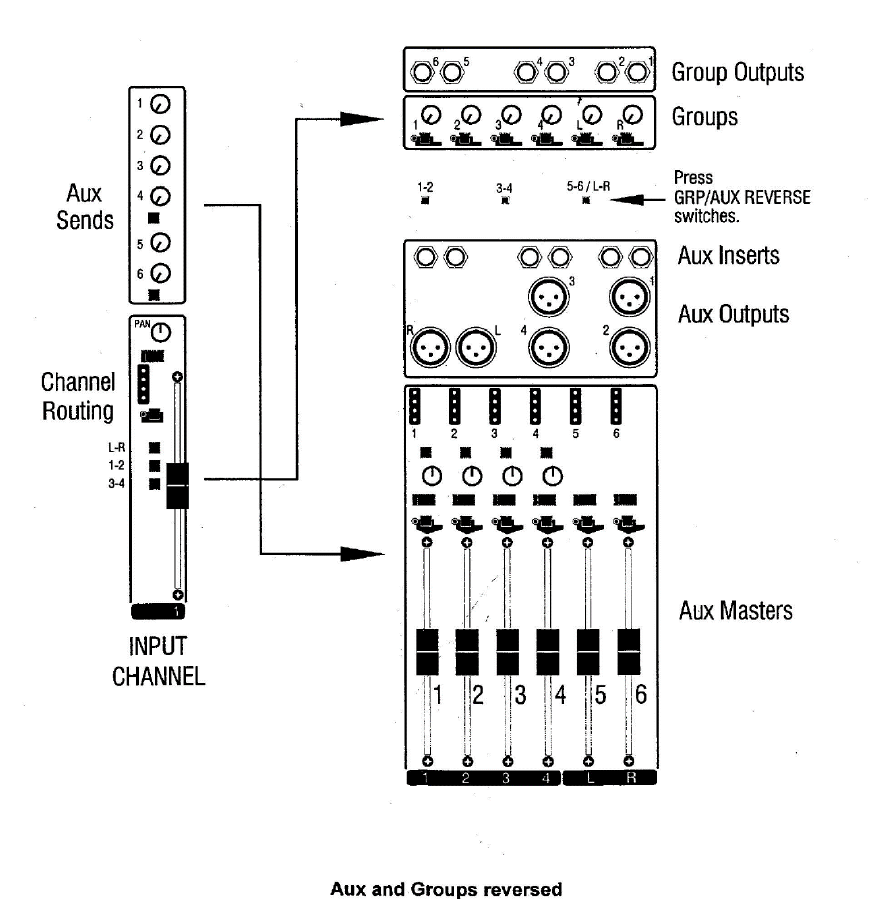

# GL2200-432（Allen & Heath）

大型固定式控台。

<figure markdown="span">
  { loading=lazy width="964" }
  <figcaption>正面分區與背板（原講義 p.24）</figcaption>
</figure>

<figure markdown="span">
  { loading=lazy width="777" }
  <figcaption>區塊分布圖（原講義 p.25）</figcaption>
</figure>

| 區塊 | 內容 |
| --- | --- |
| ❶ | Mono Input Channel 單聲道輸入 |
| ❷ | Stereo Input Channel 立體聲道輸入 |
| ❸ | Stereo Returns 輔助輸入 |
| ❹ | Aux Outputs 輔助輸出 |
| ❺ | Oscillator／Pink Noise & Mic to Talk |
| ❻ | Group Outputs（Group 1–4） |
| ❼ | Master、Monitor & 2-Track |

背板：輔助輸入、輔助輸出（AUX 6–AUX 1）、立體聲道輸入、單聲道輸入（INSERT／LINE IN／MIC IN／DIRECT OUT）、L-R 與 Group 1–4 輸出。

## ❶ Mono Input Channel 單聲道輸入

<figure markdown="span">
  { loading=lazy width="139" }
  <figcaption>原講義 p.26</figcaption>
</figure>

| 名稱 | 功能 |
| --- | --- |
| 48V | Phantom Power。用電容式麥克風時按下；一般動圈式請關掉 |
| Φ | 反相。矯正麥克風擺放產生的相位問題，也可減少回授 |
| PAD（LINE） | 選高阻抗（按）或低阻抗（不按）。通常 Phone 頭輸入就按；Canon 頭輸入影響不大 |
| GAIN | 輸入訊號量 |
| 100Hz | Low Cut，100 Hz 以下減 15 dB，去除低頻雜訊；與 EQ 獨立 |
| EQ | HF 高頻、LF 低頻為固定頻率；MF1、MF2 中頻為參數式 |
| EQ IN | 按下才經過 EQ；不按則跳過 |
| AUX SENDS | 送到監聽或效果器。PRE 鈕可把 Aux 1–4、Aux 5–6 設成 Pre 或 Post-fader（Pre 時不受 Fader 控制，但仍受 MUTE 控制） |
| PAN | 左右聲道平衡 |
| MUTE | 該軌開關，按下亮紅燈；不影響監聽 |
| 4 LED Channel Meter | 綠燈 −20 dB、黃燈正常、紅燈（Peak）過量 |
| PFL | 用耳機聽 Pre-fader 訊號；不受 MUTE 控制 |
| L-R、1-2、3-4 | 把訊號送到主輸出 L-R 和／或 Group 1–4，可獨立操作 |
| FADER | 控制所有 Post-fader 的輸出 |

!!! info "補充說明"

    原講義記錄的安裝對應：L-R → 主喇叭×2；Group 1-2 → 輔助喇叭×8；Group 3 → 音控室內喇叭；Group 4 → 舞台監聽喇叭。

## ❷ Stereo Input Channel 立體聲道輸入

<figure markdown="span">
  { loading=lazy width="159" }
  <figcaption>原講義 p.27</figcaption>
</figure>

與單聲道輸入不同的地方：

- 背板的 Line in 有兩個孔，分別是左、右聲道。
- GAIN 分成 **MIC GAIN** 與 **LINE GAIN**：Canon 頭輸入用 MIC GAIN；Phone 頭輸入用 LINE GAIN。
- **LINE TO L-R**：按下後把 Phone 頭輸入的訊號直接送到 L-R，與 Fader 旁的按鈕互相獨立；使用時務必把下方按鈕切到 LINE。
- **BALANCE**：左右聲道平衡。
- 其他功能同 Mono Input Channel。

## ❸ Stereo Returns 輔助輸入

<figure markdown="span">
  { loading=lazy width="144" }
  <figcaption>原講義 p.27</figcaption>
</figure>

可視為簡易的立體輸入：只有兩段 EQ、兩個輔助輸出（Aux 1、Aux 2），輸出也只能選 L-R 或 1-2（／3-4）。

## ❹ Aux Outputs 輔助輸出

<figure markdown="span">
  { loading=lazy width="579" }
  <figcaption>原講義 p.27</figcaption>
</figure>

- AUX 1–6 的總輸出，轉開後才有訊號輸出。
- **AFL**：監聽，受上方旋鈕（Fader）與 Mute 鍵控制。
- **GROUP1-2 REVERSE**：見下方 Mode Switching。

## ❺ Oscillator／Pink Noise & Mic to Talk

<figure markdown="span">
  { loading=lazy width="133" }
  <figcaption>原講義 p.28</figcaption>
</figure>

| 名稱 | 功能 |
| --- | --- |
| 1kHz OSC／PINK NOISE | 不按為 1 kHz 音，按下為粉紅噪音；旋鈕控制訊號大小 |
| L-R、GRP1-4 … AUX5-6 | 選擇 1 kHz／粉紅噪音與 Mic to Talk 的輸出位置，可獨立選 L-R、GRP1-4、AUX1-2、AUX3-4、AUX5-6 |
| OSC/NOISE | 1 kHz／粉紅噪音的開關 |
| TALK | 當 Ch.16 需要同時有 Phone 頭與 Canon 頭輸入時使用：把 Ch.16 切換鍵切到 LINE（啟用 Mic to Talk），再按 TALK，該軌 Canon 頭的訊號就會送到上面指定的位置 |

## ❻ Group Outputs（Group 1–4）

<figure markdown="span">
  { loading=lazy width="151" }
  <figcaption>原講義 p.28</figcaption>
</figure>

| 名稱 | 功能 |
| --- | --- |
| 4 LED 訊號燈 | 顯示訊號狀態，紅燈（Peak）表示過量 |
| L-R | 按下則此 Group 輸出到主輸出 L-R |
| PAN | 輸出到 L-R 的左右平衡 |
| MUTE | 此 Group 的開關 |
| AFL | 監聽，受 Fader 控制，不受 Mute 影響 |

## ❼ Master、Monitor & 2-Track

<figure markdown="span">
  { loading=lazy width="211" }
  <figcaption>原講義 p.29</figcaption>
</figure>

| 名稱 | 功能 |
| --- | --- |
| LAMP | 供給小燈泡 12V |
| 2-TRACK SEND | RCA 輸出，旋鈕控制大小；L-R 的訊號會送到這裡，可用來錄音，不受 L-R Fader 影響 |
| 2-TRACK RETURN | RCA 輸入，旋鈕控制大小；下方按鈕：按下送 L-R，不按送 Monitor |
| L-R LED METER | 主輸出 L-R 的訊號量；紅色 PEAK 表示過量 |
| MONITOR LEV | 耳機監聽大小；下方按鈕按下監聽 2-Track，不按監聽 L-R。若有按單軌 PFL，優先監聽該訊號 |
| 耳機插孔 |  |
| MONO OUT／AFL-PFL 切換鍵與旋鈕 | 輸出孔（Canon）在背板；可切換為主輸出 L-R 或 AFL／PFL mix，可作監聽或輔助輸出 |
| MUTE | L-R 的開關，按下亮紅燈為 Off |
| AFL | 監聽，受 Fader 控制，不受 Mute 影響 |
| FADER | 主輸出訊號量 |

## Mode Switching（Aux 與 Group 互換）

<figure markdown="span">
  { loading=lazy width="886" }
  <figcaption>Aux and Groups reversed（原講義 p.30）</figcaption>
</figure>

按下 GRP/AUX REVERSE 開關後，Group 與 Aux 的總輸出控制會對調：Aux Sends 改由 Group 的推桿（Aux Masters）控制，並可使用 Insert；Group 則改由旋鈕控制。適合需要用推桿控制多路監聽的場合。
