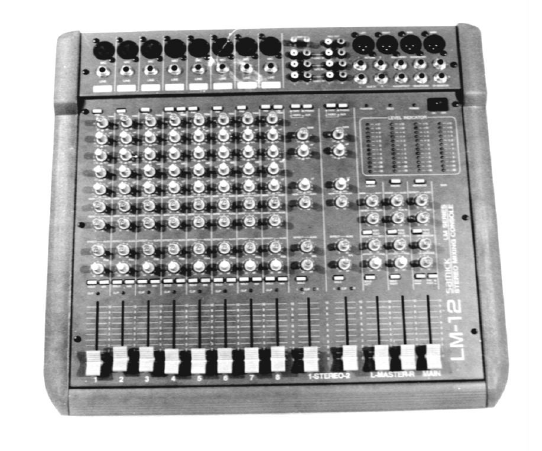
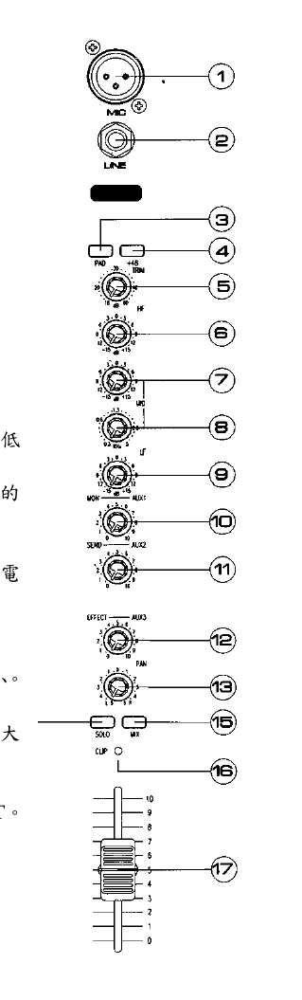
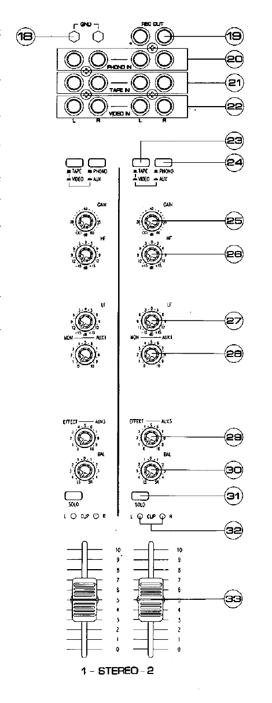
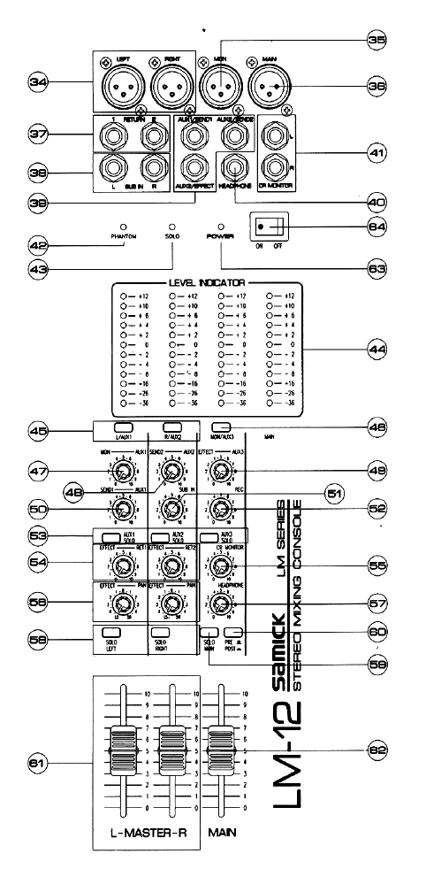
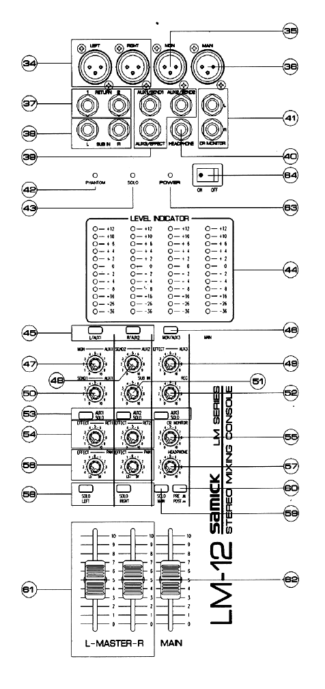

# LM12（Samick）

<figure markdown="span">
  { loading=lazy width="542" }
  <figcaption>原講義 p.32</figcaption>
</figure>

## 單聲道 Channel（1–17）

<figure markdown="span">
  { loading=lazy width="319" }
  <figcaption>原講義 p.32</figcaption>
</figure>

| # | 名稱 | 功能 |
| --- | --- | --- |
| 1 | MIC INPUT | XLR 母座，以平衡線接低阻抗麥克風 |
| 2 | LINE INPUT | 接卡座或其他音源，可接平衡或非平衡的 Phone 頭 |
| 3 | PAD | 提供較高阻抗，用於較大的訊號 |
| 4 | PHANTOM POWER | 提供 +48V 給電容式麥克風；**接非電容式麥克風有燒毀危險** |
| 5 | TRIM | 單軌輸入大小 |
| 6–9 | EQ | 修飾輸入音質 |
| 10 | AUX1（MONITOR） | 送到 MON 或 AUX1 的大小 |
| 11 | AUX2（SEND） | 送到 AUX2 和 SEND 的大小 |
| 12 | AUX3（EFFECT） | 送到 AUX3 和 EFFECT 的大小 |
| 13 | PAN | 聲道平衡 |
| 14 | SOLO | 按下後聲音送到 HEADPHONE OUTPUT |
| 15 | MIX | 允許訊號送往左右主輸出 |
| 16 | CLIP | 超載指示燈 |
| 17 | CHANNEL FADER | 單軌輸出大小 |

## 立體聲／Tape 輸入（18–33）

<figure markdown="span">
  { loading=lazy width="470" }
  <figcaption>原講義 p.33</figcaption>
</figure>

| # | 名稱 | 功能 |
| --- | --- | --- |
| 18 | GND | 接地線 |
| 19 | REC OUT | 錄音輸出，接 Tape 的輸入 |
| 20 | PHONO IN | RCA 輸入 |
| 21 | TAPE IN | 接錄音機卡座等，標準 RCA 輸入 |
| 22 | VIDEO IN | 標準 RCA 輸入，接 Video 的聲音 |
| 23 | TAPE/VIDEO SELECT | 選擇 Tape 或 Video 輸入 |
| 24 | PHONO/AUX SELECT | 選擇 Phono 或 AUX；用 AUX 時必須在 Tape 或 Video 模式 |
| 25 | GAIN | Tape／Video／Phono 輸入大小 |
| 26 | HF-HIGH | 高音頻 EQ |
| 27 | LF-LOW | 低音頻 EQ |
| 28 | MON（AUX） | 送到 AUX1／Monitor 的大小 |
| 29 | EFFECT（AUX3） | 送到 AUX3／Effect 的大小 |
| 30 | BAL | 左右聲道大小 |
| 31 | SOLO | 同 14 |
| 32 | CLIP | 同 16 |
| 33 | CHANNEL FADER | 同 17 |

## 輸出與主控區（34–64）

<figure markdown="span">
  { loading=lazy width="482" }
  <figcaption>34–55（原講義 p.34）</figcaption>
</figure>

<figure markdown="span">
  { loading=lazy width="476" }
  <figcaption>56–64（原講義 p.35）</figcaption>
</figure>

| # | 名稱 | 功能 |
| --- | --- | --- |
| 34 | LEFT/RIGHT | 左右聲道總輸出，平衡式 |
| 35 | MON | Monitor 輸出，平衡式 |
| 36 | MAIN | Main 輸出，平衡式 |
| 37 | RETURN | 輔助輸入，可和 AUX 搭配接效果器 |
| 38 | SUB INPUT | 接其他機器或串接另一台 Mixer |
| 39 | AUX 1/2/3 | 非平衡式輸出 |
| 40 | HEADPHONE | 非平衡式耳機輸出 |
| 41 | CR MONITOR | 非平衡式輸出，可接另一組 Monitor 喇叭 |
| 42 | PHANTOM INDICATOR | 亮表示 Phantom 電源開 |
| 43 | SOLO INDICATOR | 亮表示 SOLO 開 |
| 44 | CHANNEL LED METER | 聲道輸出音量顯示 |
| 45 | L/AUX1、R/AUX2 SELECT | 切換指示燈顯示聲道輸出或 AUX1、AUX2 |
| 46 | MON/AUX3 SELECT | 切換指示燈顯示 MON 或 AUX3 |
| 47 | MONITOR/AUX1 | 輸出到 Monitor／AUX1 的大小 |
| 48 | SEND2/AUX2 | 輸出到 SEND2／AUX2 的大小 |
| 49 | EFFECT/AUX3 | 輸出到 EFFECT／AUX3 的大小 |
| 50 | SEND1/AUX1 | 輸出到 SEND1／AUX1 的大小 |
| 51 | SUB IN | SUB IN 輸入送到總輸出的大小 |
| 52 | REC | 送到錄音卡座的大小 |
| 53 | SOLO/AUX1,2,3 | 按下後把 AUX1、2、3 送到 SOLO |
| 54 | EFFECT（RET1,2） | Effect Return 由 RETURN 1、2 送到左右輸出的大小 |
| 55 | CR MONITOR CONTROL | CR Monitor 輸出大小 |
| 56 | EFFECT（PAN） | Effect 的左右聲道 |
| 57 | HEADPHONE CONTROL VOLUME | 耳機輸出大小 |
| 58 | SOLO（L/R） |  |
| 59 | SOLO |  |
| 60 | PRE/POST SELECT | 控制 MAIN OUTPUT 為 Pre 或 Post 主輸出 |
| 61 | MASTER（L/R）FADER | 主輸出大小 |
| 62 | MAIN FADER | MAIN OUTPUT 輸出大小 |
| 63 | POWER INDICATOR | 電源燈號 |
| 64 | POWER ON/OFF | 電源開關 |
