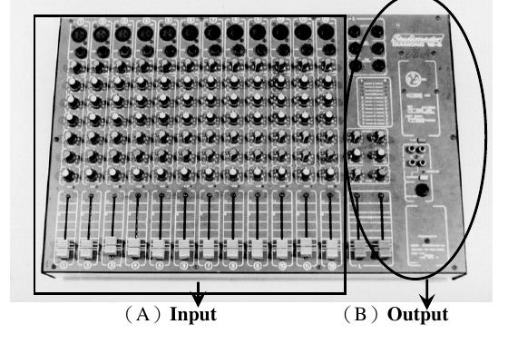
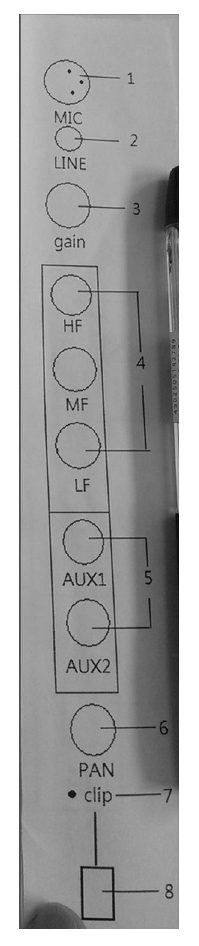
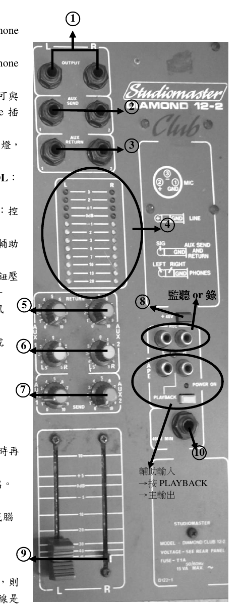

# MX122（Studiomaster）

「122」的 12 指 12 個 Channel 輸入，2 指 2 個總輸出（一組 L／R）。除了大型演奏或音樂演出，一般活動綽綽有餘。

<figure markdown="span">
  { loading=lazy width="560" }
  <figcaption>(A) Input、(B) Output 兩區（原講義 p.36）</figcaption>
</figure>

## (A) Input Channel

<figure markdown="span">
  { loading=lazy width="199" }
  <figcaption>原講義 p.36</figcaption>
</figure>

| # | 名稱 | 功能 |
| --- | --- | --- |
| 1 | MIC INPUT | XLR 母座，以平衡線接低阻抗麥克風 |
| 2 | LINE INPUT | 接卡座及其他音源 |
| 3 | GAIN CONTROL | 15–60 dB，控制單軌輸入大小 |
| 4 | EQ | HF：12 kHz；MF：2 kHz；LF：20 Hz（原講義所載） |
| 5 | AUX | AUX1 為 Post-fader；AUX2 為 Pre-fader |
| 6 | PAN | 左右聲道平衡 |
| 7 | CLIP | 輸入過大時閃亮 |
| 8 | FADER | 單軌輸出大小 |

!!! warning "注意"

    **MIC INPUT 與 LINE INPUT 不可同時使用，否則會損壞機器。**

## (B) Output Channel

<figure markdown="span">
  { loading=lazy width="482" }
  <figcaption>原講義 p.37</figcaption>
</figure>

| # | 名稱 | 功能 |
| --- | --- | --- |
| 1 | L/R OUTPUT | 左右總輸出，Phone 座，非平衡式 |
| 2 | AUX SEND 1 & 2 | 輔助輸出，Phone 座，非平衡式 |
| 3 | AUX RETURN 1 & 2 | 輔助輸入，可與 AUX SEND 配合接效果器；Phone 座，非平衡式 |
| 4 | L/R LED METERS | 左右聲道輸出指示燈 |
| 5 | AUX RETURN 1 & 2 LEVEL | 輔助輸入的大小 |
| 6 | AUX RETURN 1 & 2 PAN | 輔助輸入的左右平衡 |
| 7 | AUX SEND 1 & 2 LEVEL | 輔助輸出的大小 |
| 8 | +48V | 供電給所有 MIC INPUT；**此時若接著非電容式麥克風有燒毀危險** |
| 9 | L/R OUTPUT FADER | 左右聲道總輸出推桿 |
| 10 | PHONES | 耳機監聽 |

圖中另有「監聽 or 錄音」與「輔助輸入 → 按 PLAYBACK → 主輸出」的標示。

## 注意事項

1. 電源電壓確定為 110V。
2. 遇斷電立即關掉電源，復電後再依開機順序開機。
3. 開機及各軌接線前，把推桿拉到底。
4. 802C 及喇叭務必在開機前接好。
5. Mixer 放在穩固的地方。
6. 若仍無聲音輸出：先看 LED 指示燈有沒有輸出。**有** → 用三用電表測喇叭線是否通路；**沒有** → 檢查輸入音源有沒有開、輸入訊號線是否通路。
7. 開關機務必依順序，尤其是擴大機。
