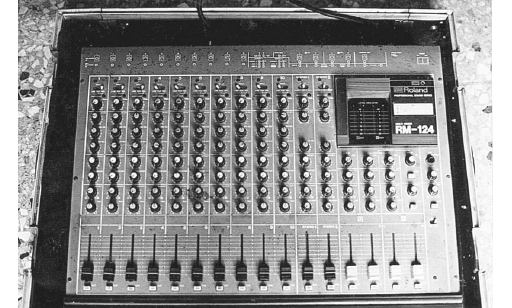
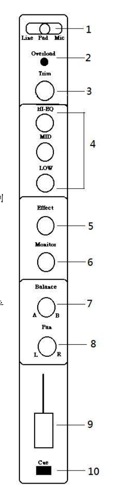
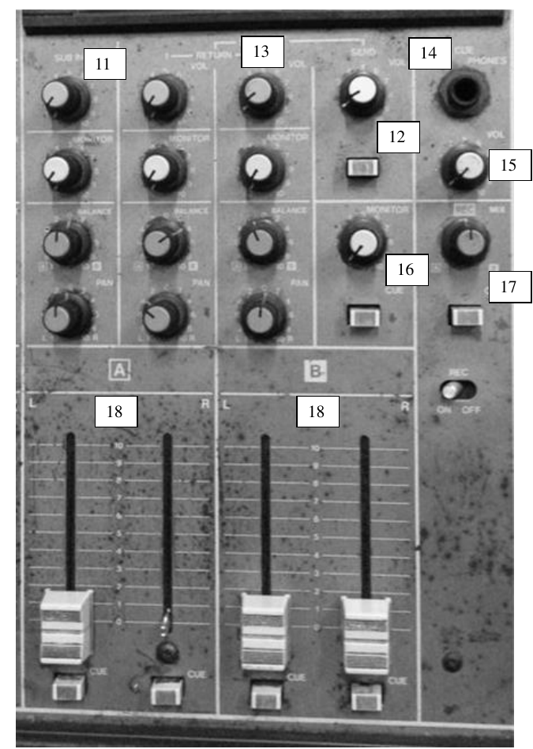
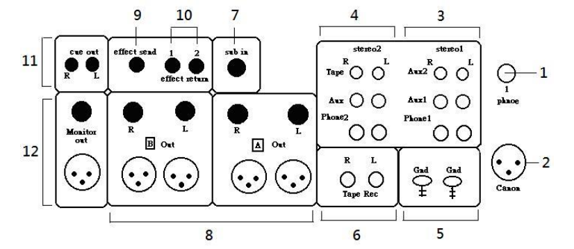

# RM-124（Roland）

12 組 Input、4 聲道 Output（L／R 有 A、B 兩組），故稱 RM-124。12 個 Channel 中有 2 組是專為卡座、唱盤、CD 等設計的 Stereo Input。

<figure markdown="span">
  { loading=lazy width="512" }
  <figcaption>原講義 p.43</figcaption>
</figure>

## 一、面板

<figure markdown="span">
  { loading=lazy width="277" }
  <figcaption>1–10（原講義 p.43）</figcaption>
</figure>

<figure markdown="span">
  { loading=lazy width="675" }
  <figcaption>11–18（原講義 p.44）</figcaption>
</figure>

| # | 名稱 | 功能 |
| --- | --- | --- |
| 1 | SWITCH | 單音聲道可切換 LINE、PAD、MIC 三種輸入；PAD 與 MIC 同組，但音量比 MIC 低 3 dB。立體聲道則切換 PHONE 1／AUX1／AUX2，或 PHONE 2／AUX3／TAPE |
| 2 | OVERLOAD | 同 CLIP |
| 3 | TRIM | 同 GAIN（最多約 30 dB 增益） |
| 4 | EQ | HI：10 kHz；MID：1 kHz；LOW：100 Hz |
| 5 | EFFECT | 輔助輸出，效果器必須外接 |
| 6 | MONITOR | 輔助輸出 |
| 7 | BALANCE | 控制送往 A、B 兩組輸出的平衡 |
| 8 | PAN | 單聲道的左右平衡 |
| 9 | OUT LEVEL FADER |  |
| 10 | CUE | 按下後可由耳機或 CUE OUT 監聽 |
| 11 | SUB IN | 接其他 Mixer 用 |
| 12 | EFFECT SEND | EFFECT SEND 孔的輸出大小 |
| 13 | EFFECT RETURN | EFFECT RETURN 輸出到 Master（A、B）的大小 |
| 14 | CUE PHONE JACK | 監聽耳機座 |
| 15 | CUE PHONE VOL | 耳機音量 |
| 16 | MONITOR | Monitor 輸出大小 |
| 17 | REC | 選擇錄音來源為 A 組或 B 組；REC 要切到 ON 才能錄音 |
| 18 | L-R MASTER FADER | A、B 組輸出 |

## 二、背面插孔

<figure markdown="span">
  { loading=lazy width="826" }
  <figcaption>原講義 p.45</figcaption>
</figure>

| # | 名稱 | 功能 |
| --- | --- | --- |
| 1 | Balance In | 單一聲道的輸入 |
| 2 | Unbalance In | 單一聲道的輸入 |
| 3 | PHONE 1、AUX1、AUX2 | Stereo 1 的輸入 |
| 4 | PHONE 2、AUX3、TAPE | Stereo 2 的輸入 |
| 5 | GND | 接地 |
| 6 | TAPE REC | 錄音輸出，用 RCA 線接卡座的 LINE IN；前方 REC SWITCH 要在 ON |
| 7 | SUB IN | 與別台 Mixer 串接 |
| 8 | A、B OUT | A、B 組總輸出，有 6.3 mm Phone 座及 XLR 座 |
| 9 | EFFECT RETURN | 效果輸入座，接效果器的輸出 |
| 10 | EFFECT SEND | 效果原訊號輸出座，接效果器的輸入 |
| 11 | CUE OUT | CUE 輸出 |
| 12 | MONITOR OUT | Monitor 輸出 |

!!! info "補充說明"

    原講義對 1、2 的說明是「Balance In 相同於 LINE input、Unbalance In 相同於 XLR input」，與一般慣例（XLR 為平衡式）相反，疑為誤植，請以實機標示為準。

## 三、注意事項

1. 擴大機及 EQ 等必須另接。
2. 多用在晚會、歌唱比賽等場合，有歌唱時要接效果器及監聽系統。
3. **接效果器的三種方法**：都是由 EFFECT SEND 出，接效果器的 Input，再由效果器的 Output 回到：
    - ① EFFECT RETURN
    - ② SUB IN
    - ③ 某一個 Channel
    
    需要效果的 Channel 把 EFF 旋開，不需要的歸零。用 ③ 時，**返回 Mixer 的那個 Channel 的 EFF 不可旋開，否則會產生回授**。③ 比較容易控制效果大小。
    
4. **Monitor 的做法**：由 MONITOR OUT 接到另一組系統（壓縮限制器、等化器、功率擴大器、喇叭），再調整各軌的 MONITOR 旋鈕。
