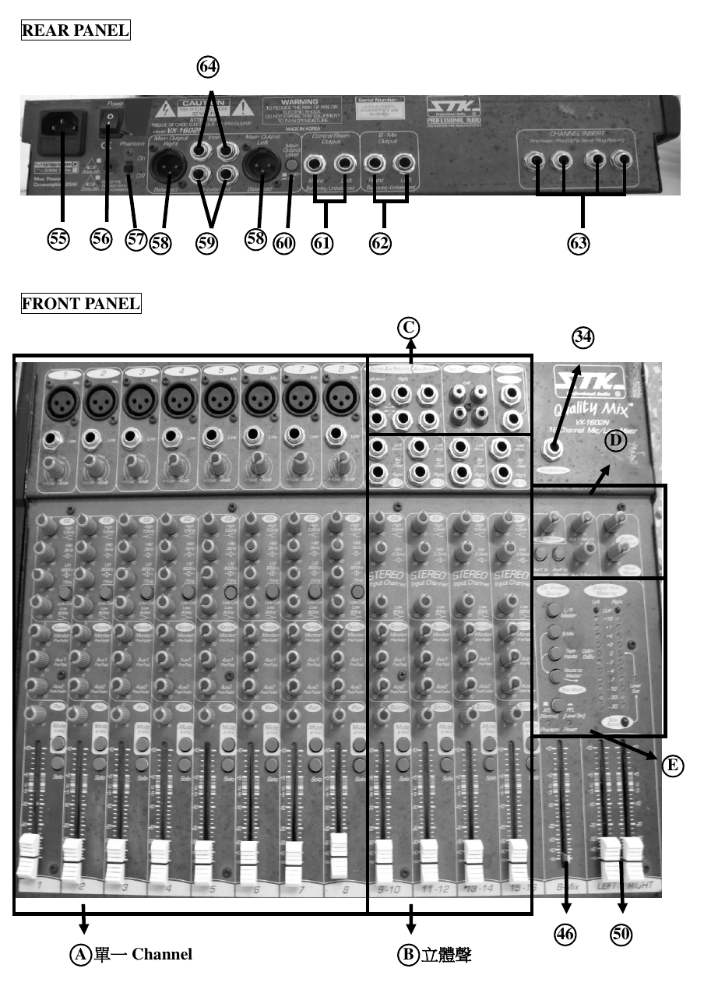
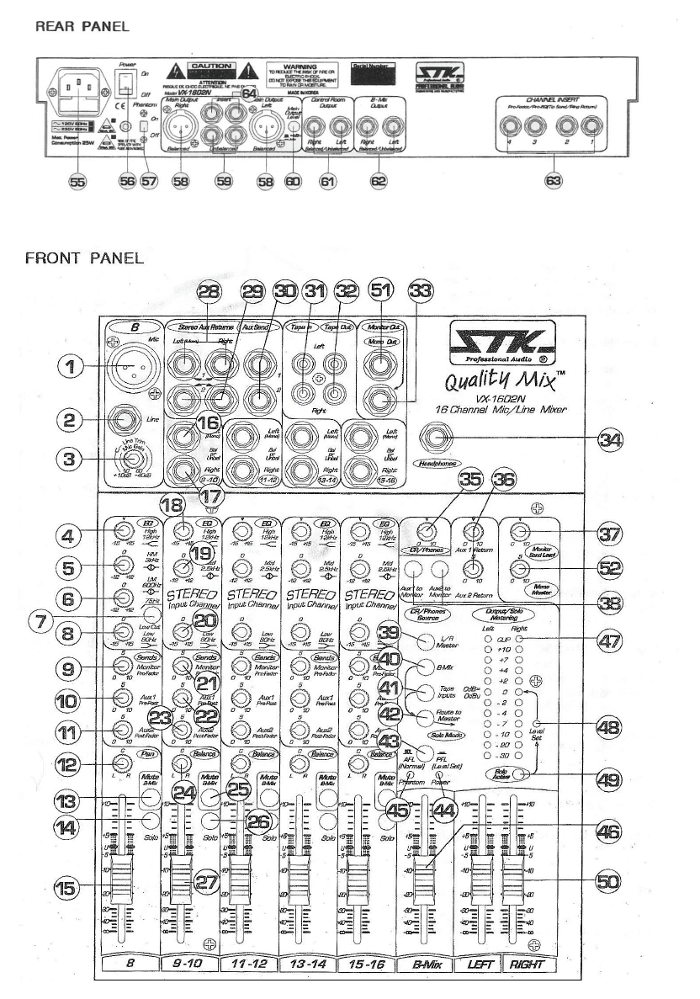
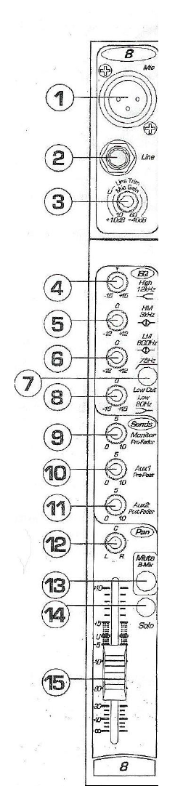
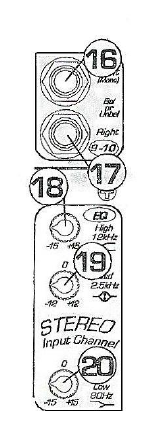
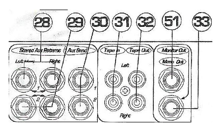
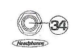
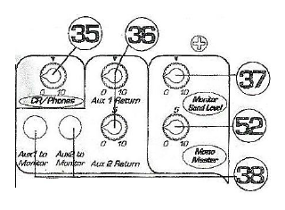
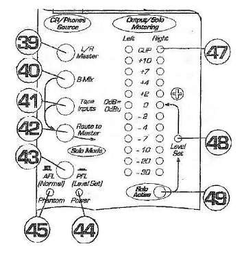
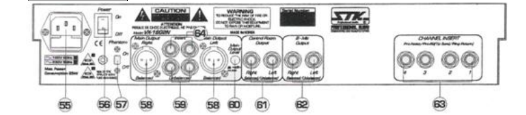

# VX-16（STK）

<figure markdown="span">
  { loading=lazy width="922" }
  <figcaption>Rear／Front Panel 實機照與分區 A–E（原講義 p.38）</figcaption>
</figure>

<figure markdown="span">
  { loading=lazy width="832" }
  <figcaption>面板線稿與編號（原講義 p.39）</figcaption>
</figure>

## A｜單一 Channel

<figure markdown="span">
  { loading=lazy width="241" }
  <figcaption>原講義 p.40</figcaption>
</figure>

| # | 名稱 | 功能 |
| --- | --- | --- |
| 1 | Mic input | Canon 頭輸入 |
| 2 | Line input | Phone 頭音源輸入 |
| 3 | Line Trim／Mic Gain | 單軌輸入大小 |
| 4 | High EQ | 高音頻 |
| 5 | High Mid EQ | 中高音頻 |
| 6 | Low Mid EQ | 中低音頻 |
| 7 | Low Cut Switch | 去除 75 Hz 以下 |
| 8 | Low EQ | 低音頻 |
| 9 | Monitor Send（pre-fader） | 送到 Monitor Out（33）的大小 |
| 10 | Aux 1 Send（pre-fader） | 送到 Aux 1 Send（30）的大小 |
| 11 | Aux 2 Send（post-fader） | 送到 Aux 2 Send（30）的大小 |
| 12 | Pan | 左右聲道比例 |
| 13 | Mute／B-Mix Switch | 把訊號送到 B-Mix Output（62），同時阻斷送往主輸出 |
| 14 | Solo Switch | 由 Control Room／Headphone 監聽單軌。與 Solo Mode（43）配合 |
| 15 | Channel Fader | 單軌輸出大小 |

!!! warning "注意"

    不同 Channel 的 Solo Switch 不可同時按，會造成訊號過大。

## B｜立體聲 Channel

<figure markdown="span">
  { loading=lazy width="157" }
  <figcaption>原講義 p.41</figcaption>
</figure>

| # | 名稱 | 功能 |
| --- | --- | --- |
| 16 | Left（mono） | 立體音的左聲道輸入，也可當單音輸入 |
| 17 | Right | 立體音的右聲道輸入 |
| 18 | High EQ | 高音頻 |
| 19 | Mid EQ | 中音頻 |
| 20–27 |  | 同單一 Channel 的 8–15 |

## C｜輔助輸入輸出與 Tape

<figure markdown="span">
  { loading=lazy width="434" }
  <figcaption>原講義 p.41</figcaption>
</figure>

<figure markdown="span">
  { loading=lazy width="157" }
  <figcaption>Headphone Output（原講義 p.41）</figcaption>
</figure>

| # | 名稱 | 功能 |
| --- | --- | --- |
| 28 | Aux Return 1（L/R） | 輔助輸入 1，直接送到主輸出 |
| 29 | Aux Return 2（L/R） | 輔助輸入 2，直接送到主輸出 |
| 30 | Aux Send 1 & 2 | Aux 1、2 的輸出孔 |
| 31 | Tape Input（L/R） | RCA，輸入卡座等音訊。**只能由 CR Monitor／Headphone 監聽**，要先按 41 選 Tape Inputs 為監聽來源 |
| 32 | Tape Output（L/R） | RCA，主要錄音用，訊號與主輸出相同 |
| 33 | Monitor Output | 輸出所有 Monitor Send 的訊號，由 37 控制大小 |
| 51 | Mono Out | 主輸出左右混合後的訊號，由 52 控制大小 |
| 34 | Headphone Output | 耳機監聽 |

## D｜輸出控制

<figure markdown="span">
  { loading=lazy width="320" }
  <figcaption>原講義 p.41</figcaption>
</figure>

| # | 名稱 | 功能 |
| --- | --- | --- |
| 35 | Control Room／Headphone Level | CR Monitor／Headphone 輸出大小 |
| 36 | Aux Return Controls（1 & 2） | Aux Return 1、2（28、29）送到主輸出的大小 |
| 37 | Monitor Output Level | Monitor Out（33）的大小 |
| 38 | Aux1 & Aux2 To Monitor | 把 Aux 1／2 Return 的訊號轉送到 Monitor Out |
| 52 | Mono Master Level | Mono Out 的大小 |

## E｜CR Source Select 與主控

<figure markdown="span">
  { loading=lazy width="356" }
  <figcaption>原講義 p.42</figcaption>
</figure>

| # | 名稱 | 功能 |
| --- | --- | --- |
| 39 | L/R Master | 選主輸出為 CR Monitor／Headphone 的來源 |
| 40 | B-Mix | 選 B-Mix 為監聽來源 |
| 41 | Tape Inputs | 選 Tape Inputs 為監聽來源 |
| 42 | Route To Master | 把監聽中的 B-Mix 或 Tape Inputs 送到主輸出 |
| 43 | Solo Mode Switch | AFL／PFL 切換；按下後 Solo 的訊號不受該軌 Fader 控制 |
| 44 | Power Indicator | 電源指示燈 |
| 45 | Phantom Power Indicator | Phantom（57）指示燈 |
| 46 | B-Mix Stereo Fader | 輸出到 B-Mix Output 的大小 |
| 47 | Meter Assembly | 顯示 CR Monitor／Headphone 訊號大小 |
| 48 | Level Set Indicator | 14 與 43 同時按下時，顯示 Solo 那一軌的訊號大小 |
| 49 | Solo Active Indicator | 按下 Solo（14）時亮，表示目前監聽來源為 Solo 的軌 |
| 50 | L & R Master Faders | 主輸出大小 |

## Rear Panel

<figure markdown="span">
  { loading=lazy width="868" }
  <figcaption>原講義 p.42</figcaption>
</figure>

| # | 名稱 | 功能 |
| --- | --- | --- |
| 55 | 電源線插孔 |  |
| 56 | Power | 電源開關 |
| 57 | Phantom Power Switch | 開啟後 Ch.1–8 的 Mic 輸入孔會有 48V，供電容式麥克風用；**接動圈式麥克風時不可開啟** |
| 58 | Main Outputs（Canon） | 左右主輸出，平衡式 |
| 59 | Main Outputs（Phone） | 左右主輸出，非平衡式 |
| 60 | Main Output Level Switch | 加大主輸出訊號，只對 Canon 主輸出（58）有作用 |
| 61 | Control Room Outputs | CR Monitor 輸出 |
| 62 | B-Mix Outputs | B-Mix 輸出 |
| 63 | Channel Insert Jack | Ch.1–4 的 Insert |
| 64 | Main Insert L & R | 主輸出的 Insert |
