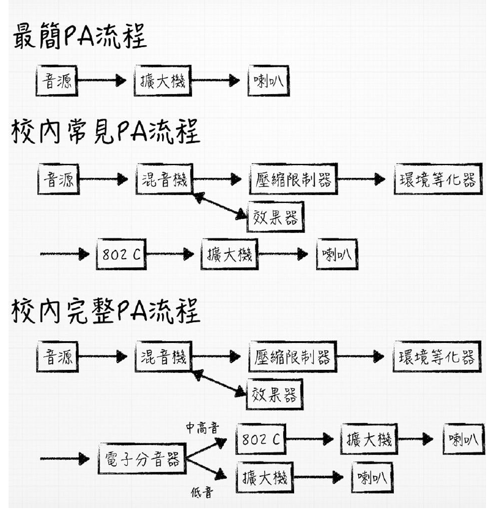

# PA 總說與系統邏輯

## PA 系統是什麼

PA（Public Address）是利用音響或廣播器材將聲音擴大傳輸、進行一對多通訊的方法。要放大聲音，基本要件是**音源、擴大機、喇叭**；混音機與各式訊號處理器則讓聲音更有變化。PA 的目的是把音源精確重現，或做些許修飾，所以要先瞭解音源的特性。

## 三種 PA 流程

<figure markdown="span">
  { loading=lazy width="808" }
  <figcaption>原講義 p.6</figcaption>
</figure>

| 流程 | 訊號鏈 |
| --- | --- |
| 最簡 | 音源 → 擴大機 → 喇叭 |
| 常見 | 音源 → 混音機（⇄ 效果器）→ 壓縮限制器 → 環境等化器 → 802C → 擴大機 → 喇叭 |
| 完整 | 音源 → 混音機（⇄ 效果器）→ 壓縮限制器 → 環境等化器 → 電子分音器 → 中高音：802C → 擴大機 → 喇叭；低音：擴大機 → 喇叭 |

## 系統連接：五個環節

所有音響設備的連接都可以這樣表述：

`Source 訊源 → Mixing 混音 → Processing 訊號處理 → Amplifying 放大 → Speaker 音響`

- **Source**：想要放大的聲音，例如麥克風、電腦裡的音樂。
- **Mixing**：將 Source 依需求混合或分配至下個設備，用混音機（Mixer）完成。
- **Processing**：一切會改變 Source 原始狀態的設備統稱，例如相位、Dynamic、Att、PEQ、GEQ、Input Delay、Level、Pan、Effect。Mixer 面板上除了 Input 和 Output 以外的部分，其實都算 Processing。
- **Amplifying**：把處理過的訊號放大成足以驅動喇叭的電流，用擴大機（Amplifier）完成。
- **Speaker**：電流轉換成聲音放出。

先確認 Amplifying 之前的所有設備都已對通訊號，並把參考電平做好。如果訊號流向有問題，先檢查訊號線有沒有接錯或沒插好；無法排除就用交叉查線判斷是線還是設備的問題（見「問題檢查與交叉查線」）。

## 系統操作三原則

設備連在一起就是「系統」，牽一髮動全身：改變任一設備的參數，最後放出來的結果就會變；不安全使用也會損壞設備。

!!! warning "注意"

    **順 PA 開機、逆 PA 關機**：開機從前端往後端（混音機 → … → 擴大機）；關機從後端往前端（擴大機 → … → 混音機）。

1. **依連接順序開關機**（如上）。
2. **偶爾跳到 Peak 可以，但禁止 Clip（失真）。** Peak 代表訊號電平快碰到失真那條線，通常在 Clip 以下 3–6 dB，是讓訊號忠實表現節目動態的範圍。如果表頭始終在 Peak 遊走甚至 Clip，就必須衰減輸入端增益。活動方抱怨太小聲也不能硬推，這代表下次需要多借幾顆喇叭。
3. **系統運作中，所有可調參數都要小心調整。** 最常見的錯誤：推桿推到頂聲音還很小，就直接去轉 Gain。正確流程：
    1. 把該軌推桿拉到不輸出的位置。
    2. 把 Gain 轉到比剛才大的刻度。
    3. 慢慢推起推桿，耳朵仔細聽；覺得夠大聲先別停，再往上推到稍微太大聲就停。
    4. 記錄該刻度，再開始修正該軌的頻率（要為該軌預留 Headroom）。

## 接線邏輯

- **1 左 2 右、1 上 2 下、1A 2B**
- 盡量用同性質的訊號線連接設備。

最簡系統對通訊號時的檢查表（設備與線材都正常時）：

| 訊號流向 ↓ | 左 | 右 |
| --- | --- | --- |
| 麥克風（Source） | 已連接到混音機 |  |
| 混音機 | L Output 已送出訊號 | R Output 已送出訊號 |
| 擴大機 | Ch.1 有訊號 | Ch.2 有訊號 |
| 喇叭 | 左喇叭正常 | 右喇叭正常 |

## 推聲音的口訣

!!! tip "口訣"

    **推聲音，要逆推！** 這是原講義連寫三次的口訣：逆著訊號流向，從後端的輸出往前端的輸入依序推開。另外要記得選擇訊號流向（按下 MAIN／L-R 等指派鍵），只推 Fader 訊號是出不去的。
