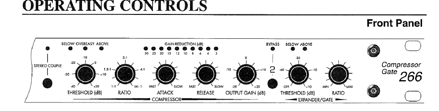
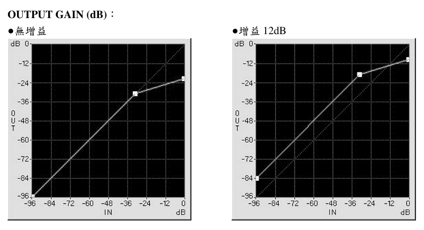
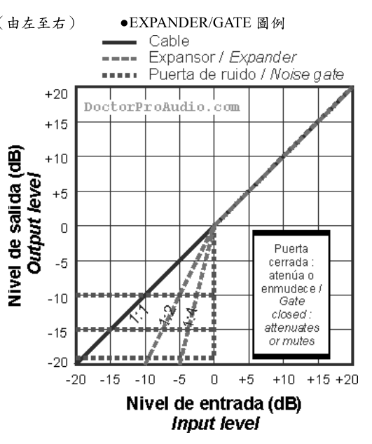
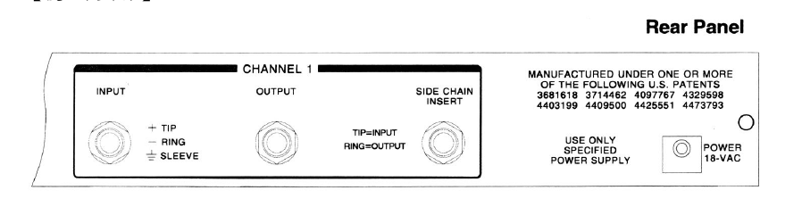
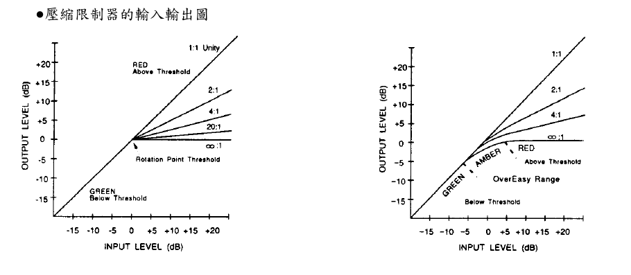
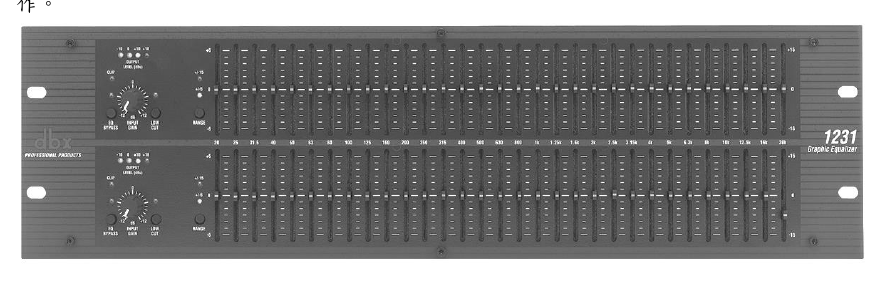
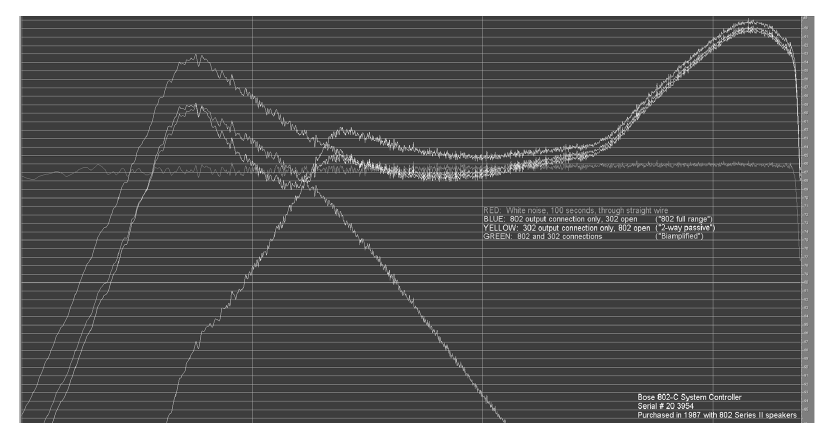

# 訊號處理器

訊號處理器在 PA 系統中用來**保護器材**與**處理訊號**：壓縮限制器、環境等化器、效果器、喇叭控制器（Bose 802C）、電子分音器。

## 壓縮限制器（Compressor–Limiter）

後級功率常大於喇叭功率，例如 400 W 的擴大機推 300 W 的喇叭，後級全輸出時就可能燒壞喇叭。在前端加壓縮限制器，把訊號壓縮和限制，就能讓後級安全地放大。

### dbx 266 Compressor / Gate

<figure markdown="span">
  { loading=lazy width="882" }
  <figcaption>前面板，原講義 p.49</figcaption>
</figure>

**COMPRESSOR 部分（由左至右）**

| 控制 | 功能 |
| --- | --- |
| STEREO COUPLE | 按下後 Channel 1、2 結合在一起控制；Channel 2 的旋鈕和儀表都不作用（GAIN REDUCTION 儀表除外） |
| THRESHOLD (dB) | 門檻。輸入訊號超過此值就開始壓縮。BELOW／OVEREASY／ABOVE 三個燈顯示訊號在門檻的下方或上方 |
| RATIO | 壓縮比 X:1（1 ≦ X < ∞）：把超過門檻的訊號分成 X 等分，只輸出一等分 |
| ATTACK | 壓縮的反應速度。越短越能快速保護器材；越長聲音越自然 |
| RELEASE | 解除壓縮的反應速度。短會讓聲音突然變化；越長變化越平順 |
| GAIN REDUCTION (dB) | 顯示超過門檻的訊號被壓縮了多少 |
| OUTPUT GAIN (dB) | 輸出增益，補回壓縮損失的音量 |
| BYPASS | 旁通 |

<figure markdown="span">
  { loading=lazy width="844" }
  <figcaption>OUTPUT GAIN 無增益 vs 增益 12 dB，原講義 p.50</figcaption>
</figure>

**EXPANDER / GATE 部分**

| 控制 | 功能 |
| --- | --- |
| THRESHOLD (dB) | 輸入訊號**低於**此值時進行衰減。BELOW／ABOVE 兩個燈顯示訊號位置 |
| RATIO | 低的 RATIO 得到溫和的 Downward Expansion；高則變成 Noise Gate（噪音門） |

<figure markdown="span">
  { loading=lazy width="531" }
  <figcaption>Expander / Gate 圖例，原講義 p.50</figcaption>
</figure>

**後面板**

- INPUT：可接平衡式或非平衡式訊號。
- OUTPUT：非平衡式輸出。

<figure markdown="span">
  { loading=lazy width="898" }
  <figcaption>後面板，原講義 p.51</figcaption>
</figure>

<figure markdown="span">
  { loading=lazy width="910" }
  <figcaption>壓縮限制器的輸入輸出圖，原講義 p.51</figcaption>
</figure>

### 其他機型上會看到的旋鈕

*（補充自資料夾內《進階 PA II 講義》）*

| 控制 | 功能 |
| --- | --- |
| LINK | 結合 Channel A、B；A 的 RATIO 與 RELEASE 同時控制兩軌，其餘旋鈕仍獨立，所以要調到幾乎相同 |
| GATE | 設定閘門，低於閘門的訊號都被消除；獨立於其他旋鈕 |
| INPUT | 輸入 Level，Bypass 時仍有效。它直接影響壓縮器「看到」的訊號大小，所以要跟 THRESHOLD 一起調 |
| OUTPUT | 輸出 Level，補回壓縮損失的增益；只有 COMPRESS 按下時才作用 |

後面板的 1/4" PHONE 座為立體式（Tip +、Ring −、Sleeve G）：插立體頭是平衡式；插單聲頭會把 Ring 與 Sleeve 短路，變成不平衡式。

## 等化器（Equalizer）

聲音放出的過程中，場地大小、形狀、環境、建材等因素會讓各頻帶出現不正常的增益或衰減，不但聲音不正確，還會增加 Feedback 機率。等化器可以針對各頻帶依需要調整，把頻率響應不規則引起的回授降到最低，也能修飾音色。

<figure markdown="span">
  { loading=lazy width="886" }
  <figcaption>圖形等化器，原講義 p.51</figcaption>
</figure>

常見面板控制 *（補充自《進階 PA II 講義》）*：

| 控制 | 功能 |
| --- | --- |
| Feedback Display Threshold | 調整各頻率回授指示燈亮起的門檻（−20 到 +20 dB） |
| Filter | 濾波器開關，可選低頻或高頻，把訊號減 18 dB |
| EQ In | 按下後 EQ 設定才生效 |
| Level Control | 輸入該 Channel 的訊號量 |

## 效果器（Effects Processors）

| 效果 | 說明 |
| --- | --- |
| Delay（延遲） | 把聲音複製，稍後再播放。複製出來的聲音除了音量與時間差，音質不變 |
| Echo（迴音） | 模擬聲音遇到障礙物反彈回來，音質會受牆壁材質、距離影響；聽起來是尾音不斷重複而漸漸消失 |
| Reverb（殘響） | 模擬空間中來自天花板、牆壁、地板等四面八方的反射混在一起；讓尾音延長，聲音豐潤不乾澀 |

### 為什麼輔助喇叭需要 Delay

音量會隨距離遞減：**距離每增加一倍，損失 6 dB SPL**（不適用於垂直陣列）。大場地後半部常補輔助喇叭，但電氣訊號比聲音傳得快很多，所以一下鼓聲，後面的人會聽到「碰碰」兩聲：先是後區輔助喇叭，再是舞台前主喇叭，反而含糊不清。

解法是用延遲器或效果器的 Delay，延後訊號到達輔助喇叭的時間，讓兩者到達聽眾的時間一致。

常見面板控制：Input／Output 控制進出效果器的訊號量；Mix 控制原音與效果音混合的比例。

## Bose 802C II System Controller（喇叭控制器）

專為 Bose 802 II 及 302 II 設計的固定 EQ 控制器，讓喇叭獲得合理的動態範圍。沒有它的 802 II 聲音異常怪異，也容易讓單體受到不正常的驅動。

> "Bose EQ is not a suggestion, it is a requirement."
> 

<figure markdown="span">
  { loading=lazy width="832" }
  <figcaption>802C 頻率響應曲線，原講義 p.52</figcaption>
</figure>

*（補充自《進階 PA II 講義》）* 802C 有三種連接模式：Full-Range、Two-Passive、Biamplified。輸出孔內有隱藏式開關，在 Biamplified 模式下具備電子分音功能。前面板的 HI CUT 與 LOW CUT 可減少高、低音增益。

## 電子分音器（Electronic Crossover）

*（補充自《進階 PA II 講義》；主講義只在「完整 PA 流程」中提到）*

喇叭各有擅長的音頻，分音器把訊號依頻率分開，分別送到不同的擴大機與喇叭，讓兩者都被有效利用。

- **主動式電子分音器（Active）**：分頻點可自由選擇。
- **被動式分音器（Passive）**：分頻點固定。
- 通常分成兩段（二音路，2-Way）或三段（三音路，3-Way）。

| 前面板 | 功能 |
| --- | --- |
| CH.1／CH.2 MASTER | 該 Channel 的主音量 |
| LOW LEVEL | 低頻音量 |
| MUTE | 低頻靜音 |
| DELAY | 低頻延遲時間 |
| CROSSOVER FREQUENCY SELECTOR | 分頻點：此頻率以上送高頻輸出，以下送低頻輸出 |
| HIGH LEVEL | 高頻音量 |

後面板：INPUT（Ch.1、Ch.2）、HIGH OUTPUT、LOW OUTPUT（皆為 Phone 頭）。
