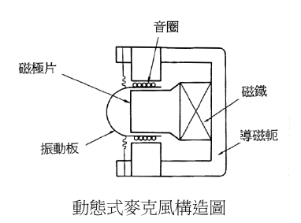
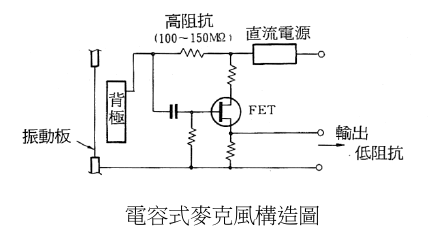
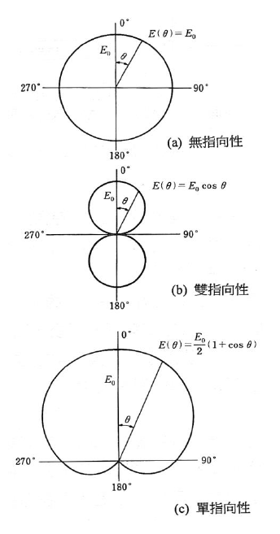
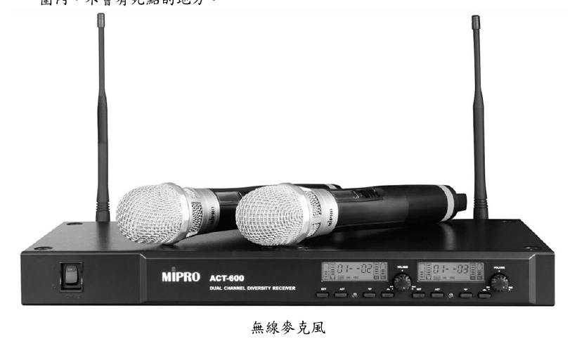

# 音源與麥克風

## 音源種類

1. **手機、MP3、CD 播放器**：使用普遍。
2. **樂器**：鍵盤樂器、電吉他等。進混音機前一般會加上 **Direct Box（DI）**，它是把高阻抗轉成低阻抗的變壓器。樂器收音沒有唯一的方法，要多嘗試。
3. **麥克風**：收人聲、鼓聲及各式樂器。音源不同，架設方式與收音技術都不同。

## 麥克風種類

麥克風是把聲能轉換為電能的裝置。依轉換方式分三種，PA 系統用最多的是動態式。

| 種類 | 原理 | 優點 | 缺點／注意 |
| --- | --- | --- | --- |
| 動態式（動圈式，dynamic） | 振膜帶動音圈切割磁力線，產生感應電壓 | 不需電源、堅固、不易受溫濕度影響、動作穩定 | 低音域與高音域感度較低，靠外殼內的空氣室與空洞諧振補償，所以不要分解或撞擊 |
| 電容式（condenser） | 振膜是電容器的一側電極，振動改變電容量而產生訊號電壓 | 頻率特性非常好（寬頻、平坦），用於錄音室與測定 | 電極間隔極窄（0.01–0.05 mm），怕振動、衝擊、溫濕度變化；需要極化電壓與前置放大器電源 → **要開 Phantom Power（+48V）** |
| 駐極式（electret） | 電容式的一種，振膜是半永久帶電的高分子膜，不需極化電源 | 體積小、便宜、特性佳 | 前置放大器仍要電池，沒換電池會突然故障 |

<figure markdown="span">
  { loading=lazy width="382" }
  <figcaption>動態式麥克風構造圖（原講義 p.7）</figcaption>
</figure>

<figure markdown="span">
  { loading=lazy width="446" }
  <figcaption>電容式麥克風構造圖（原講義 p.8）</figcaption>
</figure>

補充細節：

- 動態式音圈阻抗很低（數 Ω 到數百 Ω），有時靠內裝變壓器提高輸出阻抗。
- 電容式電極間電容量只有數 pF 到數百 pF，阻抗非常大，不能直接接一般放大器，所以外殼內裝有 FET 前置放大器。極化電壓約 40–200 V；現在多由混音機內建的 DC 48V 經一般麥克風線（2 蕊隔離線）供電，也就是幻象電源。

## 麥克風性質

### 輸出阻抗

從輸出端所見 1000 Hz 的內部阻抗公稱值。與擴大機連接時，輸出阻抗必須與輸入阻抗匹配。

|  | 高阻抗 | 低阻抗 |
| --- | --- | --- |
| 範圍 | 10 kΩ 以上（市面常見 50 kΩ） | 600 Ω 以下（市面常見 600 Ω） |
| 靈敏度 | 內有升壓變壓器，比 600 Ω 約高 20 dB | 較低 |
| 感應交流聲 | 較多 | 較少 |
| 延長線長度上限 | 約 10 m | 不平衡式 20 m；平衡式 80 m |

超過長度上限，高頻會衰減造成音質不良，或發生振盪。

### 輸出方式：平衡與不平衡

延長線感應的雜音會跟聲音訊號一起被放大。為了防止感應交流聲，蕊線外層一定要包金屬隔離層：

- **不平衡式**：兩條訊號線中的一條與外層被覆共用。
- **平衡式**：兩條訊號線都是蕊線，外面另包隔離層，隔離效果更好。

麥克風遠離擴大機時，最好用平衡式（擴大機也要有平衡式輸入）。原理見「訊號線與接頭」。

### 指向特性

對不同入射角度的感度變化；振膜正前方為 0°。

<figure markdown="span">
  { loading=lazy width="344" }
  <figcaption>(a) 無指向性 (b) 雙指向性 (c) 單指向性（原講義 p.9）</figcaption>
</figure>

| 指向性 | 特性 | 用途 |
| --- | --- | --- |
| 無指向性 | 所有方向感度相等（振膜後方封閉） | 一般錄音、簡易 PA、收四周環境音。回聲多的場所容易 Howling，職業場合少用 |
| 雙指向性（8 字形） | 只對前後兩個方向靈敏，兩側較低 | 兩人對談、前後收音 |
| 單指向性（心形） | 某一方向靈敏度最好；頻率越高指向越尖銳 | 只收想要的聲音，改善 S/N 比。**PA 為了防止回授，常用單指向性** |

### 靈敏度

給定量的聲音可以有多少電氣輸出，現在幾乎都用 dB 表示。

- 基準：1 μbar 聲壓、1000 Hz 的聲音得到 1 V 輸出時定為 0 dB。1 μbar 約等於離嘴巴 20 cm、用普通音量說話的聲壓。
- 實際輸出遠低於 0 dB，所以是負數。−50 dB 表示需要 50 dB 的放大幅度，−70 dB 需要 70 dB。
- −70 dB 的麥克風比 −50 dB 的靈敏度低 20 dB（10 倍）。

### 頻率特性

各頻率對應的輸出靈敏度。可用數字（如 50–12000 Hz ±3 dB，表示範圍內靈敏度差不超過 ±3 dB）或曲線圖表示。範圍越廣、± 值越小越好。

- 聲樂用：100–8000 Hz
- 播音要好聽又清晰：200–7000 Hz 以上
- 比 250–4500 Hz 還窄就派不上用場

### 貼近效應

嘴巴太靠近有指向性的麥克風時，低音域靈敏度會上升，出現不舒服的低音。原因是聲源遠時以平面波收音，太近則變成球面波。非靠近不可時，可用麥克風的低音截止、擴大機的濾波器或音質控制補償。

## 無線麥克風

把無線麥克風想成小型 FM 發射機，接收機就是只收特定頻率的 FM 收音機。使用者不受線長限制，但要懂電波特性。

<figure markdown="span">
  { loading=lazy width="821" }
  <figcaption>無線麥克風與接收機（原講義 p.11）</figcaption>
</figure>

### 天線

再好的接收機，天線用錯也會有雜音或失真。

| 天線 | 方向性 | 特點 |
| --- | --- | --- |
| 桿型（Rod） | 各方向靈敏度相同 | 使用方便，但雜音也一起收 |
| 鞭型（Whip） |  |  |
| T 型（Doublet） | 有方向性 | 配置得當可讓麥克風電波最大、外來雜訊最小 |

天線長度要配合頻率。例：40.68 MHz 的波長約 7.5 m；桿型天線取 1/4 波長時靈敏度最大，乘上縮短率 0.95，約 **1.76 m**；T 型天線為 2 倍長，約 **3.52 m**。

### 死點（Dead Point）

移動時聲音突然變小或有雜音，看似故障，其實是進入死點（建築物內，或室外四周有建築物時會產生）。接收機天線要裝在麥克風移動範圍內、不會有死點的地方。

## 使用禁忌

!!! danger "禁忌"

    1. 禁止吹、打、拍麥克風
    2. 禁止用手握著麥克風的頭部
    3. 禁止對著喇叭（音源）收音

    第 2、3 點都容易導致回授。

實務提醒：一般手持麥克風要離話頭數公分內才收得清楚。大合唱時支數不夠，請幾位領唱拿麥克風比較實際。
