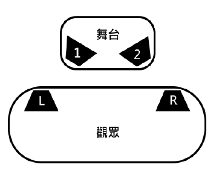
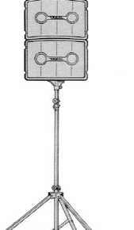
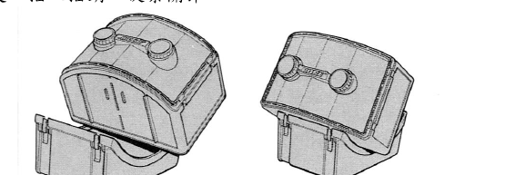

# 系統架設

## 一、事前規劃

### 1.1 安全

場佈圖是所有事前規劃的紙上展現，怎麼畫都可以，但必須先從安全著手。

**用電安全**

- 穩定供電是基本。注意人員走動會不會把電源踢掉；有鬆脫可能就要貼線，或把控台移到較安全的地方。
- 台灣常見兩孔插座最大承載電流約 **15 A，實際使用打八折，不超過 12 A**；也不能超過延長線標示的額定電量。
- 同時使用超過六顆喇叭時，就要注意每一顆的音量。

**使用安全**

用兩顆喇叭做 500 人的晚會，不管怎麼擺，都會是遠的聽不清楚、近的覺得吵，設備也可能因負擔太大而永久受損。要視場地大小和預計人數規劃設備；不知道會來多少人，也可以依場地大小先構想。

**人員安全**

任何線材出現在人員走動處或觀眾區，都可能絆倒人、損壞設備。規劃時就要想好各式線材怎麼佈置。

### 1.2 控台配置

最先確認、並且再三確認控台位置，因為定位後絕不允許任何人移動它。

1. **施工難度小的位置較佳。** 例：只架音響控台時，舞台兩側很理想，喇叭線與舞台設備用線的距離都短，可以靠舞台走線，舞台上有狀況也能立刻支援。
2. **但如果會妨礙人員或觀眾的移動路線、視線，就改選不會妨礙的位置。** 例：工作人員頻繁經過，或大型道具會堆在舞台附近時，先把控台移到安全的地方。多數活動人員對聲光設備沒有安全概念，要替他們著想。
3. **「擴音」性質的活動大多可用上述邏輯；其他類型視需求調整。**
    - 小型樂團展演：控台設在場地中央軸線上，方便平衡各音源送給觀眾的比例；線和喇叭在舞台上看似凌亂沒關係，只要不影響樂手演出和觀眾聆聽。控台擋到視線也無妨，觀眾會自己找位置。
    - 劇場類演出：完全不允許控台和任何線材出現在觀眾眼前。
4. **固定的空間裡控台也沒有固定位置，一切視需求而定。**

*（補充自《進階 PA 講義》）* 最好的控台位置是舞台正中央線上、不擋到觀眾處，可以隨時注意場上狀況與音場平衡；考慮喇叭線和麥克風線長度時，次佳位置是舞台左右側，但需要事先平衡音場。

### 1.3 音響和舞台配置

所有現場混音工程都可以拆成兩套系統：

|  | FOH（Front of House） | Monitor |
| --- | --- | --- |
| 別稱 | 外場、主喇叭 | 內場、監聽 |
| 對象 | 觀眾 | 舞台上的表演者 |
| 編號 | 從觀眾視角由左至右；依立體聲分 L、R | 從觀眾視角由左至右、由前至後用數字編號；多為單聲道，使用上更彈性 |

<figure markdown="span">
  { loading=lazy width="362" }
  <figcaption>FOH 與 Monitor 配置示意（原講義 p.57）</figcaption>
</figure>

- 區分兩套系統最首要的是**喇叭的角度和位置**。FOH 放得比 Monitor 還靠近表演者就失去意義；Monitor 沒有完全面向表演者也無意義。架每顆喇叭都要認清它是做給誰用的。
- 例：演出者站舞台中央，Monitor 卻在 5 米外的兩側，與其把音量推大增加 Feedback 風險，不如調整喇叭位置和角度，並事先跟活動方協調演出者位置。
- 只有一套設備時，就要在同一個控台上同時完成 FOH 和 Monitor 的工作。
- 需要多少 FOH、Monitor：正規做法是依設備規格計算；小型活動多半靠經驗判斷。

### 通道清單（Channel List）

依演出方需求規劃舞台配置，把所有用到的 Channel 與相關資訊整理成一張清單。

**範例一：樂團 Input Channel List**

| Ch. | Instrument | Input | Insert FOH | +48V | Stand |
| --- | --- | --- | --- | --- | --- |
| 1 | Bass Drum | Shure Beta52 | Gate+Comp |  | Y |
| 2 | Snare Top | Shure SM57 | Gate+Comp |  | Y |
| 3 | Snare Bottom | Shure SM57 | Gate+Comp |  | Y |
| 4 | Hi Tom | Shure SM57 | Gate+Comp |  | Y |
| 5 | Mid Tom | Shure SM57 | Gate+Comp |  | Y |
| 6 | Floor Tom | Shure SM57 | Gate+Comp |  | Y |
| 7 | Hi-Hat | AKG C451 | Gate+Comp | Y | Y |
| 8 | Overhead L | AKG C451 |  | Y | Y |
| 9 | Overhead R | AKG C451 |  | Y | Y |
| 10 | Bass DI | Radial ProDI | Comp |  |  |
| 11 | Bass Mic | Shure SM57 | Gate+Comp |  | Y |
| 12 | EG | Shure SM57 | Gate+Comp |  | Y |
| 13 | AG | Radial ProDI | Comp |  |  |
| 14 | Lead Vocal | Shure SM58 | Gate+Comp |  | Y |
| 15 | AG's Vocal | Shure SM58 | Gate+Comp |  | Y |
| 16 | EG's Vocal | Shure SM58 | Gate+Comp |  | Y |
| 17 | Bass's Vocal | Shure SM58 | Gate+Comp |  | Y |
| 18 | Wireless | Sennheiser EW 500-945 G3 | Gate+Comp |  |  |
| 19 | Wireless | Sennheiser EW 500-945 G3 | Gate+Comp |  |  |
| 20 | Music |  |  |  |  |
| 21 | Music |  |  |  |  |

!!! info "補充說明"

    原講義表格的 +48V 與 Stand 欄在 PDF 中對位不清，上表的 Y 是依設備特性整理（電容式 C451 需要 +48V；有線麥克風需要架），細節請對照原講義 p.57–58。

**範例二：小型活動的中文版通道清單**

| 軌數 | 音源 | 用什麼輸入 | 其他處理 | +48V | 麥克風架 |
| --- | --- | --- | --- | --- | --- |
| 1 | 麥克風（主持） | 無線麥 | 動態壓縮器 |  |  |
| 2 | 麥克風（主持） | 無線麥 | 動態壓縮器 |  |  |
| 3 | 麥克風（唱歌） | 無線麥 | 動態壓縮器 |  | 要 |
| 4 | 麥克風（和聲） | 無線麥 | 動態壓縮器 |  | 要 |
| 5 | 木吉他（可 Line in） | DI | 動態壓縮器 |  |  |
| 6 | 木吉他（不可 Line in） | 有線麥 | 動態壓縮器 |  | 要 |
| 7 | 筆電音樂（左聲道） | 訊號線 |  |  |  |
| 8 | 筆電音樂（右聲道） | 訊號線 |  |  |  |
| 9 | 投影機影片聲音（左聲道） | DI |  |  |  |
| 10 | 投影機影片聲音（右聲道） | DI |  |  |  |

*（麥克風架一欄同樣請對照原講義 p.58。）*

通道清單不論活動大小都有用，一目瞭然，誰做都不會出錯，也方便讓活動方了解狀況。只有兩軌也可以手寫兩行。

### 1.4 了解活動方需求

不是每個接洽的人都清楚自己需要什麼。聲光人員的工作是把需求**翻譯**成對方能理解、我們也做得到的東西。

| 對方說 | 不要只回「好」，要追問／說明 |
| --- | --- |
| 「有一個人要彈吉他自彈自唱。」 | 「他的吉他可以插導線嗎？」對方不知道就會去問清楚，等於先排除一個不確定因素 |
| 「有一群人要大合唱，其中一人彈吉他伴奏。」 | 說明麥克風要離話頭數公分內才收得清楚、支數也不夠每人一支，建議找幾位領唱拿麥克風；再問伴奏吉他能不能插導線 |
| 「音樂能不能再大聲點？想要有蹦蹦蹦的低音。」 | 先走到舞台前的觀眾區聽同樣的聲音再判斷 |

判斷能不能再大聲，至少要考慮：**聲音平衡、聽力受損、節目動態、系統負荷**。如果不該再大，就跟對方說明設備的使用極限（例如近場喇叭開再大也只有前排變大聲，正解是在後面加喇叭）。維護器材跟滿足需求同等重要；如果到前排發現真的不夠大聲，就回去推大。

## 二、系統邏輯

連接順序、開關機順序、Peak／Clip、Gain 的調法與接線口訣，整理在「PA 總說與系統邏輯」。

## 三、實作方法

### 3.1 喇叭架法 SOP

<figure markdown="span">
  { loading=lazy width="169" }
  <figcaption>原講義 p.62</figcaption>
</figure>

<figure markdown="span">
  { loading=lazy width="566" }
  <figcaption>原講義 p.62</figcaption>
</figure>

1. 把三腳座的旋緊關節稍微轉鬆，一腳抵地，手抓另外兩腳向後拉，就能快速張開。
2. 張到適當大小後旋緊關節。室內沒有天候因素，張太大反而妨礙動線；室外則要張到最開以抵抗強風。
3. 取下喇叭架最上端的喇叭座，用螺絲和墊片鎖在喇叭底部。
4. 不必打開喇叭上蓋，直接抓上蓋提把，把鎖好喇叭座的喇叭插到架上，再旋緊喇叭座關節。
5. 要並聯第二顆時，一樣抓提把疊上去，底部要確實卡進第一顆上方的凹槽。
6. 卸下上蓋，旋開固定高度的關節，腳踩橫桿、手抓直桿，一口氣往上提。
7. 升到想要的高度，**插入插銷**，旋緊關節。

喇叭務必用喇叭螺絲鎖緊在架上以防滑落；擺放時注意與聽眾的距離、左右音量是否平均、有沒有聲音死角。收器材就反向操作。

### 3.2 走線 SOP

- 控台定位後不動，物件位置可能變動 → **控台端不留線，物件端留線**。
- **任何懸空的線都叫做未完工的線。**
- 安全為上，但可以自行判斷是否有安全疑慮。
- *（補充自《搭場線材講稿》）* 訊號線與電源線分開走；注意公母頭方向；有邊靠邊，沒邊拉直角；貼線要貼緊。

以喇叭線為例：從控台端開始放線，邊走邊用齊，有邊靠邊，沒邊就打直。用喇叭延長線時可以先打個結再接，連接更牢固。走線前注意頭尾拉開的方向，否則會打結。走到喇叭處，多的線收成圈，平放在喇叭架三隻腳正中間，再拿起接頭接上喇叭。

同樣的邏輯適用於舞台上的麥克風線、Line in 線。

**Multicable 是例外**：它像家用延長線，可視為控台的延伸，所以跟控台一樣定位後就不移動。舞台設備很多時，用短線把設備接到 Multicable，原本要走數十條的線就變成只走一條。

### 3.3 Monitor 簡易校正

校正是讓喇叭發出正常的聲音；對 Monitor 更重要的是讓演出者聽到自己想聽的東西而不 Feedback。表演者想聽的跟觀眾無關，在不影響 FOH 的前提下盡量滿足。

準備：替 Monitor 準備等化器，最好自己帶耳塞。

1. 把自己的聲音送進 Monitor，調到覺得剛好的音量，**記錄刻度**；把自己當成表演者，把喇叭調到聽得最舒服的位置和角度。
2. 對麥克風喊比平時說話更大的音量，聽 Monitor 的頻率表現，把太多或不舒服的頻段修掉。
3. 再多送一些到 Monitor，故意做會導致 Feedback 的事（麥克風在 Monitor 前揮一揮、握著話頭說話），把 Feedback 的頻率衰減；做到什麼程度依演出性質而定。
4. 完成後，把音量轉回先前記錄的刻度。

*（補充）* 有樂器表演時舞台監聽很重要：在表演者聽得到自己和彼此、又不 Feedback 的基礎上，再追求樂器之間的平衡。
