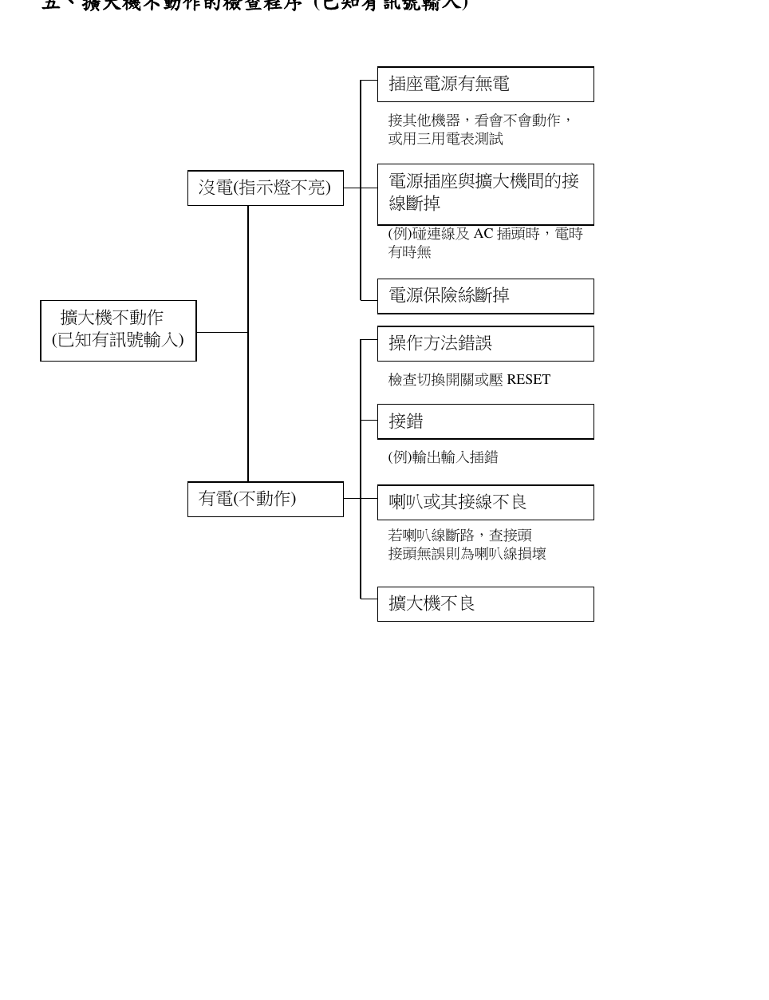
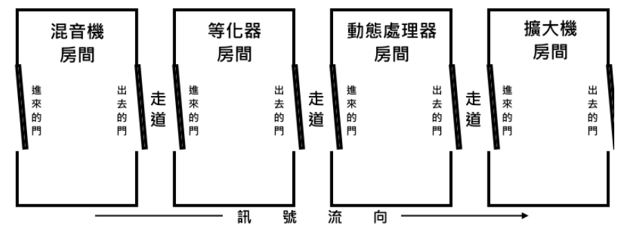

# 問題檢查與交叉查線

## 症狀速查

| 症狀 | 可能原因 |
| --- | --- |
| **無聲** | 接線：接錯線、接線不良（破損斷線）、插頭接觸不良；器材：見下方「擴大機不動作」 |
| **回授** | 喇叭位置不妥、環境等化器調整不佳、麥克風角度不佳、音量過大 |
| **音量推不大** | 壓縮限制器調整不當、喇叭線不良、輸入訊號不良 |
| **有雜音** | 系統接地不良、旁邊有卡座／錄放影機／冷氣機等、訊號線不良、輸入訊號不良 |

### 回授怎麼處理

回授是訊號輸出與輸入無限循環放大，會產生刺耳的聲音。處理方式：

- 從 Mixer 調小輸出
- 改變麥克風位置
- 用 EQ 調小回授的頻率

## 擴大機不動作的檢查程序（已知有訊號輸入）

<figure markdown="span">
  { loading=lazy width="964" }
  <figcaption>原講義 p.66</figcaption>
</figure>

- **沒電（指示燈不亮）**
    - 插座有沒有電 → 接其他機器看會不會動作，或用三用電表測試
    - 電源插座與擴大機間的接線斷掉 → 例：碰到連線及 AC 插頭時，電時有時無
    - 電源保險絲斷掉
- **有電（不動作）**
    - 操作方法錯誤 → 檢查切換開關或按 RESET
    - 接錯 → 例：輸出輸入插錯
    - 喇叭或其接線不良 → 若喇叭線斷路，先查接頭；接頭無誤則為喇叭線損壞
    - 擴大機不良

同樣的方法可以推到其他器材。

## 交叉查線邏輯

每台設備像一間房間：有進來的門（Input）和出去的門（Output），房間之間有走道（訊號線）。任何一扇門打不開或走道不通，訊號就流不過去。交叉查線就是找出哪扇門或哪條走道出問題，然後用手邊其他設備替代；沒有東西可替代就果斷棄用。

<figure markdown="span">
  { loading=lazy width="904" }
  <figcaption>混音機／等化器／動態處理器／擴大機「房間」示意，原講義 p.67</figcaption>
</figure>

!!! tip "重點"

    **三個原則**

    1. 順著訊號流向去檢查。
    2. 用已知求未知：拿已知是好的東西，去跟不知道狀況的東西交換。
    3. 擴大機之前的設備，插拔線不必一一關機，但**不能接著喇叭線**；一旦接上喇叭，插拔線和開關機前都必須先關擴大機。

### 範例演練

系統：麥克風 → 混音機 → 等化器 → 動態壓縮器 → 擴大機 → 喇叭。接完線（喇叭線先不接），觀察各設備表頭：

| 設備 | Ch.1（L） | Ch.2（R） |
| --- | --- | --- |
| 混音機 Output | 已送出訊號 | 已送出訊號 |
| 等化器 | **無訊號** | 有訊號 |
| 動態壓縮器 | 無訊號 | 無訊號 |
| 擴大機 | 無訊號 | 無訊號 |

**第一步：對換兩條線。** 把「混音機 L → 等化器 Ch.1」和「混音機 R → 等化器 Ch.2」這兩條訊號線對換：

| 對換後的結果 | 代表 |
| --- | --- |
| Ch.1 有訊號、Ch.2 無 | 訊號線有問題 |
| Ch.1 依然無、Ch.2 有 | 訊號線沒問題，是混音機 L Output 或等化器 Ch.1 Input 有問題 |
| Ch.1、Ch.2 都無 | 訊號線和設備都有問題 |

**第二步：分辨是哪一台。** 假設是第二種情況。已知「混音機 R Output → 等化器 Ch.2 Input」這條路是好的：

- 把混音機 **R Output** 接到等化器 **Ch.1 Input** → 仍然沒訊號 ⇒ 等化器 Ch.1 故障。
- 把混音機 **L Output** 接到等化器 **Ch.2 Input** → 有訊號 ⇒ 混音機 L Output 沒問題。

**第三步：解決。** 線有問題就換線，設備有問題就找替代品或棄用。換上另一台等化器後：

| 設備 | Ch.1 | Ch.2 |
| --- | --- | --- |
| 等化器 | 有訊號 | 有訊號 |
| 動態壓縮器 | 有訊號 | 有訊號 |
| 擴大機 | 有訊號 | **無訊號** |

**第四步：同樣的方法往後查。** 把「壓縮器 Ch.1 → 擴大機 Ch.1」和「壓縮器 Ch.2 → 擴大機 Ch.2」兩條線對換：

| 對換後的結果 | 代表 |
| --- | --- |
| 擴大機 Ch.2 有訊號、Ch.1 無 | 訊號線有問題 |
| Ch.2 依然無、Ch.1 有 | 線沒問題，是壓縮器 Ch.2 Output 或擴大機 Ch.2 Input 有問題 |
| 都無 | 線和擴大機都有問題 |

假設是第一種，換一條備用線後喇叭之前全部對通。

**第五步：接喇叭。** 把擴大機旋鈕轉到零並關機 → 接上喇叭 → 開擴大機 → 轉開旋鈕。結果左喇叭正常、**右喇叭無聲**。先關擴大機（喇叭線不用拔）。問題已縮小到「擴大機 Output → 喇叭」，可能是：擴大機 Ch.2 Output、右喇叭線、右喇叭。

| 測試 | 結果與判斷 |
| --- | --- |
| 把**正常的左喇叭線**改插到擴大機 **Ch.2 Output**（仍接左喇叭） | 左喇叭正常 ⇒ Ch.2 Output 沒問題；左喇叭無聲 ⇒ Ch.2 Output 故障（右喇叭線和右喇叭仍未知） |
| 把**右喇叭線**接到擴大機 **Ch.1 Output**，另一端接左喇叭 | 左喇叭正常 ⇒ 右喇叭線正常，確認**右喇叭故障**；左喇叭無聲 ⇒ 右喇叭線故障（右喇叭仍未知） |

### 重點

- 以**擴大機為分界點**，把問題分成兩個區塊分別處理。文字看起來複雜，熟悉邏輯後動手很快。
- 在擴大機環節查線時，**只有測試有沒有聲音時才開擴大機**；要重新插拔線之前務必先關掉。
